# 架构设计

潮汐栈把应用开发与应用运行建立在同一套模型契约上。开发平台维护模型元数据、界面资源和代码扩展，组织测试与联调；统一运行时基座装配这些定义和实现，提供页面、接口与业务执行能力。应用交付后，由目标环境中的基座独立加载运行，开发平台继续承担后续开发工作。

## 整体组成与职责边界

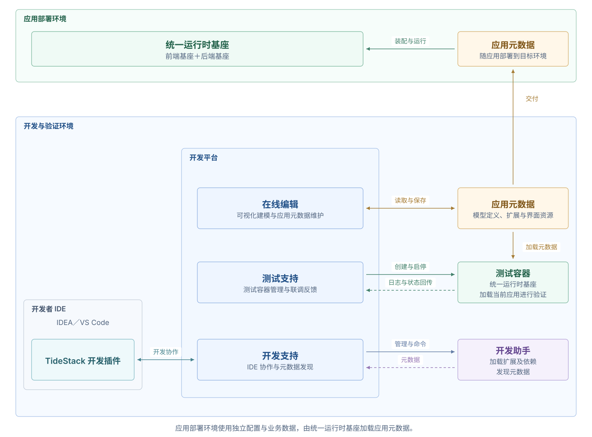

开发平台通过开发支持、测试支持和在线编辑组织应用开发。开发支持连接 IDEA 或 VS Code 中的 TideStack 开发插件，并与开发助手协作发现元数据；测试支持管理测试容器，接收运行日志与状态；在线编辑提供可视化建模，读取和保存应用元数据。

应用元数据组织模型定义、扩展与界面资源，供测试容器加载验证，交付后再由目标环境中的统一运行时基座装配运行。应用部署环境使用自己的配置、存储和访问入口，业务请求在该环境中完成处理。

开发平台本身也复用统一运行时基座。应用运行所需的模型管理、执行引擎和公共服务只维护一套实现；开发平台在其上装配模型编辑、应用管理与调试等开发模块。

## 架构分层与技术组成

开发平台在统一运行时基座上增加模型编辑、应用管理和联调服务。前后端基座分别组织界面运行与业务执行，开发平台和独立部署的应用据此复用相同的模型、引擎与公共服务。

### 开发平台总体架构

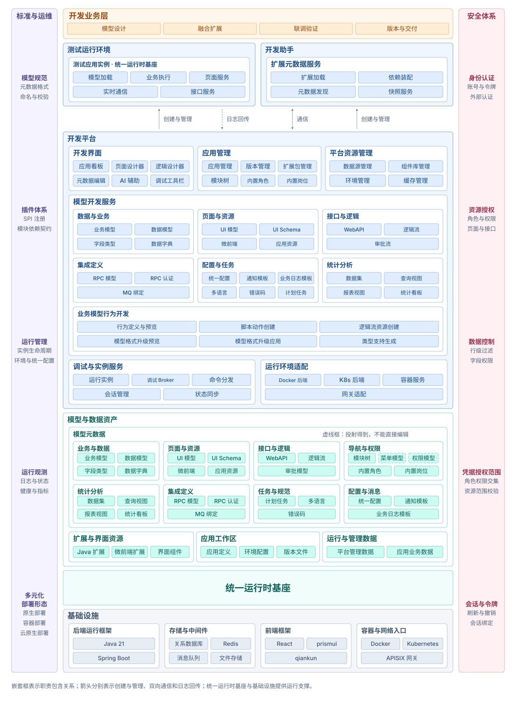

开发平台以应用工作区为中心，连接开发界面、模型开发服务和模型与数据资产。开发界面组织建模与设计，模型开发服务负责对应定义的读取、校验和保存，应用工作区则保存模型文件、扩展依赖、界面资源及版本内容。

模型开发服务沿用运行时的模型契约。业务模型中的动作、事件和订阅表达业务行为，逻辑流与代码提供执行实现；平台能够预览行为、展示定义来源与实现绑定，并提供类型支持生成和模型格式升级。模型经过编辑与校验后，仍由统一运行时基座按相应契约装配。

应用管理维护应用、版本、扩展包、模块树、内置角色和内置岗位，平台资源管理维护可供应用使用的资源。平台管理数据记录这些开发资源及运行状态，应用自身的业务数据由相应运行环境管理，二者各有存储和管理职责。

开发助手与测试运行环境由平台管理，分别提供扩展发现和运行验证。实例服务经 Docker 或 Kubernetes 调试后端创建、启停运行资源，状态和日志返回开发工作区。统一运行时基座提供开发平台复用的运行能力；模型规范、插件体系、运行管理和安全控制贯穿这些协作。

### 统一运行时基座总体架构

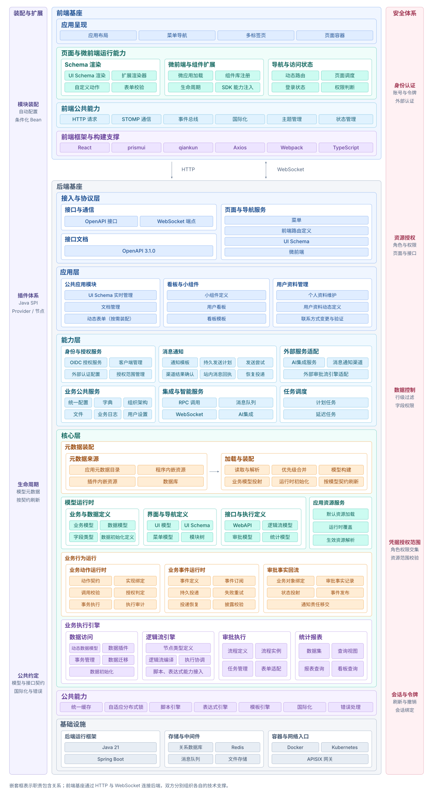

统一运行时基座分为前端基座和后端基座。前端组织应用布局、导航与页面交互；后端装配模型、执行业务并访问数据。HTTP 传递页面定义与业务请求，WebSocket 承载实时通信，两种协议各有入口。

后端自下而上由基础设施、公共能力、核心层、能力层、应用层和接入与协议层组成。运行框架和公共技术能力承载模型运行与执行引擎；能力层将这些机制组织为组织架构、统一配置、消息通知、任务调度、RPC 和 AI集成等服务，应用层再组合为公共应用模块。接口与通信、页面导航等入口位于接入与协议层，按各自契约调用下层服务。

应用资源服务与模型运行时各有职责。前者解析应用文件和运行时覆盖资源，后者维护模型对象及其生命周期。执行服务使用已经生效的模型契约，按需调用公共能力和外部适配器。

### 前端基座技术架构

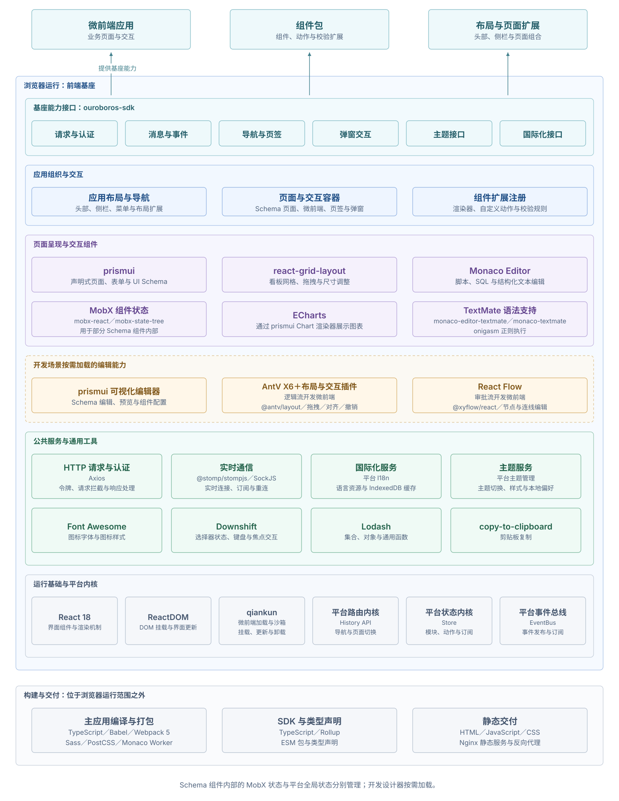

前端基座通过 `ouroboros-sdk`，向微前端应用、组件包和布局扩展提供请求、认证、导航、消息、主题、国际化等公共能力。扩展可以调用这些接口，与应用中的其他页面共享页签、弹窗和事件交互。

应用布局与导航组织头部、侧栏和菜单，页面与交互容器承载 Schema 页面、微前端、多标签页和弹窗。渲染器、自定义动作和校验规则通过组件扩展机制接入。

声明式页面由 prismui 根据 UI Schema 组合表单、数据展示和交互规则。MobX、mobx-react 和 mobx-state-tree 用于部分 Schema 组件的内部状态；应用级状态由平台状态内核管理。看板使用 react-grid-layout 处理网格布局、拖拽与尺寸调整，图表通过 prismui 的 Chart 渲染器接入 ECharts。

脚本、SQL 等编辑界面使用 Monaco Editor，Groovy 的语法支持还接入 TextMate、monaco-editor-textmate 和 onigasm。开发场景按需加载更多设计器：prismui 可视化编辑器编辑页面 Schema，逻辑流开发微前端使用 AntV X6、交互插件和 `@antv/layout`，审批流开发微前端使用 React Flow。这些编辑能力随相应页面加载。

公共服务分别处理通信、国际化和主题。HTTP 请求使用 Axios，统一处理令牌、请求拦截和响应；实时通信使用 STOMP 客户端和 SockJS，管理连接、订阅与重连。国际化服务负责语言资源加载、语言切换和 IndexedDB 缓存；主题服务负责主题样式切换，并保存用户的本地主题偏好。

通用工具各自承担独立职责。Font Awesome 提供图标字体与样式，Downshift 处理选择器的状态、键盘与焦点交互，Lodash 提供集合和对象处理等通用函数，copy-to-clipboard 完成剪贴板复制。

运行基础由 React 18、ReactDOM、qiankun 和平台自身的路由、状态、事件内核构成。React 与 ReactDOM 提供组件渲染和 DOM 挂载，qiankun 负责微前端及组件包的加载、沙箱与生命周期。平台路由内核结合 History API 处理导航和页面切换，状态内核管理模块、动作和状态订阅，事件总线负责事件发布与订阅。

构建与浏览器运行分开。主应用通过 TypeScript、Babel、Webpack 5、Sass 和 PostCSS 生成静态产物，并为 Monaco 配置 Worker；SDK 使用 Rollup 构建 ESM 包与类型声明。交付后的 HTML、JavaScript 和 CSS 可由 Nginx 提供静态服务，后端接口继续承担业务执行与授权检查。

### 后端基座技术架构

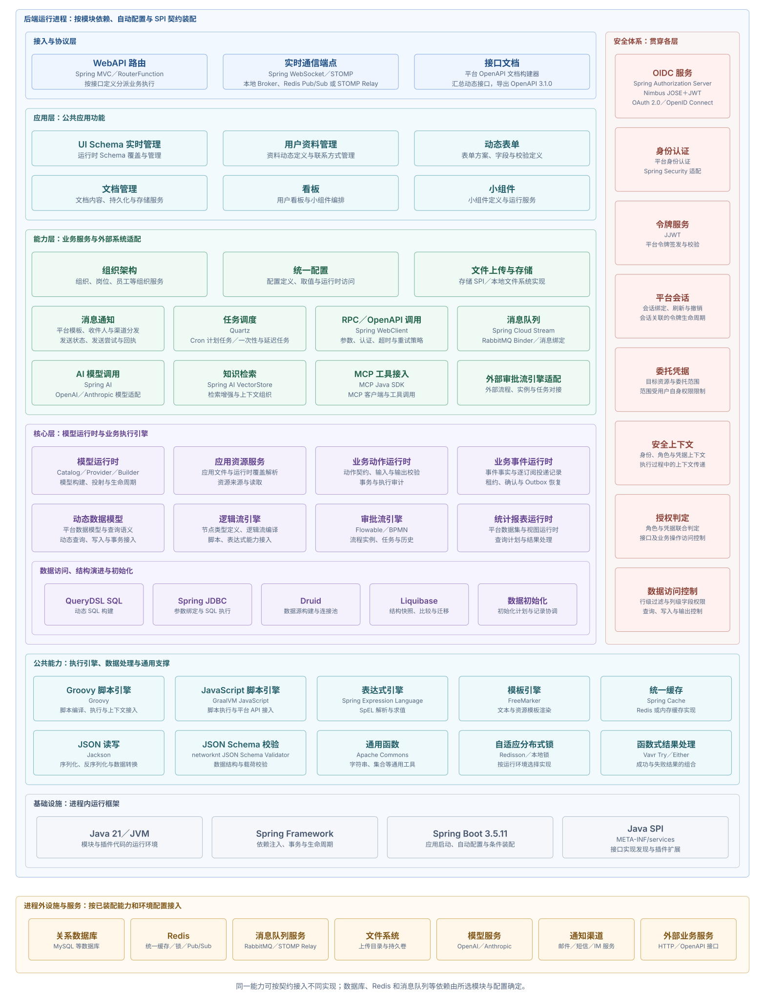

后端基座以 Java 21 和 Spring Boot 为运行框架，将模型装配、业务执行、公共服务及协议适配组织为独立模块。上层按模块依赖调用下层服务；数据库、Redis、消息队列和外部服务位于进程之外，通过相应适配器接入。

接入与协议层使用 Spring MVC 和 RouterFunction 注册 WebAPI 路由，按接口定义进入业务动作、逻辑流或代码处理器。平台的文档构建器汇总动态接口，导出 OpenAPI 3.1.0。实时通信使用 Spring WebSocket 和 STOMP，按部署配置选择本地 Broker、Redis Pub/Sub 或 RabbitMQ STOMP Relay。

应用层提供可直接使用的公共应用功能。UI Schema 实时管理处理运行时页面定义，用户资料管理维护资料定义与联系方式，动态表单管理表单方案和字段。文档管理负责文档内容与存储，看板负责布局和小组件编排，小组件服务提供组件定义与运行支持。这些功能分别复用下层服务。

能力层组织业务服务和外部集成。组织架构、统一配置和文件上传分别提供组织信息、配置访问和文件存储服务。消息通知管理模板、收件人、渠道及发送状态；Quartz 调度计划任务、一次性任务和延迟任务。RPC／OpenAPI 调用使用 Spring WebClient，消息队列通过 Spring Cloud Stream 和 RabbitMQ Binder 接入。AI 模型调用、知识检索和 MCP 工具接入各有独立职责，分别使用 Spring AI、Spring AI VectorStore 和 MCP Java SDK；外部审批流引擎适配也在这一层完成。

模型运行时通过 Catalog、Provider、Builder 和生命周期机制装配模型，应用资源服务处理应用文件的读取、覆盖与来源。业务动作运行时组合契约校验、事务和审计，业务事件运行时管理事件事实与订阅投递；这些执行服务使用已经生效的模型定义。

各执行引擎采用适合自身职责的实现。动态数据模型处理平台的数据模型与查询语义；逻辑流引擎管理节点类型、编译逻辑流，并接入脚本与表达式能力；审批流引擎通过 Flowable 管理 BPMN 部署、实例、任务和历史；统计报表运行时用数据集与视图组织查询和结果。

数据访问与结构演进分别使用 QueryDSL SQL、Spring JDBC、Druid 和 Liquibase。它们依次承担动态 SQL 构建、参数绑定与执行、数据源和连接池管理，以及数据库结构比较与迁移；数据初始化模块另行管理应用初始数据的补充。

公共能力供各层按契约调用。Groovy 与 GraalVM JavaScript 执行脚本，SpEL 求值表达式，FreeMarker 渲染模板；Jackson 处理 JSON 读写与转换，networknt 校验 JSON Schema，Apache Commons 提供通用函数，Vavr 的 Try／Either 用于组合成功与失败结果。统一缓存通过 Spring Cache 接入 Redis 或内存实现；自适应分布式锁在具备 RedissonClient 时使用 Redisson，否则采用本地锁。

底部的运行框架负责进程内的基础工作。Java 21／JVM 执行模块与插件代码，Spring Framework 管理依赖注入、事务和生命周期，Spring Boot 3.5.11 组织启动、自动配置与条件装配，Java SPI 通过 `META-INF/services` 发现契约实现。所需模块和具体实现由应用装配与环境配置确定。

安全体系贯穿调用过程。平台维护身份、角色、委托凭据和授权判定，并提供 Spring Security 适配；JJWT 处理平台令牌，OIDC 服务使用 Spring Authorization Server 和 Nimbus。接口、业务动作及数据访问在各自位置校验权限，安全上下文继续传递行级过滤和列级字段控制。

## 模型装配 {#元数据装配与模型生效}

基座从应用目录、内嵌资源和数据库等来源读取模型元数据，按各类模型的规则处理同名定义，再构建运行时模型，供页面、接口和业务执行服务使用。

### 元数据加载与模型构建

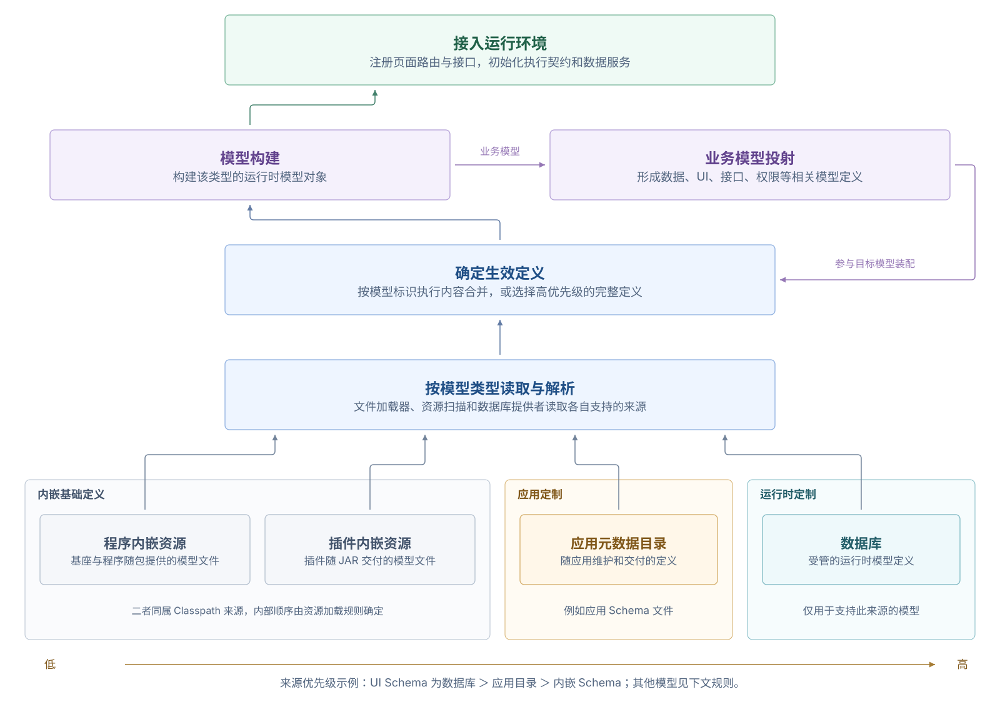

程序和插件提供基础定义，应用元数据目录保存随应用维护、交付的定义，支持运行时管理的模型还可以从数据库或专用的运行时目录读取定制内容。每类模型通过自己的加载器和提供者读取支持的来源，以完整名称、路径或配置键等标识归集定义，再决定哪些内容生效。

生效定义经过构建成为运行时模型。业务模型还会投射数据、页面、接口、权限等相关定义；这些投射结果也要进入相应模型的装配过程，与显式定义一起完成合并或取舍。随后，各模块注册路由、初始化执行契约和数据服务，把模型接入运行环境。

### 同名定义如何处理

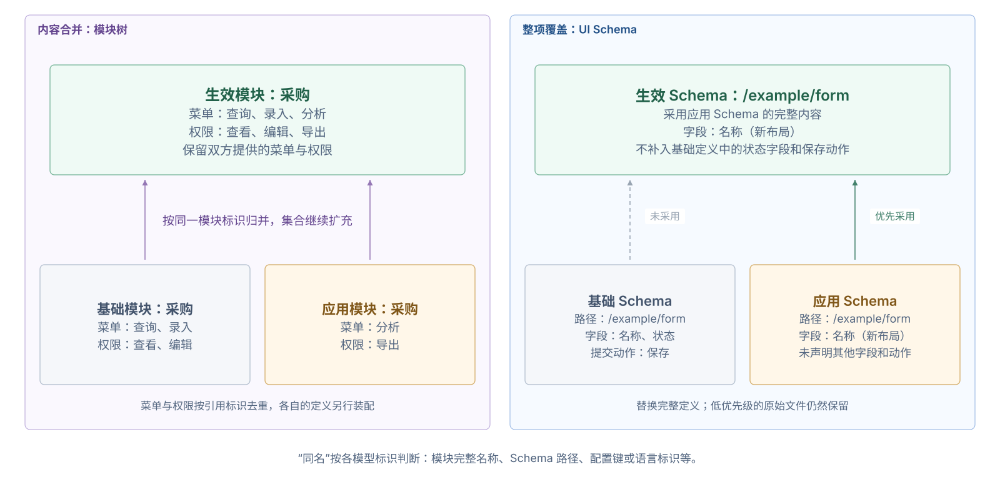

同名定义主要采用两种处理方式。**内容合并**保留多个来源提供的内容，按模型自身的规则处理重叠部分；**整项覆盖**选中一份完整定义，低优先级定义中的字段、动作等内容不会自动补入。覆盖只改变运行时采用的定义，原始文件仍保留在各自来源中。

采用内容合并的定义包括：

| 定义 | 按什么标识合并 | 合并规则 |
| --- | --- | --- |
| 权限 | 权限完整名称 | 累加接口、UI 视图和菜单项引用，合并访问控制定义；引用列表不去重。标题优先取先读入的非空值，委托许可要求双方都允许，任一来源禁止委托，结果就不可委托 |
| 模块树 | 模块完整名称 | 子菜单和权限引用合并、去重；标题、图标、排序和主菜单等属性优先采用后续定义中的非空值。汇总完成后，再应用模块树的运行时调整 |
| 配置项定义 | 配置键 | 标题、说明、默认值、分组、编辑器等字段按后续定义取值，部分空值回落到原定义；类型、作用域和布尔属性采用后续定义。扩展属性按键浅合并，受保护的配置定义禁止同键覆盖 |
| 配置分组定义 | 分组路径 | 标题、图标、说明、排序等采用后续定义中的非空值，扩展属性按键浅合并 |
| 多语言 | 语言标识，再按命名空间和词条键 | 同一语言的词条汇总后保留各来源的独有词条；重复词条采用版本排序靠后的值，同版本时由提供者顺序决定 |

模块树合并的是菜单和权限的**引用**，菜单定义本身按完整名称选择整项，不会递归合并两个菜单对象。配置的扩展属性也只合并一级键：同键的嵌套对象由后者整体替换。多语言当前按版本字符串排序，不能把它理解为统一的数据库优先规则。

用户资料未采用表单方案时，模板字段配置还支持按字段名覆盖指定属性，布局设置继续调整顺序和显隐。这类局部覆盖只作用于已有字段；用户资料表单方案本身仍选择一份完整方案。

业务模型、数据模型、逻辑流、UI 模型、UI Schema、WebAPI、RPC、审批流、数据字典、通知模板、业务日志模板、字段类型、小组件和统计分析定义等，主要采用整项选择。只有明确实现了字段合并的定义，才能通过一个不完整的同名副本补充原定义。

### 优先级的原则与具体顺序

常见的定制方向是**基础定义 → 应用定制 → 运行时定制**。越贴近当前应用和部署环境的定义，越有机会替换通用定义；基础定义保持原样，升级时仍可独立更新。元数据装配图用 UI Schema 展示这一方向，各类模型的实际顺序由自己的提供者决定。

程序内嵌资源和插件内嵌资源都属于 Classpath 来源，代码没有为二者设置一套统一的“插件一定高于程序”规则。采用通用覆盖加载器时，Classpath 中靠前的资源优先；跨来源的优先级则由模型提供者及其汇总方式决定。`@Priority` 和 `getOrder()` 的数字也不能跨模型直接比较，有的实现先取命中项，有的实现让后读入的定义覆盖先读入的定义。

下表按**高优先级 → 低优先级**列出标准提供者的主要顺序：

| 定义 | 选择顺序及条件 |
| --- | --- |
| UI Schema | 数据库中的启用定义 → 应用 Schema 文件 → 内嵌 Schema 文件 → 业务模型投射的 Schema → UI 模型内嵌的 Schema；用户资料等专用提供者还可以在自己的优先级位置提供 Schema |
| UI 模型／前端路由 | 动态表单提供的页面 → 应用低代码定义 → 内嵌 UI 定义 → 业务模型投射结果 |
| 逻辑流 | 应用文件 → 业务模型投射结果 → 内嵌定义；按名解析时跳过未启用的定义，继续查找可用定义 |
| 审批流定义 | 应用 `workflow` 目录 → 内嵌定义；应用目录内出现同名定义会报错 |
| 通知模板、业务日志模板 | 数据库定义 → 应用文件 → 内嵌定义 |
| 内置岗位 | 运行时覆盖目录 → 应用定义 → 随程序交付的默认定义；同一优先级出现相同岗位键会报错 |
| 字段类型 | 运行时扩展 → JAR 定义 → 默认定义；开发平台的应用设计场景还会在其前面加入应用字段类型和开发平台内置定义 |
| 统计数据集、数据集视图 | 运行时覆盖目录 → 应用默认目录；同级同名定义会报错 |
| 统计看板 | 业务模型投射结果 → 运行时覆盖目录 → 应用默认目录；同级同名定义会报错 |
| 错误码 | 应用工作区定义 → 内嵌定义 |
| RPC 模型、RPC 认证 | 当前运行时实现为内嵌定义 → 应用文件，与常见的应用定制方向相反 |

业务模型的全量装配会让后汇总的应用定义覆盖内嵌定义，但当前两个标准提供者的优先级相同，按名称单独查询时又采用首次命中，两条路径对同名定义可能得到不同结果。现阶段应避免依赖这类同级重名定义的隐式顺序。

同级冲突也有自己的约束。审批流、内置岗位和统计分析定义会在上述范围内拒绝重复定义，不能用文件名或修改时间控制取舍。停用是否允许回落到低优先级定义，同样取决于模型：逻辑流会继续查找启用定义，RPC 则先选定同名定义，再检查是否启用。

## 基座启动与刷新

后端启动时建立模型和服务，达到就绪状态后，前端才能取得应用配置、用户菜单和页面定义。前端随后完成自身的资源加载和界面挂载；运行中的定义变更通过刷新或重新装配进入这套协作。

### 后端基座启动生命周期

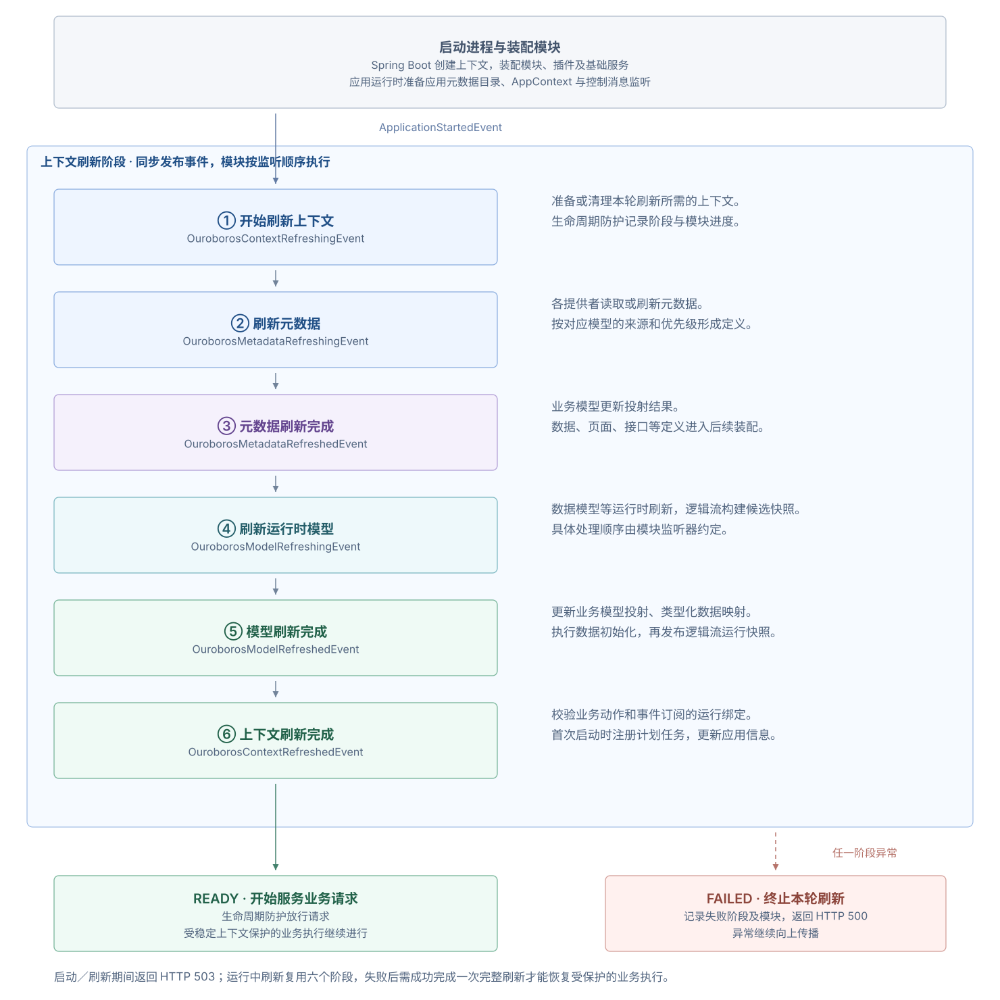

后端先由 Spring Boot 创建应用上下文，装配已引入的模块、插件和基础服务。应用运行时准备应用元数据目录及 `AppContext`，注册控制消息监听；启用运行时依赖锁强制校验时，还会检查所需锁定信息。Spring 发布 `ApplicationStartedEvent` 后，应用运行时开始首次上下文刷新。此时，即使 HTTP 服务已经监听端口，模型装配仍可能尚未完成。

上下文刷新按图中的六个事件顺序推进。每个阶段先发布进度，再同步调用该阶段的模块监听器，监听器的顺序由模块约定。`OuroborosMetadataRefreshingEvent` 驱动各提供者更新元数据；元数据刷新完成后，业务模型更新向数据、页面、接口等模型投射的定义，使后续装配能够读取这些结果。

运行时模型随后刷新。数据模型在 `OuroborosModelRefreshingEvent` 阶段刷新，逻辑流准备候选模型快照。在 `OuroborosModelRefreshedEvent` 阶段，业务模型再次更新投射，类型化数据映射完成更新，数据初始化协调器执行初始化计划，逻辑流再用运行时引用初始化并发布快照。这里的“模型刷新完成”仍有后续工作，不能据此判断应用已经可用。

数据初始化定义在模型可用后接续执行。应用或模块通过 `.data-init.json` 声明目标模型、匹配字段和初始记录，初始化协调器据此检查、补充数据；它采用自己的计划与校验规则，不套用同名模型元数据的覆盖顺序。

`OuroborosContextRefreshedEvent` 承接最后的运行准备，包括校验业务动作及事件订阅的实现绑定、更新提供给前端的应用信息。计划任务也在这一阶段注册到调度器，但仅首次启动会自动注册。

生命周期防护维护 `BOOTSTRAPPING`、`READY` 和 `FAILED` 三种状态。启动或刷新期间，请求返回 HTTP 503，并携带当前阶段及进度；进入 `READY` 后才放行请求。刷新异常会记录失败阶段和模块，终止本轮刷新并继续向上传播，防护过滤器返回 HTTP 500。首次启动的异常会使启动过程失败。

刷新与受稳定上下文保护的业务执行互斥，避免一次业务操作跨越两套定义；刷新失败后，这类业务执行保持不可用，直到一次完整刷新成功。

### 前端基座启动生命周期

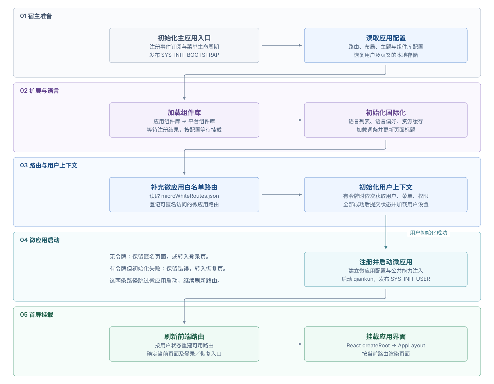

浏览器加载主应用后，入口先注册事件订阅和菜单生命周期，发布 `SYS_INIT_BOOTSTRAP`，随后进入宿主启动流程。前端读取后端提供的应用配置，确定应用名称、布局、主题、路由和组件库，并恢复用户、页签等本地存储。首屏所需的配置先进入状态内核，后续组件加载和页面渲染据此进行。

组件库先于主界面加载。宿主依次处理应用组件库和平台组件库，等待各库的注册结果，再初始化国际化服务：取得语言列表，结合用户语言偏好与缓存加载词条，更新页面标题。随后读取 `microWhiteRoutes.json`，补充允许匿名访问的微应用路由。组件库加载会汇总各库的成功与失败结果；语言资源加载失败时使用默认语言，白名单文件读取失败时继续启动。

用户初始化决定接下来进入哪个页面。没有令牌时，匿名页面可以继续访问，其他地址转入登录页并保留返回地址；已有令牌时，前端依次取得用户资料、菜单和权限，全部成功后才统一提交用户状态，再加载用户设置并配置空闲退出监测。有令牌但用户初始化失败时，宿主保留失败信息，将页面转入初始化恢复入口。

用户初始化成功后，宿主注册微应用并启动 qiankun，再发布 `SYS_INIT_USER`。注册时向微应用提供公共能力，微应用通过 `ouroboros-sdk` 使用这些能力，各页面随后按路由和加载条件挂载。

最后，宿主刷新前端路由，用 React 挂载 `AppLayout`，按当前地址显示业务页面、登录页或恢复页。匿名访问和用户初始化失败的路径会跳过上述用户态微应用启动，继续完成路由与界面挂载。

### 变更何时生效

运行中的刷新沿用后端启动时的上下文刷新阶段，无需重新创建整个 Spring 上下文，各模块按自己的监听契约更新定义与模型。应用目录中的业务模型可以在刷新时重新读取；部分内嵌定义只在初始化时加载，替换 JAR 后需要重新装配。模型文件保存成功，并不代表所有运行服务已经同步更新；是否需要刷新或重启，取决于相应模块的加载契约。

刷新也有服务边界。计划任务定义可以重新读取，但调度器中的任务需要通过调度接口维护，模型刷新不会自动重新调度全部任务。前端页面和微应用的更新由各自的加载、更新和卸载契约处理。

## 应用运行 {#应用运行与访问控制}

页面交互通过接口发起业务请求，由业务动作、逻辑流或代码完成处理。业务事件发布已经发生的业务事实，消息通知提供发送能力，任务调度按时间触发处理，各自遵循相应的执行契约。

### 页面加载与业务请求

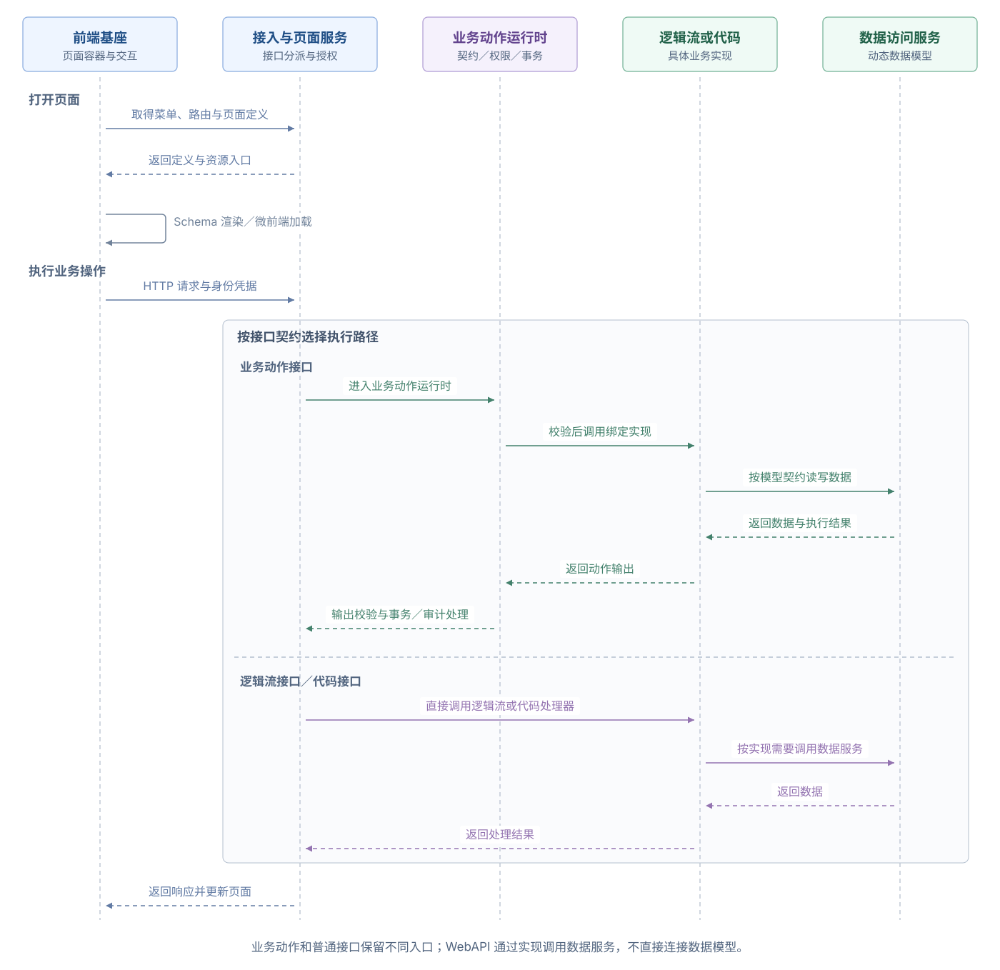

打开应用页面时，前端取得菜单、路由和页面定义，再由页面容器选择 Schema 渲染或微前端加载。界面中的查询、提交和操作继续发起业务请求，后端先建立身份上下文并执行相应授权，再按接口定义分派。

业务动作接口进入统一的动作运行时。运行时检查动作启用状态、调用权限、输入和前置条件，再调用绑定的逻辑流或代码实现；输出校验、事务和执行审计共同约束一次动作调用。嵌套动作加入已有事务时，最终提交或回滚由外层事务决定。

普通逻辑流接口和代码接口按自己的 WebAPI 定义执行。代码接口可以由 RequestMapping 或 RouterFunction 处理器实现，逻辑流接口进入逻辑流执行入口；这些路径按实现需要调用数据服务、业务动作或其他能力。数据读写由相应执行服务发起，WebAPI 本身不直接连接数据模型。

### 业务事件与可靠投递

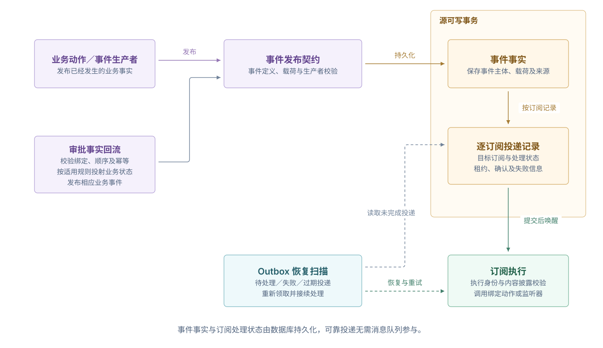

业务事件表达已经发生的业务事实，订阅声明后续如何响应。业务动作或注册的事件生产者按契约发布事件，平台校验事件定义、载荷和生产者身份，再记录事件及目标订阅。

可靠投递路径在源可写事务内保存事件事实与逐订阅投递记录，事务提交后唤醒订阅执行。Outbox 恢复扫描继续处理待投递、失败或租约过期的记录，依据租约、确认和失败状态接续处理。订阅执行还会检查执行身份与内容披露权限，再调用绑定的业务动作或监听器。事件事实和投递状态由数据库保存，这条恢复路径无需消息队列参与。

审批结果可以通过事实回流接回业务。平台校验事实与业务对象的绑定、顺序及幂等条件，按适用规则投射业务状态，再发布相应业务事件。事件由此保留业务含义，后续响应由各订阅自行组织。

### 消息通知

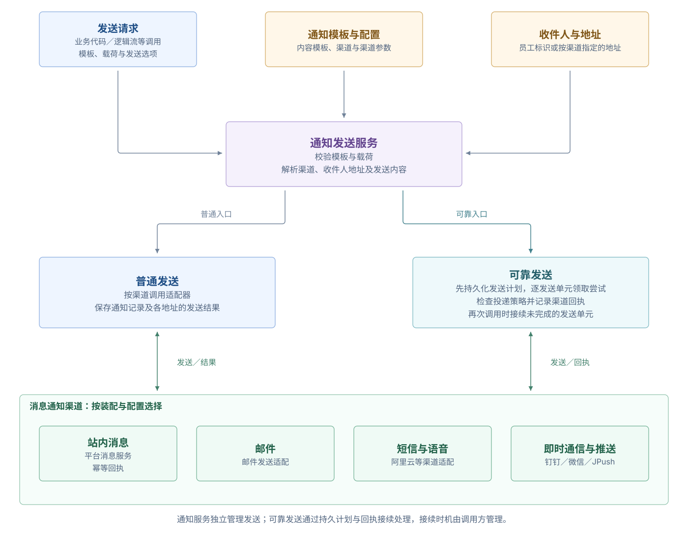

消息通知向业务代码、脚本、逻辑流和 HTTP 接口提供统一的发送能力。调用方提交模板、载荷和收件人，通知服务校验载荷、解析模板及渠道参数，将员工标识转换为渠道地址，或直接使用请求给出的地址，再交给对应渠道适配器发送。渠道可以包括站内消息、邮件、短信、语音、钉钉、微信和 JPush，具体取决于模块装配与配置。

普通发送在调用渠道后记录结果。可靠发送会先持久化发送计划，固定地址、渠道配置和发送选项，按收件人与渠道建立发送单元，再领取发送尝试并记录回执。调用方再次提交同一发送计划时，可以接续未完成的单元；结果未知的发送需要结合渠道证据处理，避免直接重发。

通知服务管理发送状态，接续调用的时机由调用方负责。业务事件订阅可以使用这项能力，业务代码和其他模块也可以独立调用。

### 任务调度

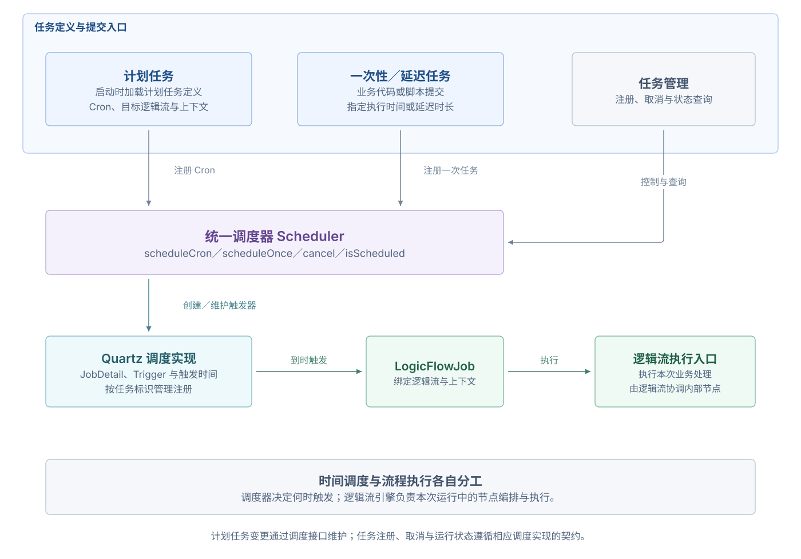

任务调度按时间触发业务处理，分为两种输入：

- **计划任务**在 `.schedule.json` 中定义 Cron 表达式、目标逻辑流和上下文，由 Provider 聚合，在应用启动完成时注册到调度器。
- **一次性或延迟任务**由运行中的业务代码或脚本通过 `scheduleOnce` 提交，指定执行时间或延迟时长。

统一调度器默认由 Quartz 实现，按任务标识维护 Job 和 Trigger。两类任务到达触发时间后，通过 `LogicFlowJob` 进入逻辑流执行入口。调度器决定何时开始业务处理，逻辑流引擎负责本次运行中的节点编排与执行协调。

运行期间可以通过调度接口注册任务、查询是否已调度或取消任务；同名任务定义发生变化时，调度实现比较定义并按需重建。

## 访问控制 {#身份权限与安全控制}

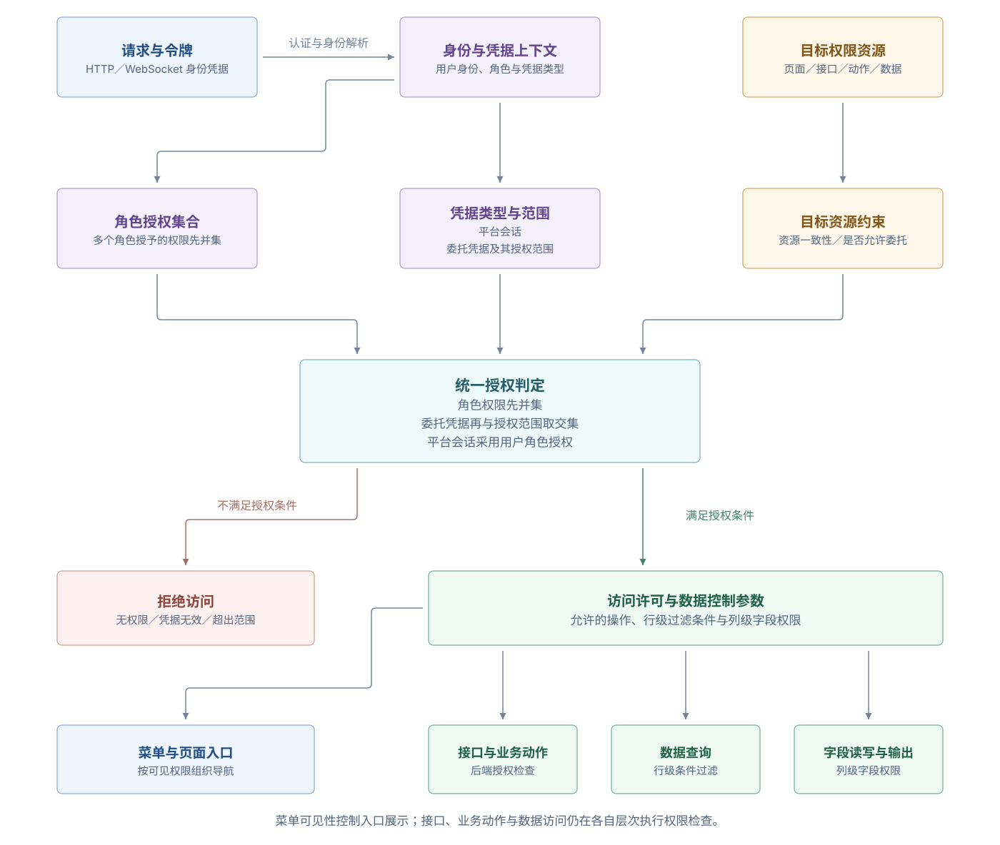

请求携带的令牌用于建立用户身份、角色与凭据上下文。授权判定同时读取目标权限资源，确定正在访问哪个接口、业务操作或数据范围。外部认证、OIDC 和平台会话管理负责相应的身份接入及会话生命周期。

一个用户拥有多个角色时，先汇集各角色授予的权限。使用委托凭据时，再与凭据允许的授权范围取交集，并检查目标资源是否一致、相应权限是否允许委托。使用平台会话时，按用户角色授予的权限判定，委托凭据的授权范围始终受用户自身权限限制。

菜单与页面入口根据可见权限组织展示。后端接口、业务动作和数据访问分别执行自己的权限检查，页面上是否出现一个按钮不决定请求是否能够通过授权。令牌刷新、撤销及会话绑定则约束身份在后续调用中能否继续使用。

### 行级与列级数据访问控制

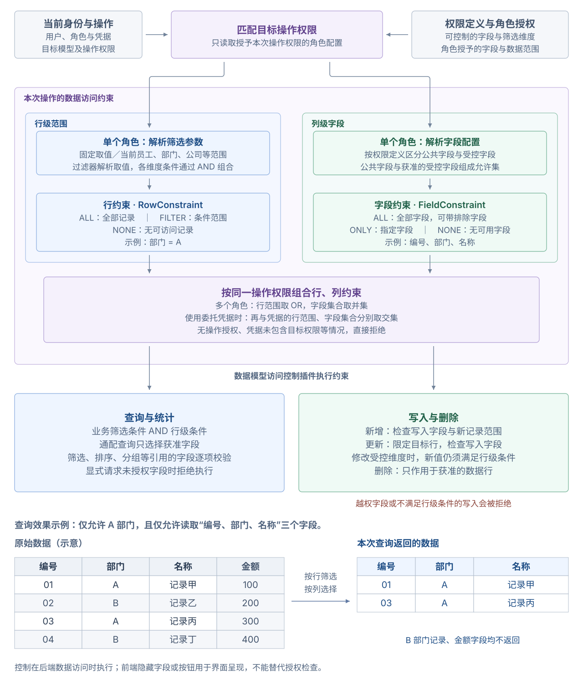

行级控制决定可以访问哪些记录，列级控制决定可以使用哪些字段。业务模型把可控制的字段和筛选维度纳入权限定义，角色授权据此配置字段及数据范围。运行时，启用访问控制的数据模型通过访问控制插件取得本次操作的授权结果；查询、新增、更新和删除分别使用对应的操作权限，读取权限不会自动授予修改权限。

#### 行级条件与字段集合

行级配置先由过滤器解析成可执行的数据条件。固定取值直接限定范围，“当前员工”“当前部门”“当前公司”等选项则根据当前组织上下文解析出标识；同一角色中不同筛选维度的条件通过 AND 组合。例如，部门范围与某个业务字段的取值限制需要同时满足。选择了组织范围却没有解析出任何可用标识时，结果为无可访问记录；无法解析的配置会导致授权失败。

解析后的行约束使用三种明确状态：**ALL** 表示不追加行级限制，**FILTER** 携带具体筛选条件，**NONE** 表示没有可访问记录。NONE 与“没有筛选条件”含义相反，不能当作全部放行。

列级配置依据权限定义区分公共字段与受控字段。角色已获得该操作权限后，公共字段无需再逐项选择，受控字段按角色授权纳入允许集合；字段控制未启用时按全部字段处理，是否必须显式选择受控字段由权限定义决定。最终字段约束同样有明确状态：**ALL** 允许全部字段，也可以附带排除字段；**ONLY** 只允许指定字段；**NONE** 表示没有可用字段。

#### 多角色与委托凭据如何组合

同一个用户的多个角色可能授予同一操作权限。授权判定先汇集这些角色：行级范围通过 OR 组合，字段集合取并集。例如，两个角色分别允许 A 部门和 B 部门，合并后的行级范围允许其中任一部门；字段权限也在这些角色的授权之间合并。这里仅合并同一操作的授权，查询权限与更新权限仍分别计算。

使用委托凭据时，还要在角色授权结果上进一步收窄：行级范围与凭据范围通过 AND 组合，字段集合与凭据允许的字段取交集。因此，凭据只能使用用户已获授权范围内的一部分能力；未授予该操作、凭据未包含目标权限或权限不允许委托时，授权判定直接拒绝。

#### 约束如何作用于数据操作

**行级条件参与数据操作本身的筛选。** 查询时，插件把业务筛选条件与授权的行级条件通过 AND 组合，分页和计数也在这个范围内进行。更新、删除同样限定目标记录，调用方传入的条件不能扩大授权范围。新增记录或修改受控维度时，还要检查新值是否满足行级条件；无法安全判定的写入会被拒绝。

**列级约束在读取和写入时分别检查。** 查询全部字段时，插件只选择允许读取的字段；显式选择字段，或在筛选、排序、分组等表达式中引用字段时，也必须通过字段授权检查。新增、更新逐项校验提交的字段，出现未授权字段就拒绝本次写入。

图中的查询示例只允许读取 A 部门，以及编号、部门、名称三个字段，因此返回结果同时排除了 B 部门记录和金额字段。这些限制在后端数据访问时执行，前端接收到的就是授权范围内的数据。

## 扩展机制

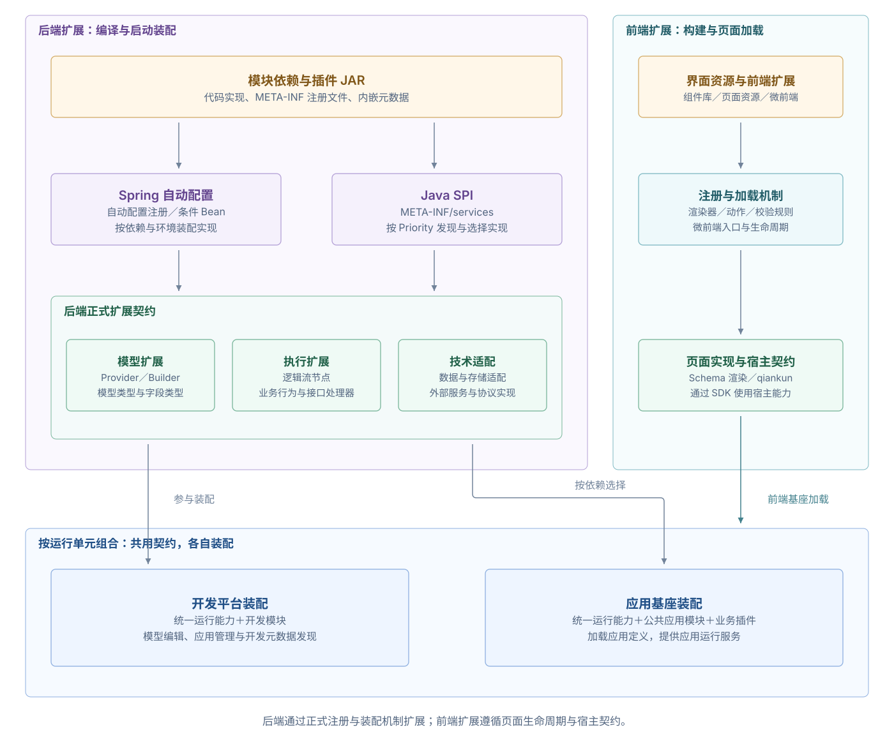

后端扩展随模块依赖或插件 JAR 进入运行环境。Spring 自动配置按条件装配 Bean，Java SPI 通过 `META-INF/services` 发现实现并按优先级选择。模型 Provider、Builder、字段类型、逻辑流节点和外部服务适配器都通过各自的正式契约接入。

扩展契约使插件提供的实现可以被模型引用。插件既可以提供节点、字段类型或服务，也可以附带模型元数据，由基座统一装配。代码实现与元数据分别通过对应机制发现，是否生效还取决于应用的模块组合、启用条件和模型定义。

前端扩展使用渲染器、动作、校验规则、组件库和微前端入口等机制接入。Schema 页面与代码页面共享宿主公共能力，微前端遵循加载、挂载、更新和卸载的生命周期。

开发平台与应用基座按用途组合模块。`ouroboros-develop` 装配统一运行能力及开发模块，`ouroboros-mothership` 装配统一运行能力与公共应用模块；业务插件补充具体应用的能力。两者共用契约，又保留各自的运行职责。

## 开发与联调协作

开发平台用测试实例中的统一运行时基座验证应用。在线建模和本地代码开发共同维护测试所需的元数据与扩展产物，实例状态、日志和调试会话把运行结果带回开发过程。

### 线上建模与测试验证

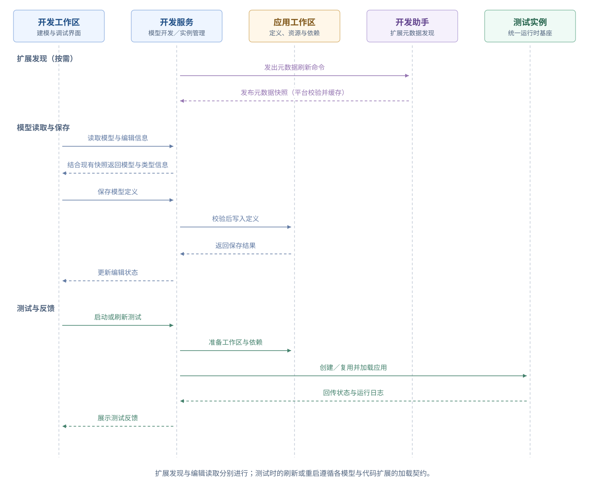

开发助手将发现的扩展元数据发布为快照。平台校验助手身份、运行代次和刷新请求后保存快照，编辑查询据此取得类型及扩展信息。按需刷新快照与普通模型读取分别进行，打开编辑页面可以使用当前已有的信息。

保存模型时，开发服务先按对应模型的规则校验，再写入应用工作区。页面设计、业务定义和代码扩展由此汇集到同一应用中，测试前的工作区准备负责把运行所需的定义与依赖组织到实例目录。

测试支持负责创建或复用测试实例，将准备好的应用工作区交给实例中的统一运行时基座加载。平台接收实例状态与运行日志，开发者据此继续修改模型或代码。模型刷新和代码重启分别遵循前述加载契约，测试支持负责协调运行过程。

### 本地 IDE 与线上开发平台联调

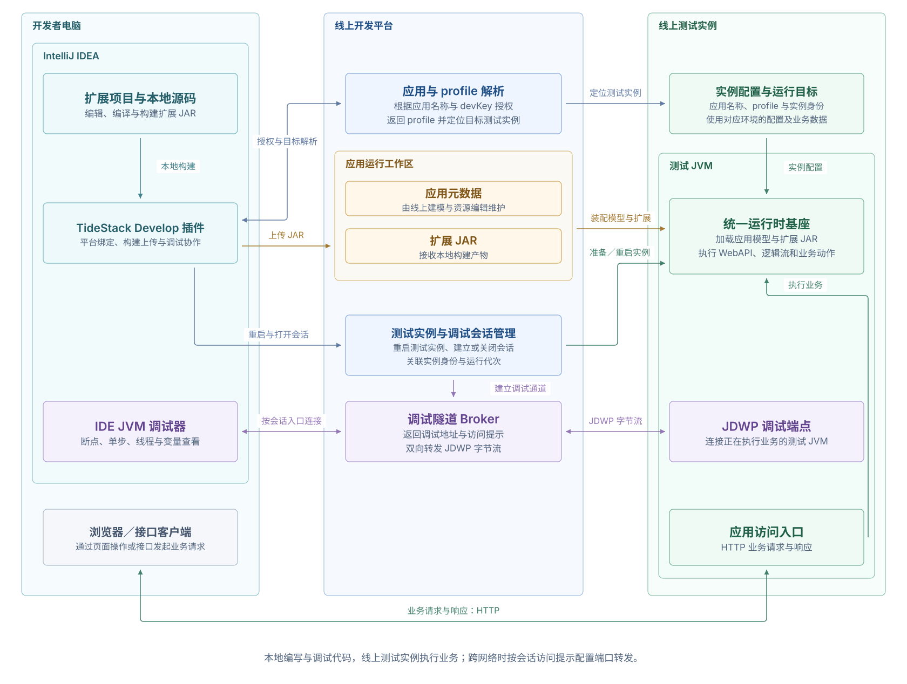

本地 IDE 保留源码编辑、编译和断点调试，应用在线上平台管理的测试实例中运行。平台维护的模型元数据与本地构建、上传的扩展 JAR 汇入运行工作区，由同一个统一运行时基座加载。代码扩展与在线模型因此可以在同一实例中联合验证。

IntelliJ IDEA 的 [TideStack Develop 联调流程](../../fusion-development/backend-extension-packages#本地-ide-与线上平台联调)将目标解析、构建上传、实例重启和调试器附加串联起来。开发平台负责授权、解析目标实例、接收产物并建立调试会话；IDE 使用返回的入口连接测试 JVM。浏览器或接口客户端触发业务后，代码在测试实例中执行，本地 IDE 可以命中断点、查看调用栈和变量。

平台 API、业务请求和调试连接各自承担不同职责。授权、上传和会话管理走平台 HTTP API，业务请求进入测试实例的应用入口，断点与变量交互使用 JDWP 调试通道。实例状态和运行日志继续回传平台，调试器连接直接服务于本地源码跟踪。

调试会话关联具体实例及运行代次。实例重启、删除或运行代次变化会使旧会话失效，代码变更需要重新构建、上传并建立对应调试连接；本地源码必须与测试实例加载的扩展产物对应。

## 部署结构与环境隔离

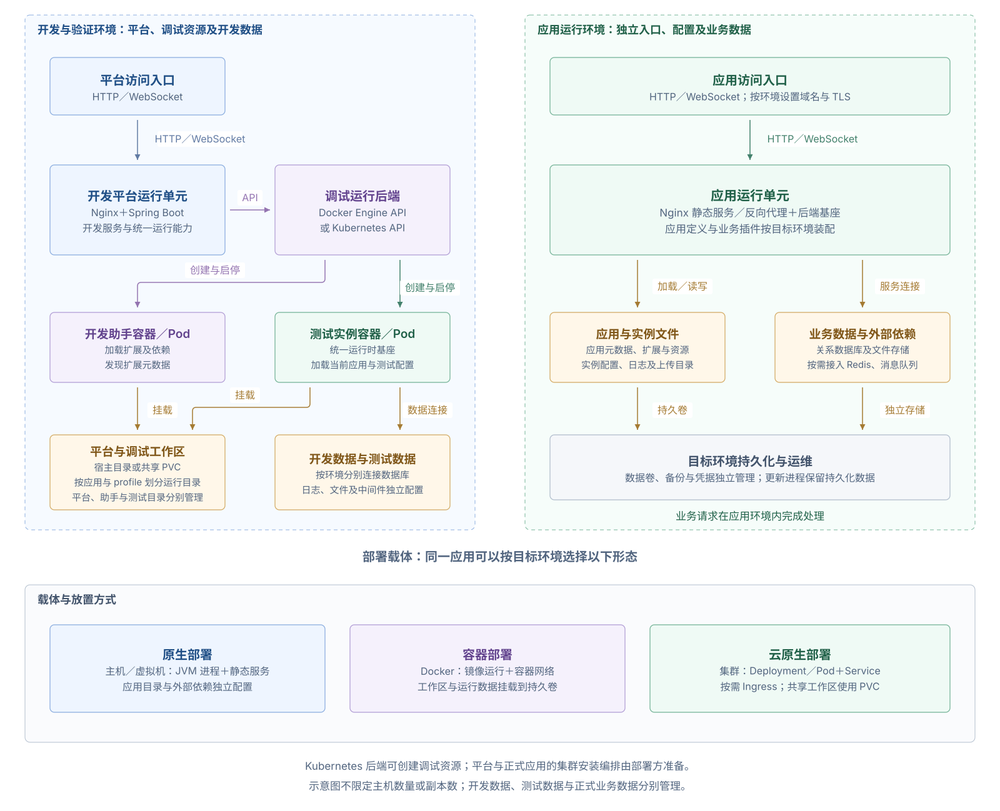

开发环境保存应用工作区和平台管理数据，并按需创建开发助手与测试实例；应用运行环境保存自己的应用定义、实例配置和业务数据。两者分别设置入口、凭据与持久化目录，平台升级、应用变更和数据恢复也各有处理范围。

平台通过 Docker 或 Kubernetes 调试后端管理开发助手与测试实例。Docker 使用宿主目录绑定运行工作区；Kubernetes 创建 Deployment、Service，并按访问策略创建 Ingress，工作区使用预先准备的共享 PVC。运行目录按应用与 profile 划分，平台目录、助手目录和测试目录分别管理。

部署载体有三种组织方式。原生部署将 JVM 进程、静态服务和应用目录放到主机或虚拟机；容器部署将运行文件固化为镜像，以容器网络连接服务，并挂载持久化目录；云原生部署使用集群工作负载、服务入口与持久卷承载相同的运行内容。当前标准镜像把 Nginx、前端静态资源与 Spring Boot 后端组合在同一容器中，也可以按环境另行组合静态交付与后端服务。

仓库提供了平台镜像和 Compose 安装材料。Kubernetes 调试后端已经实现开发运行资源管理，平台及正式应用的集群安装清单仍由部署方准备；原生形态同样需要自行准备进程、静态服务和依赖配置。

长期运行时，应用元数据、实例配置、日志、上传文件与数据库等数据需要持久保存。开发、测试和正式环境分别管理数据与凭据，按启用的能力接入数据库、消息队列、统一缓存和文件存储，避免把临时实例的生命周期与需要保留的数据绑定在一起。
