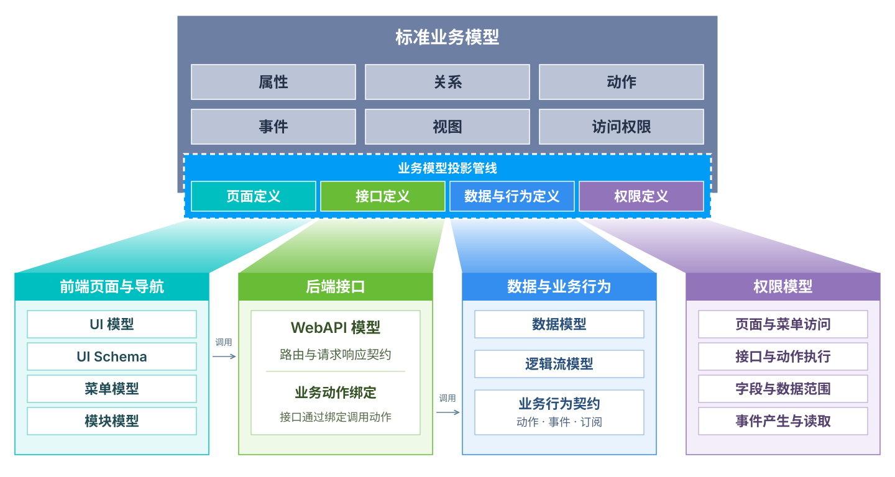

# 业务模型

标准业务模型将业务对象的数据结构、可执行操作、业务事件、页面和访问权限放在同一份定义中。字段和关系说明对象包含什么，动作说明对象能做什么，事件说明发生了什么，视图和权限则决定使用者如何接触这些能力。

平台也用业务模型组织复合视图和看板。它们有各自的用途和属性，建模时首先需要选对类型。

## 业务模型的类型

| 类型 | `modelType` | 描述什么 | 适用场景 |
| --- | --- | --- | --- |
| 标准业务模型 | `default` | 业务对象的字段、关系、动作、事件、视图和访问权限。 | 需要维护业务记录，并围绕记录完成查询、录入和业务处理。 |
| 复合视图业务模型 | `composite-view` | 查询结果，以及列、筛选条件和操作按钮。 | 需要组合展示或分析已有数据。 |
| 看板业务模型 | `dashboard` | 多个报表视图的布局与呈现。 | 需要把多个分析视图组织到同一个看板中。 |

三种类型共享模型名称、命名空间、标题等基本信息。标准业务模型以业务记录为中心；复合视图以查询结果为中心；看板以多个视图的组合为中心。后两种类型分别使用自己的属性，不沿用标准业务模型的字段、关系和增删改查配置。

## 通用属性

模型名称和命名空间共同确定模型身份。标题、图标和描述用于展示；修改标题不会改变模型全名，修改名称或命名空间则会影响其他定义对它的引用。

| 属性 | 作用 | 说明 |
| --- | --- | --- |
| `formatVersion` | 格式版本 | 标识业务模型元数据的结构版本，供加载与格式升级使用。 |
| `modelType` | 模型类型 | `default` 为标准业务模型，`composite-view` 为复合视图，`dashboard` 为看板。 |
| `name` | 模型名称 | 模型在命名空间内的标识，供其他定义引用。 |
| `namespace` | 命名空间 | 与模型名称一起组成全名，区分不同业务域中的同名模型。 |
| `fullName` | 模型全名 | 由命名空间与名称计算得到的只读标识，不作为独立配置维护。 |
| `title` | 模型标题 | 页面、菜单和开发界面使用的显示名称。 |
| `description` | 模型说明 | 解释模型描述的业务对象及用途。 |
| `icon` | 模型图标 | 用于模型入口和相关页面的视觉标识。 |
| `isEnabled` | 启用状态 | 控制模型是否参与运行时构建。 |
| `isAttachment` | 附属模型 | 标准业务模型设为附属模型后，不提供独立菜单入口；仍可被其他模型引用。 |
| `source` | 定义来源 | 加载器记录的元数据来源，用于追溯定义。 |
| `order` | 展示顺序 | 模型对应模块等入口的排序值。 |

## 标准业务模型

标准业务模型把数据与行为组织成一个完整的业务对象。页面、接口、数据访问和权限围绕这份定义协作；同一个字段的含义、同一个动作的输入输出，都可以在这些环节中保持一致。

### 从业务定义到运行能力

图中上半部分是标准业务模型中的定义，下半部分是平台据此投影的模型与业务行为契约。投影随模型加载和构建完成，无需逐个手工新建这些下游定义。具体参与投影的内容取决于模型是否启用，以及视图、接口和标准能力的配置。

页面通过接口发起请求，接口可以绑定业务动作；动作由逻辑流或代码实现完成处理，并通过数据模型访问数据、按约定产生事件。事件订阅再把后续处理交给其他动作或监听器。权限模型贯穿其中，分别约束入口、操作、数据和事件内容的访问。

### 属性：描述业务对象包含的数据

属性在元数据中保存为 `fields`。字段名称是稳定标识，字段标题用于展示，字段类型同时提供数据存储、校验及默认输入和显示组件的约定。选择字段类型时，应先确定业务含义，再考虑页面上使用什么控件。

主键用来识别记录；显示字段用来在其他模型引用该记录时展示名称。必填、唯一和校验规则约束数据本身，自定义输入和显示组件则控制呈现方式。仅修改组件不会改变字段的数据含义，也不会替代服务端约束。

| 属性 | 作用 | 说明 |
| --- | --- | --- |
| `fields` | 字段集合 | 定义业务对象的属性及其类型、约束和页面配置。 |
| `fields[].name` | 字段标识 | 同一模型内唯一的字段名称。 |
| `fields[].title` | 字段标题 | 表单、列表和详情中的显示名称。 |
| `fields[].description` | 字段说明 | 解释字段的业务含义。 |
| `fields[].type` | 字段类型 | 引用平台字段类型，并按该类型的约定配置参数。 |
| `fields[].defaultValue` | 默认值 | 创建业务记录时采用的默认值定义。 |
| `fields[].isRequired` | 必填标记 | 要求提交时提供该字段的值。 |
| `fields[].isPrimaryKey` | 主键标记 | 指定用于标识业务记录的字段。 |
| `fields[].isDisplayField` | 显示字段标记 | 指定引用该业务对象时用于展示的字段。 |
| `fields[].isUnique` | 唯一标记 | 要求字段值满足唯一性约束；主键字段也具有唯一性。 |
| `fields[].validators` | 校验器 | 补充字段需要执行的校验规则。 |
| `fields[].customInput` | 自定义输入 | 覆盖字段的输入组件配置。 |
| `fields[].customDisplay` | 自定义展示 | 覆盖字段的只读展示组件配置。 |
| `fields[].rawFieldName` | 原始字段名 | 需要映射到已有数据库字段时指定；这是字段的扩展属性，直接写在字段对象中。 |

模型还可以通过以下属性指定存储位置和结构迁移方式。

| 属性 | 作用 | 说明 |
| --- | --- | --- |
| `dataStation` | 数据源 | 指定模型使用的数据源名称；未设置时沿用应用的默认配置。 |
| `rawTableName` | 原始表名 | 指定投影后数据模型对应的数据库表名。 |
| `migrationStrategy` | 结构迁移策略 | `auto` 允许自动迁移，`disabled` 禁用自动迁移；默认 `auto`。 |

字段类型还可以提供自己的参数，例如文本长度、数字精度或可选值。这些参数随类型变化，见 [字段类型](../field-define/)。只影响某个页面的标题或组件，应在该页面的视图配置中覆盖，避免影响同一字段在其他页面的展示。

### 关系：描述业务对象之间的联系

关系保存为 `relations`，通过目标业务模型的全名建立关联。它既影响数据访问，也决定表单中使用选择器还是子表编辑等交互方式。

| 关系类型 | `type` | 含义 |
| --- | --- | --- |
| 主表关系 | `master` | 当前记录归属于一个主对象，保存指向主对象的关联。 |
| 子表关系 | `child` | 当前对象包含一组子记录，目标模型通过关联字段指回当前对象。 |
| 引用关系 | `reference` | 当前记录引用另一个对象，表达对象之间的业务联系。 |

主表与子表关系需要共同确定关联方向。子表关系的 `referenceKey` 指向子模型中回连当前对象的字段；主表和引用关系则用它指定目标模型的引用字段，未设置时默认使用目标模型的 `id`。目标模型存在多条关联时，应明确填写引用键，避免自动推导产生歧义。

| 属性 | 作用 | 说明 |
| --- | --- | --- |
| `relations` | 关系集合 | 定义与其他业务对象的关联及共同提交方式。 |
| `relations[].name` | 关系标识 | 同一模型内引用这项关系的名称。 |
| `relations[].title` | 关系标题 | 页面中展示的关系名称。 |
| `relations[].description` | 关系说明 | 解释两个业务对象之间的业务联系。 |
| `relations[].model` | 目标模型 | 引用关联业务模型的全名。 |
| `relations[].type` | 关系类型 | 指定关联方式，由对应关系处理器解释。 |
| `relations[].submitTogether` | 共同提交 | 控制关联对象是否与当前对象一同提交。 |
| `relations[].isRequired` | 必填关系 | 要求提交时提供这项关系。 |
| `relations[].referenceKey` | 引用键 | 指定关联使用的引用字段。 |

`submitTogether` 控制关联数据是否随当前对象一起提交。启用前应明确关联记录由谁负责维护，以及新增和更新时应提交哪些内容；单纯提供一个对象选择器，通常不需要把被引用对象也一并提交。

### 动作：描述可以执行的业务操作

业务动作保存为 `actions`。一个动作先声明输入、输出、执行前提和允许产生的事件，再绑定具体实现。这样，页面、接口、代码和事件订阅可以围绕同一份动作契约调用业务能力。

输入回答“执行需要哪些数据”，前置条件回答“当前是否允许执行”，执行绑定回答“交给哪个实现处理”。动作运行时统一检查启用状态、权限、输入契约和前置条件，执行后再校验输出。需要修改数据的动作还会进入平台的事务与写入约束链路。

#### 动作契约

| 属性 | 作用 | 说明 |
| --- | --- | --- |
| `actions` | 业务动作 | 声明业务操作的输入、输出、授权、前置条件及执行绑定。 |
| `actions[].name` | 动作标识 | 供接口、代码或事件订阅引用的动作名称。 |
| `actions[].title` | 动作标题 | 动作在开发界面中的显示名称。 |
| `actions[].description` | 动作说明 | 解释业务操作的用途。 |
| `actions[].isEnabled` | 启用状态 | 动作必须显式启用才能执行；未设置时为禁用。 |
| `actions[].inputSchema` | 输入契约 | 用 JSON Schema 描述动作输入。 |
| `actions[].outputSchema` | 输出契约 | 用 JSON Schema 描述动作返回值。 |
| `actions[].binding` | 执行绑定 | 指定动作的逻辑流或代码实现。 |
| `actions[].readOnly` | 只读执行 | 启用后，动作在平台数据访问链路中受到写入限制，也不能嵌套调用可写动作。 |
| `actions[].authorization` | 预留授权定义 | 当前未提供执行语义，应保持为空；实际授权使用权限模型。 |
| `actions[].precondition` | 前置条件 | 定义执行动作前必须满足的业务条件。 |
| `actions[].emits` | 允许产生的事件 | 声明动作实现允许产生的业务事件；单独填写此属性不会自动发布自定义事件。 |

动作的“可用性检查”可用于页面判断操作当前是否可执行；真正执行时仍会重新检查权限和条件，避免依赖页面之前取得的判断结果。

#### 执行绑定

逻辑流适合编排步骤、分支和外部调用；代码处理器适合专用算法、复杂集成等实现。两者使用同一份动作契约，调用方不需要随实现方式改变业务操作的含义。

| 属性 | 作用 | 说明 |
| --- | --- | --- |
| `actions[].binding.kind` | 实现类型 | `logicflow` 绑定逻辑流，`handler` 绑定已注册的代码处理器。 |
| `actions[].binding.flowName` | 逻辑流引用 | `kind` 为 `logicflow` 时填写，不能同时指定代码处理器。 |
| `actions[].binding.handlerName` | 处理器引用 | `kind` 为 `handler` 时填写，不能同时指定逻辑流。 |
| `actions[].binding.inputMapping` | 输入映射 | 将动作输入映射到执行实现的输入。 |
| `actions[].binding.outputMapping` | 输出映射 | 将执行结果映射为动作输出。 |
| `actions[].binding.requiresHttpRequest` | 请求上下文要求 | 声明执行绑定是否依赖 HTTP 请求上下文。 |
| `actions[].emits[].modelFullName` | 事件所属模型 | 引用事件定义所在的业务模型。 |
| `actions[].emits[].eventName` | 事件名称 | 引用该模型中声明的事件。 |

依赖 HTTP 请求上下文的动作只能在具有真实请求上下文的调用中执行。需要由计划任务或事件订阅调用时，应将必要信息纳入动作输入，避免依赖浏览器请求。

#### 标准接口与动作

标准业务模型可以提供查询、获取单条、新建、更新和删除能力。`apis` 配置这些标准接口的数据处理规则；`actions` 则声明可被复用的业务操作。面向 HTTP 的自定义入口可以通过 [WebAPI 模型](../webapi-model/) 绑定业务动作。

| 属性 | 作用 | 说明 |
| --- | --- | --- |
| `apis` | 接口配置 | 配置标准业务接口的启用状态和参数。 |
| `apis.search` | 查询接口 | 配置列表查询的启用状态、过滤、排序和关联数据填充。 |
| `apis.getOne` | 单条查询接口 | 配置按记录标识读取数据的处理规则。 |
| `apis.add` | 新建接口 | 配置新建记录时允许写入的字段、默认值和覆写值。 |
| `apis.update` | 更新接口 | 配置更新记录的允许字段和处理规则。 |
| `apis.delete` | 删除接口 | 配置删除记录的处理规则。 |

标准接口中的默认条件可以用于简化调用，覆写条件可以用于固定业务规则；需要限制不同角色的数据范围时，应配置访问权限。页面传入的筛选条件不能替代权限控制。

### 事件：描述已经发生的业务事实

业务事件保存为 `events`。动作表达要执行的操作，事件记录操作完成或数据变化后已经发生的事实。事件发布者描述事实，订阅者决定如何响应，两者通过事件契约协作。

事件契约需要说明事件名、发生条件、主体和负载。模型级事件面向整个模型，实例级事件关联一条具体记录。`occurrenceCondition` 是对发布时机的业务说明；实际发布由相应的动作实现或已接入的事件生产机制完成。

#### 事件定义

| 属性 | 作用 | 说明 |
| --- | --- | --- |
| `events` | 业务事件 | 声明业务事实、事件负载和允许的事件生产方式。 |
| `events[].name` | 事件标识 | 同一模型内唯一的事件名称。 |
| `events[].title` | 事件标题 | 开发界面展示的事件名称。 |
| `events[].description` | 事件说明 | 解释事件代表的业务事实。 |
| `events[].occurrenceCondition` | 发生条件 | 描述事件代表的业务事实及发布时机；这段说明不作为条件表达式自动执行。 |
| `events[].subject` | 事件主体 | `model` 表示模型级事件，`instance` 表示某条业务记录的事件；实例级事件要求模型具有唯一的 `id` 主键。 |
| `events[].requireUnfilteredModelRead` | 完整数据读取要求 | 声明事件消费是否要求具备不受行级过滤限制的模型读取权限。 |
| `events[].payloadSchema` | 负载契约 | 用 JSON Schema 描述事件携带的数据。 |
| `events[].allowedProducerKinds` | 允许的生产方式 | 限制哪些类型的生产者可以发布该事件。 |

事件负载应包含后续处理所需的信息，同时遵守读取权限。平台会检查事件的产生权限和读取权限；负载中的字段及业务对象引用也参与访问检查。

#### 事件订阅

订阅保存为 `eventSubscriptions`，属于消费方的模型。每项订阅指定来源事件、过滤条件、输入映射和执行身份，并选择调用一个业务动作或一个已注册监听器。

调用动作时填写目标模型与动作名称；调用监听器时填写监听器名称及其配置。这两种目标互斥，输入映射也应与所选目标一致。执行身份需要具备读取事件和执行后续操作的权限。

| 属性 | 作用 | 说明 |
| --- | --- | --- |
| `eventSubscriptions` | 事件订阅 | 声明接收哪些事件，以及调用哪个动作或监听器。 |
| `eventSubscriptions[].name` | 订阅标识 | 在模型内识别该项订阅。 |
| `eventSubscriptions[].isEnabled` | 启用状态 | 未设置时默认启用；设为 `false` 后停用该订阅。 |
| `eventSubscriptions[].sourceEventModelFullName` | 来源模型 | 指定事件定义所属的业务模型。 |
| `eventSubscriptions[].sourceEventName` | 来源事件 | 指定订阅的事件名称。 |
| `eventSubscriptions[].filter` | 事件过滤 | 筛选需要处理的事件。 |
| `eventSubscriptions[].targetActionModelFullName` | 目标动作模型 | 调用业务动作时指定动作所属模型。 |
| `eventSubscriptions[].targetActionName` | 目标动作 | 指定被调用的业务动作名称。 |
| `eventSubscriptions[].inputMapping` | 动作输入映射 | 将事件内容映射为目标动作输入。 |
| `eventSubscriptions[].listenerName` | 监听器引用 | 使用监听器处理事件时引用已注册监听器。 |
| `eventSubscriptions[].listenerConfig` | 监听器配置 | 提供该监听器约定的配置。 |
| `eventSubscriptions[].listenerInputMapping` | 监听器输入映射 | 将事件内容映射为监听器输入。 |
| `eventSubscriptions[].executionPrincipalRef` | 执行身份引用 | 必填，指定消费事件时使用的已配置身份；该身份仍需具备相应权限。 |

事件发布和订阅处理分开进行。可靠投递链路记录处理状态，并支持失败后的重试或重驱；订阅实现应能识别重复处理，避免重复产生业务结果。

### 视图：组织业务对象的页面

视图保存为 `views`。字段定义提供可用的数据和默认组件，视图再选择哪些字段、关系和操作出现在页面中，并确定它们的顺序、标题和布局。

| 视图 | 属性 | 用途 |
| --- | --- | --- |
| 索引页 | `views.index` | 查询、筛选和浏览记录，并提供新增及行操作入口。 |
| 新建表单 | `views.add` | 收集创建记录需要的信息。 |
| 编辑表单 | `views.edit` | 修改已有记录中允许更新的内容。 |
| 详情页 | `views.detail` | 只读查看记录及关联信息。 |

索引页配置显示列和查询条件，表单配置输入字段和布局，详情页配置只读内容。它们可以分别覆盖字段标题和组件，因此不必为了一个页面的展示需要修改全局字段定义。

| 属性 | 作用 | 说明 |
| --- | --- | --- |
| `views` | 视图配置 | 配置列表、新增、编辑、详情等页面的标题与呈现方式。 |
| `views.index.isEnabled` | 启用索引页 | 控制是否提供标准索引页。 |
| `views.index.title` | 索引页标题 | 覆盖默认的模型标题。 |
| `views.index.displayColumns` | 显示列 | 按顺序配置表格中的字段、关系或自定义列。 |
| `views.index.defaultFilters` | 默认过滤器 | 配置索引页提供的字段或关系筛选项及其顺序。 |
| `views.index.isAutoFillHeight` | 占满高度 | 控制列表是否自适应可用高度。 |
| `views.add.isEnabled` | 启用新建表单 | 控制是否提供标准新建表单。 |
| `views.add.title` | 新建表单标题 | 覆盖新建表单的默认标题。 |
| `views.add.fields` | 新建表单字段 | 选择字段、关系及布局项，并确定顺序。 |
| `views.add.mode` | 新建表单打开方式 | 选择弹窗、抽屉等呈现方式。 |
| `views.add.layoutType` | 新建表单布局 | 设置表单标签与内容的布局方式。 |
| `views.add.columnCount` | 新建表单列数 | 设置表单内容的分列方式。 |
| `views.edit.isEnabled` | 启用编辑表单 | 控制是否提供标准编辑表单。 |
| `views.edit.title` | 编辑表单标题 | 覆盖编辑表单的默认标题。 |
| `views.edit.fields` | 编辑表单字段 | 选择编辑时可见的字段、关系及布局项。 |
| `views.edit.mode` | 编辑表单打开方式 | 选择编辑表单的呈现方式。 |
| `views.edit.layoutType` | 编辑表单布局 | 设置编辑表单的布局方式。 |
| `views.edit.columnCount` | 编辑表单列数 | 设置编辑表单内容的分列方式。 |
| `views.detail.isEnabled` | 启用详情页 | 控制是否提供标准详情页。 |
| `views.detail.title` | 详情页标题 | 覆盖详情页的默认标题。 |
| `views.detail.fields` | 详情页字段 | 选择需要展示的字段、关系及布局项。 |
| `views.detail.mode` | 详情页打开方式 | 选择详情页的呈现方式。 |
| `views.detail.layoutType` | 详情页布局 | 设置只读内容的布局方式。 |
| `views.detail.columnCount` | 详情页列数 | 设置详情内容的分列方式。 |

页面路由由 [UI 模型](../ui-model/) 承载，页面内容由 [UI Schema](../ui-schema/) 描述。启用索引页且模型未设为附属模型时，平台还会投影相应菜单入口。模型的独立菜单、表单和接口应按使用需要分别配置。

### 访问权限：约束入口、操作和数据

业务模型中的 `accessControl` 声明标准操作可以采用哪些控制维度。平台据此形成权限定义，管理者再向角色或其他授权主体授予权限，并配置实际的字段范围和数据范围。

访问控制需要同时考虑三个层面：是否能够进入页面或看到菜单，是否允许执行查询、新建、更新、删除及其他动作，以及允许读取或修改哪些字段、哪些记录。隐藏一个按钮只能改变界面，服务端仍需执行相应授权检查。

| 属性 | 作用 | 说明 |
| --- | --- | --- |
| `accessControl` | 访问控制 | 定义模型相关的访问控制参数、字段控制和数据过滤能力。 |
| `accessControl.search.isEnabled` | 查询控制 | 启用标准查询权限的细粒度控制配置。 |
| `accessControl.search.fieldControl` | 查询字段控制 | 允许授权时配置可读取的字段。 |
| `accessControl.search.filters` | 查询范围维度 | 声明授权时可以配置的数据过滤维度。 |
| `accessControl.search.delegable` | 允许委托查询 | 允许该权限参与第三方应用的委托授权，默认关闭。 |
| `accessControl.add.isEnabled` | 新建控制 | 启用标准新建权限的细粒度控制配置。 |
| `accessControl.add.fieldControl` | 新建字段控制 | 允许授权时配置可写入的字段。 |
| `accessControl.add.delegable` | 允许委托新建 | 允许该权限参与第三方应用的委托授权，默认关闭。 |
| `accessControl.update.isEnabled` | 更新控制 | 启用标准更新权限的细粒度控制配置。 |
| `accessControl.update.fieldControl` | 更新字段控制 | 允许授权时配置可修改的字段。 |
| `accessControl.update.filters` | 更新范围维度 | 声明授权时可以配置的记录范围维度。 |
| `accessControl.update.delegable` | 允许委托更新 | 允许该权限参与第三方应用的委托授权，默认关闭。 |
| `accessControl.delete.isEnabled` | 删除控制 | 启用标准删除权限的细粒度控制配置。 |
| `accessControl.delete.filters` | 删除范围维度 | 声明授权时可以配置的记录范围维度。 |
| `accessControl.delete.delegable` | 允许委托删除 | 允许该权限参与第三方应用的委托授权，默认关闭。 |

`filters` 声明可供授权时使用的控制维度，实际范围由授权配置决定。允许第三方应用委托访问时，客户端范围、用户本次授权和用户已有权限仍需共同满足。

启用的业务动作会参与操作权限投影；业务事件分别具有产生和读取权限。事件订阅使用自己的执行身份接受检查，因此拥有页面访问权限，并不意味着可以读取全部事件或执行全部订阅动作。

关闭某项细粒度控制配置，仅表示不提供相应的字段或范围配置维度；对应操作仍受平台权限体系约束。完整权限概念见 [权限模型](../authority-model/)。

### 标准能力与审批绑定

#### 标准能力

草稿、审计字段、软删除和导入导出等能力可以按需启用。它们会影响数据模型、标准操作和页面，启用后应同时检查相关字段、视图和操作权限。

| 属性 | 作用 | 说明 |
| --- | --- | --- |
| `features` | 标准能力配置 | 配置草稿、审计字段、软删除及导入导出等能力。 |
| `features.isEnabledAuditFields` | 审计字段 | 启用创建、修改等审计信息字段。 |
| `features.isEnabledSoftDelete` | 软删除 | 启用删除标记及对应的数据处理。 |
| `features.isEnabledDraft` | 草稿 | 启用业务记录的草稿能力。 |
| `features.isEnabledImport` | 数据导入 | 启用标准导入入口及处理能力。 |
| `features.isEnabledBatchDelete` | 批量删除 | 启用列表中的批量删除操作。 |
| `features.isEnabledServerSideExport` | 服务端导出 | 启用由服务端处理的数据导出。 |
| `features.serverSideExport.fields` | 导出字段 | 配置服务端导出使用的字段。 |
| `enableArchiveDelete` | 归档删除 | 控制是否启用归档删除插件行为。 |
| `enableScd2History` | 历史版本 | 控制是否启用 SCD2 历史记录插件行为。 |
| `statusFlow` | 状态流转 | 定义状态字段及允许的状态转换。 |

归档删除和历史版本由相应插件提供。`statusFlow` 描述业务状态及允许的转换；需要人员参与、跨时间处理的审批过程，应通过审批绑定接入审批流。

#### 审批绑定

`workflow` 连接业务记录与审批流程：绑定流程定义，将流程状态映射到业务字段，并确定发起时如何传递表单数据。流程中的审批节点、候选人和流转规则仍在 [审批流模型](../approval-workflow-model/) 中定义。

| 属性 | 作用 | 说明 |
| --- | --- | --- |
| `workflow` | 审批绑定 | 绑定审批流程，配置业务状态映射和表单数据传递。 |
| `workflow.isEnabled` | 启用审批绑定 | 控制模型是否接入审批流程。 |
| `workflow.bindings` | 流程绑定 | 保存关联流程及状态映射。 |
| `workflow.bindings[].processId` | 流程标识 | 引用绑定的审批流程定义。 |
| `workflow.bindings[].statusField` | 业务状态字段 | 指定用于保存审批状态的模型字段。 |
| `workflow.bindings[].statusMap` | 状态映射 | 定义流程状态与业务字段取值的对应关系。 |
| `workflow.startMode` | 发起方式 | 控制流程的发起方式。 |
| `workflow.formDataMode` | 表单数据方式 | 确定发起流程时如何提供业务表单数据。 |
| `workflow.formDataMapping` | 表单数据映射 | 按需要映射传递给流程的数据。 |

#### 自定义功能

`custom` 保存自定义函数及其页面、接口配置，用于扩展标准页面和标准操作。需要被多个入口或事件订阅复用的业务行为，应明确声明动作契约，再绑定实现，便于统一校验输入输出及执行条件。

| 属性 | 作用 | 说明 |
| --- | --- | --- |
| `custom` | 自定义函数 | 保存模型中的脚本等自定义函数定义，可供业务动作绑定使用。 |

## 复合视图业务模型

复合视图面向查询结果，配置数据从哪里来、显示哪些列、如何筛选和排序，以及每行或批量选择后可以调用什么操作。它不使用标准业务模型的 `fields`、`relations` 和增删改查配置来创建一份新的业务记录结构。

定义中的数据来源在 `datasetName` 和 `embeddedQuery` 之间二选一。当前运行时执行入口使用 `datasetName` 引用的数据集，尚不执行 `embeddedQuery` 内嵌查询。显示列、筛选字段和排序字段应与数据源相匹配；操作按钮引用已有接口，并通过上下文绑定传递所选记录等信息。

### 核心属性

| 属性 | 作用 | 说明 |
| --- | --- | --- |
| `datasetName` | 数据集引用 | 指定复合视图使用的数据集。 |
| `embeddedQuery` | 内嵌查询 | 保存视图内部的查询定义；当前可保存和校验，运行时执行入口尚不支持。 |
| `columns` | 列配置 | 定义查询结果中展示的列。 |
| `filterConfig` | 筛选配置 | 定义筛选字段、允许的操作和控件。 |
| `actionButtons` | 操作按钮 | 定义按钮及其引用的接口和上下文绑定。 |
| `layoutConfig` | 布局配置 | 定义分页大小和默认排序。 |

### 显示列与筛选

| 属性 | 作用 | 说明 |
| --- | --- | --- |
| `columns[].field` | 结果字段 | 引用查询结果中的字段；显示列不能为空。 |
| `columns[].title` | 列标题 | 页面中显示的列名称。 |
| `columns[].width` | 列宽 | 指定该列的显示宽度。 |
| `columns[].format` | 显示格式 | 指定结果值的格式化方式。 |
| `filterConfig.items` | 筛选项 | 保存允许使用的筛选配置。 |
| `filterConfig.items[].field` | 筛选字段 | 指定查询结果或数据源允许筛选的字段。 |
| `filterConfig.items[].ops` | 筛选操作 | 声明允许使用的比较操作。 |
| `filterConfig.items[].widget` | 筛选控件 | 选择适合该字段的输入控件。 |

### 操作与布局

| 属性 | 作用 | 说明 |
| --- | --- | --- |
| `actionButtons[].label` | 按钮标题 | 操作按钮显示的文字。 |
| `actionButtons[].icon` | 按钮图标 | 用于识别操作的图标。 |
| `actionButtons[].scope` | 操作范围 | `row` 为行操作，`batch` 为批量操作。 |
| `actionButtons[].apiRef` | 接口引用 | 指定按钮调用的接口。 |
| `actionButtons[].contextBinding` | 上下文绑定 | 将当前记录或选择内容映射为接口参数。 |
| `layoutConfig.pageSize` | 每页数量 | 设置大于零的默认分页大小。 |
| `layoutConfig.defaultSort` | 默认排序 | 按顺序声明排序字段。 |
| `layoutConfig.defaultSort[].field` | 排序字段 | 指定参与排序的结果字段。 |
| `layoutConfig.defaultSort[].direction` | 排序方向 | `asc` 为升序，`desc` 为降序。 |

复合视图通过数据集与查询执行能力获取结果，不走标准业务模型的整套增删改查投影。按钮所调用接口的权限和数据访问约束仍独立生效。

## 看板业务模型

看板把多个报表视图组织到一张栅格页面中，统一安排各视图的位置、大小和外观。看板负责组合和布局，各报表视图继续负责自己的查询与呈现。

当前看板模型中的小组件类型为 `report-view`，通过 `viewName` 引用报表视图。这里的小组件配置属于看板模型，与 [Widget 模型](../widget-model/) 的通用组件定义分别管理。

### 核心属性

| 属性 | 作用 | 说明 |
| --- | --- | --- |
| `layout` | 栅格布局 | 配置列数、行高以及是否允许拖动和调整尺寸。 |
| `widgets` | 小组件集合 | 指定组件、视图、位置、尺寸和实例配置。 |
| `globalFilterBinding` | 全局筛选绑定 | 将共享筛选条件映射到各个小组件的字段。 |

### 栅格与小组件

| 属性 | 作用 | 说明 |
| --- | --- | --- |
| `layout.cols` | 栅格列数 | 横向划分的列数，默认 `24`，必须大于零。 |
| `layout.rowHeight` | 栅格行高 | 单行高度，默认 `30`，必须大于零。 |
| `layout.draggable` | 允许拖动 | 控制是否允许调整组件位置，默认开启。 |
| `layout.resizable` | 允许缩放 | 控制是否允许调整组件尺寸，默认开启。 |
| `widgets[].id` | 组件实例标识 | 看板内唯一，用于布局和筛选绑定。 |
| `widgets[].widgetName` | 组件类型 | 当前支持 `report-view`。 |
| `widgets[].viewName` | 报表视图引用 | 指定组件展示的报表视图。 |
| `widgets[].position` | 组件位置 | 保存组件在栅格中的坐标。 |
| `widgets[].position.x` | 横向位置 | 从零开始的横向栅格坐标，不能为负数。 |
| `widgets[].position.y` | 纵向位置 | 从零开始的纵向栅格坐标，不能为负数。 |
| `widgets[].size` | 组件尺寸 | 保存组件占用的栅格大小。 |
| `widgets[].size.cols` | 占用列数 | 组件横向占用的列数，默认 `12`。 |
| `widgets[].size.rows` | 占用行数 | 组件纵向占用的行数，默认 `10`。 |
| `widgets[].config` | 实例显示配置 | 配置该组件在看板中的外观。 |
| `widgets[].config.title` | 组件标题 | 覆盖该实例的显示标题。 |
| `widgets[].config.showHeader` | 显示标题区 | 控制是否显示组件标题区，默认开启。 |
| `widgets[].config.showBorder` | 显示边框 | 控制是否显示组件边框，默认开启。 |
| `widgets[].config.backgroundColor` | 背景色 | 设置组件实例的背景色。 |

### 共享筛选

`globalFilterBinding` 声明共享筛选的来源与字段映射，需要明确条件来自哪里、传给哪个组件，以及在目标组件中使用哪个字段。当前看板运行时装配尚未接入这组映射，保存这些属性不会自动启用组件联动。

| 属性 | 作用 | 说明 |
| --- | --- | --- |
| `globalFilterBinding.source` | 筛选来源 | 默认 `reactive-data-domain`，当前不接受 `event-bus` 作为来源。 |
| `globalFilterBinding.widgetFieldMappings` | 字段映射集合 | 保存各组件接收共享筛选条件的映射。 |
| `globalFilterBinding.widgetFieldMappings[].widgetId` | 目标组件 | 引用看板中的组件实例标识。 |
| `globalFilterBinding.widgetFieldMappings[].sourceField` | 来源字段 | 引用共享筛选中的字段。 |
| `globalFilterBinding.widgetFieldMappings[].targetField` | 目标字段 | 指定组件接收筛选条件的字段。 |
| `globalFilterBinding.widgetFieldMappings[].op` | 比较操作 | 指定筛选使用的比较操作，默认 `eq`。 |

看板定义由报表看板能力装配和使用，不会按标准业务模型的方式创建数据表、增删改查接口及编辑表单。

## 扩展阅读

- [业务模型操作手册](../../low-code/development-platform-menus/business-model)：新建、编辑、配置和调试业务模型。
- [模型化](../modeling/)：业务模型与其他模型之间的整体关系。
- [JSON Schema 参考](../../reference/jsonschema/)：业务模型元数据的结构契约，文件为 `business.schema.json`。
