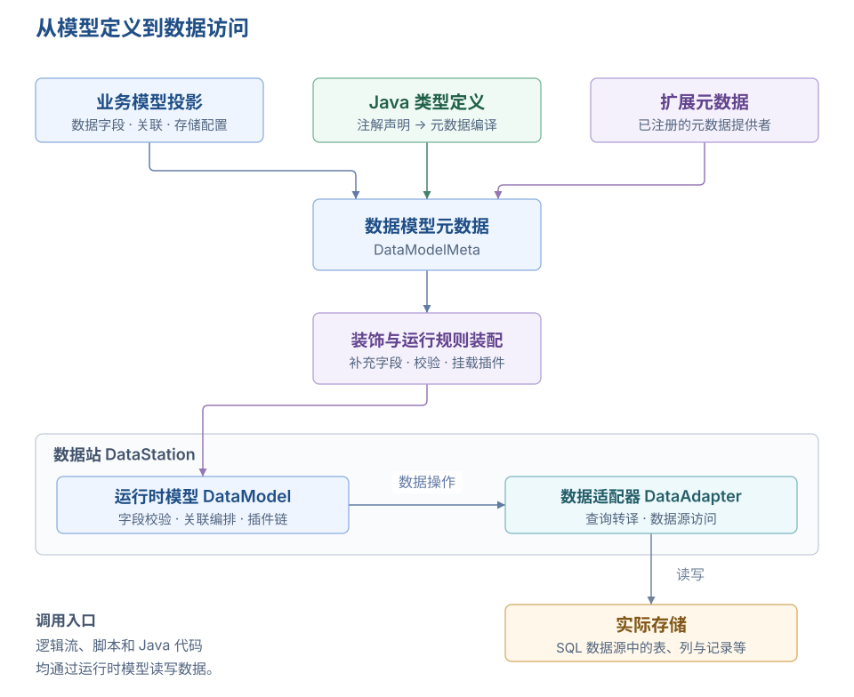
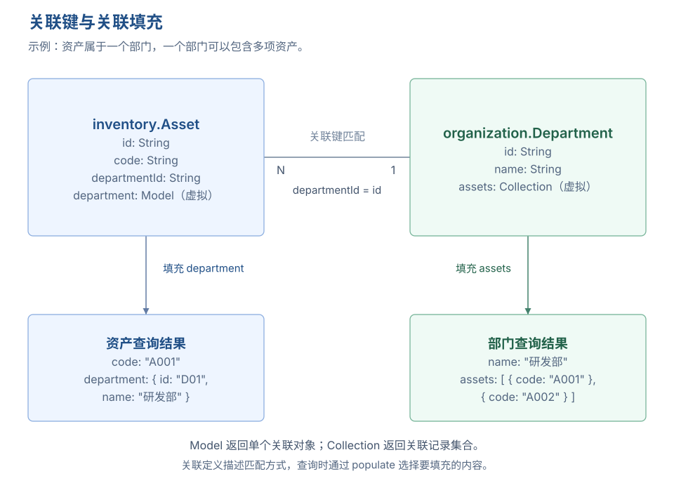

# 数据模型

数据模型定义一组记录的结构，以及这些记录如何存储、校验和读写。字段的类型、主键、唯一约束、模型关联和数据插件共同决定一次数据操作的行为；逻辑流、脚本和 Java 代码都可以通过数据模型访问数据。

业务模型用字段、关系、动作、事件、视图和权限描述业务对象，数据模型承接其中的数据定义。业务模型加载和构建时，平台会完成相应投影。Java 代码也可以声明数据模型，两种来源进入同一套数据访问机制。

## 从模型定义到数据访问



理解数据模型，需要区分三个对象：

| 对象 | 包含什么 | 用于什么 |
| --- | --- | --- |
| 模型元数据 `DataModelMeta` | 模型名称、字段、主键、约束、插件等声明。 | 描述数据结构和运行规则。 |
| 运行时模型 `DataModel` | 加载后的字段、值类型、校验和插件，以及查询、写入等操作。 | 执行数据访问。 |
| 实际存储 | 数据库中的表、列、索引和记录等。 | 保存数据；结构是否随模型变化，由迁移策略和数据源能力决定。 |

模型元数据在构建时可以经过装饰器补充，例如添加审计字段、逻辑删除字段和对应插件。运行时模型据此完成校验，并在读写时执行插件链。因而，最初声明的字段、装饰后的字段和数据库当前已有的列，可能并不完全相同。

`DataStation`（数据站）组织所属的数据模型及数据源连接，`DataAdapter`（数据适配器）负责具体的数据访问和查询转译。应用开发通常通过 `DataModel` 读写记录，以保留模型上的校验、关联处理和插件行为。

WebAPI 定义 HTTP 接口契约，其绑定的业务动作、逻辑流或代码实现再调用数据模型。页面、接口契约与数据模型各有职责，不能从存在一个数据模型就推断它已经具有可公开调用的接口或页面。

## 数据模型的定义来源

| 来源 | 如何定义 | 修改位置 |
| --- | --- | --- |
| 业务模型投影 | 从业务模型的数据字段、关联和存储配置投影数据模型，也可按启用的能力补充历史、归档等配套模型。 | 修改对应业务模型。 |
| Java 类型定义 | 通过 `@Model`、`@Field`、`@PrimaryKey`、`@Related`、`@UniqueConstraint` 等注解声明，再编译为数据模型元数据。 | 修改 Java 模型定义并更新相应模块或插件。 |
| 扩展提供 | 通过已注册的 `DataModelMetaProvider` 提供元数据。 | 修改该扩展的正式定义来源。 |

这些来源描述的是定义如何进入平台。动态访问与类型化访问则描述如何使用运行时模型：前者处理 `Map`、`Record`，后者处理 Java 对象。它们不构成互斥的数据模型类型，具体用法见[数据读写与查询](#数据读写与查询)。

开发平台的[数据模型菜单](../../low-code/development-platform-menus/data-model)是只读核对入口。需要调整字段、关联或插件时，应回到相应的定义来源。

## 模型标识与存储映射

### 模型身份

`namespace` 与 `name` 共同组成模型全名。例如，命名空间为 `inventory`、名称为 `Asset`，模型全名就是 `inventory.Asset`。其他定义和代码按全名引用模型；`label` 用于显示，修改显示名称不会改变引用。

| 属性 | 作用 | 说明 |
| --- | --- | --- |
| `name` | 模型名称 | 模型在命名空间中的标识。 |
| `namespace` | 命名空间 | 区分不同领域或模块中的同名模型。 |
| `fullName` | 模型全名 | 由命名空间和名称计算得到的只读标识，不单独配置。 |
| `label` | 显示名称 | 在开发和管理界面中展示的名称。 |
| `description` | 模型说明 | 解释这组记录的含义和用途。 |
| `formatVersion` | 格式版本 | 标识元数据的结构版本。 |
| `source` | 定义来源 | 记录元数据来源，供追溯使用。 |
| `extraProps` | 模型扩展属性 | 保存装饰器、插件等约定的附加定义；JSON 序列化时按属性名平铺在模型对象中。 |

### 数据站与物理名称

模型全名用于平台内引用，物理名称用于定位实际存储。在 SQL 数据源中，模型的 `rawName` 对应表名，字段的 `rawName` 对应列名。代码和查询仍使用逻辑名称，适配器负责映射。

| 属性 | 作用 | 说明 |
| --- | --- | --- |
| `dataStation` | 所属数据站 | 指定负责该模型及其数据访问的数据站。 |
| `rawName` | 物理名称 | 映射底层存储中的名称，例如已有数据库表名；未设置时，将模型全名中的点替换为下划线，再转为下划线命名。 |

接入已有表时，应核对表名、列名、字段类型和主键，再决定是否允许自动迁移。只指定表名，不会自动推导出完整的字段和约束定义。

## 字段与数据类型

### 字段定义

`fields` 声明模型中的字段。普通字段保存值，关联字段则描述如何取得另一个模型的记录。一个字段是否占用物理列，取决于它的值类型和关联配置。

| 属性 | 作用 | 说明 |
| --- | --- | --- |
| `fields` | 字段集合 | 声明数据字段及关联字段。 |
| `fields[].name` | 字段名称 | 查询和写入使用的逻辑名称。 |
| `fields[].label` | 显示名称 | 字段在开发和管理界面中的名称。 |
| `fields[].description` | 字段说明 | 解释字段值的含义。 |
| `fields[].rawName` | 物理字段名 | 指定实际存储中的列名；未设置时，运行时按字段逻辑名转为下划线命名。 |
| `fields[].type` | 逻辑类型 | 引用已注册的值类型，决定值转换、持久化和关联等行为。 |
| `fields[].rawType` | 存储类型 | 指定底层数据源的类型，由相应适配器解释。 |
| `fields[].size` | 长度或容量 | 供存储类型映射使用，例如字符串长度；含义取决于类型。 |
| `fields[].decimalDigits` | 小数位数 | 指定数值存储的小数位数。 |
| `fields[].isUnsigned` | 无符号标记 | 声明数值存储的无符号要求，实际支持取决于数据源。 |
| `fields[].extraProps` | 字段扩展属性 | 保存关联键等类型专属配置；JSON 中直接写在字段对象中。 |

### 逻辑类型与存储类型

逻辑类型描述程序如何理解一个值，存储类型描述数据源如何保存它。例如，`Decimal` 将值转换为 `BigDecimal`，具体数据库列的精度和小数位数再由存储配置确定。

| 逻辑类型 | 表达的数据 | 使用时关注什么 |
| --- | --- | --- |
| `String` | 文本。 | 存储长度、可空和校验规则。 |
| `Short` | 短整数。 | 数值范围及目标存储类型。 |
| `Integer` | 整数。 | 数值范围及目标存储类型。 |
| `Long` | 长整数。 | 数值范围及目标存储类型。 |
| `Float` | 单精度浮点数。 | 允许近似计算的数值。 |
| `Double` | 双精度浮点数。 | 允许近似计算的数值。 |
| `Decimal` | 定点数。 | 精度与小数位数，适合需要明确小数精度的数据。 |
| `Boolean` | 布尔值。 | 是否允许空值，以区分“否”和“未填写”。 |
| `Date` | 日期。 | 仅包含日期的场景。 |
| `DateTime` | 日期时间。 | 日期和时间的存储与转换。 |
| `Snowflake` | 雪花标识值。 | 运行时按字符串处理、持久化时转为长整数；值类型与主键生成策略分别配置。 |
| `Map` | 键值对象。 | 对象值的转换与存储，不表示模型关联。 |
| `List` | 列表值。 | 列表值的转换与存储，不等同于关联集合。 |
| `Json` | JSON 数据。 | 结构化内容的转换与存储。 |
| `Model` | 关联到一条模型记录。 | 目标模型、当前模型关联键和目标模型引用键。 |
| `Collection` | 关联到一组模型记录。 | 集合填充与两端关联键；该类型不占物理列。 |

业务模型中的[字段类型](../field-define/)还封装了业务含义、输入和展示组件等配置。数据模型的值类型关注数据转换与访问，两者处在不同层次。例如，一个业务字段可以使用专用输入组件，投影后的数据字段仍采用 `String`。

### 默认值与校验

默认值参与新增记录时的值计算。当前实现中，非主键物理字段未提供值或值为 `null` 时，会尝试求取默认值，再进行值转换和规则校验。默认值可以是表达式，计算上下文可通过 `$record` 读取本次提交的数据。

| 属性 | 作用 | 说明 |
| --- | --- | --- |
| `fields[].defaultValue` | 默认值表达式 | 新增记录时按上下文计算字段默认值；它与数据库列默认值分别由不同机制处理。 |
| `fields[].isNullable` | 允许为空 | 元数据对象默认 `true`；设为 `false` 时，运行时补充非空校验。Java `@Field` 注解的 `nullable` 默认值则为 `false`。 |
| `fields[].rules` | 校验规则 | 引用已注册的字段校验规则；非空不等于非空字符串，文本不能为空白等要求应使用相应规则。 |

局部更新只处理本次提交的字段，不会把所有未提交字段重新填入默认值。`isNullable=false` 表达字段不能为 `null`，不能据此推断任意格式、长度或取值范围都已被校验。

## 主键与唯一约束

### 主键与主键生成

主键标识一条记录，用于按标识获取、更新和删除。单主键由一个字段组成，联合主键由多个字段共同组成。联合主键中的每个字段都必须有值；它与“若干字段分别唯一”含义不同。

| 属性 | 作用 | 说明 |
| --- | --- | --- |
| `primaryKeys` | 主键字段 | 以字段逻辑名称声明主键，可以包含一个或多个字段。 |
| `primaryKeyGenerator` | 主键生成器 | 单主键未提供值时使用的已注册生成器，例如 `snowflake`。 |
| `fields[].isAutoIncrement` | 自增标记 | 声明由数据源生成自增值；默认 `false`，实际支持取决于数据源。 |

使用单主键时，可以由调用方提供值、交给注册的生成器生成，或由数据库自增。应根据模型定义确定一种明确的生成方式；联合主键需要调用方提供完整的键值，不能依赖单主键生成器补齐。

### 单字段唯一与联合唯一

单字段唯一要求某一个字段值不重复。联合唯一要求一组字段的组合值不重复，其中某个字段可以在其他组合中再次出现。例如，同一部门内资产编号唯一，可以约束 `departmentId` 与 `code` 的组合，而不必要求 `code` 在所有部门中都唯一。

| 属性 | 作用 | 说明 |
| --- | --- | --- |
| `fields[].isUnique` | 单字段唯一 | 声明该字段的唯一性，默认 `false`。 |
| `fields[].uniquenessScope` | 字段唯一性范围 | 覆盖模型默认范围；未设置或为 `DEFAULT` 时继承模型设置。 |
| `uniqueConstraints` | 模型级唯一约束 | 声明单字段或多字段组合的唯一性。 |
| `uniqueConstraints[].name` | 约束名称 | 标识这项约束，便于诊断和维护。 |
| `uniqueConstraints[].fields` | 约束字段 | 共同参与检查的字段逻辑名称。 |
| `uniqueConstraints[].scope` | 约束范围 | 覆盖模型默认的唯一性检查范围。 |
| `uniqueConstraints[].nullsDistinct` | 区分空值 | 默认 `false`；设为 `true` 时，完整约束键中任一持久值为 `null`，该键不参与重复检查。该配置属于约束扩展属性。 |
| `uniqueConstraints[].extraProps` | 约束扩展属性 | 保存约束专属配置，JSON 中平铺在单条约束对象内。 |
| `uniquenessScope` | 模型默认唯一性范围 | 模型扩展属性；未设置时采用 `ALL_RECORDS`。 |

唯一性范围决定哪些记录参加重复检查：

| 范围 | 含义 |
| --- | --- |
| `ALL_RECORDS` | 包含逻辑删除的记录。删除后原值仍可能被占用。 |
| `ACTIVE_RECORDS` | 在逻辑删除语义下，只检查未删除的记录。 |
| `DEFAULT` | 字段或约束继承模型默认范围；模型默认范围最终回落为 `ALL_RECORDS`。 |

以下是模型级唯一约束的定义片段：

```json
{
  "uniqueConstraints": [
    {
      "name": "departmentAssetCode",
      "fields": ["departmentId", "code"],
      "scope": "ACTIVE_RECORDS",
      "nullsDistinct": false
    }
  ]
}
```

局部更新时，唯一性检查需要结合已有记录补齐约束字段，判断更新后的完整组合。字段缺失与显式空值不是同一种情况。`nullsDistinct=true` 只改变空值的重复检查方式，不改变逻辑删除范围，也不允许用含空值的组合键充当无主键更新的唯一身份。

运行时的重复检查由相应插件执行，数据库物理唯一约束提供并发写入时的保障。两者的字段、范围和空值语义需要匹配；单独声明模型约束，不能视为所有数据库都已自动建立同等含义的物理约束。

## 模型关联与关联查询

### 关联字段和关联键



数据模型使用关联值类型表达记录之间的联系。`Model` 面向一条关联记录，`Collection` 面向一组关联记录。业务模型中的主表、子表、引用等关系投影到数据层后，由这些字段和关联键承接数据访问。

| 属性 | 作用 | 说明 |
| --- | --- | --- |
| `fields[].model` | 关联模型 | 关联字段指向的数据模型全名，属于字段扩展属性。 |
| `fields[].key` | 当前模型关联键 | 当前模型中用于关联的字段逻辑名称，属于字段扩展属性。 |
| `fields[].referenceKey` | 目标模型引用键 | 目标模型中用于匹配的字段逻辑名称，属于字段扩展属性。 |

例如，资产记录通过 `departmentId` 关联部门的 `id`，可以声明以下两个字段。`departmentId` 保存关联标识，`department` 用于取得关联对象：

```json
{
  "fields": [
    {
      "name": "departmentId",
      "type": "String"
    },
    {
      "name": "department",
      "type": "Model",
      "model": "organization.Department",
      "key": "departmentId",
      "referenceKey": "id"
    }
  ]
}
```

在这个例子中，`department` 使用另一个字段 `departmentId` 保存标识，因此本身是虚拟字段。`Model` 类型也允许把关联标识存储在该字段自身对应的列中；不能一概把所有 `Model` 字段视为虚拟字段。`Collection` 始终是虚拟字段，集合中的记录保存在目标模型中。

反向查看某部门的资产时，可在部门模型声明 `Collection` 字段，`key` 为部门的 `id`，`referenceKey` 为资产的 `departmentId`。涉及多个关联或非默认主键时，明确填写两端的键可以避免错误推导。当前关联键配置按单字段匹配，不能把支持联合主键理解为已经支持任意联合键关联。

### 关联过滤、连接与填充

| 方式 | 用途 | 对结果的影响 |
| --- | --- | --- |
| 关联字段路径 | 用关联对象的字段进行筛选或选择，例如 `department.name`。 | 查询规划根据关联定义解析路径并构建相应查询。 |
| 显式连接 | 通过 `join`、`leftJoin` 等声明多模型查询。 | 可以组合多个模型的字段，具体能力受数据源和适配器支持约束。 |
| `populate` 关联填充 | 将关联记录放入查询结果的对象或集合字段。 | 得到嵌套记录；声明关联本身不会自动填充所有关联数据。 |

对上面的资产模型，可以使用以下查询语句取得部门名称：

```json
{
  "select": ["id", "code", "departmentId"],
  "populate": {
    "department": {
      "select": ["id", "name"]
    }
  },
  "limit": 20
}
```

这里传入的是资产数据模型的查询语句，模型提供查询主体。关联编排会根据查询和数据源能力决定执行方式，填充并不保证只发出一条 SQL。声明关联也不等于创建了数据库外键，引用完整性还需要相应校验和存储约束配合。

## 数据读写与查询

### 动态访问与类型化访问

| 访问方式 | 适合的场景 | 输入与结果 |
| --- | --- | --- |
| `DataModel` | 逻辑流、脚本、通用数据处理，或模型名在运行时确定。 | 使用字段映射和 `Record`、`RecordList`。 |
| `TypedDataModel<PK, M>` | Java 代码中已有明确的模型对象类型。 | 使用 Java 对象 `M` 和对象列表，并可取得底层 `DataModel`。 |

Java 代码通过 `DataModelCenter.getDataModel(模型全名)` 获取动态模型，结果为 `Optional<DataModel>`。脚本上下文提供的 `DataModelCenter.get(模型全名)` 是脚本使用的入口，两者的方法名与返回约定不同。

类型化访问可通过 Spring 注入或 `TypedDataModelCenter` 获取，底层仍使用数据模型的校验、插件和适配机制。相关签名见[数据模型 API](../../api/backend/data-model/)，脚本入口见[脚本上下文](../../api/backend/script-context/)。

### 写入行为

| 操作 | 行为 | 需要关注 |
| --- | --- | --- |
| 新增 | 转换字段值、计算适用的默认值、校验数据并写入。 | 主键生成、必填字段、唯一约束及启用的插件。 |
| 批量新增 | 提交多条记录进行写入。 | 每条记录和批内数据的约束，以及批次的事务安排。 |
| 更新 | 按主键、主键集合或条件修改提交的字段。 | 关联键和联合唯一约束在更新后的完整记录上是否成立。 |
| 插入或更新 | 未提供主键时新增；提供主键时，查到已有记录则更新，未查到则新增。 | 当前仅支持单主键，不会根据其他唯一字段自动推断更新对象。 |
| 删除 | 按主键、主键集合或条件执行删除链路。 | 逻辑删除、归档删除和引用检查可能改变最终行为。 |

关联查询返回的嵌套对象不意味着可以通过普通数据模型写入接口一次性保存整个对象图。业务模型中的共同提交由上层业务处理组织，数据模型调用应明确本次写入哪个模型、哪些物理字段。

读写方法通常返回 `Try`，调用方需要处理成功和失败结果。它不等同于自动忽略错误，也不表示多次独立调用天然处于同一事务。

### 查询行为

查询语句可以选择字段、设置条件、排序、分页、分组和聚合，并按需使用关联和填充。完整语法见[查询 DSL](../../api/backend/data-query-dsl/)。

| 子句 | 作用 | 使用说明 |
| --- | --- | --- |
| `select` | 选择结果字段 | 使用字段逻辑名，可表达别名和计算列。 |
| `where` | 筛选记录 | 使用结构化条件表达式。 |
| `order` | 排序 | 分页查询应采用明确、稳定的排序。 |
| `skip` | 跳过记录 | 与 `limit` 配合控制分页。 |
| `limit` | 限制记录数量 | 控制单次读取规模。 |
| `group` | 分组 | 配合聚合表达式组织统计结果。 |
| `having` | 筛选分组结果 | 对聚合后的分组施加条件。 |
| `populate` | 填充关联数据 | 按需指定关联及返回字段，避免无目的地加载整个关联对象。 |
| `omit` | 排除结果字段 | 控制结果形状，不能代替字段访问权限。 |

`get` 用于按主键获取单条记录，`query` 用于取得记录集合，`count` 用于计数。权限控制由平台接入的授权机制参与；调用方传入的 `where`、`select` 或 `omit` 都不能作为权限边界。

## 数据插件与扩展行为

### 插件如何参与模型运行

装饰器在模型构建时补充元数据，插件在数据操作时参与执行。例如，审计装饰器加入审计字段并挂载插件；审计插件再在新增、更新时填写这些字段。两者分别承担结构补充和行为执行。

| 属性 | 作用 | 说明 |
| --- | --- | --- |
| `pluginDescriptors` | 数据插件集合 | 按声明组织参与数据操作的插件，具体挂载还可能由装饰器补充。 |
| `pluginDescriptors[].name` | 插件名称 | 引用已注册的插件构建器支持的名称。 |
| `pluginDescriptors[].config` | 插件配置 | 传入该插件要求的参数，配置结构由插件定义。 |

插件按链路执行，先后顺序可能影响数据过滤、历史记录和删除行为。独立提供数据模型的扩展需要通过正式装饰器和插件机制接入这些能力；仅在元数据中添加一个没有消费者的属性，不会产生对应行为。

### 审计、校验与条件处理

| 插件 | 能力 | 使用时关注什么 |
| --- | --- | --- |
| `BasicAudit` | 在写入时维护创建人、创建时间、更新人和更新时间。 | 操作人由运行时身份机制提供，字段应与配置一致。 |
| `DuplicateDataChecker` | 按字段唯一和模型级唯一约束检查重复。 | 唯一性范围、空值语义及数据库约束需要匹配。 |
| `referenceChecker` | 按配置检查删除记录是否被其他模型引用。 | 需要明确被检查的引用模型和字段。 |
| `NormalizeWhere` | 按配置处理条件中的空值或空内容。 | 过滤空条件会改变查询含义，应明确适用字段。 |
| `UpdateWhenDataChange` | 只更新提交值与已有值存在差异的记录。 | 为更新条件补充差异判断，避免相同值重复写入；不负责生成字段值。 |

### 删除策略与历史版本

| 能力 | 插件 | 行为 |
| --- | --- | --- |
| 逻辑删除 | `LogicalDelete` | 删除时修改删除标记及相关信息；常规查询、计数通过插件排除已删除记录。 |
| 归档删除 | `ArchiveDelete` | 将待删除数据写入符合契约的归档模型，再删除源记录；需要匹配的归档字段及事务协调。 |
| 历史版本 | `Scd2History` | 按配置记录数据变更的历史版本，维护有效期、当前版本标记和操作信息，可记录差异。 |

逻辑删除的数据仍在原存储中，归档记录保存在归档模型中，历史版本则用于追踪变化。三者的用途不同，不能仅凭“查询不到”判断记录已经物理删除，也不能把归档模型直接当作历史版本模型。

以下模型扩展属性会被内置装饰器读取。它们在 JSON 中与 `fields` 等属性平级：

| 属性 | 作用 | 说明 |
| --- | --- | --- |
| `enableAuditFields` | 启用审计字段 | 为模型补充审计字段并挂载 `BasicAudit`。 |
| `basicAuditConfig` | 审计字段映射 | 配置审计字段的物理名称映射。 |
| `enableSoftDelete` | 启用逻辑删除 | 为模型补充逻辑删除字段并挂载 `LogicalDelete`。 |
| `softDeleteConfig` | 逻辑删除配置 | 配置删除字段的物理名称及是否保留删除人、删除时间。 |
| `enableScd2History` | 启用历史版本 | 为模型挂载历史版本行为，需要相应历史模型及配置。 |
| `scd2HistoryConfig` | 历史版本配置 | 指定历史模型、业务标识、有效期字段、差异记录等。 |

由业务模型投影的数据模型应在业务模型中启用相应能力，让投影统一组织字段、配套模型和插件。直接提供数据模型元数据时，需要同时满足这些能力的字段和目标模型契约。

## 结构变更与数据库迁移

### 元数据生效与存储结构同步

修改字段定义，会改变模型描述的结构；数据库是否同步调整，还取决于是否触发迁移、模型迁移策略及数据源支持。开发平台中看到新字段，并不能单独证明实际表结构已经迁移成功。

| 属性 | 作用 | 说明 |
| --- | --- | --- |
| `migrationStrategy` | 结构迁移策略 | 默认 `auto`；`auto` 允许模型参与自动结构迁移，`disabled` 禁止该模型参与自动结构迁移。 |

`disabled` 只关闭结构自动迁移，不等于禁止使用数据模型读写记录。接入由外部系统维护的表时，可以关闭迁移，由外部流程管理表结构，同时保证模型声明与实际结构一致。

### 变更后如何核对

新增字段、更改类型、调整长度、修改主键和唯一约束，对已有数据的影响不同。自动迁移遵循数据库与迁移实现的能力，不能假定所有类型转换、重命名或删除操作都会自动完成。

变更后应分别核对模型和存储：先确认定义已经在目标运行环境加载，再检查字段、约束及插件；涉及 SQL 结构时，还应检查迁移结果和实际表结构。启用逻辑删除、归档或历史版本时，配套字段、目标模型与约束也需要一起核对。

数据初始化用于装入初始记录，与结构迁移职责不同。模型结构同步完成，不表示字典值、预置记录等数据已经初始化。

## 常见问题

### 为什么数据模型里比业务模型多出一些字段？

投影和元数据装饰器可以补充审计、逻辑删除等字段。应区分业务模型直接声明的数据、投影结果和构建后的运行时字段，再对照启用的能力核对来源。

### 为什么开发平台不能直接编辑数据模型？

数据模型菜单是只读检查入口。业务模型投影的内容回到业务模型修改，Java 或扩展提供的内容回到相应定义修改，再更新目标运行环境。

### 为什么配置了关联，查询结果里仍然只有关联标识？

关联定义说明两端如何匹配，不会自动展开所有关联记录。需要返回关联对象时，配置 `populate`，并检查目标模型全名、两端字段和读取权限。

### 为什么逻辑删除后，新建相同编号仍然提示重复？

先检查唯一约束的范围。`ALL_RECORDS` 包含已逻辑删除的记录；`ACTIVE_RECORDS` 按逻辑删除语义检查有效记录。同时检查数据库是否仍保留了范围更严格的物理唯一约束。

### 为什么设置默认值后，已有记录没有变化？

数据模型默认值参与新增记录时的值计算，不会批量回填已有记录，也不会为局部更新中未提交的字段自动补值。已有数据需要通过明确的数据更新或初始化安排处理。

### 为什么模型里已经有新字段，读写时仍然报列不存在？

核对当前连接的数据站和数据库、模型的 `migrationStrategy`、目标环境加载的元数据以及迁移执行结果。模型加载与数据库结构同步是两个环节，需要分别确认。

## 扩展阅读

- [业务模型](../business-model/)：业务字段、关系和行为如何组织并参与投影。
- [数据模型菜单](../../low-code/development-platform-menus/data-model)：查看字段、主键和插件。
- [数据模型 API](../../api/backend/data-model/)：运行时模型与类型化模型的接口。
- [查询 DSL](../../api/backend/data-query-dsl/)：条件、关联、填充和聚合的完整语法。
