# 概念与设计

潮汐栈以业务语义组织应用开发，用模型表达业务，用基座承载运行。平台提供可复用的通用能力，项目差异通过扩展实现，让产品持续演进，也让开发者把精力留给最有价值的业务。

## 设计理念

### 以业务语义为中心

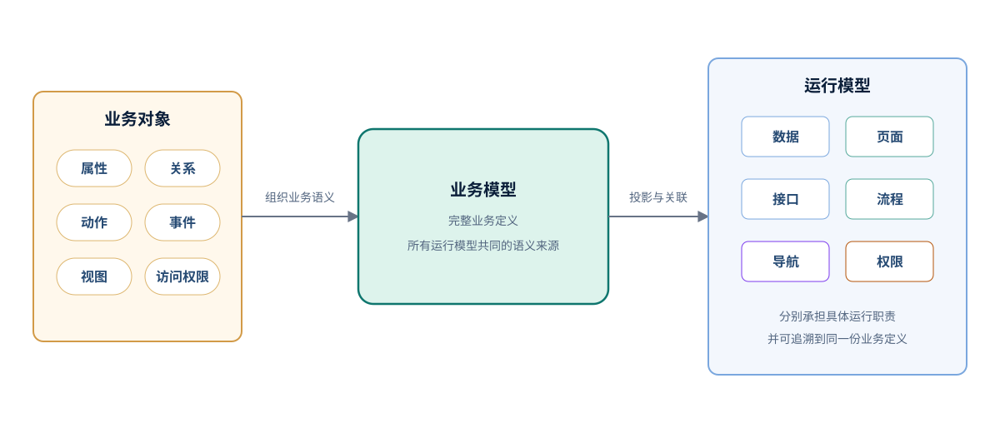

开发首先要回答业务对象是什么、彼此有什么关系、遵循什么规则，以及谁可以做什么。数据如何存储、页面如何呈现、接口如何调用，都围绕这些业务含义展开。

业务语义为需求讨论、系统设计和后续维护提供共同的理解基础。技术实现可以调整，对业务的描述应当能够保留下来，成为判断变更影响和继续演进的依据。

这份清楚的业务表达也为 AI 提供了理解应用的依据。业务概念、关系和约束能够被直接读取，AI 就可以据此理解功能、生成实现和检查结果，减少从代码中反推业务意图的工作。开发者与 AI 围绕同一份业务含义协作。

### 声明式开发

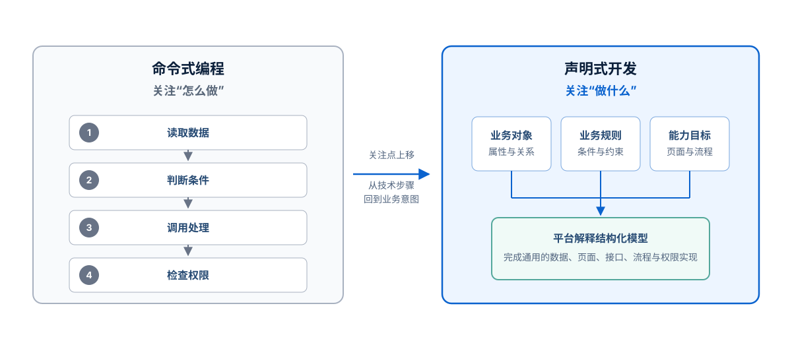

命令式编程关注“怎么做”，开发者需要逐步安排读取、判断、调用等执行过程。声明式开发关注“做什么”，开发者先说明业务目标、规则和约束，由平台承担通用的执行过程。

这种分工把开发者的关注点拉到更接近业务的层面。同一份业务声明可以用于校验、比较和执行，通用实现也可以持续改进，减少各个应用重复处理技术细节的工作。

### 聚焦业务价值（二八原则）

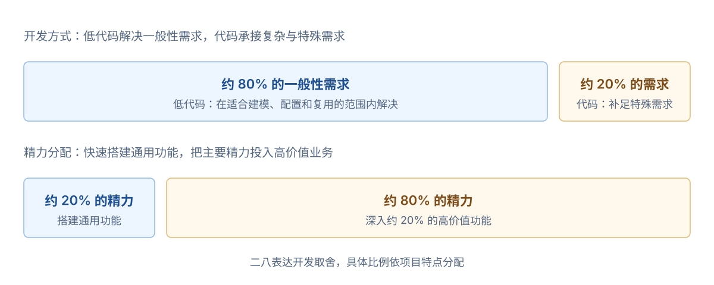

二八原则体现在两个方面。首先是开发方式的分工：低代码着重解决约 80% 的一般性开发需求，在适合建模、配置和复用的范围内提高效率；其余约 20% 的复杂或特殊需求交给代码实现。平台保留完整的代码扩展能力，让低代码覆盖范围之外的需求也有实现途径。

另一个方面是开发精力的分配。信息系统中，大量支撑和外围功能不可缺少，但业务价值密度相对较低；真正形成业务差异的功能，往往只占一小部分。潮汐栈希望开发者用约 20% 的精力，通过低代码搭好约 80% 的通用功能，再把约 80% 的精力投入约 20% 的高价值功能。开发方式由此服务于业务价值，也让精力和工作量得到更合理的安排。

这里的比例表达开发取舍，具体项目应按需求特点分配。

### 经验复用

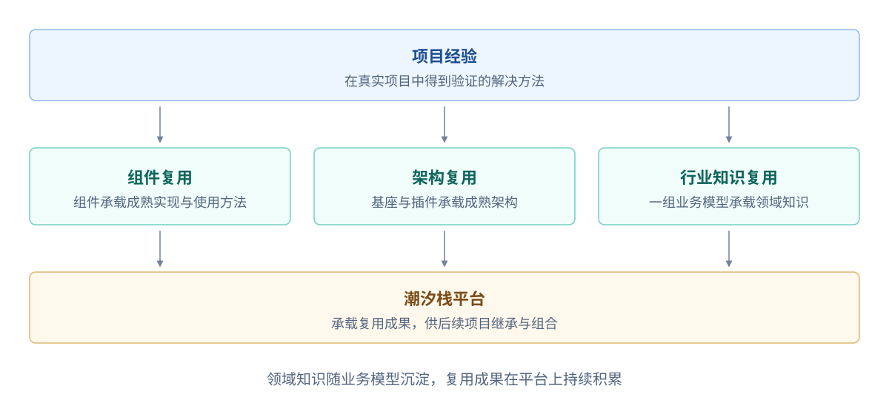

复用的核心是把已经验证的解决方法带到后续项目中。组件复用保存成熟的实现和使用方法，架构复用保存能力组织与协作方式，行业知识复用保存业务概念、规则和解决方案。它们都是经验的载体，复用的价值也包含对问题的认识、设计取舍和适用条件。

潮汐栈就是这些复用成果的载体。组件、基座和模型把经验保存为应用可以继承的能力，让后续项目直接建立在已有积累之上，把新的投入用于业务差异。

行业知识的复用主要体现在业务模型上。一组相互关联的业务模型承载一个领域的业务概念、关系、规则和行为，也承载对这个领域的理解与实践经验。项目可以复用这组模型，并将经过验证的新经验继续补充进去，使领域知识随平台一起积累。

### 标准与规范先行

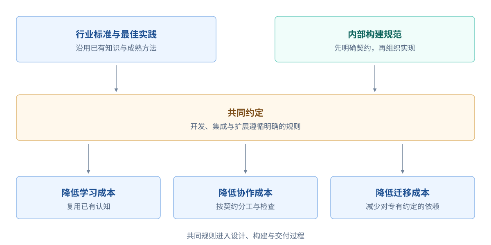

平台遵循行业标准、规范和成熟的工程实践，使开发者已有的知识能够直接用于理解平台、接入系统和维护应用。接口、格式与行为采用共同约定，有助于减少专有知识带来的学习和迁移负担。

内部构建同样从规范开始：先明确模型、接口和扩展的契约及协作规则，再据此组织实现。团队成员沿用相同的约定理解问题、划分职责和检查结果，降低沟通与集成成本，也让后续维护和迁移有据可循。

### 微核心与插件化

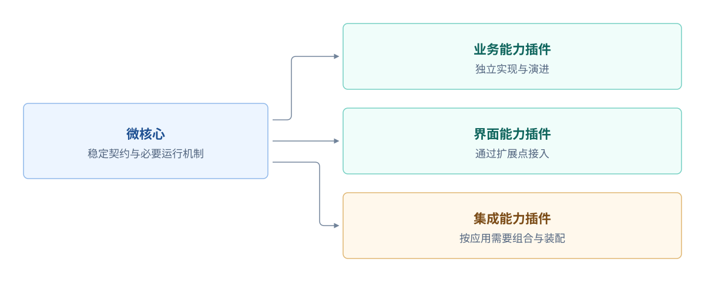

平台把稳定契约和必要的运行机制留在核心，将具体能力组织为独立插件。核心保持精简，业务与技术能力围绕核心提供的契约分别演进。

插件通过明确的扩展点接入，并按应用需要组合、装配。新的能力和实现可以独立补充，核心保持稳定；不同应用复用同一套运行机制，同时保留各自的能力组合。

### 开闭原则

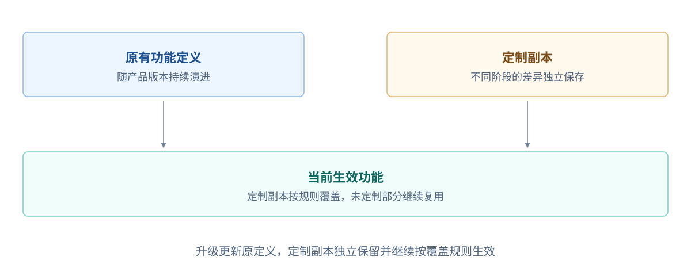

同一项功能可以在产品建设、项目实施和运行使用等不同阶段继续定制。定制时保留原有定义，将修改保存为独立副本，再按优先级覆盖原定义。每个阶段都能保留自己的差异，原有功能也可以持续维护和升级。

版本升级更新原有功能，定制副本独立保存，并继续按覆盖规则生效。产品演进与项目定制由此拥有各自的修改空间，升级过程不会直接覆盖项目保存的定制内容，减少产品线开发与实施交付之间的相互牵动。

### 开放性原则

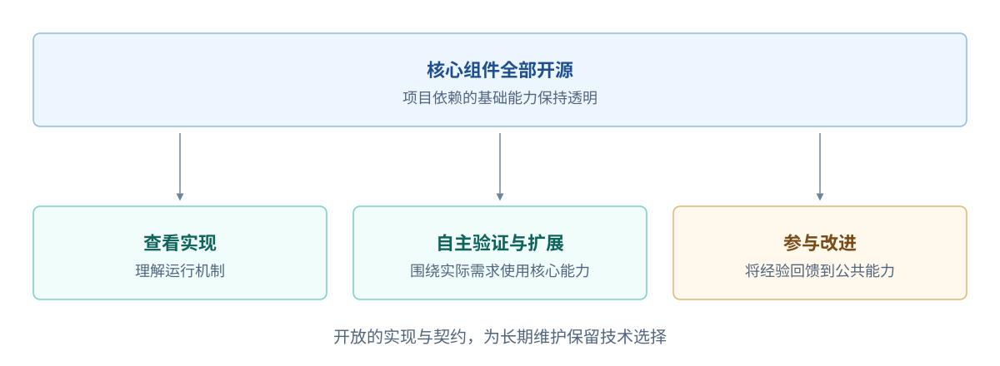

潮汐栈的核心组件全部开源。开发者能够查看实现、理解运行机制，围绕实际需求验证和扩展能力，也可以参与改进。项目依赖的基础能力保持透明，团队能够在使用过程中积累自主维护所需的知识。

开源与行业标准、明确的扩展契约共同支撑平台的开放性。外部系统、工具和开发者可以据此接入平台，复用已有能力，也让项目在长期维护中保有技术选择和持续演进的空间。

### 追求先进生产力

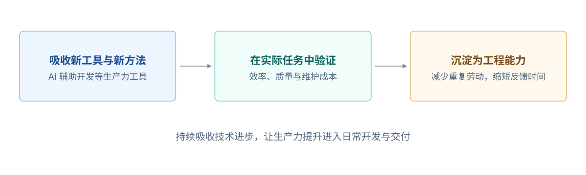

技术选择以提高实际生产力为目标。能够减少重复劳动、缩短反馈时间、帮助解决复杂问题的新工具和新方法，应当持续进入开发与交付过程，让开发者有更多精力投入业务判断和创造性工作。

AI 辅助开发是这一理念在当前阶段的体现。平台把检索、生成和重复性检查交给工具，开发者负责目标判断、设计取舍与成果评审。采用新工具时，以实际任务中的开发效率、交付质量和维护成本判断效果，让技术进步转化为可以持续积累的工程能力。

## 核心概念

### 模型、元数据与业务模型

| 概念 | 在平台中的作用 |
| --- | --- |
| 模型 | 以结构化形式表达业务或技术对象的语义、约束和能力需求 |
| 元数据 | 保存模型的声明式定义，使模型可以被校验、比较、版本化和装载 |
| 业务模型 | 集中表达业务对象及其属性、关系、动作、事件和访问权限，是平台模型体系的语义中心 |

模型规定平台如何理解业务和技术对象，元数据让模型能够保存和流转，业务模型则把最接近业务本身的语义组织起来。后续的数据、页面、接口、流程和权限模型，都从这三个概念继续展开。

### 元数据分层加载

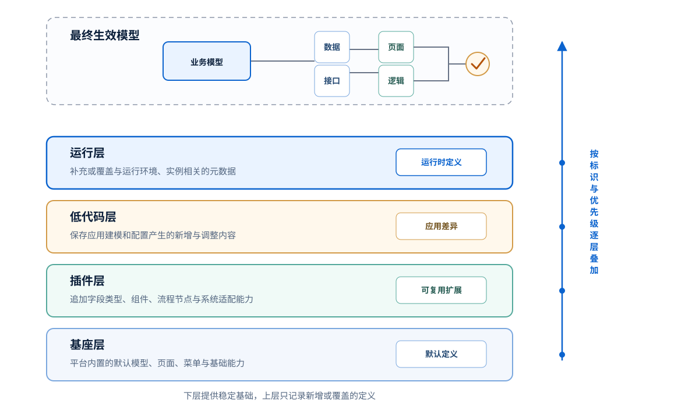

元数据分为基座层、插件层、低代码层和运行层。基座层提供平台内置的默认定义，插件层追加可复用能力，低代码层保存当前应用通过建模和配置形成的差异，运行层也可以定义元数据，补充或覆盖与运行环境、实例相关的内容。

分层加载时，平台按标识和优先级叠加各层定义，得到当前环境最终采用的完整定义。这个过程类似分层文件系统：下层保留原有内容，上层记录新增或覆盖的差异；同一标识在上层重新定义时，按对应模型的合并规则和优先级生效。项目可以在自己的层次扩展应用，无需复制或直接修改整套基础定义。

### 高低代码融合

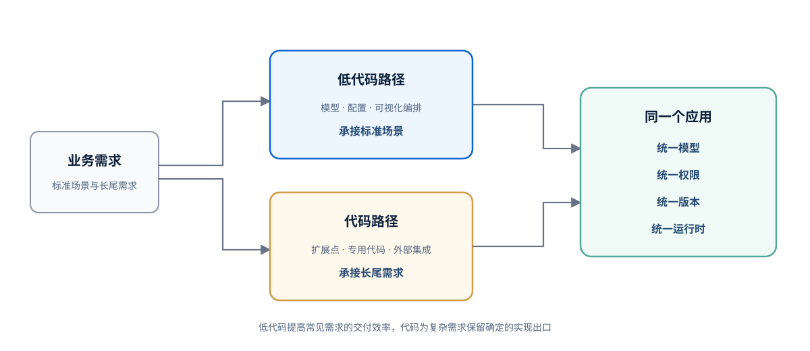

低代码与代码扩展共同构成应用。模型、配置和可视化编排承接标准场景；专用算法、协议、复杂交互和既有系统集成，可以通过代码实现。

两种开发方式共享模型契约和运行机制。开发者通过字段类型、逻辑流节点、页面组件、微前端和接口处理器等扩展点补充能力，再由模型引用这些能力。代码扩展可以与低代码定义组合使用，并继续接受平台的装配、权限和生命周期管理。

### AI 开发融合

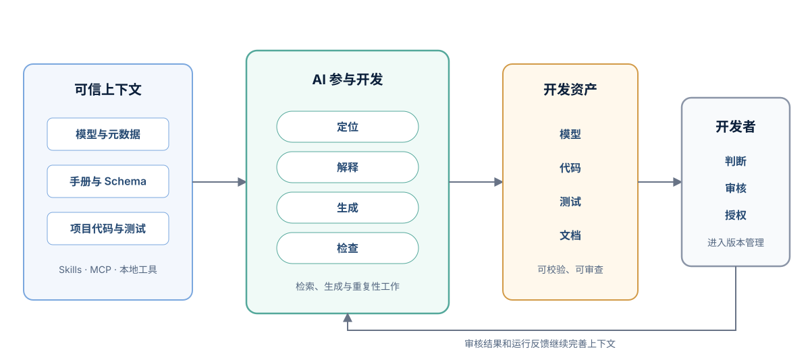

业务模型集中声明业务对象、属性、关系、动作、事件和权限，为 AI 提供可以直接读取的业务语义。这与本体建模有相通之处：用明确的概念、关系和约束表达领域知识。AI 可以从这些声明中理解功能及其约束，减少通过代码逆向分析业务意图的工作。

声明式开发也为大模型提供了清晰的生成目标。AI 可以在已有模型、Schema 和平台能力的范围内生成或调整定义，再通过结构校验和运行验证检查结果；需要代码扩展时，仍沿用相同的业务语义和扩展契约。

手册、Schema、Skills 和 MCP 分别提供说明、格式约束、任务指引和工具入口，帮助 AI 检索资料、理解模型、生成模型或代码并执行检查。产出进入已有的模型、代码和测试资产，由开发者评审，并纳入版本管理。

### 基座

基座提供应用共用的运行能力。应用通过模型、资源和代码扩展表达自己的业务，由基座加载并执行这些定义，复用页面呈现、数据访问、逻辑执行和权限控制等通用实现。

| 概念 | 职责 |
| --- | --- |
| 前端基座 | 根据 UI 模型、UI Schema、菜单等定义组织页面与导航，承载页面渲染、微前端运行及前端公共能力 |
| 后端基座 | 加载模型元数据与扩展，提供数据访问、业务动作、逻辑流、审批、接口和业务公共服务 |
| 统一基座 | 即统一运行时基座，由前端基座与后端基座协作构成，通过 HTTP、WebSocket 连接，共同承载应用 |

“统一”体现在前后端围绕同一套应用定义协作。前端呈现业务界面，后端执行业务规则并校验权限，两者分别保留自己的框架和技术支撑。开发平台创建的测试运行环境也使用这套基座加载应用。

## 核心模型：从业务语义到运行能力

业务模型把一个业务对象的属性、关系、动作、事件和访问权限放在一起描述，再将其中的语义投影到数据、页面、接口、流程、导航和权限等模型。应用的构建由此围绕同一份业务定义展开，运行中的变化和反馈也可以回到后续建模与版本演进中。

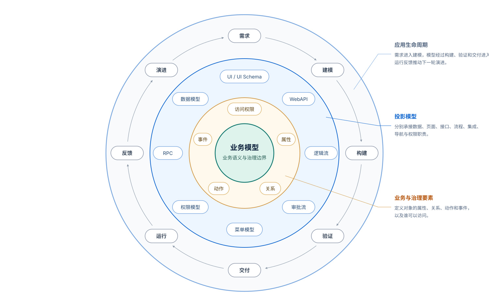

图中的内层是业务对象及其约束，中层是承接具体运行职责的投影模型，外层是从需求、建模到运行反馈的应用生命周期。三层围绕同一份业务语义展开。[模型化](./modeling/)进一步解释模型、元数据和执行引擎如何分工。

[模块模型](./module-model/) 组织应用内的功能归属，[业务模型](./business-model/) 处在业务语义中心，描述平台需要理解和实现的业务对象。

围绕业务模型，[数据模型](./data-model/) 承担数据结构和访问语义，[UI 模型](./ui-model/) 承担页面入口，[WebAPI 模型](./webapi-model/) 承担 HTTP 契约，逻辑流和审批流分别承接机器执行与人员参与的流程。菜单、权限、组织、配置和 RPC 模型继续补充导航、治理和集成能力。这些模型的职责与协作方式见 [核心模型与关系](./modeling/#核心模型与关系)。

## 模型间关系

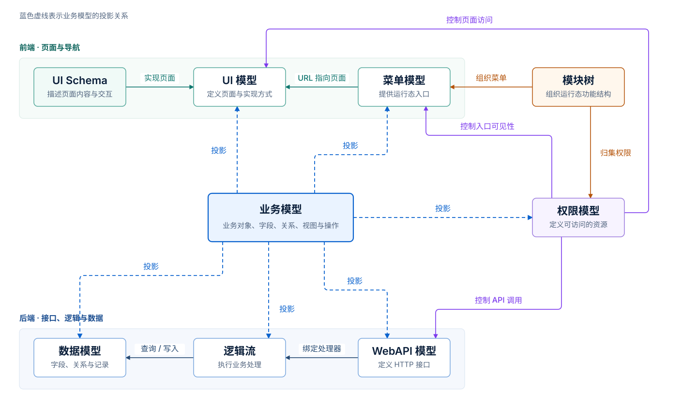

模型之间通过包含、归属、投影、引用、调用、实现和治理等关系协作。关系类型决定了语义从哪里来、由谁执行，以及哪些模型会约束其他模型。

业务模型通过投影把业务语义展开到相应的低维模型，每个目标模型仍然保留自己的契约和生命周期。运行时，WebAPI 把请求交给逻辑流或代码处理器，逻辑流再通过数据模型访问数据，因此 WebAPI 与数据模型之间没有直接关系。UI 模型定义页面入口和实现方式，UI Schema 描述页面内容与交互；模块组织功能归属，菜单指向页面入口，权限模型分别约束菜单、页面、接口和数据访问。[核心模型与关系](./modeling/#核心模型与关系)对这些关系作了完整说明。

## 开发平台总体架构

潮汐栈以开发平台为中心，组织模型设计、融合扩展、联调验证和版本交付。开发平台创建并管理测试运行环境和开发助手，模型与数据资产连接应用的设计与运行；统一运行时基座提供模型运行、执行引擎、业务公共服务和集成能力，基础设施提供前后端框架、存储、中间件与容器网络。

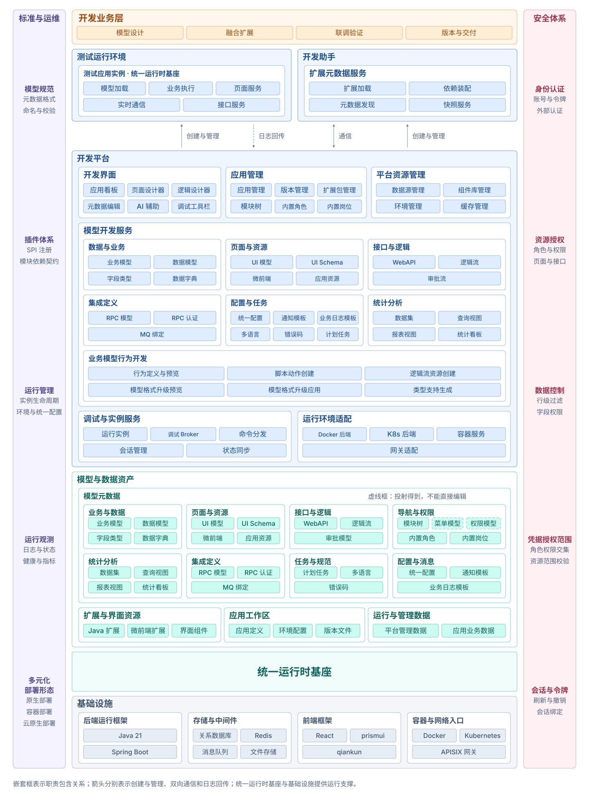

开发助手发现扩展元数据，为开发平台提供模型定义；测试运行环境由开发平台按需创建，其中的基座加载当前应用并执行业务。元数据规范、扩展契约、运行管理和安全约束贯穿各层。[开发平台总体架构](./architecture/#开发平台总体架构)进一步说明各层职责与开发、运行之间的协作。

## 统一运行时基座总体架构

统一运行时基座由前端基座和后端基座共同承载应用。前端组织页面呈现、微前端运行及其公共能力，后端装配模型定义与扩展，提供业务服务。

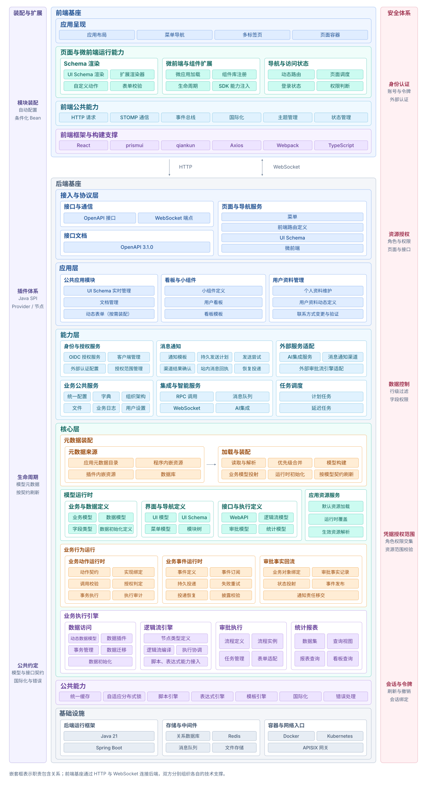

前端基座在内部组织页面、运行能力和技术支撑，通过 HTTP 与 WebSocket 连接后端。后端基座自下而上由基础设施、公共能力、核心层、能力层、应用层和接入与协议层组成。核心层完成元数据装配、模型运行、业务动作执行、事件投递与审批事实回流，并提供执行引擎和应用资源服务。能力层提供身份授权、消息通知、计划任务与延迟任务调度及外部集成；应用层组合公共应用模块、看板与小组件和用户资料管理。接入与协议层提供接口与通信、接口文档和页面导航服务，安全体系同时约束用户角色权限和凭据授权范围。[统一运行时基座总体架构](./architecture/#统一运行时基座总体架构)展开各层能力和运行机制。
