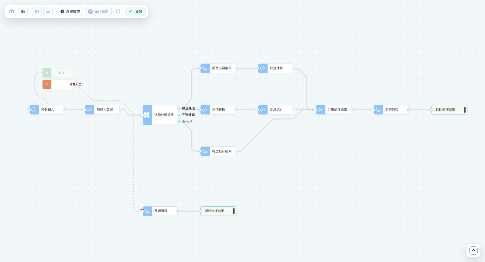
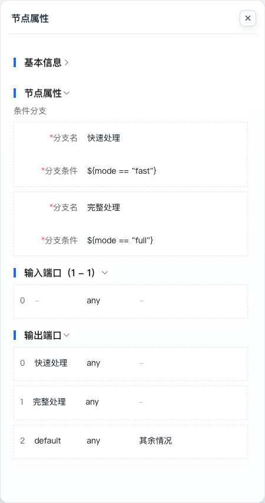

# 逻辑流模型

逻辑流模型用节点和连线描述一段自动执行的处理过程。校验输入、查询数据、选择分支、转换结果和调用外部服务，都可以成为流程中的一步。节点声明要做什么，连线声明数据如何传递，引擎据此组织执行，并把结果交还调用方。

[业务模型](../business-model/)的动作可以投影为逻辑流，也可以单独定义逻辑流供接口、计划任务、消息消费或其他流程调用。前者的业务语义来自业务模型，后者由流程自身声明输入、处理步骤和返回结果。

## 看懂一条逻辑流



这是一条包含 13 个节点的批量数据处理示例，使用真实编辑器展示。主流程接收带有 `mode` 和 `items` 的对象，校验后去掉空项与重复项，再按处理策略分流：

- **快速处理**：提取必要字段，直接计算条目数量。
- **完整处理**：逐项转换数据，再汇总统计。
- **其他情况**：构造默认结果。

三条路径在“汇集处理结果”处重新汇合，随后封装响应并返回。下方的“整理错误 → 返回错误结果”属于错误处理路径，主流程失败后才会进入。它与上方路径的距离只是画布排版，不影响触发条件。

示例的输入可以是：

```json
{
  "mode": "full",
  "items": ["A", "B", "A", null]
}
```

按示例定义，完整处理路径会得到两个带有 `checked` 标记的条目，再封装到 `success`、`data` 组成的响应中。切换 `mode` 可以解释不同分支的行为；缺少必填属性则会进入校验失败的处理过程。[查看示例模型定义](.assets/batch-processing.logicflow.json)。

理解画布时，先找入口和成功终点，再沿连线阅读分支，最后看错误路径。每个节点都有自己的输入输出端口；连线连接的是两个端口，不只是画面上的两个矩形。

## 模型定义与运行时流程

逻辑流涉及三类定义：

| 对象 | 职责 |
| --- | --- |
| 流程元数据 `FlowModelMeta` | 保存流程属性、节点、端口、连线和画布坐标。 |
| 节点类型定义 `NodeDefine` | 为节点库提供名称、图标、分组、默认配置、属性面板和端口数量规则。 |
| 运行时流程 `FlowModel` | 将元数据构建为可执行节点，完成校验和编译，处理实际输入。 |

平台按照节点的 `type` 查找已注册的节点构建器，再把节点与连线组装为流程。结构、端口类型和资源引用等校验通过后，引擎将依赖关系编译为执行链。模型定义与节点实现共同决定行为，节点图标和属性面板本身不执行逻辑。

逻辑流采用**有向无环图**。执行顺序由连线和依赖关系决定，移动节点或调整 `nodes` 数组的顺序都不会改变依赖。需要逐项处理集合时，应使用集合节点或支持逐项执行的节点，无需在画布中连出回路。

### 流程属性

| 属性 | 作用 | 说明 |
| --- | --- | --- |
| `name` | 流程标识 | 调用方引用流程时使用的名称。 |
| `description` | 流程说明 | 说明处理目标、输入含义和预期结果。 |
| `entryNode` | 主流程入口 | 指定主流程开始执行的节点。 |
| `exitNode` | 显式出口 | 指定作为成功终点的节点；使用可达的成功返回节点时可以不设置。 |
| `errorEntryNode` | 错误入口 | 指定主流程失败后接收错误上下文的节点；可不设置。 |
| `inputDataType` | 输入类型 | 声明流程接收的数据类型，默认 `any`。 |
| `outputDataType` | 输出类型 | 声明流程返回的数据类型，默认 `any`。 |
| `nodes` | 节点集合 | 保存节点通用属性、端口和类型专属配置。 |
| `connections` | 连线集合 | 声明源输出端口与目标输入端口的连接。 |
| `nodePositions` | 画布布局 | 以节点名称为键保存位置，只影响显示。 |
| `isEnabled` | 流程启用状态 | 默认 `true`；关闭后流程不能正常执行。 |

### 输入输出与数据类型

流程输入由入口及其输入端口接收，沿连线逐步传递。代码调用采用位置参数：第一个参数对应输入端口 `0`，第二个参数对应端口 `1`，依此类推。传入参数数量必须满足实际输入端口的要求。

流程和端口使用的数据类型包括 `string`、`integer`、`long`、`float`、`double`、`boolean`、`date`、`datetime`、`time`、`object`、`array`、`map` 和 `any`。`any` 允许与其他类型连接，数值类型之间也允许兼容。

这些类型描述数据的大类。需要检查对象中的必填字段、数组项或字段取值时，应通过数据校验节点声明 JSON Schema。把输入类型设置为 `object`，并不能替代对对象内容的校验。

## 节点：处理步骤与可复用能力

节点类型决定一步处理能够执行什么。数据映射节点负责转换结构，条件分支节点负责选择路径，数据访问节点通过[数据模型](../data-model/)读写记录。节点是否可用，取决于当前环境加载的模块和插件。

### 节点通用属性

| 属性 | 作用 | 说明 |
| --- | --- | --- |
| `nodes[].name` | 节点标识 | 在同一流程内唯一；入口、出口、连线和坐标均通过它引用节点。 |
| `nodes[].description` | 节点说明 | 解释这一步的用途。 |
| `nodes[].type` | 节点类型 | 引用已注册的节点类型，例如 `mapping`、`switch` 或 `script`。 |
| `nodes[].inputPorts` | 输入端口 | 声明节点接收的数据，数量受节点类型规则约束。 |
| `nodes[].outputPorts` | 输出端口 | 声明节点向后续步骤传递的数据，数量受节点类型规则约束。 |
| `nodes[].isAsync` | 异步调度 | 默认 `false`；开启后，在输入就绪时异步调度该节点。 |
| `nodes[].isEnabled` | 节点启用状态 | 默认 `true`；关闭后节点及与它相连的连接不参与有效执行图。 |
| `nodes[].extraProps` | 类型专属属性 | 在模型对象中保存附加配置；序列化为 JSON 时按属性名平铺，例如直接写 `script`，不包在 `extraProps` 对象内。 |

停用节点不会自动把上游接到下游。调整启用状态后，应重新检查剩余路径是否完整，尤其是入口、成功终点和必需的输入。

### 常见节点如何分工

| 类别 | 典型节点 | 适用情况 |
| --- | --- | --- |
| 数据准备与转换 | 定义常量、数据映射、提取属性、剔除属性 | 整理输入或输出结构。 |
| 集合处理 | 过滤、去重、提取元素、并集、交集、差集 | 对已有集合进行选择和变换。 |
| 路径控制 | 条件分支、互斥汇集、成功返回 | 选择处理路径、汇集互斥结果或确定返回值。 |
| 校验与局部计算 | 数据校验、脚本节点 | 检查数据格式或实现局部算法。 |
| 数据访问 | 查询、插入、更新、删除、计数 | 通过数据模型访问记录，保留模型的校验和插件行为。 |
| 流程复用与系统集成 | 调用流程、RPC 调用、发送消息、发送通知 | 复用独立过程或接入外部能力。 |

业务动作、事件、访问控制和审批操作也可以由相应扩展提供节点。审批流负责人员参与、任务状态和长时间等待，逻辑流负责其中即时执行的自动处理。

### 常见节点的专属属性

以下属性写在对应类型的节点对象中。相同属性名在不同节点中应按各自定义理解。

| 节点类型 | 属性 | 说明 |
| --- | --- | --- |
| 数据校验 `validate` | `schema` | 用 JSON Schema 校验输入；通过后原样输出，失败时抛出校验异常。 |
| 数据映射 `mapping` | `mapping` | 声明目标字段及取值表达式。 |
| 数据映射 `mapping` | `mappingEachItem` | 默认 `false`；开启后对集合中的每一项分别映射。 |
| 数据映射 `mapping` | `conflictStrategy` | 字段冲突时采用的策略，默认 `OVERWRITE`；还支持 `SKIP`、`MERGE`、`ERROR`。 |
| 条件分支 `switch` | `conditions` | 按声明顺序排列的条件集合。 |
| 条件分支 `switch` | `conditions[].name` | 分支名称，用于识别对应输出端口。 |
| 条件分支 `switch` | `conditions[].description` | 说明分支的含义。 |
| 条件分支 `switch` | `conditions[].expression` | 决定该分支是否命中的表达式。 |
| 脚本 `script` | `language` | 使用的脚本语言，默认 `groovy`；可用语言取决于已加载的脚本能力。 |
| 脚本 `script` | `script` | 节点执行的脚本正文，其结果作为节点输出。 |
| 合并对象 `merge` | `deepMerge` | 默认 `false`；开启后递归合并嵌套对象。 |
| 调用流程 `callFlow` | `flowName` | 被调用的逻辑流名称。 |
| 调用流程 `callFlow` | `executeForEachItem` | 默认 `false`；开启后对集合中的每一项调用流程并收集结果。 |
| 调用流程 `callFlow` | `resultWrapperKey` | 为结果增加一层对象包装；留空时直接输出结果。 |

## 端口与连线：数据如何传递

一个节点可以有多个输入或输出端口，端口序号从 `0` 开始。例如合并对象节点的两个输入端口分别接收两个对象；分支节点的多个输出端口则代表不同路径。具体数量由节点类型的端口规则、节点元数据和连接共同确定。

### 输入端口属性

| 属性 | 作用 | 说明 |
| --- | --- | --- |
| `nodes[].inputPorts[].name` | 端口名称 | 识别输入，也可用于表达式和脚本中的命名访问。 |
| `nodes[].inputPorts[].description` | 端口说明 | 解释输入数据的含义。 |
| `nodes[].inputPorts[].dataType` | 输入类型 | 默认 `any`，用于端口类型兼容性检查。 |
| `nodes[].inputPorts[].exclusiveGroupId` | 互斥组标识 | 端口元数据中的分组属性；路径选择主要由输出端口和节点实现决定，填写输入端口不会自动形成分支。 |
| `nodes[].inputPorts[].defaultBranch` | 默认分支标记 | 默认 `false`；普通输入端口无需设置，不能用它指定节点的默认输入值。 |

### 输出端口属性

| 属性 | 作用 | 说明 |
| --- | --- | --- |
| `nodes[].outputPorts[].name` | 端口名称 | 识别输出或分支。 |
| `nodes[].outputPorts[].description` | 端口说明 | 解释输出数据或路径条件。 |
| `nodes[].outputPorts[].dataType` | 输出类型 | 默认 `any`，用于与下游输入端口进行兼容性检查。 |
| `nodes[].outputPorts[].exclusiveGroupId` | 互斥组标识 | 同一节点中属于同组的输出端口表示互斥路径，供校验与支持选择性输出的节点使用。 |
| `nodes[].outputPorts[].defaultBranch` | 默认分支标记 | 标记同组条件均未命中时的默认路径；必须指定互斥组，同组最多一个默认分支。 |

互斥属性需要节点实现配合。给普通节点的输出端口填写一个互斥组，不会使它自动具备条件判断和分流能力。条件分支节点会根据条件自动组织这些输出端口。

### 连线属性

| 属性 | 作用 | 说明 |
| --- | --- | --- |
| `connections[].label` | 连线标题 | 在画布上显示的名称，不参与条件判断。 |
| `connections[].description` | 连线说明 | 解释连接用途。 |
| `connections[].sourceNode` | 源节点 | 引用数据来源节点。 |
| `connections[].sourceOutputPort` | 源输出端口 | 源节点的输出端口序号。 |
| `connections[].targetNode` | 目标节点 | 引用接收数据的节点。 |
| `connections[].targetInputPort` | 目标输入端口 | 目标节点的输入端口序号。 |

改变端口顺序会影响按序号连接的数据对应关系。调整端口时，需要同时核对相关连线和按位置取值的脚本。

### 画布坐标

| 属性 | 作用 | 说明 |
| --- | --- | --- |
| `nodePositions.<节点名>.x` | 横向坐标 | 保存节点在画布中的横向位置。 |
| `nodePositions.<节点名>.y` | 纵向坐标 | 保存节点在画布中的纵向位置。 |

坐标只服务阅读。即使一个节点在画面左侧，只要它依赖右侧节点的输出，也必须等待该输出就绪。

## 条件分支与结果汇集

### 选择一条路径



示例中的“选择处理策略”包含两个条件和一个默认输出。条件按顺序判断，首个命中后选择对应输出；全部未命中时走 `default`。输入值会传给选中的输出端口，其余输出标记为路径未激活。

未激活路径上的节点会被跳过，这个状态还会继续向下游传递。它与数据值为 `null` 有区别：`null` 可以是合法输入，而未激活表示本次没有选择这条路径。

### 互斥汇集与合并对象

“汇集处理结果”把三条互斥路径接到同一个输入端口。引擎等待相关上游完成后，排除未激活的路径，取得本次实际命中的结果。校验需要能够证明这些来源互斥；它不按到达先后抢占结果。

**合并对象**解决另一个问题：从多个输入端口接收对象，并组合其中的字段。它需要各路输入都参与这一步处理。若把互斥分支分别接到合并对象节点的不同输入端口，未激活的输入会使该节点被跳过，无法得到预期的合并结果。

因此，选择“本次有效的一个结果”使用互斥汇集，组合“本次都需要的多个对象”使用合并对象。

## 表达式、脚本与流程复用

表达式适合取值、字段映射和简短条件，脚本适合局部计算，逻辑流负责组织步骤和依赖。示例把处理策略保留为分支节点，把逐项转换放在脚本中，使路径和算法各自清楚。

映射、分支和脚本等使用通用节点上下文的节点，可以按以下方式访问输入：

| 访问方式 | 含义 |
| --- | --- |
| `$0` | 第一个输入端口的数据。 |
| `$1` | 第二个输入端口的数据，其他端口依此类推。 |
| `$request` | 名为 `request` 的输入端口数据；实际名称由端口定义决定。 |
| `mode` | 只有一个输入且该输入为对象映射时，可直接访问展开后的 `mode` 字段。 |

例如，示例分支使用 `${mode == "full"}`，也可以通过第一个输入对象访问相应属性。脚本节点使用所选语言的语法；Groovy 中可以写 `return $0.items.size()`。这些变量来自当前节点的输入，不能据此访问画布上任意其他节点的内部数据。

一段处理具有独立的输入输出，并且需要在多个入口复用时，可以定义为单独的逻辑流，通过 `callFlow` 节点调用。子流程名称必须可解析，其输入输出也要与调用节点相匹配。逐项调用只声明对集合每项执行，不代表批处理自动具有统一事务或失败补偿。

## 执行、返回与错误处理

### 依赖与异步调度

节点在所需输入就绪后执行。`isAsync=true` 会把这一步提交为异步调度，下游仍然等待它的结果。异步标记不提供持久化任务、失败重试或断点续跑能力，也不代表事务上下文会自动跨线程传递。

存在多个不互相依赖的路径时，应通过连线表达真正的先后约束。例如“写入完成后发送通知”需要让通知依赖写入结果，仅把两个节点摆成左右顺序并不足够。

### 成功终点

流程可以通过 `exitNode` 指定显式出口，也可以通过 `return` 类型的成功返回节点给出结果。示例主流程以“返回处理结果”结束，因此没有额外配置 `exitNode`。

一次执行应当命中一个成功终点。若不同分支各自返回，需要能够静态证明这些终点互斥。成功返回节点输出的是它收到的第一个输入值；执行器会等待当前执行范围内的节点完成，再处理最终结果，返回节点不会取消其他仍在运行的路径。

### 错误路径与错误上下文

未设置 `errorEntryNode` 时，主流程失败会向调用方传播。设置错误入口后，引擎把失败信息整理为对象，交给错误路径处理。示例中的“整理错误”据此构造错误响应，再由单独的成功返回节点返回。

| 错误上下文字段 | 含义 |
| --- | --- |
| `exceptionType` | 异常类型的简单类名。 |
| `exceptionMessage` | 异常消息。 |
| `exceptionCode` | 标准化后的错误码。 |
| `flowName` | 出错流程的名称。 |
| `flowInputs` | 本次流程调用的输入。 |
| `nodeName` | 能够定位时，记录出错节点名称。 |
| `nodeInputs` | 能够取得时，记录出错节点的输入。 |

错误上下文提供可传递的错误信息，不包含完整异常对象。错误路径也必须到达明确的成功终点，才能把本次失败转换为正常返回；若错误处理再次失败，失败继续向外传播，不会反复进入同一错误入口。

返回错误响应只是改变调用结果。已经发生的数据库写入、消息发送和外部调用是否能回滚，取决于对应入口、事务和外部系统能力，不能从存在错误路径推断它们都会撤销。

## 校验与执行验证

结构校验会检查入口与成功终点、环路、节点配置、端口连接与类型、资源引用，以及分支互斥和结果是否明确等问题。编辑器可提供即时提示，后端校验负责核对实际构建规则与引用资源。

### 校验状态属性

| 属性 | 作用 | 说明 |
| --- | --- | --- |
| `validationState` | 派生校验状态 | 有错误或诊断时为 `INVALID`；已有校验时间且没有错误时为 `VALID`；尚无校验结果时为空。 |
| `validationSummary` | 校验摘要 | 概括校验发现的问题。 |
| `validationErrors` | 错误列表 | 保存错误消息。 |
| `validationDiagnostics` | 结构化诊断 | 保存问题涉及的节点、端口、连线与字段位置。 |
| `lastValidatedTime` | 最近校验时间 | 记录校验结果的时间。 |

这些字段记录校验结果，无需作为业务处理参数填写。单个结构化诊断可以包含以下属性：

| 属性 | 含义 |
| --- | --- |
| `validationDiagnostics[].diagnosticKind` | 诊断类别。 |
| `validationDiagnostics[].message` | 问题说明。 |
| `validationDiagnostics[].nodeNames` | 相关节点名称。 |
| `validationDiagnostics[].scope` | 问题所属执行范围。 |
| `validationDiagnostics[].fieldPath` | 元数据中的问题字段路径。 |
| `validationDiagnostics[].portKind` | 输入或输出端口类别。 |
| `validationDiagnostics[].portIndex` | 端口序号。 |
| `validationDiagnostics[].sourceNode` | 相关连接的源节点。 |
| `validationDiagnostics[].sourceOutputPort` | 相关连接的源输出端口。 |
| `validationDiagnostics[].targetNode` | 相关连接的目标节点。 |
| `validationDiagnostics[].targetInputPort` | 相关连接的目标输入端口。 |

校验通过后，还需要通过真实调用验证输出和副作用。对于示例这样的多分支流程，应分别覆盖快速处理、完整处理、默认路径和输入校验失败，并在调试会话中核对节点实际输入输出。画布上出现“正常”，只说明当前检查未发现结构问题，不能替代执行验证。

## 常见问题

### 为什么节点在画布上靠前，却没有先执行？

节点位置不决定执行顺序。检查连线、输入依赖，以及上游是否选择了通向该节点的分支。

### 为什么合并后面的节点被跳过？

先判断需要汇集互斥结果，还是合并多个对象。一个节点的任意输入未激活时，该节点会被跳过；互斥分支应按互斥汇集规则连接。

### 是否必须设置出口节点？

可以指定 `exitNode`，也可以使用可达的成功返回节点。关键是每次执行都能得到明确、唯一的成功结果。

### 为什么保存成功，调用仍然失败？

保存表示定义已写入，不保证后端校验和实际执行都成功。检查后端诊断、流程启用状态、引用资源和本次输入，再查看调试会话中的出错节点。

## 扩展阅读

- [逻辑流菜单](../../low-code/development-platform-menus/logicflow)：创建、编辑、校验与查看调试会话。
- [扩展逻辑流](../../guide/advance/extend-backend/extend-logicflow/)：注册自定义节点能力。
- [平台支撑资源](../supporting-resources/)：节点类型定义与其他支撑资源。
