# 模型化

潮汐栈通过模型，把对各个领域的认识转化为可定义、可组合、可执行、可持续演进的应用。业务对象、页面交互、处理逻辑和接口各有自己的概念与规则，模型把这些认识保存为明确的定义，基座据此提供运行能力。

开发应用的过程，也是使用和积累这些定义的过程。开发者在模型中表达需求，通过模型之间的协作构建功能，再在已有模型上增加扩展与定制。领域知识和实现经验因而能够随应用保存，成为后续开发的起点。

## 模型是对领域共性的归纳

模型来自对一类问题的归纳。前端交互需要描述组件、数据和事件，后端逻辑需要组织步骤、分支与调用，接口需要确定输入、输出和访问方式。各个应用的具体功能不同，这些领域中仍然存在可以共同使用的结构与规则。

潮汐栈把这些共性定义为不同的模型，具体应用再用模型表达自己的内容。

| 领域 | 提炼出的共性 | 模型中的表达 |
| --- | --- | --- |
| 业务对象 | 对象的结构、行为与使用规则 | 业务模型中的属性、关系、动作、事件、视图与权限 |
| 前端交互 | 页面内容的组织方式与交互规则 | UI Schema 中的组件结构、数据绑定、事件与动作 |
| 后端逻辑 | 处理步骤、分支与能力调用 | 逻辑流中的节点、连线、参数与执行规则 |
| 前端路由 | 页面如何被识别和访问 | UI 模型中的页面路径与页面实现绑定 |
| 后端接口 | 请求与响应的契约 | WebAPI 模型中的路径、方法、参数、响应与处理器绑定 |

**抽象化**使同类问题有了共同的表达。不同接口处理的业务可以不同，但请求方法、参数和响应仍有相同的结构；不同逻辑流完成的任务可以不同，但处理过程都可以用节点、分支和连线组织。模型确定稳定的概念，应用定义其中的具体内容。

**标准化**使这种表达成为各方共同遵循的契约。接口的参数名称、类型与约束有明确含义，编辑器、校验器和执行引擎就可以按同一份定义工作；开发者也能用一致的术语讨论需求、检查实现和判断变更。

**单一职责与组合**使不同领域能够各自演进。页面模型关注交互，接口模型关注请求与响应，逻辑流关注处理步骤。它们通过引用、调用和实现绑定协作，应用功能由这些职责的组合形成。

**声明与实现分离**让应用定义与通用处理各有归属。模型描述应用需要的结构和规则，基座提供读取、校验、渲染与执行能力。同一套基座能力可以处理不同的应用定义，应用也能在模型契约内绑定专用实现。

模型也保存了经验。业务模型承载对业务领域的认识，页面、逻辑和接口等模型分别承载相应领域的设计经验。经过归纳和验证的解决方法可以继续用于其他应用，无需在每个项目中重新组织一套表达。

## 模型化的优势

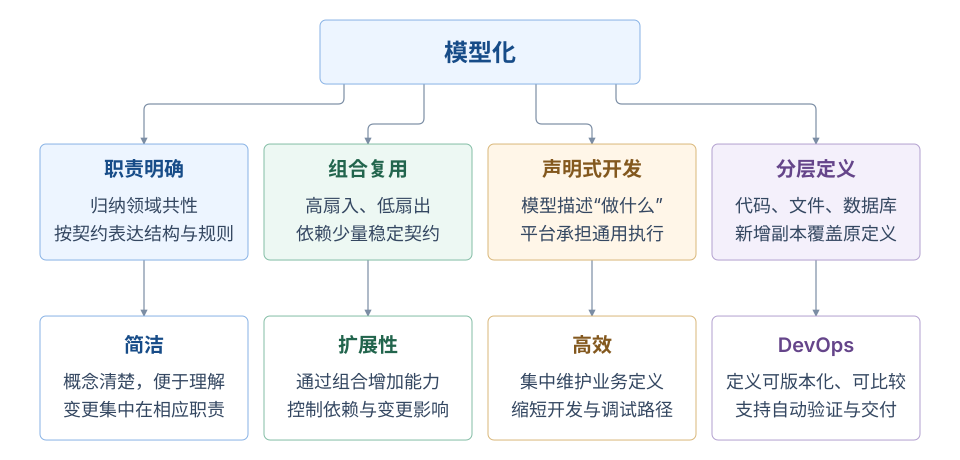

*模型化如何支撑软件设计：归纳领域共性，建立稳定契约，再由模型组合应用能力。*

共同的表达方式让应用定义更容易理解，明确的职责与契约让能力可以组合，声明与实现分离则减少了重复的技术处理。这些特性贯穿开发、维护与交付，带来以下优势。

- **简洁，便于理解与维护。** 每种模型使用所属领域的概念表达问题，并保持明确职责。开发者可以直接查看页面、逻辑或接口定义，理解它要完成什么，修改也更容易集中在对应位置。
- **通过组合扩展能力。** 多个页面可以使用同一接口，多条逻辑流可以复用同一种节点能力。公共能力被多处使用，使用方只依赖需要的契约，有助于形成高扇入、低扇出的协作结构，控制新增功能带来的依赖与变更影响。
- **让开发与调试集中于应用差异。** 页面呈现、数据访问和逻辑执行中的通用处理由基座维护，开发者主要定义具体内容、规则与协作关系。已有能力可以继续使用，开发与排查也有明确的定义作为依据。
- **便于持续集成与交付。** 结构化定义可以纳入版本管理、比较变更并执行校验；分层定制使公共定义与项目差异能够分别维护，为自动验证、升级和持续交付提供基础。

## 从模型定义到应用运行

模型定义保存应用需要什么，基座提供处理这些定义的通用能力。页面定义描述组件与交互，逻辑流描述步骤与分支，数据模型描述数据结构与访问规则，接口定义描述请求与响应。基座依据各自的定义组织页面、执行业务处理、访问数据和分派请求，让声明成为应用行为。

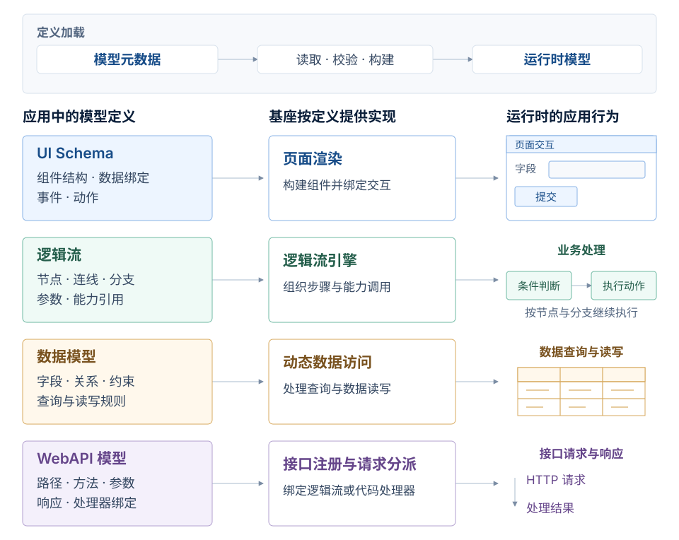

*模型定义如何成为应用行为：应用定义内容与规则，基座提供可复用的实现。*

**模型、元数据与运行时模型**分别对应表达规则、具体定义和运行对象。模型规定一个领域可以表达的概念与规则；元数据保存具体应用填写的结构、参数、约束和引用；运行时模型则是基座读取、校验并构建这些定义后，供相应运行服务使用的对象。

定义进入运行环境后，各类模型按自己的职责发挥作用。UI Schema 中的组件与数据绑定由页面渲染能力使用；逻辑流的节点与连线由逻辑流引擎组织执行；数据模型约束查询与读写；WebAPI 的请求方法、路径和参数用于接口注册与请求分派。接口绑定逻辑流或代码处理器，实际处理过程再按需要访问数据。

这种分工就是声明式开发在平台中的体现。开发者维护应用的内容与规则，基座维护可以复用的执行过程。定义中的字段、引用和约束也为可视化编辑、结构校验和 AI 辅助开发提供了共同依据，各环节围绕同一份含义协作。

## 通过模型协作构建完整应用 {#核心模型与关系}

一种模型聚焦一个领域，完整应用则需要多个领域共同参与。潮汐栈用业务模型集中表达业务含义，再由数据、页面、接口、逻辑和权限等模型承担各自的职责。模型之间通过投影、引用、调用和实现绑定建立协作。

### 以业务对象组织完整语义

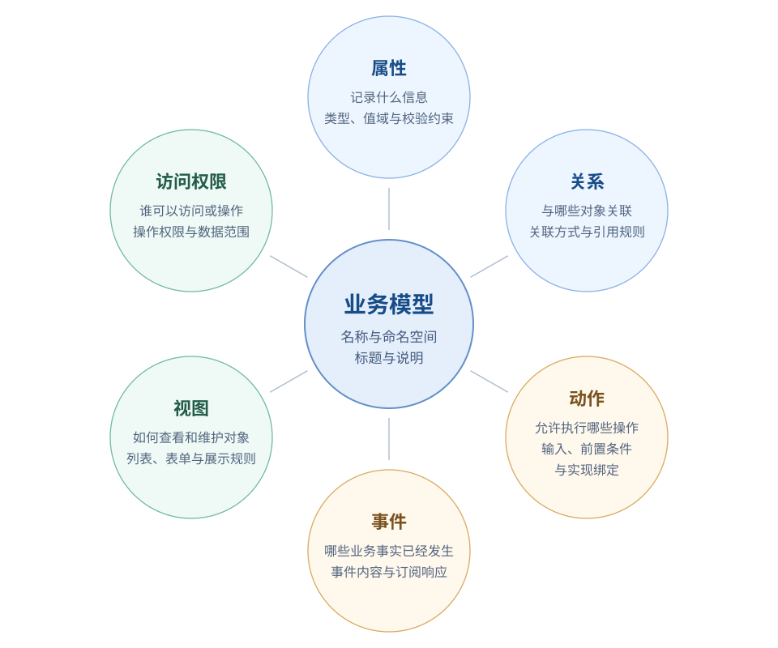

*业务模型的六个要素：同一对象的结构、行为和使用规则，在模型中形成完整的业务表达。*

[业务模型](../business-model/) 从业务对象出发，把对象的结构、行为和使用规则组织在一起。名称与命名空间用于稳定地识别对象，标题和说明解释它的业务含义，六个要素进一步描述对象如何参与应用。

| 要素 | 要表达的内容 |
| --- | --- |
| 属性 | 对象记录哪些信息，各项信息采用什么类型，遵循哪些值域和校验约束 |
| 关系 | 对象与其他对象如何关联，哪些信息通过关联取得 |
| 动作 | 对象允许执行哪些业务操作，操作接受什么输入，满足什么条件，由什么实现处理 |
| 事件 | 对象会产生哪些业务事实，事件携带什么内容，哪些订阅需要响应 |
| 视图 | 对象如何被查询、展示和维护，列表、详情与表单各自呈现什么 |
| 访问权限 | 谁能够查看或操作对象，可以访问哪些记录和字段 |

这些要素共同约束一个对象的行为。属性类型影响数据访问和页面编辑，关系影响查询与展示，动作遵守权限和前置条件，动作产生的事件又可以由订阅继续处理。业务模型把这些含义联系起来，使一项业务需求在数据、界面和处理过程中保持一致。

### 从业务语义到专门职责

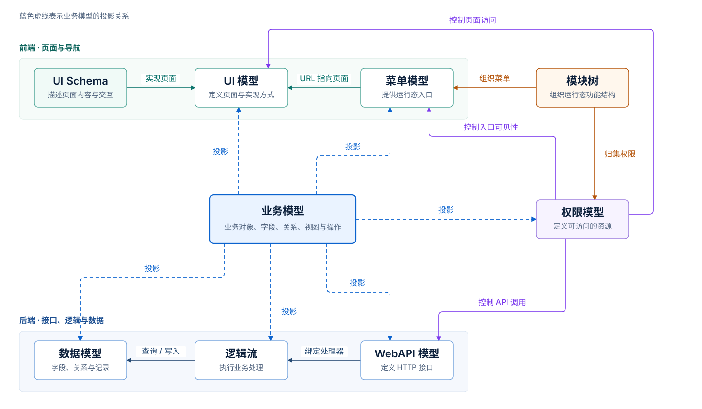

*业务模型与专门职责模型的关系：蓝色虚线表示业务语义的投影，其他连线标明引用、实现与权限约束。*

业务模型中的含义通过投影落实到承担专门职责的模型中：属性与关系展开为[数据模型](../data-model/)，视图展开为 [UI 模型](../ui-model/) 和 [UI Schema](../ui-schema/)，业务操作展开为接口、逻辑及相应权限定义。各个目标模型共享语义来源，减少在数据、页面和接口中重复定义同一件事的工作。

从语义覆盖范围看，业务模型同时描述对象的结构、行为和使用规则，属于高维模型；数据模型、UI 模型和 [WebAPI 模型](../webapi-model/)等分别聚焦数据、页面或接口，属于低维模型。投影把完整的业务语义按这些专门职责展开，各个目标模型遵守自己的契约，并保持与业务模型的语义联系。

投影由平台的模型装配机制完成，参与的目标模型及投影规则取决于业务定义和已装配的能力。模型体系中也包含独立定义的模型；需要定制时，在相应模型支持的范围内覆盖定义或绑定专用实现。

### 通过契约组合不同职责

模型间的关系决定它们如何协作，也决定修改会影响哪些地方。投影说明语义从哪里来，引用说明定义依赖谁，调用说明执行时把处理交给谁。

| 关系 | 含义 | 平台中的体现 |
| --- | --- | --- |
| 投影 | 同一份业务语义按目标模型的职责展开 | 业务模型中的属性与关系投影到数据模型 |
| 引用 | 定义通过标识使用另一个对象 | 字段引用数据字典，菜单引用页面路径 |
| 调用 | 执行过程中把处理交给另一个能力 | WebAPI 调用逻辑流，逻辑流使用数据访问或 RPC 能力 |
| 实现 | 为模型契约提供具体的呈现或执行方式 | UI Schema、微前端实现 UI 模型对应的页面 |
| 归属 | 将定义纳入功能组织结构 | 业务模型归属于模块 |
| 权限约束 | 限制对象的可访问范围和允许操作 | 权限控制菜单、页面、接口及数据访问 |

一次页面请求就会涉及多种协作。UI 模型提供页面入口，UI Schema 或[微前端](../micro-web-model/)实现内容与交互；页面通过接口请求业务处理，WebAPI 将请求交给逻辑流或代码处理器，处理过程再使用数据模型访问数据。**WebAPI 模型与数据模型之间没有直接关系**，两者通过执行实现协作。

专用实现也通过模型契约接入。例如，逻辑流节点通过类型与参数引用执行能力；新增节点实现后，逻辑流仍用同一套节点、连线与参数规则组织处理过程。代码承担具体执行，模型保留用途、配置和协作关系。

这样的分工体现了**单一职责与接口隔离**。页面布局在交互定义中调整，接口参数在接口契约中声明，处理步骤在逻辑流中组织。页面只需理解接口的输入与输出，逻辑流按节点契约调用能力，协作双方都可以减少对内部实现的依赖。

共享契约也让组合复用成为可能。多个页面可以使用同一个接口，多条逻辑流可以使用同一种节点能力。被多处使用的公共能力形成高扇入，使用方依赖少量稳定契约有助于保持低扇出。模型化追求通过复用扩大能力的使用范围，同时控制每个定义需要了解和依赖的内容；实际的依赖数量仍需在设计中持续维护。

## 模型关系总览 {#完整模型拓扑}

各类模型通过投影、引用、调用、实现、归属和权限约束联系起来。除页面、数据与业务逻辑外，完整的应用还会使用组织授权、审批、外部集成、任务调度和统计分析等定义。

[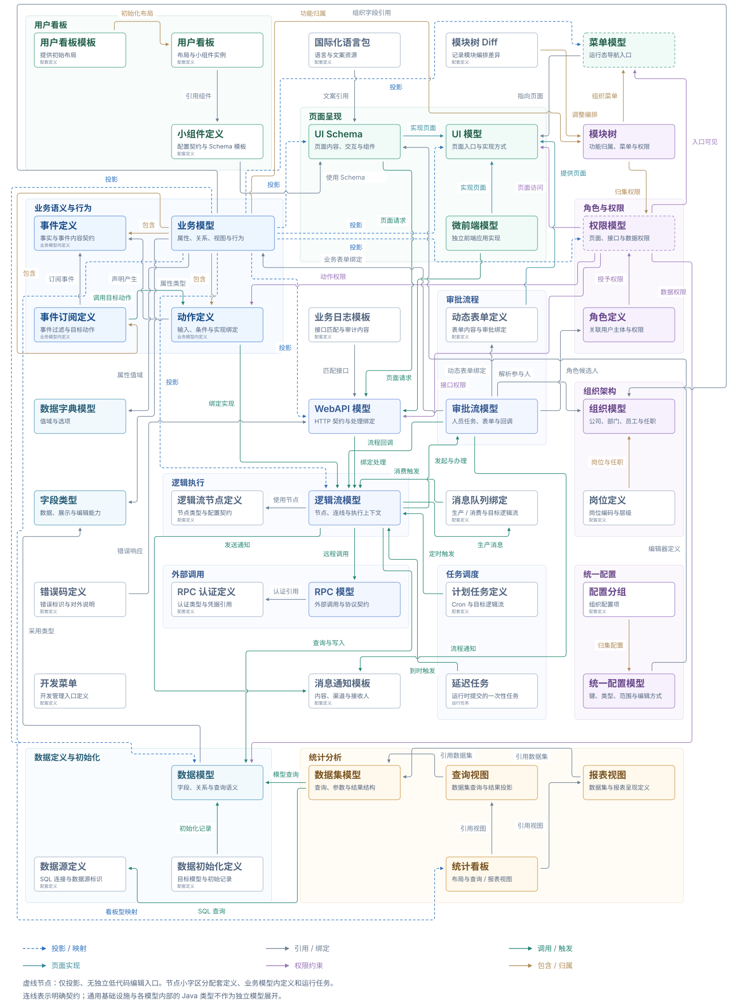](.assets/complete-model-topology.svg)

*模型关系总览：覆盖模型、业务行为与配套资源；虚线节点表示仅投影、没有独立低代码编辑入口的模型。*

### 页面与导航

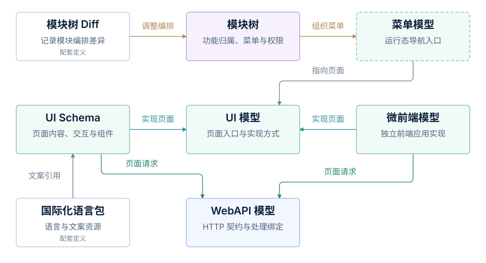

*页面入口、页面实现与接口调用：模块树组织功能，菜单指向页面，页面通过接口请求业务处理。*

模块树确定功能归属，模块树 Diff 保存编排调整；菜单组织运行时导航，UI 模型标识页面入口并绑定实现。UI Schema 与微前端分别提供页面内容与交互，两种页面实现都可以调用 WebAPI。国际化语言包为 UI Schema 提供文案。

### Web 接口

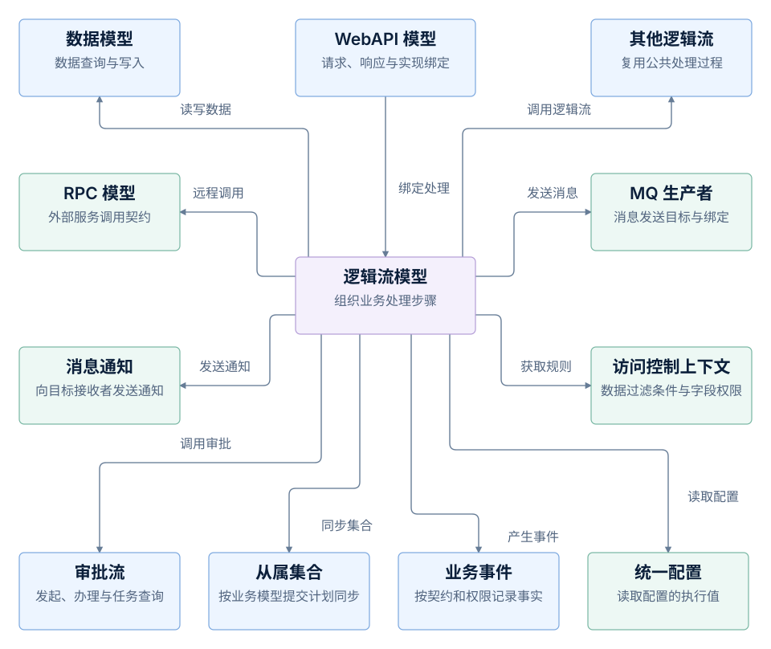

*Web 接口与逻辑流能力：WebAPI 绑定处理逻辑，逻辑流按需组合模型与平台能力；业务事件的产生遵循事件契约与生产权限。*

WebAPI 模型定义请求路径、方法、参数和响应，并绑定处理实现。使用逻辑流处理接口时，请求交给绑定的逻辑流，由逻辑流组织具体业务步骤，处理结果再通过接口返回。页面只需遵守接口契约，具体的数据访问与外部集成由处理逻辑完成。

逻辑流通过节点引用和使用其他模型：数据节点根据数据模型执行查询、新增、修改或删除；RPC 调用节点使用 RPC 模型发起外部服务调用；消息生产节点使用指定的 MQ 生产者绑定发送消息，绑定中定义发送目标等配置。各项能力按业务需要组合，执行顺序和分支由逻辑流中的节点与连线确定。

多个接口共用的处理过程还可以定义为独立逻辑流，再通过流程调用节点引用。接口契约、处理步骤、数据结构、外部服务契约和消息发送配置分别保存在各自的定义中，通过引用与调用组成完整的接口功能。

逻辑流还能接入审批、业务事件、消息通知等能力。各类节点把模型与平台服务接入同一执行过程，具体可用的节点取决于应用加载的模块与插件。

| 模型或平台能力 | 逻辑流中的操作 |
| --- | --- |
| 数据模型 | 获取数据模型、规范化查询条件、查询、分页查询、单条查询、计数、新增、批量新增、更新、部分更新、删除 |
| 其他逻辑流 | 调用已定义的逻辑流，复用公共处理过程 |
| RPC 模型 | 按 RPC 模型的契约调用外部服务 |
| MQ 生产者 | 按生产者绑定发送消息 |
| 审批流 | 发起审批流程、提交审批任务、获取任务详情、为业务记录附加流程与任务信息、按流程事件和状态分流 |
| 业务模型 | 按业务模型的提交计划同步从属集合；在符合事件契约与生产权限的上下文中产生业务事件 |
| 消息通知 | 发送通知 |
| 统一配置 | 读取配置的执行值 |
| 访问控制 | 获取当前数据访问过滤条件、允许访问的字段、禁止访问的字段 |

这些能力之间的参数传递、条件判断和结果整理，由逻辑流自身的处理节点完成：

| 处理能力 | 节点操作 |
| --- | --- |
| 对象与数据处理 | 定义常量、数据映射、合并对象、提取属性、剔除属性 |
| 集合处理 | 合并集合、交集、差集、过滤、去重、按位置提取元素 |
| 执行路径与返回 | 条件分支、互斥汇集、成功返回 |
| 数据校验 | 按 JSON Schema 校验数据 |
| 脚本执行 | 执行脚本，所用语言由已加载的脚本引擎提供 |
| 文件读取 | 读取 Excel |
| 异常处理 | 抛出平台异常 |

新的业务能力也可以通过节点扩展接入，使逻辑流继续按节点契约组织调用。

### 看板与小组件

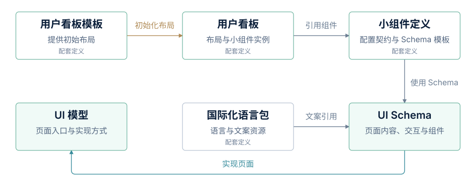

*看板、小组件与页面定义：模板提供初始布局，小组件定义通过 UI Schema 组织交互。*

用户看板模板提供初始布局，用户看板再引用小组件定义组织具体内容。小组件定义使用 UI Schema 描述呈现与配置方式，复用页面渲染和国际化能力。用户看板面向个人工作界面，与后面的统计看板分别承担不同职责。

### 业务动作与事件

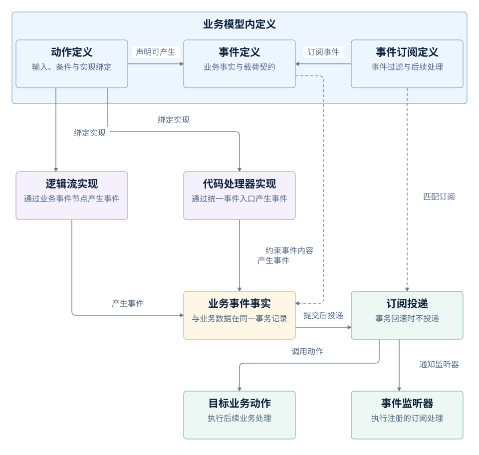

*业务动作、事件与订阅：动作声明允许产生的事件，逻辑流或代码处理器记录实际发生的业务事实；事务提交后，订阅把事件交给目标动作或监听器处理。*

动作、事件和事件订阅属于业务模型内部定义。动作声明输入、执行条件和可能产生的事件，并绑定逻辑流或代码处理器；事件定义业务事实及其携带的内容。订阅按事件与过滤条件调用目标动作，也可以交给注册的事件监听器处理，使后续处理围绕明确的业务含义衔接。

逻辑流作为业务动作的实现时，可以通过业务事件节点产生该动作允许的事件；代码处理器也可以通过统一的业务事件入口产生事件。动作中声明“可能产生哪些事件”确定了允许范围，实际何时产生、携带什么内容，由实现中的业务处理决定。部分标准数据写入动作还会由平台根据实际发生的数据变更记录相应事件。

业务事件与业务数据在同一个事务中记录，事务成功提交后再向订阅者投递；事务回滚时，相应事件也不会生效。因此，一次业务动作既可能返回处理结果，也可能通过事件带动后续动作。业务事件表达已经发生的业务事实，MQ 生产者负责向指定目标发送消息，两者各有自己的定义和执行机制。

### 逻辑执行、集成与调度

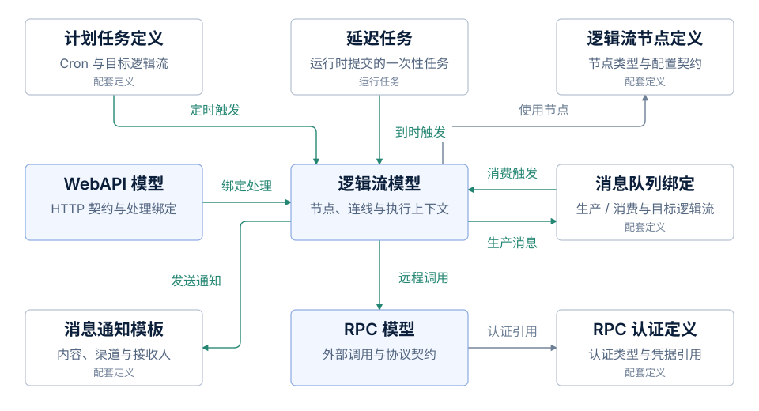

*逻辑执行、集成与任务触发：不同入口使用同一套逻辑流能力，逻辑流通过契约接入外部服务。*

WebAPI 把请求交给绑定的逻辑流，消息消费、计划任务和延迟任务也可以触发逻辑流。计划任务保存 Cron 等调度定义，延迟任务则是运行时提交的一次性任务。逻辑流使用节点定义组织执行，还可以通过 RPC 调用外部服务、生产消息或发送通知；RPC 认证定义为外部调用提供认证配置。

### 审批与表单

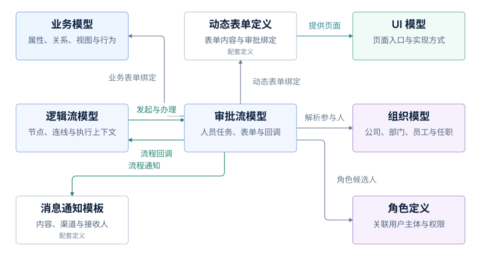

*审批、表单与参与人：审批流组织人员任务，表单承载办理内容，逻辑流负责程序处理与回调。*

审批流可以绑定业务模型提供的业务表单，也可以绑定动态表单定义；动态表单通过 UI 模型提供页面。组织模型与角色定义用于解析参与人和候选人。逻辑流可以发起或办理审批，审批流也可以回调逻辑流，并通过消息通知模板组织流程通知。

### 数据与统计分析

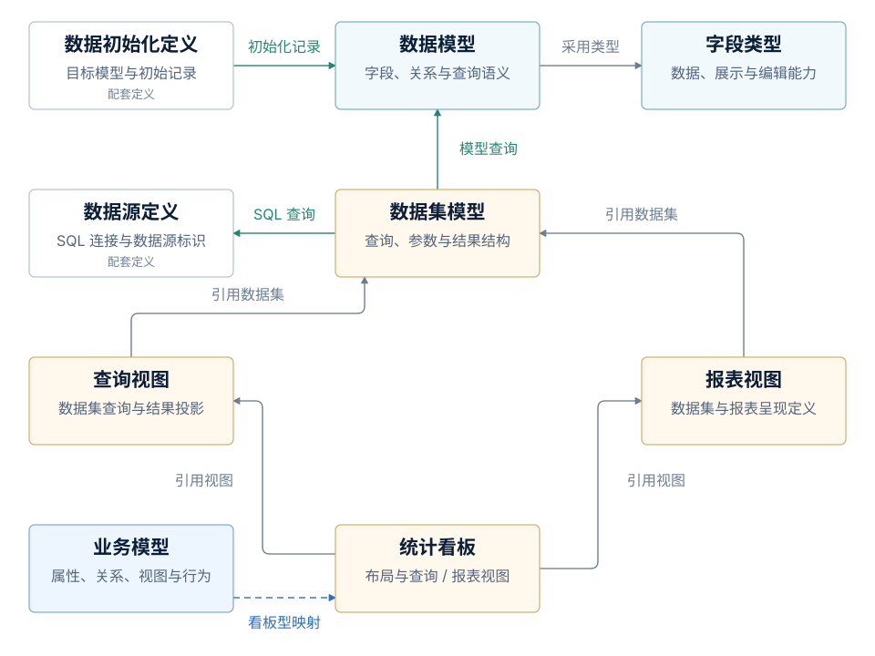

*数据访问、初始化与统计分析：数据集连接数据查询与结果呈现，统计看板组合查询视图和报表视图。*

数据模型使用字段类型定义数据能力，数据初始化定义向目标数据模型写入初始记录。数据集既可以查询数据模型，也可以通过数据源执行 SQL 查询。查询视图和报表视图引用数据集，统计看板再引用这些视图组织展示；看板型业务模型可以映射到统计看板。

### 组织与权限

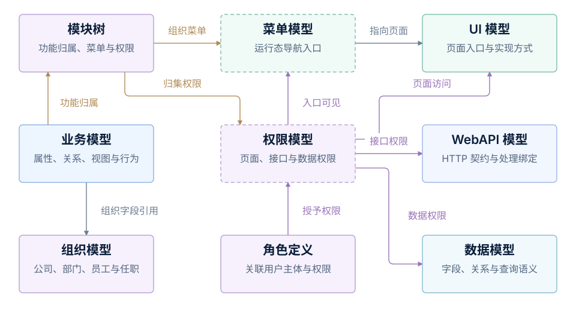

*功能归属、组织架构与权限约束：模块树归集功能权限，角色授予权限，各运行入口分别执行访问控制。*

业务模型归属于模块，并可以使用组织字段引用组织模型。模块树组织菜单、归集权限，角色定义关联用户主体与权限。权限模型分别约束菜单可见性、页面访问、接口调用与数据访问；隐藏菜单只影响导航展示，不能替代页面、接口和数据层的权限判断。

## 在复用中保留差异，让模型持续演进

一组经过验证的模型可以成为后续项目的起点。一组业务模型承载一个领域的对象、术语、规则和行为，相关的页面、逻辑和接口定义保存实现这些业务的组织方式。潮汐栈承载这些复用成果，新的应用在已有积累上构建，把新增投入用于自己的业务差异。

### 分层定义与开闭原则

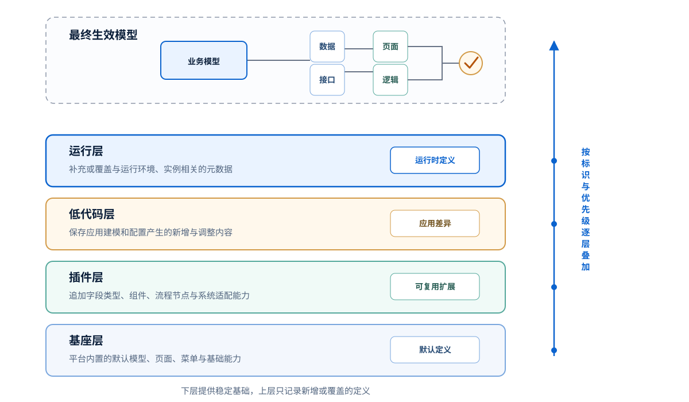

*元数据分层加载：不同来源的定义按相应模型的装配规则形成最终生效模型。*

复用需要容纳不同阶段的定制。基座层提供内置默认定义，插件层携带可复用能力，低代码层保存当前应用的建模与配置，运行层也可以定义元数据，保存运行环境和使用过程中的调整。

同一功能需要改变时，可以新增同名定制副本，在加载时按相应模型的优先级与处理规则选取或合并生效，原有定义仍保留在自己的来源中。这体现了**开闭原则**：对扩展开放，对修改关闭。定制通过新增定义实现，避免直接改写公共定义，使产品能力与项目差异能够分别维护。

产品升级时，公共定义可以继续更新，项目定制有独立的保存位置，减少产品线演进与实施交付之间的相互干扰。定制副本保留下来之后，仍需验证它与新版本的模型契约和业务行为是否兼容。

四层表达定义的来源与定制关系。具体优先级、整项覆盖或内容合并、修改何时生效，由相应模型实现决定，不能把所有模型都理解为支持四层存储、逐字段合并和即时刷新。实际装配规则见[模型装配](../architecture/#元数据装配与模型生效)。

### 在验证中积累新的经验

结构化定义让修改能够被检查和比较。模型文件可以进入版本管理，记录属性、动作、页面和引用关系的变化；类型、约束和引用校验可以在运行前发现一部分问题。实际的页面交互、业务处理、权限和外部集成还要结合场景验证，结构合法不能替代行为正确。

当一项定制经过使用和验证，具有共同价值的部分可以进一步归纳为可复用模型或扩展，补充到公共积累中。项目由此既使用已有经验，也留下新的经验；模型随应用演进，对领域的认识也在这一过程中逐步完善。
