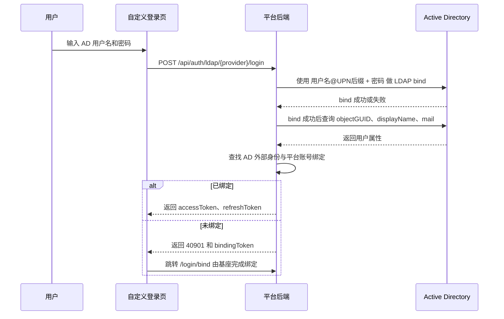

# AD 域认证方式适配指南

本指南把企业 Microsoft Active Directory 接入潮汐栈的 LDAP 认证链路：服务端使用用户凭据完成 bind、读取外部身份，再关联平台账号。实施需要目录管理员提供真实目录信息，开发者配置 provider 与登录页，运维人员确认网络和证书。

本方案需要用户输入 AD 用户名和密码，适用于 LDAP bind；Windows 已登录后的免密访问，以及 Kerberos、NTLM、SPNEGO 协商认证，应另行确定方案。

## 确定接入任务与认证流程

AI 可以基于脱敏目录信息、配置、SDK 和响应样例调整 provider、登录页及测试。开始前明确目标平台版本、实例、用户名规则与平台账号绑定方式；示例域名和 DN 不直接作为企业配置。

| 阶段 | 先确认什么 | 完成结果 |
| --- | --- | --- |
| 目录准备 | 域控、Base DN、UPN、稳定用户属性、证书与搜索权限 | 管理员确认连接和身份规则 |
| 后端配置 | bind 模式、provider key、认证与用户属性映射 | 测试账号可认证并取得稳定身份 |
| 页面接入 | LDAP 入口、SDK 调用、首次绑定与错误处理 | 用户能从登录页完成认证 |
| 交付 | 测试账号、验证记录、恢复方式与用户说明 | 可复验、可维护的登录链路 |

推荐使用 `adDirectBind` 的前提是用户凭据能够完成 bind，并有权限读取所需属性。该模式不额外配置只读搜索账号。



平台不保存 AD 密码。认证后的 `objectGUID` 等稳定标识用于外部身份绑定，登录成功后可访问哪些业务资源仍由平台角色和权限决定。

## 收集目录与身份信息

接入前建议向 AD 管理员确认以下信息。

| 信息 | 示例 | 用途 |
| --- | --- | --- |
| AD DNS 域名 | `corp.example.com` | 推导 Base DN，作为 UPN 后缀 |
| 域控地址 | `dc01.corp.example.com` | 组成 LDAP/LDAPS URL |
| LDAPS 端口 | `636` | 推荐使用加密连接 |
| Base DN | `DC=corp,DC=example,DC=com` | bind 成功后搜索用户属性 |
| UPN 后缀 | `corp.example.com` 或 `example.com` | 拼接 `username@domain` |
| NetBIOS 域名 | `CORP` | 仅当使用 `CORP\username` 时需要 |
| 稳定用户 ID 属性 | `objectGUID` | 外部身份绑定主键 |
| 展示属性 | `displayName`、`mail` | 平台用户展示和绑定提示 |
| 企业 CA 证书 | 根证书或中间证书 | 让 JVM 信任 AD 的 LDAPS 证书 |
| 用户查询权限 | 普通用户是否可读取自身属性 | 确认 `adDirectBind` 是否可查询属性 |

如果企业允许普通域用户读取自身 `objectGUID`、`displayName`、`mail`，优先使用无只读账号的 `adDirectBind`。如果不允许，改用 `search` 模式并配置只读服务账号。

### 核对目录名称与登录名

Base DN、UPN 后缀和 NetBIOS 域名用途不同，不能仅由同一个域名字符串替代。以下推导用于形成待确认值，最终与管理员提供的信息和实际搜索结果核对。

#### Base DN 推导

AD DNS 域名通常可以直接推导为 Base DN。

```text
corp.example.com -> DC=corp,DC=example,DC=com
example.com -> DC=example,DC=com
ad.company.local -> DC=ad,DC=company,DC=local
```

推导规则是把域名按 `.` 拆分，每段转换为一个 `DC=`。

#### UPN 与 NetBIOS

AD 常见两种登录名格式：

```text
zhangsan@corp.example.com
CORP\zhangsan
```

推荐使用 UPN 方式：

- 用户可以输入 `zhangsan`，平台拼成 `zhangsan@corp.example.com`。
- 用户也可以直接输入完整 UPN。
- 只需要知道 DNS 域名或 UPN 后缀。

只有企业明确要求 `CORP\zhangsan` 时，才使用 NetBIOS 模式。NetBIOS 域名不能总是从 DNS 域名可靠推导，必须向管理员确认。

#### 域控地址发现

Windows 加域时会通过 DNS SRV 发现域控。当前平台配置不自动发现域控，但实施人员可以用同样的 DNS 记录人工查询：

```bash
nslookup -type=SRV _ldap._tcp.dc._msdcs.corp.example.com
```

或：

```bash
dig SRV _ldap._tcp.dc._msdcs.corp.example.com
```

返回的主机名通常就是域控，例如：

```text
dc01.corp.example.com
dc02.corp.example.com
```

配置时优先使用 LDAPS：

```yaml
urls:
  - ldaps://dc01.corp.example.com:636
  - ldaps://dc02.corp.example.com:636
```

## 配置后端 provider

按目标实例既有配置加载方式应用以下配置。先验证单个测试 provider，再调整登录页默认方式或本地登录开关。

### 推荐配置：AD direct bind

这是最接近“只输入 AD 用户名密码验证”的配置方式。

```yaml
ouroboros:
  security:
    external-auth:
      ldap:
        - key: ad-default
          type: ldap
          display-name: 企业 AD
          enabled: true

          urls:
            - ldaps://dc01.corp.example.com:636
            - ldaps://dc02.corp.example.com:636

          base-dn: DC=corp,DC=example,DC=com
          mode: adDirectBind

          domain: corp.example.com
          login-id-mode: USER_PRINCIPAL_NAME

          search-filter: "(&(objectCategory=person)(objectClass=user)(!(objectClass=computer))(!(userAccountControl:1.2.840.113556.1.4.803:=2))(sAMAccountName={0}))"

          external-id-attribute: objectGUID
          attribute-mapping:
            displayName: displayName
            mail: email
            sAMAccountName: username
            userPrincipalName: userPrincipalName

      external-call:
        ldap:
          connect-timeout: 5s
          read-timeout: 10s
```

字段说明：

| 字段 | 推荐值 | 说明 |
| --- | --- | --- |
| `key` | `ad-default` | 前端调用 LDAP 登录时使用的 provider 标识 |
| `type` | `ldap` | 固定值，表示 LDAP/AD 直连认证 |
| `display-name` | `企业 AD` | 登录页展示名称 |
| `urls` | `ldaps://dc01...:636` | 域控 LDAPS 地址，推荐配置多个 |
| `base-dn` | `DC=corp,DC=example,DC=com` | 查询用户属性的搜索根 |
| `mode` | `adDirectBind` | 使用用户输入的账号密码直接 bind |
| `domain` | `corp.example.com` | UPN 后缀；裸用户名会拼成 `username@domain` |
| `login-id-mode` | `USER_PRINCIPAL_NAME` | 使用 UPN 方式 bind |
| `search-filter` | 见示例 | bind 成功后查询用户属性 |
| `external-id-attribute` | `objectGUID` | 平台绑定 AD 用户的稳定 ID |
| `attribute-mapping` | 见示例 | 将 AD 属性映射成平台外部身份属性 |

### 用户名输入规则

使用上面的配置时，推荐登录页提示用户输入：

```text
AD 用户名，例如 zhangsan 或 zhangsan@corp.example.com
```

后端行为：

- 输入 `zhangsan`：按 `zhangsan@corp.example.com` bind。
- 输入 `zhangsan@corp.example.com`：直接按完整 UPN bind。
- 输入 `CORP\zhangsan`：当前配置不推荐，除非改用 NetBIOS 模式。

### NetBIOS 模式

如果企业要求使用 `CORP\zhangsan`，配置改为：

```yaml
mode: adDirectBind
domain: CORP
login-id-mode: SAM_ACCOUNT_NAME
search-filter: "(sAMAccountName={0})"
```

这时 `domain` 填 NetBIOS 域名，不填 DNS 域名。

### UPN 后缀与 AD DNS 域名不同

很多企业的 AD 域是：

```text
corp.local
```

但用户实际登录名是：

```text
zhangsan@example.com
```

这时配置应分开：

```yaml
base-dn: DC=corp,DC=local
domain: example.com
login-id-mode: USER_PRINCIPAL_NAME
```

`base-dn` 反映 AD 目录域，`domain` 反映用户 UPN 后缀。

### 备用配置：search 模式

如果 AD 不允许普通用户读取自身属性，或 `adDirectBind` bind 成功后无法搜索到用户，可以改用 `search` 模式。

```yaml
ouroboros:
  security:
    external-auth:
      ldap:
        - key: ad-default
          type: ldap
          display-name: 企业 AD
          enabled: true
          urls:
            - ldaps://dc01.corp.example.com:636
          base-dn: DC=corp,DC=example,DC=com
          mode: search
          search-bind-dn: svc_ouroboros@corp.example.com
          search-bind-password-ref: env:LDAP_BIND_PASSWORD
          search-filter: "(&(objectCategory=person)(objectClass=user)(!(objectClass=computer))(!(userAccountControl:1.2.840.113556.1.4.803:=2))(|(sAMAccountName={0})(userPrincipalName={0})))"
          login-id-mode: AUTO
          external-id-attribute: objectGUID
          attribute-mapping:
            displayName: displayName
            mail: email
```

部署环境中配置服务账号密码：

```bash
export LDAP_BIND_PASSWORD='服务账号密码'
```

`search` 模式的服务账号只用于搜索用户 DN 和读取属性，不用于验证用户密码。用户密码仍然通过用户 DN bind 进行校验。

### 本地账号密码登录开关

如果希望登录页只展示 AD 登录，可以关闭本地账号密码登录：

```yaml
security:
  auth:
    login:
      localPassword:
        enabled: false
```

关闭本地登录不影响 LDAP 登录。LDAP 仍然需要用户名密码表单，因为 LDAP bind 本身就是凭据型登录。

### LDAPS 证书

推荐使用 `ldaps://...:636`。如果 AD 使用企业自签 CA，需将 CA 证书导入后端 JVM truststore，或在运行环境中提供可信证书链。

可用下面命令检查证书链：

```bash
openssl s_client -connect dc01.corp.example.com:636 -showcerts
```

如果 Java 报 PKIX、certificate_unknown 或 unable to find valid certification path，说明 JVM 还不信任该证书链。

## 接入登录页

登录页将 AD / LDAP 放在凭据登录区，与本地登录模式明确区分；CAS、OAuth2 / OIDC 使用跳转入口。按 `provider.type === 'ldap'` 选择 LDAP，提交的 provider key 与后端 `key` 一致。

| 运行配置 | 页面需要处理 |
| --- | --- |
| 本地与 AD 都可用 | 明确选中的凭据模式，避免把 AD 密码提交给本地入口 |
| 只有 AD | 显示 AD 表单，不因关闭本地登录而隐藏全部凭据输入 |
| 多个 LDAP provider | 展示可识别名称，提交当前选定的 key |
| provider 不可用 | 展示状态并限制该入口，提示管理员处理 |
| 首次绑定 | 进入基座 `/login/bind`，保留已处理的业务回跳目标 |

使用 `listExternalProviders()`、`isLocalPasswordLoginEnabled()`、`loginWithLdap()` 和 `mapAuthError()`；SDK 代码与 i18n 实现统一见 [自定义登录页与认证接入](./custom-login-page-and-auth-integration)。LDAP 的 `loginUrl` 为空是正常的，不应按单点登录按钮跳转。

页面只替换 `/login`。`/login/callback` 与 `/login/bind` 继续由基座负责，页面不保存 AD 密码或自行把平台访问 token 加到 URL。

AD 表单提示写明实际接受的用户名格式，例如 `zhangsan` 或 `zhangsan@example.com`；首次绑定说明使用已有平台账号，密码错误提示用户确认输入的是 AD 密码。

## 逐层调试

在后端测试环境按下面顺序操作。每一阶段都使用管理员确认的域名、目录和测试账号；网络或证书未通过时，先处理该层，再继续认证调用。

### 第一步：确认网络和证书

在平台后端所在机器上检查域控连通性：

```bash
nc -vz dc01.corp.example.com 636
```

检查 LDAPS 证书：

```bash
openssl s_client -connect dc01.corp.example.com:636 -showcerts
```

如果端口不通，先处理网络、防火墙或域控访问策略。如果证书不可信，先导入企业 CA。

### 第二步：确认 Base DN 和用户搜索

如果环境有 `ldapsearch`，可用用户 UPN 测试 bind 和搜索：

```bash
ldapsearch \
  -H ldaps://dc01.corp.example.com:636 \
  -D 'zhangsan@corp.example.com' \
  -W \
  -b 'DC=corp,DC=example,DC=com' \
  '(&(objectCategory=person)(objectClass=user)(sAMAccountName=zhangsan))' \
  objectGUID displayName mail userPrincipalName
```

预期能返回且只返回一个用户。如果返回 0 条，重点检查：

- `base-dn` 是否过窄或拼错。
- 用户是否不在该 OU 下。
- `search-filter` 使用的属性是否符合企业规则。
- UPN 后缀是否和 AD DNS 域不同。

### 第三步：确认 provider 列表

启动平台后，请求 provider 列表：

```bash
curl -s http://localhost:8080/api/auth/providers
```

预期能看到：

```json
{
  "success": true,
  "data": [
    {
      "key": "ad-default",
      "type": "ldap",
      "displayName": "企业 AD",
      "loginUrl": null,
      "availability": "healthy"
    }
  ]
}
```

排查方向：

- 没有 `ad-default`：检查配置是否加载、`enabled` 是否为 `true`、启动日志是否有配置校验错误。
- `availability` 不是 `healthy`：检查域控连通性和 LDAPS 证书。
- `loginUrl` 为 `null`：这是 LDAP provider 的预期结果，不是错误。

### 第四步：直接调用 LDAP 登录接口

用测试账号调用：

```bash
curl -s \
  -X POST \
  -H 'Content-Type: application/json' \
  http://localhost:8080/api/auth/ldap/ad-default/login \
  -d '{"username":"zhangsan","password":"用户AD密码"}'
```

可能结果：

| 结果 | 含义 | 下一步 |
| --- | --- | --- |
| 返回 `accessToken`、`refreshToken` | 登录成功且已绑定平台账号 | 继续验证前端登录 |
| 返回 `40901` 和 `bindingToken` | AD 验证成功，但尚未绑定平台账号 | 跳转 `/login/bind?token=...` 完成绑定 |
| 返回 `40101` 或 `40104` | 用户名密码错误或身份校验失败 | 检查账号、密码、登录名格式 |
| 返回 `50201` | provider 不存在、不可用或 AD 连接失败 | 检查配置、网络、证书和后端日志 |

### 第五步：验证自定义登录页

在浏览器中打开 `/login`，检查：

- 能看到 AD 登录方式。
- AD 登录按钮不是跳转式 SSO 按钮。
- 本地登录关闭时，AD 用户名密码表单仍保留。
- AD 首次登录后能进入 `/login/bind`。
- 绑定后再次登录能直接进入平台。

浏览器开发者工具中重点看：

- `GET /api/auth/providers` 是否返回 AD provider。
- `POST /api/auth/ldap/ad-default/login` 请求体是否包含 `username` 和 `password`。
- 登录失败时是否展示 `mapAuthError()` 映射后的用户文案。

### 常见问题

| 问题 | 常见原因 | 处理方式 |
| --- | --- | --- |
| `Provider not found or unavailable` | provider key 配错、配置未加载、provider 启动不可用 | 对齐前端 `providerKey` 与后端 `key`，检查启动日志 |
| `LDAP connection error` | 域控不可达、LDAPS 证书不可信、端口错误 | 检查网络和 JVM truststore |
| 用户密码正确但登录失败 | `domain` 或 `login-id-mode` 不匹配 | 确认使用 UPN 还是 NetBIOS |
| bind 成功但查不到属性 | `base-dn` 或 `search-filter` 不匹配 | 用 `ldapsearch` 验证搜索条件 |
| 首次登录进入绑定页 | 正常行为，AD 身份尚未绑定平台账号 | 使用平台账号完成绑定 |
| 每次登录都要求绑定 | `external-id-attribute` 变化或绑定记录未保存 | 固定使用 `objectGUID`，检查绑定数据 |
| AD 禁用账号还能搜索到 | 过滤器未排除禁用账号 | 增加 `userAccountControl` 禁用过滤 |

provider 列表正常不能单独证明用户搜索和绑定正确；`openssl` 或 `ldapsearch` 成功也不能代替 JVM 的证书及平台认证验证。最终使用同一测试账号贯通这些步骤。

## 业务验收与用户交接

| 场景 | 预期结果 |
| --- | --- |
| 未绑定测试用户首次认证 | AD 凭据通过后进入平台账号绑定，保留业务回跳目标 |
| 已绑定用户再次登录 | 使用同一稳定外部身份进入平台，不重复绑定 |
| 无效密码、禁用账号或格式错误 | 登录拒绝并展示可定位的错误 |
| 外部服务断开或证书不可信 | 认证失败可定位到依赖问题，不误报业务权限 |
| 登录成功但未授权 | 用户不能越过平台角色和数据权限 |
| 本地登录开关变化 | 页面入口与后端开关一致，AD 登录仍按配置工作 |

只对实际支持的用户名格式和认证组合记录通过结果。运行凭据通过目标环境既有配置注入；交给 AI 的任务上下文保留字段关系和脱敏日志即可。

给用户的操作说明包括：选择企业 AD、按提示输入目录账号、首次登录按需绑定平台账号、后续正常登录。给支持人员的交接按下面问题定位：

| 用户问题 | 支持人员检查 |
| --- | --- |
| 账号或密码错误 | AD 凭据、登录名格式和账号状态 |
| 每次要求绑定 | 稳定外部身份属性、绑定记录及配置是否变化 |
| 外部认证不可用 | provider、网络、域控和 JVM 证书 |
| 登录后没有业务权限 | 平台账号角色和数据范围 |

上线前保存 provider 与登录页配套配置、产物版本和恢复步骤。需要保留本地管理员恢复入口时，先确认实际开关与账号可用，不能仅在方案中写明后即视为可恢复。

## 相关文档

- [自定义登录页与认证接入](./custom-login-page-and-auth-integration)
- [权限与访问控制](./authority-subject-and-access-control-design)
- [本地 IDE 与线上平台联调](./local-ide-and-platform-debugging)
