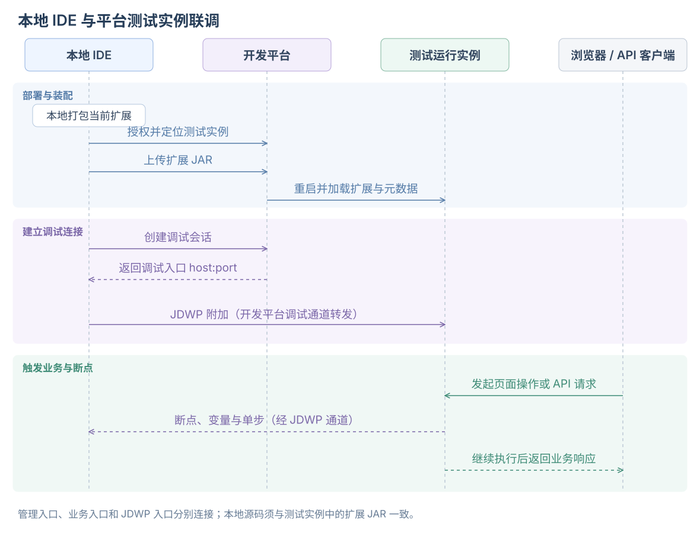
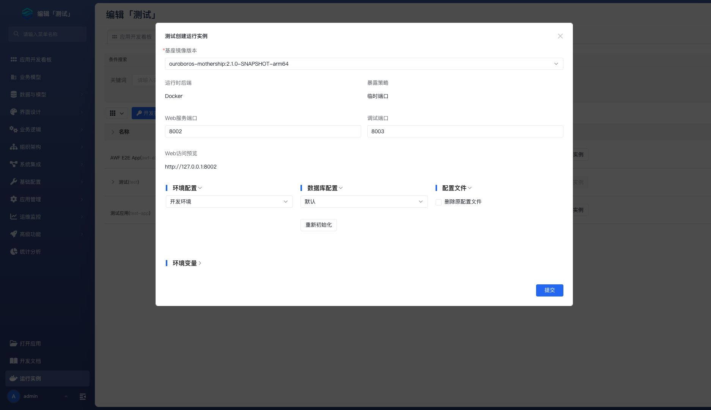
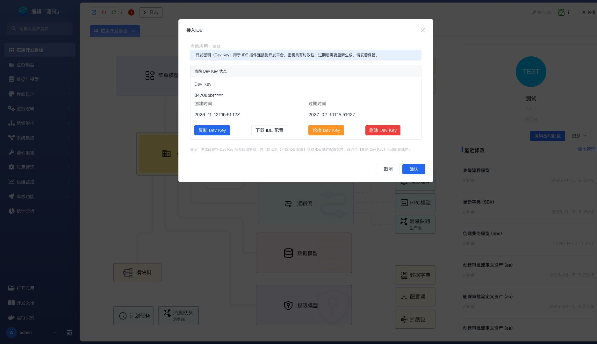

# 平台测试实例调试

IntelliJ IDEA 的 **TideStack Develop** 插件可以完成扩展上传和调试连接。业务代码始终在测试实例中执行，本地 IDE 显示源码、调用栈和变量。插件的安装方式见 [开发工具](./development-tools#安装与选择能力)。

开始前，确认本地源码、扩展依赖和测试实例的基座版本配套，并准备一条可以重复触发的页面操作或 API 请求。

## 调试链路



开发平台负责接收扩展包、控制测试实例和创建调试通道。浏览器发出的业务请求进入测试实例；实例执行到断点时暂停，经 JDWP 通道把调试信息传回 IDE。继续执行后，浏览器才会收到业务响应。

这条链路有三个入口：**开发平台地址**用于授权、上传和实例管理，**应用 Web / API 地址**用于触发业务，**调试会话地址**用于连接 JVM。三个地址的端口和可达范围可能不同。

## 1. 准备测试实例

打开开发平台中的目标应用，从顶部调试工具栏创建运行容器，选择与工程匹配的基座版本和环境。已有实例时，先检查其运行状态、基座版本及数据源。创建与管理步骤见 [运行实例](../low-code/development-platform-menus/runtime-instance)。



记录应用的内部名称，例如 `myapp`。IDE 配置使用这个名称，不使用应用的显示标题。环境由开发密钥授权返回的 profile 确定，插件再用应用名称和 profile 查找测试实例；项目配置中无需填写 `profileId` 或 `containerId`。

## 2. 获取开发密钥

在应用顶部工具栏点击 **接入IDE**。已有有效密钥时，可以复制 Dev Key 或下载 IDE 配置；没有密钥时，填写用途和有效期后生成。运行实例页也提供 **开发密钥** 入口。



开发密钥到期或轮换后，更新本机配置。团队成员各自保存私有凭据，不把密钥写进共享工程文件。

## 3. 配置 IDEA 项目

在 IDEA 中打开准备上传的后端扩展工程，进入 **Settings → Tools → TideStack Develop Config**，也可使用 **Tools → TideStack Develop → Configure Project**。

| 配置 | 填写内容 |
| --- | --- |
| 开发平台地址 | 平台根地址，例如 `https://dev.example.com`；不附加 `/dev`、应用路径或 `/api` |
| 应用名称 | 平台中的应用内部名称，例如 `myapp` |
| Dev Key | 上一步取得的有效开发密钥 |

保存后，插件将共享设置写入 `.tidestack/develop.json`：

```json
{
  "developmentServerUrl": "https://dev.example.com",
  "appName": "myapp"
}
```

密钥单独保存在 `.tidestack/develop.local.json`：

```json
{
  "devKey": "替换为本机开发密钥"
}
```

在工程的 `.gitignore` 中加入：

```gitignore
.tidestack/develop.local.json
```

插件当前从所打开工程根目录的 `target/` 或 `build/libs/` 查找最近生成的非 sources、非 javadoc JAR。多模块工程应先确认待上传 JAR 的实际位置。需要同时装配多个业务 JAR 和额外依赖时，按 [本地基座容器调试](./local-runtime-container-debugging) 装配运行环境，或按 [后端扩展包管理](../low-code/development-platform-menus/backend-extension-package) 安装完整产物。

## 4. 上传并连接调试器

先用工程的正式构建命令生成当前源码对应的普通扩展 JAR，例如 Maven 工程执行 `mvn clean package`。插件会发起 IDE 构建并查找现有 JAR，不能把 IDE 编译完成当作 Maven 已重新打包；提前打包可以避免上传上一次构建的旧产物。

随后进行一次完整联调：

1. 在目标 Controller、Service 或业务扩展实现中设置断点。
2. 在 IDEA 工具栏执行 **Deploy & Debug**。
3. 核对插件提示的 profile 和测试实例。插件依次解析目标、构建、上传 JAR、重启实例、创建调试会话，并启动 Remote JVM Debug 配置。
4. 确认实例已经启动，IDE 调试窗口显示连接成功，再打开该实例的 Web 入口或调用其 API。
5. 重复准备好的业务操作。命中断点后，查看参数、执行身份、模型标识、调用栈和返回结果；单步完成后继续执行，检查页面或接口响应。

共享测试实例会因重启中断正在执行的请求，调试时尽量使用自己的实例。重新修改源码后，再次打包并执行 **Deploy & Debug**。实例重启或重新创建后，旧调试会话可能失效，需要重新连接。

## 5. 检查网络并结束会话

JDWP 使用平台返回的调试会话 `host`、`port`。实例内部的 `5005` 端口与开发者实际连接的端口可能不同，不要直接把内部端口填进远程配置。

当会话入口仅绑定服务器回环地址或内网时，按会话中的 **客户端访问提示** 建立转发，再把 IDEA 的 Remote JVM Debug 指向转发后的本地地址。平台页面可以访问，只能说明管理入口可达，仍需单独验证 JDWP 通道。

调试结束后，在 IDEA 断开调试器，再到 [运行实例的调试会话](../low-code/development-platform-menus/runtime-instance#调试会话) 点击 **关闭当前会话**。断开 IDE 与关闭平台会话是两个动作。

## 常见问题

### 已连接调试器，为什么断点没有命中？

先确认业务请求进入当前连接的测试实例，再核对上传 JAR 与本地源码。检查插件返回的应用、profile、实例，以及最近一次打包、上传和重启是否成功。最后确认请求确实执行到目标分支。

### 能打开平台，为什么 Remote JVM Debug 连接失败？

平台管理 API 与 JDWP 是不同通道。查看调试会话状态、端口、绑定范围与客户端访问提示，确认开发者电脑可以连接会话返回的地址。

### 实例重启后为什么需要重新连接？

调试器绑定到具体 JVM。重启会结束旧进程，平台还会使旧运行代次关联的会话失效。等待新进程启动，再创建调试会话并连接。

## 验证调试结果

修改完成后，取消断点暂停，重新触发原问题及相邻正常场景，确认响应、数据和权限均符合预期。保留本次使用的基座版本、元数据版本、扩展产物、请求与实际结果，交接要求见 [任务协作与交付验收](./high-low-code-collaboration)。
