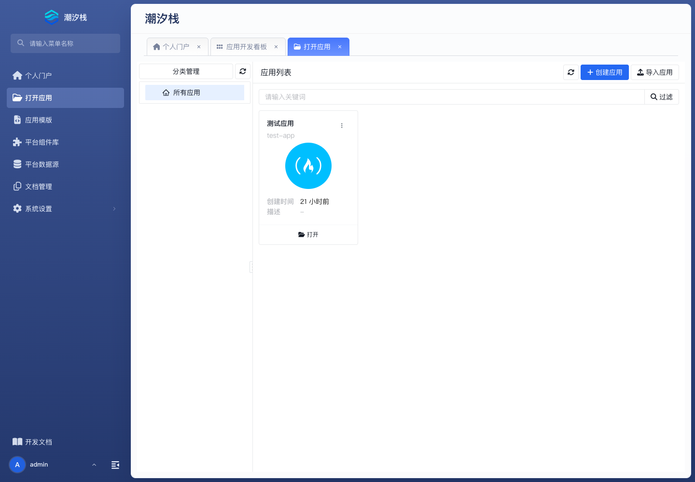
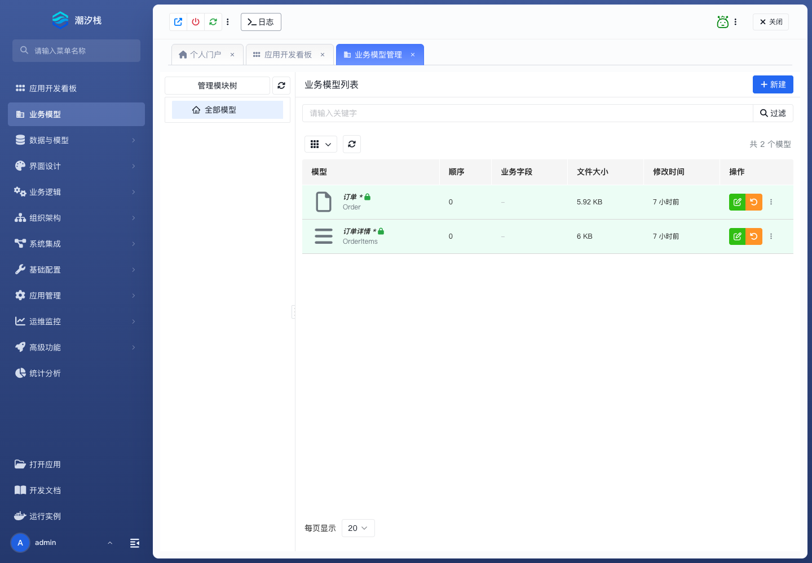
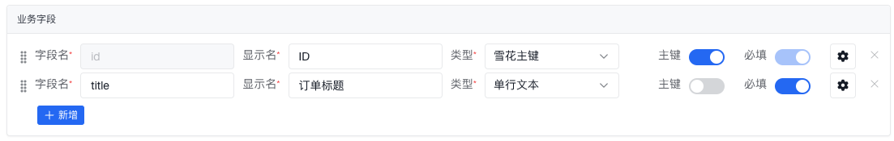

# 快速上手

本教程从本地启动潮汐栈开发平台开始，带你创建并运行一个“客户管理”应用。完成后，你将拥有一个可以新建、查询、查看和编辑客户数据的业务应用。

接下来的操作分为两段：先在电脑上启动开发平台，用它创建应用并定义模型；再从开发工作区启动这个应用，录入一条客户数据，确认生成的页面可以正常使用。

本地环境只适合个人体验和功能验证。团队共享、测试或生产环境需要单独规划依赖、凭据、备份和升级，请使用[Docker Compose 部署](../operations/deployment-methods/docker-compose)中的部署流程。

## 你会完成什么

完成这篇教程后，你会在浏览器中打开自己搭建的开发平台，并在其中搭建一个可以实际操作的“客户管理”应用。最终可以看到：

- 应用列表中出现“客户管理”应用。
- 应用内有一个已启用的 `Customer` 模型，客户列表、录入表单、编辑表单和详情页已经生成。
- 客户管理应用已经启动，可以录入、查询和修改客户数据。

## 开始前

准备一台能够运行 Docker 的电脑，并确认以下条件：

- Linux 已安装 Docker Engine，或者 Windows、macOS 已安装 Docker Desktop；Windows 使用 WSL 2 后端和 Linux 容器。所有环境都需要 Docker Compose v2。
- 当前网络可以访问镜像仓库 `registry.cn-hangzhou.aliyuncs.com`。
- 本机有可写的工作目录。
- 可以在终端中执行以下命令：

  ```bash
  docker info
  docker compose version
  ```

两条命令都应成功返回。默认配置会使用宿主机的 `80`、`13306`、`15005`、`5672`、`15672` 和 `15692` 端口；启动前应确认这些端口没有被其他服务占用。

## 启动本地开发平台

这一阶段会启动开发平台、MySQL 和 RabbitMQ 三个容器。完成后，你应能使用管理员账号登录开发平台，并确认平台可以调用本机 Docker 创建后续的业务应用运行实例。

### 1. 准备工作目录

下载以下文件，并把它们保存到同一个独立目录：

- [docker-compose.yml](.assets/docker-compose.yml)
- [docker-compose.env.example](.assets/docker-compose.env.example)

Mac 或 Linux 可以执行：

```bash
mkdir -p ~/tidestack-develop/{workspace,mysql-data,logs}
cd ~/tidestack-develop
```

Windows PowerShell 可以执行：

```powershell
mkdir D:\tidestack-develop
mkdir D:\tidestack-develop\workspace,D:\tidestack-develop\mysql-data,D:\tidestack-develop\logs
cd D:\tidestack-develop
```

启动前，目录应至少包含以下内容：

```text
tidestack-develop/
├── docker-compose.yml
├── docker-compose.env.example
├── workspace/
├── mysql-data/
└── logs/
```

### 2. 配置本地环境

Mac 或 Linux 执行：

```bash
cp docker-compose.env.example .env
```

Windows 请复制 `docker-compose.env.example`，并把副本重命名为 `.env`。

打开 `.env`，逐项确认以下配置：

| 配置项 | 填写要求 |
| --- | --- |
| `OUROBOROS_VERSION` | 保留示例文件提供的版本，或者改为发行说明指定的镜像版本 |
| `PLATFORM_PORT` | 开发平台的浏览器访问端口；默认 `80` 被占用时改为其他空闲端口 |
| `HOST_WORKSPACE_PATH` | 本机 `workspace/` 目录的绝对路径，不能填写容器内路径 |
| `MYSQL_ROOT_PASSWORD` | 把示例值替换为随机强密码 |
| `RABBITMQ_DEFAULT_USER` | 设置本地 RabbitMQ 用户名 |
| `RABBITMQ_DEFAULT_PASS` | 把示例值替换为随机强密码 |

例如，Mac 上的工作目录为 `/Users/yourname/tidestack-develop` 时，可以填写：

```bash
PLATFORM_PORT=8080
HOST_WORKSPACE_PATH=/Users/yourname/tidestack-develop/workspace
MYSQL_ROOT_PASSWORD=replace-with-a-random-password
RABBITMQ_DEFAULT_USER=ouroboros
RABBITMQ_DEFAULT_PASS=replace-with-a-random-password
```

Windows 路径使用正斜杠，例如 `D:/tidestack-develop/workspace`。Apple Silicon 只有在镜像仓库提供对应 ARM64 镜像时才启用 `ARCH_AFFIX=-arm64`。

### 3. 开启 Docker API

开发平台通过 Docker Engine API 创建和管理业务应用的运行容器。`docker info` 成功只说明当前终端可以访问 Docker；还需要根据操作系统，让开发平台容器也能访问 Docker API。

#### Linux

Linux 上的 Docker Engine 默认通过 `/var/run/docker.sock` 提供 API，不需要另外开放 TCP 端口。使用 systemd 的发行版可以执行：

```bash
sudo systemctl enable --now docker
docker info
test -S /var/run/docker.sock && echo "Docker API is ready"
```

如果 `docker info` 提示权限不足，可以使用 `sudo` 执行 Docker 命令，或者把当前用户加入 `docker` 用户组后重新登录：

```bash
sudo usermod -aG docker "$USER"
newgrp docker
docker info
```

本教程提供的 Compose 文件已经把 `/var/run/docker.sock` 挂载到开发平台容器，并将平台的 Docker API 地址设置为 `unix:///var/run/docker.sock`，Linux 用户不需要再修改 Compose 文件。

Docker Desktop for Linux 使用当前用户目录下的 Socket，而不是系统级的 `/var/run/docker.sock`。快速体验时建议直接使用 Docker Engine；如果必须使用 Docker Desktop for Linux，先执行以下命令查出实际 Socket 路径，再把 Compose 文件中卷挂载左侧的 `/var/run/docker.sock` 改为该绝对路径：

```bash
docker context inspect --format '{{.Endpoints.docker.Host}}'
```

#### macOS

启动 Docker Desktop 即可。当前 Compose 文件会把 Docker Desktop 提供的 `/var/run/docker.sock` 挂载到开发平台容器，不需要开启无 TLS 的 `2375`。启动平台后，使用与 Linux 相同的 Socket 命令验证。

#### Windows

Windows 上使用 Docker Desktop，并确认当前运行的是 Linux 容器：

```powershell
docker info --format '{{.OSType}}'
```

命令应输出 `linux`。如果输出 `windows`，先在 Docker Desktop 中切换到 Linux containers。随后打开 **Settings > General**，启用 **Expose daemon on tcp://localhost:2375 without TLS**，点击 **Apply & restart**。

Docker Desktop 重启后，在 PowerShell 中验证本机 API：

```powershell
(Invoke-WebRequest -UseBasicParsing http://localhost:2375/_ping).Content
```

命令应输出 `OK`。然后编辑 `docker-compose.yml`，删除 Docker Socket 挂载，并把开发平台的 Docker API 地址改为 `tcp://host.docker.internal:2375`：

```diff
 services:
   ouroboros-develop:
     volumes:
       - ./:/app/deploy
-      - /var/run/docker.sock:/var/run/docker.sock
     environment:
-      OUROBOROS_DEV_CONTAINER_DOCKERAPI_HOST: unix:///var/run/docker.sock
+      OUROBOROS_DEV_CONTAINER_DOCKERAPI_HOST: tcp://host.docker.internal:2375
```

:::warning
Docker Socket 和 Docker API 都可以控制本机容器，权限接近宿主机管理员权限。Linux 和 macOS 只把 Socket 挂载给受信任的开发平台容器。Windows 的 `2375` 方案没有 TLS，只能用于受信任的本地体验环境；不要把它改为 `tcp://0.0.0.0:2375`，不要通过端口映射或防火墙规则把它暴露到局域网或公网。不再使用开发平台时，应关闭 Docker Desktop 中的该选项。团队或远程环境必须使用 TLS、SSH 或受限代理接入 Docker。
:::

### 4. 启动容器

在包含 `docker-compose.yml` 和 `.env` 的目录执行：

```bash
docker compose config
```

该命令应正常输出合并后的配置，并且不提示缺少变量。确认配置有效后再执行：

```bash
docker compose pull
docker compose up -d
```

首次启动需要拉取镜像。命令返回后，执行以下命令查看容器状态：

```bash
docker compose ps
```

`ouroboros-develop`、`ouroboros-dev-db` 和 `ouroboros-rabbitmq` 都应处于运行状态。容器没有正常启动时，先执行 `docker compose logs ouroboros-develop` 查看开发平台日志，不要继续创建应用。

### 5. 登录并验证开发平台

首次使用全新的 `mysql-data/` 启动时，开发平台会创建 `admin` 用户并生成随机密码。Mac 或 Linux 执行：

```bash
docker compose logs ouroboros-develop | grep 'Generated random password'
```

Windows PowerShell 执行：

```powershell
docker compose logs ouroboros-develop | Select-String 'Generated random password'
```

打开 `http://localhost:<PLATFORM_PORT>`，使用账号 `admin` 和日志中的随机密码登录。首次登录后立即修改管理员密码。

Linux 或 macOS 用户执行以下命令，确认 Docker Socket 已挂载到开发平台容器：

```bash
docker compose exec ouroboros-develop test -S /var/run/docker.sock
```

Windows 用户执行以下命令，确认开发平台使用刚才开启的本机 API：

```powershell
docker compose exec ouroboros-develop printenv OUROBOROS_DEV_CONTAINER_DOCKERAPI_HOST
```

Linux 或 macOS 命令的退出码应为 `0`；Windows 命令应输出 `tcp://host.docker.internal:2375`，并且前面的 `_ping` 请求应返回 `OK`。平台中的 **打开应用** 和 **运行实例** 页面都能正常打开后，本地开发平台已经准备好。后续操作都在这个平台中完成。

## 创建客户管理应用

应用是模型、页面、权限、流程和版本的交付边界。本阶段先创建一个空的“客户管理”应用，下一阶段再向其中加入客户模型。

1. 登录开发平台，在左侧菜单打开 **打开应用**。
2. 点击页面右上角的 **创建应用**。

   

3. 按下表填写表单：

   | 字段 | 填写值 |
   | --- | --- |
   | 应用名 | `customerManagement` |
   | 应用标题 | `客户管理` |
   | 图标 | 留空 |
   | 描述 | `客户资料维护示例` |

   **应用名**是目录和资源使用的唯一标识，只能包含字母、数字、下划线和中划线，且不能以数字开头。应用名已存在时，可以改为 `customerManagementDemo`，后续仍使用“客户管理”作为应用标题。

4. 点击 **确认**。
5. 在应用列表中找到“客户管理”，点击应用卡片底部的 **打开**，进入应用开发工作区。

左侧出现 **业务模型**、**应用管理** 等应用级菜单，表示应用已创建并打开。

## 定义客户模型

业务模型定义客户数据的字段，并据此生成标准页面和接口。本阶段只创建完成增查改所需的最小字段，不添加关系、流程或自定义页面。

### 1. 创建模型

1. 在应用开发工作区打开 **业务模型**。
2. 点击右上角的 **新建**。

   

3. 保持模型类型和模块的默认值，填写以下内容：

   | 字段 | 填写值 |
   | --- | --- |
   | 模型名 | `Customer` |
   | 模型标题 | `客户` |
   | 图标 | 留空 |
   | 模型描述 | `客户基本资料` |

4. 点击 **确认**，然后打开新建的 `Customer` 模型进入编辑器。

模型名必须以字母开头且只能包含字母和数字。它会参与生成数据模型、接口和页面地址；模型标题则显示在菜单和页面中。

### 2. 配置字段和页面

1. 在 **基本信息** 中打开 **启用模型**。新建模型默认未启用，未启用的模型不会生成可用的业务入口。
2. 打开 **业务字段**。保留系统生成的主键，点击 **新增**，依次添加以下字段：

   | 字段名 | 显示名 | 类型 | 必填 | 其他设置 |
   | --- | --- | --- | --- | --- |
   | `name` | 客户名称 | 单行文本 | 是 | 在字段设置中打开 **作为显示字段** |
   | `phone` | 联系电话 | 单行文本 | 否 | 保持默认 |
   | `remark` | 备注 | 多行文本 | 否 | 保持默认 |

   

3. 打开 **视图配置**，确认索引页、新建表单、编辑表单和详情页均已启用，并保持自动生成。
4. 点击 **保存并提交**，提交说明填写 `创建客户模型`。

保存并提交后，`Customer` 模型应处于启用状态，编辑器不再提示有未提交更改。自动生成的页面和接口会在业务应用运行后提供客户数据的增查改能力。

## 启动客户管理应用

开发平台会基于当前工作区启动一个用于调试的客户管理应用。它与开发平台分开运行：开发平台用于继续修改模型和页面，调试应用用于检查这些改动在实际业务界面中的效果。

1. 保持在“客户管理”应用的开发工作区，找到页面顶部的调试工具栏。
2. 点击工具栏左侧的 **创建运行容器**。
3. 在弹窗中选择与当前平台版本匹配的 **基座镜像版本**。首次练习保留默认的运行时后端、暴露策略、环境和数据库配置。

   :::warning
   不要勾选 **重新初始化** 或 **删除原配置文件**。重新初始化会删除已有实例数据库，删除原配置文件会移除已有实例配置。
   :::

4. 提交表单，等待运行容器创建完成。
5. 工具栏中出现可用的外链图标后，将鼠标移到图标上，确认提示为 **打开应用页面**，然后点击该图标。

浏览器会在新窗口中打开客户管理应用。应用菜单中出现 **客户**，表示模型已经生成了可操作的业务功能。

## 验证客户功能

最后用实际数据验证自动生成的列表、表单和详情页。只有数据能够写入并在刷新后保持，才算完成本次快速上手。

1. 在运行应用中打开 **客户**。
2. 点击 **新建**，填写客户名称 `示例客户`、联系电话 `13800000000`，然后提交。
3. 返回客户列表，搜索 `示例客户`。
4. 打开客户详情，确认名称和联系电话与录入值一致。
5. 编辑该客户，把备注改为 `快速上手验证`，然后保存。
6. 刷新详情页，确认备注仍为 `快速上手验证`。

以下结果全部成立时，客户管理应用已经完成：

- `Customer` 模型处于启用状态，且没有未提交更改。
- 顶部调试工具栏可以打开客户管理应用。
- `示例客户` 可以被查询、查看和编辑，刷新后修改仍然存在。

## 发生问题时

| 现象 | 检查和处理 |
| --- | --- |
| `docker compose config` 提示缺少变量 | 确认 `.env` 与 `docker-compose.yml` 在同一目录，并填写了工作区路径、数据库密码和 RabbitMQ 账号密码 |
| 镜像拉取失败 | 确认网络能够访问镜像仓库；企业网络需要先配置仓库登录或 Docker 镜像代理 |
| 容器因端口占用而启动失败 | 修改 `.env` 中可配置的端口；RabbitMQ 端口冲突时修改 `docker-compose.yml` 中对应的宿主机端口映射 |
| 日志中没有随机密码 | 当前 `mysql-data/` 可能已经初始化过；使用已有管理员账号，或按管理员密码重置流程处理 |
| **创建应用**或**保存并提交**不可用 | 当前账号缺少相应权限；使用管理员账号，或为当前角色补充分配对应权限 |
| **创建运行容器**时没有镜像可选 | 确认平台版本存在配套的基座镜像，并按操作系统检查开发平台容器能否访问 Docker Engine API |
| 运行应用中没有 **客户** 菜单 | 确认模型和四类视图均已启用，重新执行 **保存并提交**，然后点击顶部调试工具栏中的 **热刷新应用** |

需要查看容器日志时，在本地部署目录执行：

```bash
docker compose logs -f ouroboros-develop
```

需要暂时停止本地开发平台时执行：

```bash
docker compose down
```

该命令会停止并移除 Compose 容器，但不会删除本地的 `mysql-data/`、`workspace/` 和 `logs/` 目录。再次启动时执行 `docker compose up -d`。

## 继续学习

- 在客户模型中增加关系、校验、接口或定制页面：阅读[开发业务模型](../guide/tutorial/business-model/develop-business-model/)。
- 在真实需求中加入规则、审批、权限和通知：从[从需求到交付](../low-code/from-requirement-to-delivery)开始。
- 把本地环境改造成团队共享或长期运行环境：阅读[运维管理](../operations/)。
