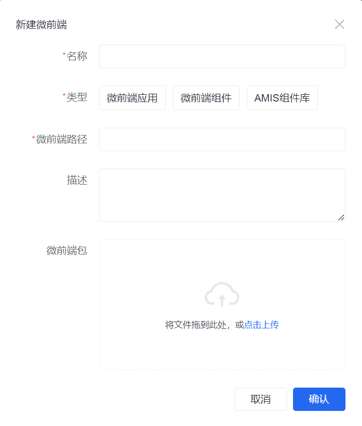
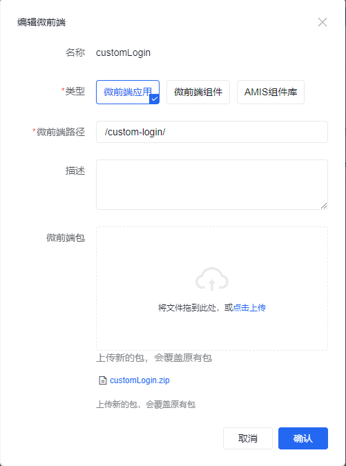

# 微前端包管理

应用开发界面的 **高级 → 微前端** 管理前端记录和构建 ZIP。记录决定平台如何引用产物，构建包提供实际脚本、样式和页面资源；创建记录、上传包和配置业务引用需要分别完成。

## 上传前准备

准备包名称、用途、构建版本、资源基础路径和引用位置。让 AI 对照工程构建配置、ZIP 内容与现有记录核对这些信息，避免把源码 ZIP 或本地开发地址作为部署产物。

工程接入方式见 [应用改造](./application-transformation)。更新前保留上一版包和配置，并确认当前页面、布局、登录页或 Schema 是否仍使用该记录。

## 配置方式 {#configuration}

### 微前端管理


列表用于创建记录、修改描述或资源路径、上传新包，以及删除不再使用的记录。

### 创建微前端

点击 **新建**，按下表填写并上传构建包。



| 属性 | 必填 | 核对内容 |
| --- | --- | --- |
| 名称 | 是 | 稳定且可识别的标识，与后续引用保持一致 |
| 类型 | 是 | 按下方的用途分类选择 |
| 微前端路径 | 是 | 部署资源的基础路径，与构建 publicPath 或资源解析方式相符 |
| 描述 | 否 | 用途、所属业务及必要的版本信息 |
| 微前端包 | 否 | 构建产物 ZIP；未上传包的记录仍需有可加载的真实入口 |

ZIP 按平台支持的方式打包，避免使用 macOS 系统压缩产生额外目录。上传前检查 ZIP 内的入口与资源层级，确认与部署路径相符。

#### 微前端类型

| 管理界面类型 | 用途 | 实现指南 |
| --- | --- | --- |
| 微前端应用 | 自定义业务页面、独立应用和登录页 | [微前端应用](./micro-app/) |
| 微前端组件 | 顶栏、侧栏等布局区域 | [布局组件](./layout-component/) |
| 组件库 | UI Schema 中复用的表单项、展示组件等能力 | [组件库](./amis-component/) |

跨应用分发的组件库走 [平台组件库](../../../fusion-development/plugin-extensions/frontend/platform-component-library) 的安装与应用导入流程。

#### 微前端路径

例如工程使用固定资源基础路径 `/custom-login/`，平台记录应与之对应。下面是 Vue CLI / Webpack 的配置片段：

```js
module.exports = {
  publicPath: '/custom-login/',
}
```



使用自动或相对 publicPath 的工程，核对浏览器实际请求的脚本、样式和异步资源地址。路径填写正确还需由安装后的请求结果确认。

## 让业务入口引用记录

| 用途 | 需要配置的引用 |
| --- | --- |
| 业务页面 | UI 模型的微前端实现或 Schema 中的微前端容器 |
| 登录页 | 应用配置中的自定义登录页入口 |
| 顶栏或侧栏 | 应用配置中的布局组件入口 |
| Schema 组件 | 组件库加载与组件类型注册 |

从实际菜单或页面进入验证。记录存在但没有业务引用时，不会自动改变已有页面。

## 更新与回退

1. 查看现有名称、路径和使用位置，保留上一版 ZIP 与配置。
2. 上传新包；需要调整路径时，同步核对构建配置和所有引用。
3. 刷新或重新进入真实页面，检查实际资源与功能对应新版本。
4. 回退时恢复配套包和配置，再执行同一组业务检查。

名称作为稳定标识使用，创建后不建议修改。上传新包会覆盖原产物，因此版本记录与上一版包需要在更新前保留。

## 删除记录

先清理 UI 模型、Schema、登录入口或布局中的引用，再删除记录。存在共享引用时，逐个确认受影响页面，避免因删除包导致其他入口无法加载。

## 安装后验证

| 检查层次 | 要保留的结果 |
| --- | --- |
| 记录 | 名称、类型、路径及引用位置 |
| 资源 | 入口、脚本、样式和异步资源的实际请求 |
| 生命周期 | 挂载、离开、重进和刷新结果 |
| 业务 | 目标账号的页面操作、数据和错误行为 |
| 恢复 | 上一版包与配置恢复后的运行结果 |

让 AI 排查时提供记录、构建配置、ZIP 文件层级、网络错误和复现步骤。实现边界及通用验收见 [前端开发](../../../fusion-development/frontend-extension-paths)。
