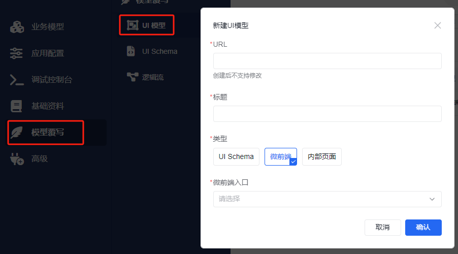
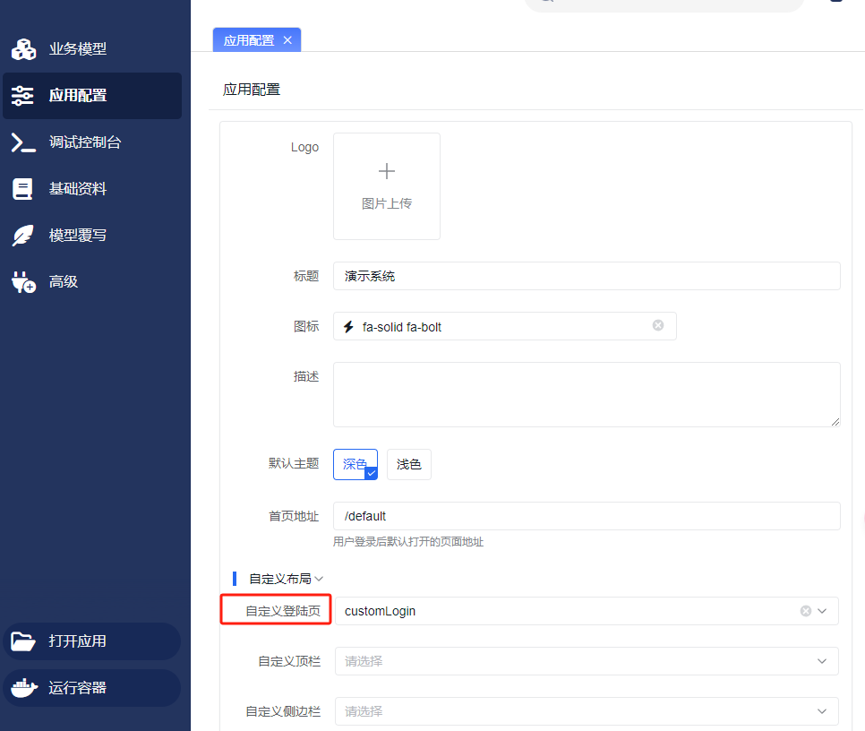

# 微前端应用

微前端承载自定义业务页面、独立子应用或登录体验。平台通过 UI 模型、Schema 容器或应用配置引用已上传的前端产物。本页按引用方式说明如何接入，工程生命周期与构建配置见 [应用改造](../application-transformation)。

## 确定页面入口

先提供目标 UI 模型、现有 Schema、接口样例、操作角色和 SDK 版本，让 AI 列出页面接收的数据、调用的接口以及需要改变的引用。

| 页面用途 | 引用位置 | 路由安排 |
| --- | --- | --- |
| 替换业务模型的一张页面 | 对应 UI 模型 | 保留业务入口，核对覆盖 URL |
| 在现有页面或表单内嵌入界面 | Schema 的微前端容器 | 使用局部组件，不注入独立路由 |
| 承载一组独立业务页面 | 微前端页面入口与子应用路由 | 明确路由前缀、宿主导航和刷新行为 |
| 自定义登录页 | 应用配置的登录入口 | 只接管 `/login` |

模型生成的标准页面先检查模型视图和投影配置。只有需要自定义的部分进入微前端，其接口和权限继续沿用平台契约。

## 准备并安装产物

1. 在现有工程或兼容模板中实现页面。AI 生成时同时提供加载、空数据、失败、只读及无权限状态。
2. 按 [应用改造](../application-transformation) 处理生命周期、容器和资源路径。
3. 执行工程测试和构建，将构建目录打包成 ZIP。
4. 在 **高级 → 微前端** 新建或更新记录，类型选择 **微前端应用**，上传构建包。字段说明见 [微前端包管理](../index.md#configuration)。

安装后仍需完成下面一种引用，上传本身不会替换业务页面。

## 用 UI 模型引用页面

需要覆盖业务模型的页面时，先定位该页面的 URL，再在 UI 模型中指定微前端实现。创建业务模型的方法见 [业务模型教程](../../../tutorial/business-model/)。



| 参数 | 检查内容 |
| --- | --- |
| URL | 与要覆盖的页面地址一致，避免覆盖其他业务入口 |
| 标题 | 与页面用途及菜单展示一致 |
| 类型 | 选择 **微前端** |
| 微前端入口 | 引用已经上传的目标记录 |

使用目标业务账号从原入口进入，核对实际加载包、页面参数和接口请求。多路由应用还要验证子路由跳转、浏览器前进后退与刷新，避免子应用接管宿主其他页面。

## 在 Schema 中嵌入局部界面

只需嵌入单个界面时，使用 `micro-component`；表单内需要参与值处理时，按 [表单内加载微前端](../../../../api/frontend/buildin-comps/business-pickers-and-micro-components#表单内加载微前端应用) 的契约接入。

```json
{
  "type": "page",
  "body": [
    {
      "type": "micro-component",
      "entry": "已经上传的微前端路径"
    }
  ]
}
```

`entry` 使用平台记录对应的真实入口。容器参数及宿主交互见 [加载微前端应用](../../../../api/frontend/buildin-comps/business-pickers-and-micro-components#加载微前端应用)。局部组件不建立独立路由，表单场景还需验证初始值、变化、重置、校验和提交。

## 自定义登录页

登录页优先使用单组件模式，完成工程接入后，在“应用配置”中设置对应微前端入口。



认证 SDK、provider、首次绑定、token 和国际化统一见 [自定义登录页与认证接入](../../../../fusion-development/custom-login-page-and-auth-integration)。自定义页面只替换 `/login`；`/login/callback` 和 `/login/bind` 继续由基座处理。

## 验证与交付

| 检查 | 预期结果 |
| --- | --- |
| 从真实菜单或业务入口进入 | UI 模型引用目标记录，加载本次构建产物 |
| 正常数据与失败响应 | 请求参数、状态变化和错误展示符合业务契约 |
| 无权限账号直接请求接口 | 后端拒绝越权操作，界面与授权一致 |
| 离开、重进、刷新及路由切换 | 容器与监听正确释放，导航不干扰宿主 |
| 嵌入表单 | 值回填、变化与提交满足容器契约 |
| 更新与回退 | 包与引用配置配套，恢复后原业务可用 |

交付 UI 模型或 Schema 改动、工程版本、ZIP 和实际验证记录。让 AI 排查时，提供入口、网络请求、控制台错误及宿主 props，区分引用、加载、挂载与业务实现问题。
