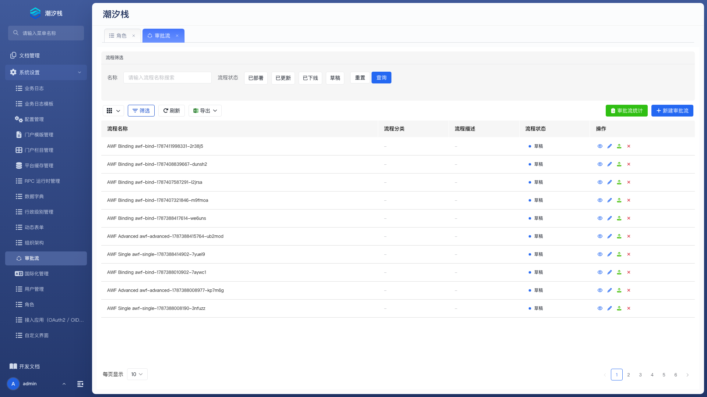
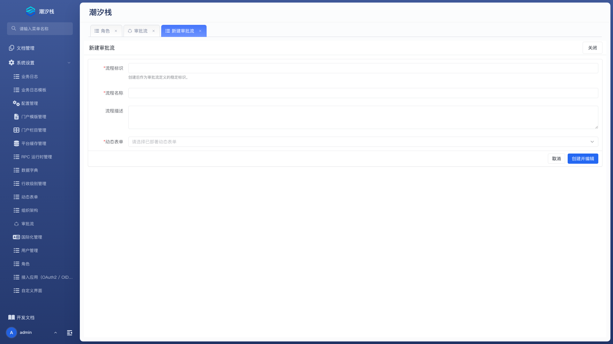
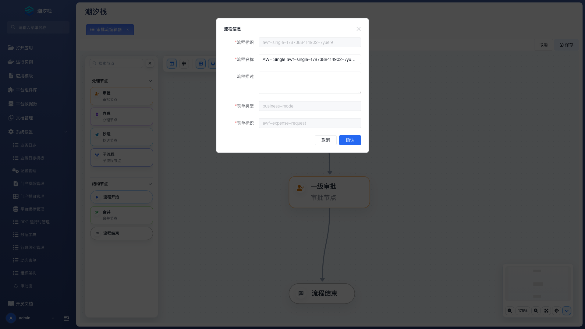
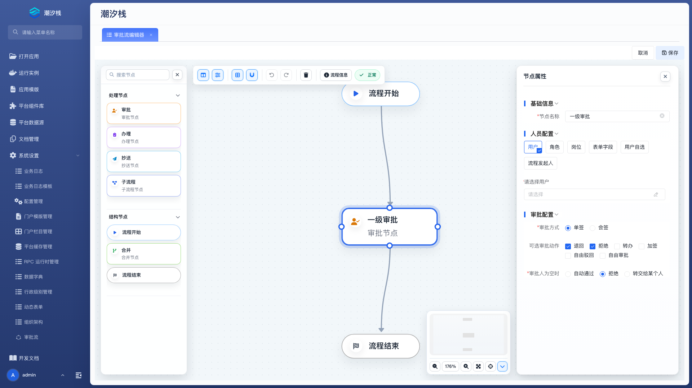
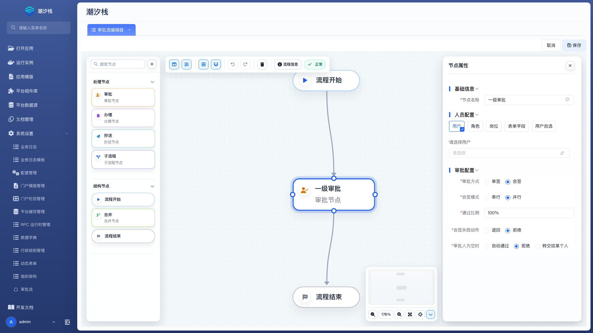

# 审批流管理

审批流管理维护运行环境中的流程定义：创建流程、配置审批人和路由、保存草稿，再部署生效。申请人从 [发起审批](../approval-start/) 提交申请，审批人在 [审批中心](../approval-center/) 处理任务。

应用中的审批定义资产在 **业务逻辑 / 审批流** 中开发，随应用元数据交付；本页介绍 **系统设置 / 审批流** 中的运行管理操作。应用资产的字段说明见 [审批流开发](../../../../low-code/development-platform-menus/approval-workflow)。

## 打开审批流管理

选择 **系统设置 / 审批流**。列表显示流程名称、分类、描述和状态，可以按名称或流程状态筛选，并进入查看、编辑、部署或下线操作。

设计前准备好业务表单和审批人来源。先做一条“开始 → 审批 → 结束”的完整路径，验证后再添加分支或会签。

## 新建审批流程

点击 **新建审批流**，填写基本信息。

| 配置项 | 说明 |
| --- | --- |
| 流程标识 | 必填，创建后作为流程定义的稳定标识，调用和绑定时使用。 |
| 流程名称 | 必填，管理和发起界面中显示的名称。 |
| 流程描述 | 说明适用业务、处理范围和必要条件。 |
| 动态表单 | 必填，从已部署的动态表单中选择。先部署表单，再创建绑定它的流程。 |

点击 **创建并编辑** 进入画布。顶部 **流程信息** 可以查看流程标识、名称、描述、表单类型和表单标识。

## 编排节点

左侧节点库提供审批、办理、抄送、子流程、流程开始、合并和流程结束节点。把节点拖入画布，通过连线连接前后步骤。右下角可缩放、居中和适配画布；选中节点后在右侧配置属性。

- **流程开始、流程结束** 确定主路径的起止。
- **审批** 等待审批人作出结论。
- **办理** 用于需要人员完成工作的处理步骤。
- **抄送** 把流程信息送达指定人员。
- **子流程** 引用另一段审批过程。
- **合并** 汇集前面的路径。

画布上显示 **存在错误** 时，点击状态按钮阅读诊断，再定位相应节点或连线。完成所有必填配置后再保存、部署。

### 人员配置 {#人员配置}

选中审批节点，在 **人员配置** 中选择候选人来源，再填写对应的人员、角色、岗位或表单字段。

| 来源 | 用途 |
| --- | --- |
| 用户 | 指定具体账号，适合人员固定的步骤。 |
| 角色 | 按职责确定审批人，人员调整时维护角色关系。 |
| 岗位 | 根据岗位确定处理人，需先维护组织架构与岗位关系。 |
| 表单字段 | 从申请数据中读取候选人，字段内容必须符合人员标识要求。 |
| 用户自选 | 发起时由用户补充审批人。 |
| 流程发起人 | 由申请人本人处理；会签时不提供此选项。 |

同时配置 **审批人为空时** 的处理方式：自动通过、拒绝，或转交给指定人员。不要让候选人缺失时的行为依赖默认猜测。

### 单签与会签 {#审批配置}

**单签** 由一个审批人给出结论。可选审批动作包括退回、拒绝、转办、加签、自由驳回和自由审批；勾选后，相应动作才会在满足任务条件时提供给处理人。

**会签** 需要多名审批人共同参与。

| 配置项 | 说明 |
| --- | --- |
| 会签模式 | 串行依次发送任务，并行同时发送任务。 |
| 通过比例 | 达到该比例的通过人数后满足会签通过条件，取值为 1–100%。 |
| 会签失败动作 | 会签无法通过时退回或拒绝。 |
| 审批人为空时 | 定义没有候选人时的处理方式；选择转交时，还需指定接收人。 |

例如三人会签设置通过比例为 50%，需要至少两人通过。测试时分别覆盖通过、拒绝、人员缺失和中途转办等实际使用路径。

### 表单权限 {#表单权限配置}

节点可以约束表单字段的可见、可写和必填：可写字段应当可见，必填字段应当可写。发起环节开放需要申请人填写的内容，后续环节仅开放本步骤需要补充的字段。

字段权限依赖绑定表单提供的字段定义。节点面板没有显示表单权限时，先检查表单绑定及字段来源；修改流程名称或重新拖入节点不会补出缺失的字段。

### 路由条件 {#分支条件}

条件配置在路由连线上。选中需要分流的连线，在 **连线属性** 中检查条件；可用的条件字段来自绑定表单。普通顺序连线无需额外条件时，面板会直接提示“当前连线无需配置条件”。

分流时应覆盖所有业务取值，并设置明确的兜底路径。条件互相重叠、字段不存在或类型不匹配，都应在部署前修正。

## 保存与部署

点击顶部 **保存** 写入流程定义，再回到列表检查状态。保存不会让修改立即影响新的申请。

| 状态 | 含义和下一步 |
| --- | --- |
| 草稿 | 尚未部署，完成检查后执行部署。 |
| 已部署 | 可供业务发起。修改保存后需重新部署。 |
| 已更新 | 已保存新的定义，重新部署后新申请才使用它。 |
| 已下线 | 停止提供该流程，确认后可重新部署。 |

部署前检查表单、候选人、会签比例、空审批人策略及所有分支。部署后使用目标业务账号发起一条测试申请，确认预期人员收到待办，并验证通过、拒绝和退回。

## 下线与删除

已部署流程可以下线，草稿可以删除。删除前检查是否仍在设计中、是否有业务模型绑定；下线前检查现有申请及后续业务影响。流程定义管理与已发起实例的处理应分别核对，不能把下线当作对现有实例的清理。

## 常见问题

### 保存后为什么还在走旧流程？

保存只更新定义。返回列表重新部署，再发起新的测试申请核对。

### 为什么预期的审批人没有收到待办？

检查候选人来源、角色或岗位关系、表单中的人员标识，以及“审批人为空时”的处理设置。再到实例详情确认流程实际停留的节点。

### 为什么审批中心没有某个动作？

检查节点是否允许该动作，以及当前用户是否是该任务的可处理人。会签和单签的配置不同，不应仅凭用户拥有管理权限判断动作一定可用。

## 扩展阅读

- [发起审批](../approval-start/)
- [审批中心](../approval-center/)
- [审批流统计](../approval-statistics/)
