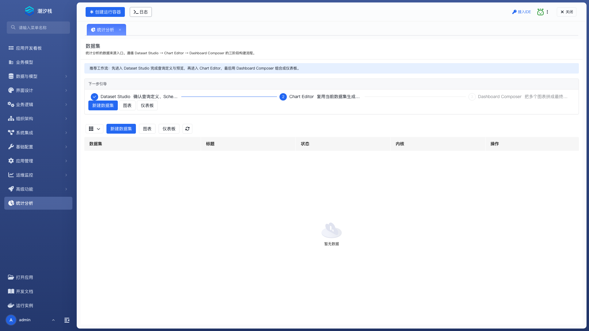
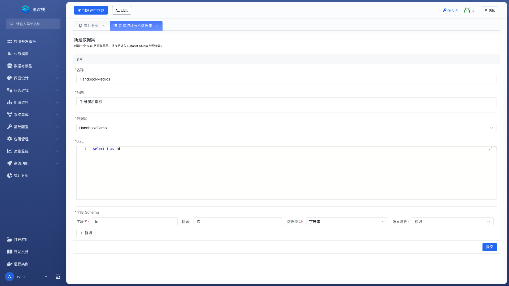
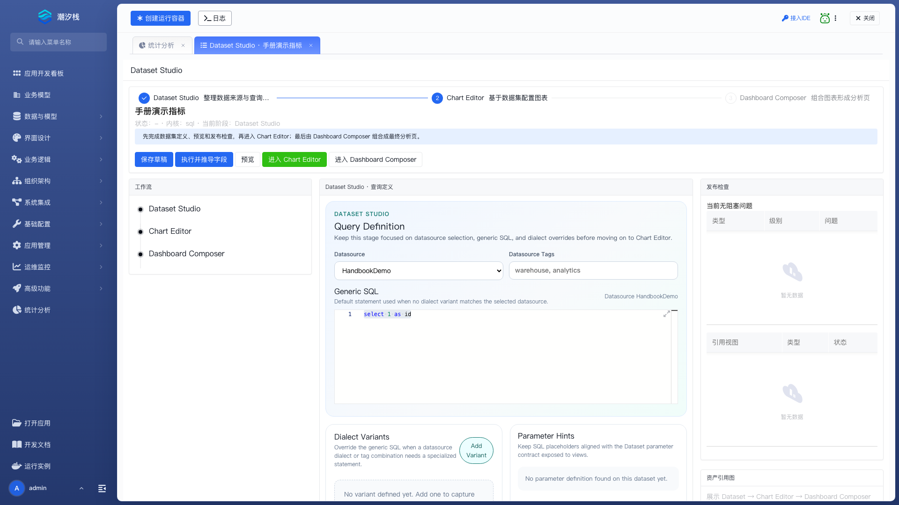
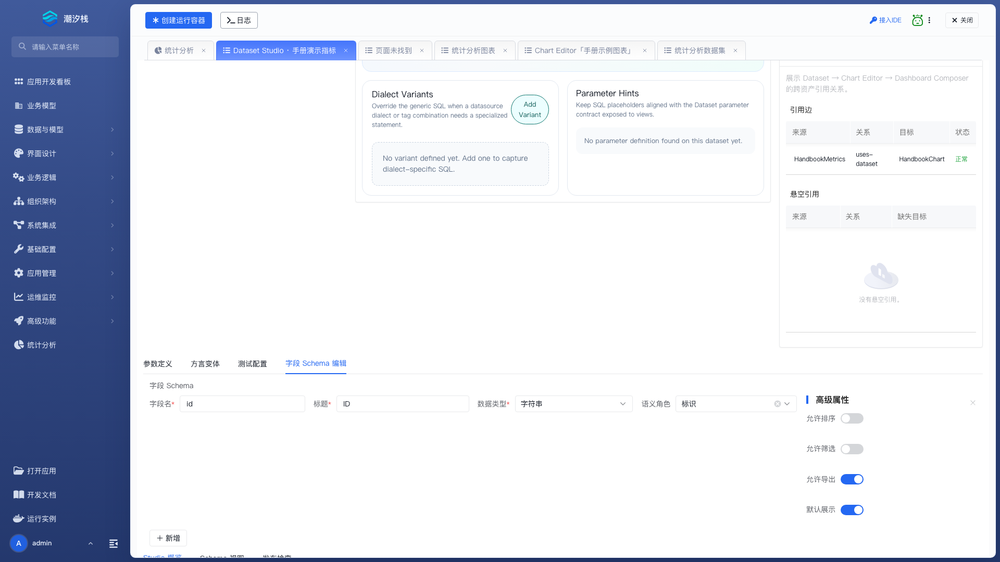
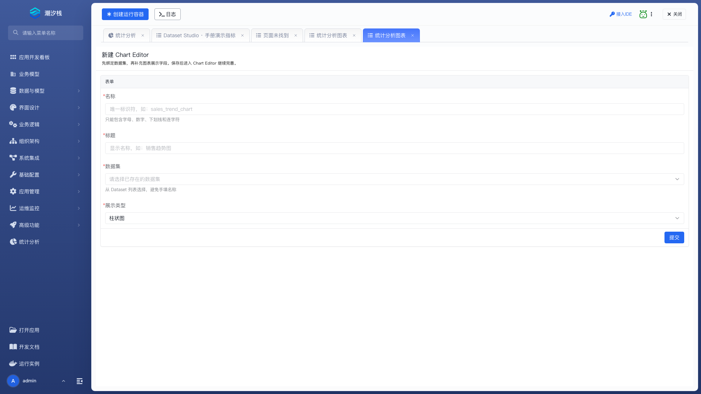
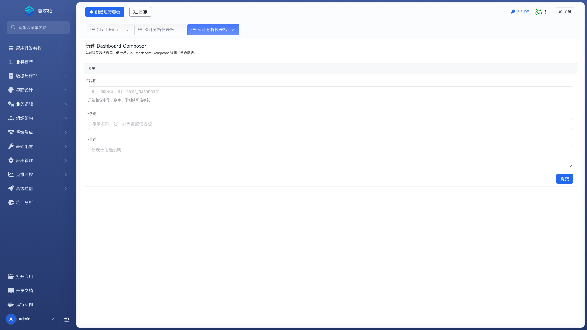
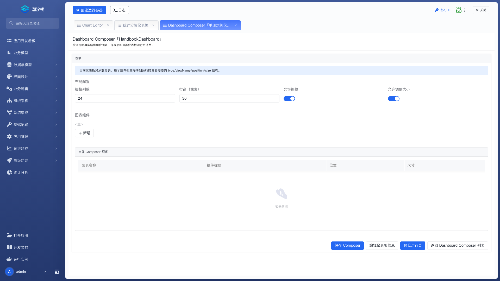
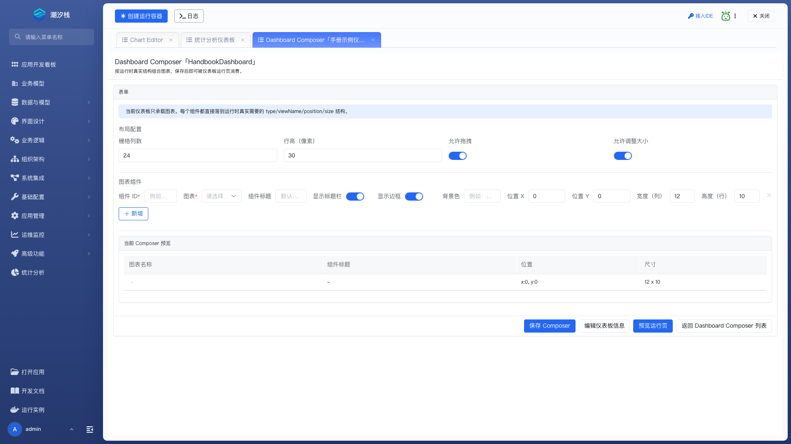

# 统计分析

统计分析把查询口径、图表呈现和页面布局分开维护：数据集定义查询及字段含义，图表选择要展示的维度和指标，仪表板把多张图表组合成分析页面。调整图表样式时不必重写 SQL，同一数据集也可以被多张图表复用。

## 打开统计分析

打开应用，在左侧选择 **统计分析**。页面提供数据集、图表和仪表板三个入口，通常按这个顺序配置。

开始前，先创建并绑定 [应用数据源](../../../low-code/development-platform-menus/datasource)，明确查询口径、参数和一组可核对的结果。查询使用只读 SQL，数据库账号只授予所需权限。

:::warning 当前版本的使用限制
`2.1.0-SNAPSHOT` 的数据集工作台和图表编辑器仍有未完成的运行链路。部分编辑页加载后会丢失应用上下文，出现 `Not Found`，字段选择和预览无法正常完成；从 Dataset Studio 携带参数进入图表创建页也可能出现 404。可从 **统计分析 / 图表 / 新建图表** 进入创建页。

数据集发布检查用于检查定义和引用，不会完成发布。当前页面没有独立的发布入口，不能把“保存草稿”或“当前无阻塞问题”当作正式可用。下面介绍界面中的配置项；正式运行前还需确认部署版本已经修复这些问题并完成实际验证。
:::

## 创建数据集

在数据集列表点击 **新建数据集**。名称用于稳定引用，标题用于界面展示。

| 配置项 | 说明 |
| --- | --- |
| 名称 | 必填，数据集的唯一标识。图表通过它引用数据集。 |
| 标题 | 必填，开发和管理界面中的显示名称。 |
| 数据源 | 必填，选择当前应用已绑定的数据源逻辑名称。 |
| SQL | 必填，返回分析字段的只读查询；默认示例为 `select 1 as id`。 |
| 字段 Schema | 必填，逐项定义查询结果字段的名称、标题、数据类型和语义角色。 |

点击 **提交** 创建数据集，随后进入 Dataset Studio。这里可以继续维护查询、参数、测试配置和结果字段。

### 查询定义

| 配置项 | 说明 |
| --- | --- |
| Datasource | 数据集使用的应用数据源；`Use runtime default` 表示使用运行环境默认数据源。 |
| Datasource Tags | 数据源标签，多个标签以逗号分隔，用于匹配方言变体。 |
| Generic SQL | 未匹配到专用方言变体时使用的查询。参数占位符应与参数定义一致。 |
| Add Variant | 增加一份特定数据库方言或数据源标签适用的 SQL。 |

每份方言变体包含：

| 配置项 | 说明 |
| --- | --- |
| Variant Name | 变体名称，用于识别和维护该份查询。 |
| Dialect | 目标数据库方言。 |
| Dialect Version Range | 适用版本范围，例如 `8.x` 或 `12-16`。 |
| Priority | 多个候选变体匹配时使用的优先级。 |
| Datasource Tags | 该变体适用的数据源标签，逗号分隔。 |
| SQL | 与通用查询返回相同业务字段和含义的专用查询。 |

变体可以改写数据库语法，但不能让同名字段在不同环境中变成不同业务含义。

### 参数定义与测试配置

打开 **参数定义**，为查询中的每个输入逐项配置：

| 配置项 | 说明 |
| --- | --- |
| 参数名 | 必填，查询和视图使用的参数标识。 |
| 标题 | 参数在界面中显示的名称。 |
| 类型 | 字符串、数字、日期、日期时间或布尔。 |
| 操作符 | `=`、`>=`、`<=`、`LIKE` 或 `IN`，应与筛选含义一致。 |
| 必填 | 调用时是否必须提供参数。 |
| 多值 | 参数是否接收多个值，常用于 `IN` 筛选。 |
| 视图可见 | 是否在视图参数区域显示，默认开启。 |
| 默认值 | 调用方未提供值时使用的值，应符合参数类型。 |

**测试配置** 中的“测试数据源”指定开发态测试连接，“测试参数”以键值对保存一组可重复使用的样本输入。它们用于开发验证，应使用测试数据和凭据。

### 结果字段

字段定义必须与 SQL 实际返回的列一致。**执行并推导字段** 可以读取查询结果元信息，但仍需要人工核对业务标题和语义角色。

| 配置项 | 说明 |
| --- | --- |
| 字段名 | 必填，查询结果列名；图表按此名称取值。 |
| 标题 | 必填，图表或明细页默认显示的名称。 |
| 数据类型 | 字符串、数字、整数、小数、日期、日期时间或布尔。新建表单的选项较少，完整类型在工作台中维护。 |
| 语义角色 | 标识、维度、指标、明细或时间；决定字段可进入哪些图表槽位。 |
| 允许排序 | 是否允许按该字段排序，默认关闭。 |
| 允许筛选 | 是否允许按该字段筛选，默认关闭。 |
| 允许导出 | 是否允许导出该字段，默认开启。 |
| 默认展示 | 是否默认在视图中展示，默认开启。 |

### 保存、预览与发布检查

**保存草稿** 写入当前定义。**预览** 用于检查当前编辑内容的查询结果；应分别验证正常参数、空结果和边界值，并与已知样本核对。**发布检查** 展示问题类型、级别、说明及引用视图；资产引用图用于查看数据集到图表、仪表板的引用和悬空关系。

运行时只加载状态为 `PUBLISHED` 的数据集。当前新建页声明草稿状态，但实际创建结果也可能显示状态为空；状态为空与草稿都不能作为已发布使用。

## 创建图表

从 **统计分析 / 图表** 点击 **新建图表**，填写名称、标题，选择数据集和展示类型，提交后进入 Chart Editor。

| 图表类型 | 适用问题 |
| --- | --- |
| 指标卡 | 总量、完成率等单值。 |
| 折线图、面积图 | 随时间变化的趋势。 |
| 柱状图 | 类别、部门或时段之间的对比。 |
| 饼图 | 类别占比。 |
| 散点图 | 两个数值之间的关系。 |
| 交叉表 | 按多个维度汇总对比。 |
| 明细表 | 逐条查询、筛选和导出记录。 |

### 字段槽位

图表编辑器会按数据集字段的语义角色提供选项。字段没有出现在预期槽位时，先回到数据集核对语义角色和类型。

| 配置项 | 说明 |
| --- | --- |
| 名称 | 图表稳定标识，创建后保持不变。 |
| 标题 | 图表的显示名称。 |
| 数据集 | 图表使用的数据来源；更换后重新核对所有槽位。 |
| 图表类型 | 选择指标卡、折线图、柱状图等呈现方式。 |
| 维度槽位 | 按类别分组的字段，可多选；接受维度、标识和明细字段，指标卡不显示。 |
| 指标槽位 | 要展示的数值字段，可多选，只接受指标角色；明细表不显示。 |
| 时间槽位 | 折线、柱状、面积图可用；选择时间角色或日期、日期时间字段。 |
| 系列槽位 | 按另一分类拆分多组序列，折线、柱状、面积、散点图可用。 |

### 展示设置

| 配置项 | 出现条件 | 说明 |
| --- | --- | --- |
| 图表内标题、副标题 | 通用呈现 | 图表内部显示的说明。 |
| 标题对齐 | 通用呈现 | 左对齐、居中或右对齐。 |
| 显示数据标签 | 非明细表、交叉表 | 是否直接标出数据值。 |
| 显示图例、图例位置 | 支持图例的图表 | 控制图例可见性及上、右、下、左位置。 |
| X 轴名称、Y 轴名称 | 坐标轴图 | 坐标轴的显示标题。 |
| 平滑曲线 | 折线、面积图 | 是否把折线显示为平滑曲线。 |
| 堆叠展示 | 折线、柱状、面积图 | 是否把多个系列叠加显示。 |
| 饼图半径 | 饼图 | 设置饼图或环形图的半径。 |
| 排序字段、排序方向 | 数据排序 | 指定排序字段，以及升序或降序。 |
| 最多展示 | 数据排序 | 限制图表展示的数据条数。 |

保存后重新打开图表，核对数据集引用和字段槽位。即时预览或运行预览失败时，先确认数据集可用、应用上下文完整，再检查图表配置。

## 组装仪表板

从 **统计分析 / 仪表板** 点击 **新建仪表板**，填写名称、标题和描述，提交后进入 Dashboard Composer。

### 布局配置

| 配置项 | 说明 |
| --- | --- |
| 栅格列数 | 页面水平方向的总列数，默认 `24`。 |
| 行高（像素） | 每一行的像素高度，默认 `30`。 |
| 允许拖拽 | 是否允许拖动组件位置。 |
| 允许调整大小 | 是否允许调整组件尺寸。 |

### 图表组件

在 **图表组件** 中点击 **新增**。每个组件引用一张已创建的图表。

| 配置项 | 说明 |
| --- | --- |
| 组件 ID | 必填，仪表板内唯一标识；不要给不同组件使用同一 ID。 |
| 图表 | 必填，选择要展示的图表。 |
| 组件标题 | 仪表板中显示的标题，可与原图表标题不同。 |
| 显示标题栏 | 是否显示组件标题区域。 |
| 显示边框 | 是否为组件显示边框。 |
| 背景色 | 组件背景颜色。 |
| 位置 X、位置 Y | 组件左上角的栅格坐标。 |
| 宽度（列） | 占用的栅格列数，默认 `12`；X 与宽度之和不应超过栅格总列数。 |
| 高度（行） | 占用的行数，默认 `10`。 |

点击 **保存 Composer** 保存组件和布局。打开 **预览运行页** 检查实际呈现；确认图表互不遮挡、刷新后位置稳定，并分别验证有权限和无权限用户的数据访问。

## 常见问题

### 执行 SQL 提示 datasource-not-found，如何处理？

先检查应用数据源是否绑定平台数据源，以及当前查询使用的环境是否存在连接定义。当前版本的字段推导接口未指定环境时使用 `default`，平台数据源新建页默认建立的是 `dev`；两者不一致也会出现此错误。

### 编辑器反复提示 Not Found，为什么字段选项为空？

检查请求路径中是否缺少应用名，例如出现 `/api/dev//statistics-reporting/...`。这是应用上下文丢失造成的页面问题，重复新增字段不能解决；应先修复或升级平台。

### 发布检查通过，为什么运行时仍找不到数据集？

发布检查与发布状态是两回事。运行时只加载 `PUBLISHED` 数据集；草稿或状态为空的定义不会进入正式运行链路。

### 图表结果与查询结果不一致，应该检查什么？

核对图表绑定的数据集、字段槽位、排序和展示条数，再用相同测试参数比较数据集预览。只有数据集查询本身正确，图表结果才有核对依据。

### 仪表板中的图表重叠，怎样调整？

统一栅格列数和行高，检查每个组件的 X、Y、宽度和高度。先消除栅格区域重叠，再调整标题和留白。
