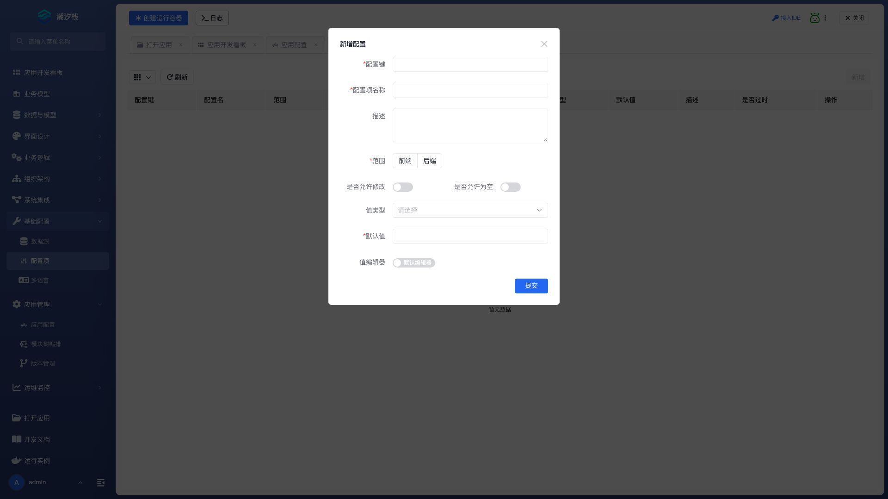
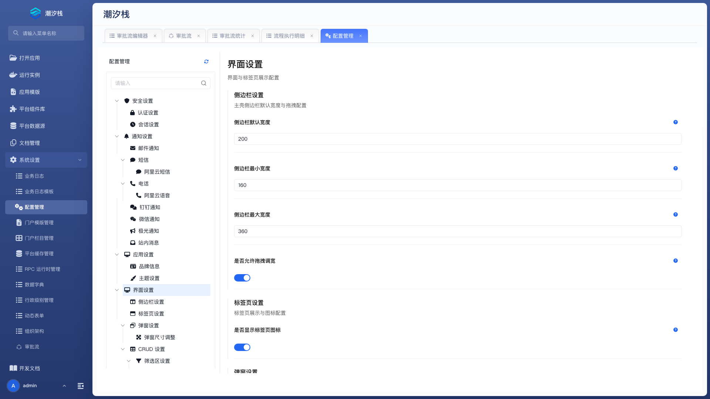

# 配置项

配置项声明应用运行中可能变化的参数和开关。开发阶段定义配置键、类型、默认值和录入方式；部署后，管理员在运行环境的配置工作台中维护实际值。

## 定义配置项

打开应用，选择 **基础配置 / 配置项**，点击 **新增**。

| 配置项 | 说明 |
| --- | --- |
| 配置键 | 必填，应用内唯一。代码和表达式使用它读取配置。 |
| 配置项名称 | 必填，管理界面中的显示名称。 |
| 描述 | 说明用途、取值范围和示例。 |
| 范围 | 必填，选择前端或后端。前端配置可能发送到浏览器，不能保存密码或令牌。 |
| 是否允许修改 | 控制运行环境能否覆盖配置值。关闭后使用固定定义。 |
| 是否允许为空 | 控制实际值是否可以为空；关闭时需提供有效默认值。 |
| 值类型 | 约束实际值的数据类型，应与读取方的预期一致。 |
| 默认值 | 未配置环境覆盖值时使用的值。 |
| 值编辑器 | 使用 UI Schema 定义录入控件和校验；默认编辑器按值类型提供控件。 |

填写后点击 **提交**。编辑已有定义时，还可以设置 **是否过时**；开启后须填写 **过时原因**，说明替代项和迁移方法。标记过时不会自动迁移调用方。

## 维护运行环境中的值 {#配置值修改}

在目标运行环境打开 **系统设置 / 配置管理**。左侧按用途分组，右侧展示当前分组的配置和编辑控件。

1. 选择配置所在的分组。
2. 找到目标配置，检查名称、说明和当前值。
3. 修改实际值并点击 **保存**。
4. 重新调用使用该配置的功能，确认实际行为符合预期。

**是否允许修改** 关闭时，运行环境不能覆盖该值。某些配置由专用管理入口维护，不提供通用编辑表单，应进入对应功能操作。

### 空值与类型 {#配置值为空}

开启 **是否允许为空** 才能保存空值；关闭时必须提供符合类型的值。控件允许输入不代表业务可以接受该值，还应验证阈值、范围和关联条件。

### 过时配置 {#配置项过时}

先按过时原因迁移代码、页面和逻辑流中的引用，再检查各环境的实际值。确认没有读取方后，才删除定义。

## 验证配置

用目标环境分别检查默认值、环境覆盖值、空值和非法类型。保存时遇到版本冲突，重新加载最新值，核对其他人的修改后再保存。

敏感参数使用后端范围，并通过相应组件的安全管理入口维护。密码输入控件只改变显示方式，不会自动限制接口读取权限。

## 扩展阅读

- [配置项完整字段说明](../../../low-code/development-platform-menus/config-item)
- [应用配置](../../../low-code/development-platform-menus/app-configuration)
