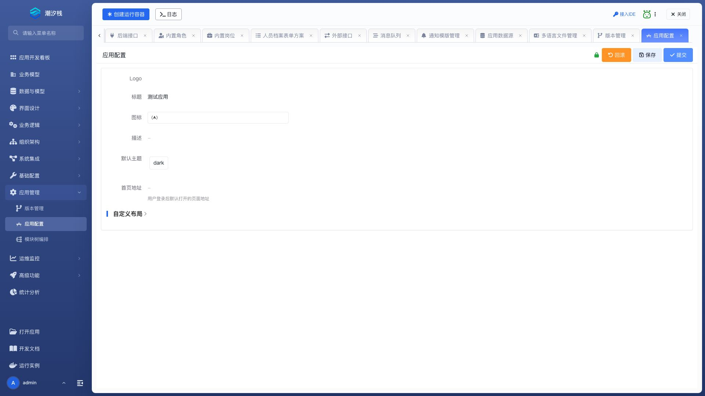
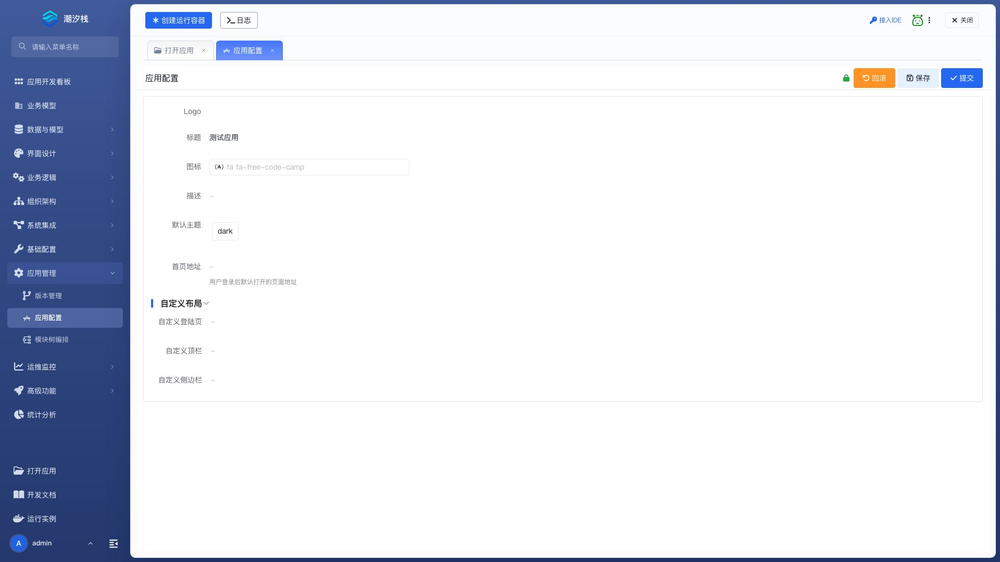

# 应用配置

应用配置维护应用的品牌信息、默认主题、登录后首页和自定义布局入口。这些设置面向整个应用，修改后应同时检查登录页、桌面端和移动端。

## 打开并取得编辑权

打开应用，在左侧菜单选择“应用管理 / 应用配置”。页面初始为只读状态，先点击工具栏中的编辑或锁定操作取得编辑权，再修改表单。

## 配置应用信息

| 配置项 | 说明 |
| --- | --- |
| Logo | 上传 JPG、JPEG、PNG 或 GIF。编辑器支持 1:1 裁剪、旋转和缩放；已有 Logo 可以在取得编辑权后清除。 |
| 标题 | 应用显示名称。 |
| 图标 | 从图标选择器中选择应用图标。 |
| 描述 | 说明应用用途，可能显示在应用列表或信息页。 |
| 默认主题 | 可选深色或浅色，作为用户没有个人偏好时的默认主题。 |
| 首页地址 | 用户登录后默认打开的应用内页面地址。 |

首页地址应指向当前应用中存在且目标用户有权访问的页面。使用业务路径前先在“前端页面”中验证。

## 配置自定义布局

展开“自定义布局”后，可以选择当前应用中已注册的微前端：

| 配置项 | 说明 |
| --- | --- |
| 自定义登录页 | 选择类型为微前端应用的入口，用于替换默认登录界面。 |
| 自定义顶栏 | 选择类型为微前端组件的入口，用于替换或扩展顶栏。 |
| 自定义侧边栏 | 选择类型为微前端组件的入口，用于替换或扩展侧边栏。 |

下拉框只显示符合对应类型的微前端。列表为空时，先到“微前端”创建或上传正确类型的入口。

## 保存、提交与回滚

工具栏的版本控制操作用于管理应用配置文件：

- 保存表单后，页面提示“保存成功”。
- 完成验证后提交配置变更。
- 不再需要未提交修改时使用回滚。
- 结束编辑后释放锁，让其他用户可以修改。

清除 Logo 只是把表单中的 Logo 设为空，仍需保存和提交才会成为应用配置的一部分。

## 验证应用配置

1. 保存后刷新配置页，确认字段值没有丢失。
2. 重新打开应用，检查标题、图标、Logo 和默认主题。
3. 使用没有个人主题偏好的测试用户验证默认主题。
4. 登录后确认首页地址可访问且权限正确。
5. 分别验证自定义登录页、顶栏和侧边栏的加载、异常回退和响应式布局。
6. 在运行实例中确认提交后的配置已经生效。

## 常见问题

### 为什么所有字段都不能编辑？

应用配置使用编辑锁。先通过工具栏取得编辑权；若被其他用户锁定，等待对方释放后再刷新。

### 为什么自定义布局下拉框为空？

登录页需要微前端应用类型，顶栏和侧边栏需要微前端组件类型。先注册符合类型的微前端，并确认当前用户有编辑权限。

### 首页地址打开后提示无权限怎么办？

检查地址是否正确，并确认目标用户的角色包含页面和接口权限。首页可访问性不能只用管理员账号验证。

### 保存后 Logo 仍显示旧图怎么办？

确认已经提交配置并刷新实际应用页面。若仍未变化，再清理浏览器缓存并核对当前运行实例加载的应用版本。

## 扩展阅读

- [前端页面](./frontend-page)
- [微前端](./micro-frontend)
- [主题样式](./theme-style)
