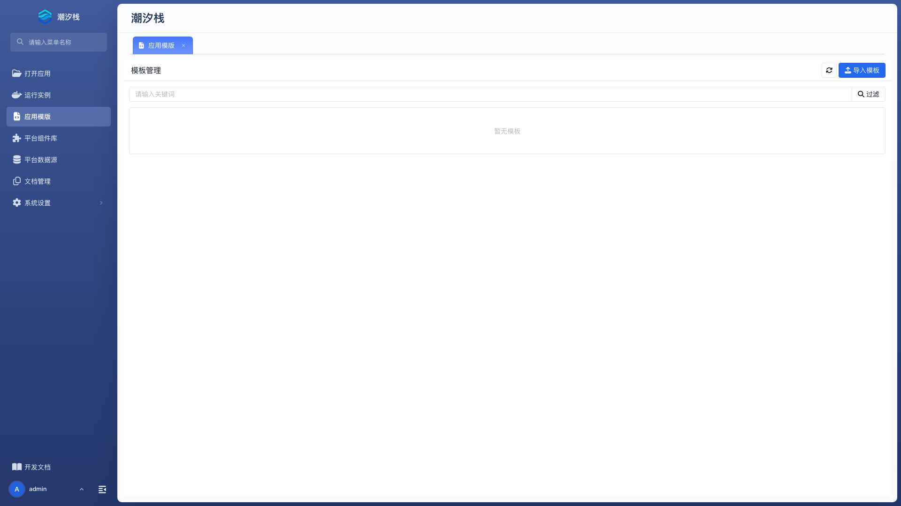
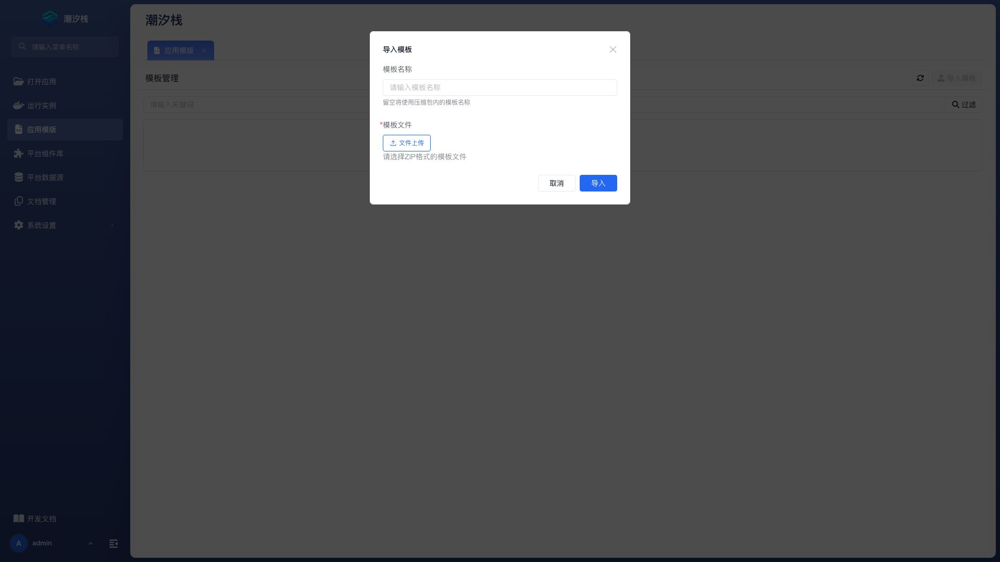

# 应用模版

应用模版保存一套可复用的应用定义，用于快速创建结构相同的新应用。模版可以从现有应用生成，也可以在平台管理中导入、导出和删除。

## 打开应用模版

在平台管理菜单选择“应用模版”。列表可以按关键字过滤，并显示模版标题或名称、版本、作者和描述。

## 从模版创建应用

在目标模版的操作菜单点击“从模版创建应用”，填写：

| 配置项 | 说明 |
| --- | --- |
| 模板名称 | 只读。当前使用的模版。 |
| 应用名称 | 必填。新应用的唯一标识。 |
| 应用标题 | 必填。用户看到的应用名称。 |
| 应用图标 | 从图标选择器中选择。 |
| 应用描述 | 说明新应用用途。 |

创建完成后，在“打开应用”中找到新应用并检查其模型、页面、配置项和依赖。模版不会自动提供目标环境的数据源值、凭据或业务数据。

## 导入模版

点击“导入模版”，填写：

| 配置项 | 说明 |
| --- | --- |
| 模板名称 | 可选。为导入模版指定名称；留空时按包内信息处理。 |
| 模板文件 | 必填。选择已导出的模版包。 |

导入前确认模版来源可信，并与当前平台版本兼容。导入后先查看版本、作者和描述，再用于创建应用。

## 导出模版

在模版操作菜单点击“导出模版”下载模版包。导出文件适合备份或迁移到兼容平台，不包含运行数据库中的业务数据和环境凭据。

## 删除模版

删除模版不会删除已经从它创建的应用。执行前确认没有团队仍将该模版作为标准起点，并保留需要的导出备份。

## 从现有应用创建模版

“打开应用”列表的应用操作中选择“创建模板”，填写模版名称、标题、图标、描述、版本和作者。创建完成后回到应用模版页检查结果。

## 验证模版

1. 使用模版创建一个测试应用。
2. 打开应用，检查业务模型、页面、逻辑和基础配置。
3. 补齐测试环境的数据源和配置值。
4. 创建运行实例并完成一条关键业务流程。
5. 记录模版中需要创建者手工补充的环境依赖。

## 常见问题

### 从模版创建应用后为什么不能直接运行？

模版主要提供应用定义。数据源、环境配置、密钥、外部服务和平台组件库等依赖仍需在目标环境准备。

### 导入失败应该先检查什么？

检查文件是否为有效模版包、平台版本是否兼容、模版名称是否冲突，以及当前用户是否有模版管理权限。

### 删除模版会影响现有应用吗？

不会删除已经创建的应用。但后续无法再以该模版创建新应用，删除前应确认不再需要。

### 应用模版和应用版本有什么区别？

应用版本记录一个应用的历史快照；应用模版面向复用，用于创建新的应用。两者的用途和生命周期不同。

## 扩展阅读

- [打开应用](./open-apps)
- [版本管理](./version-management)
