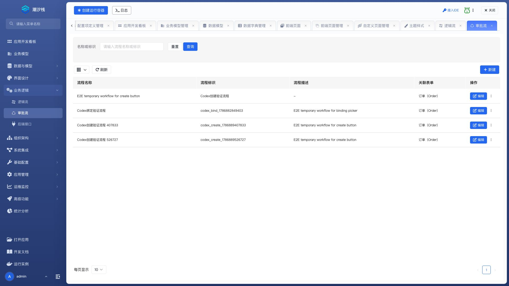
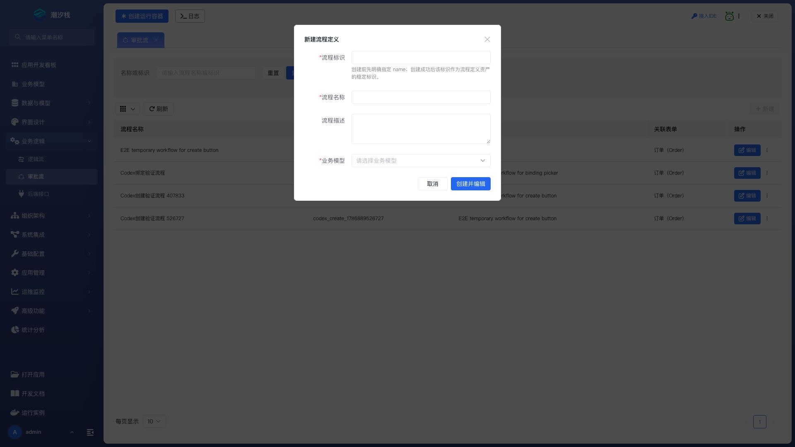
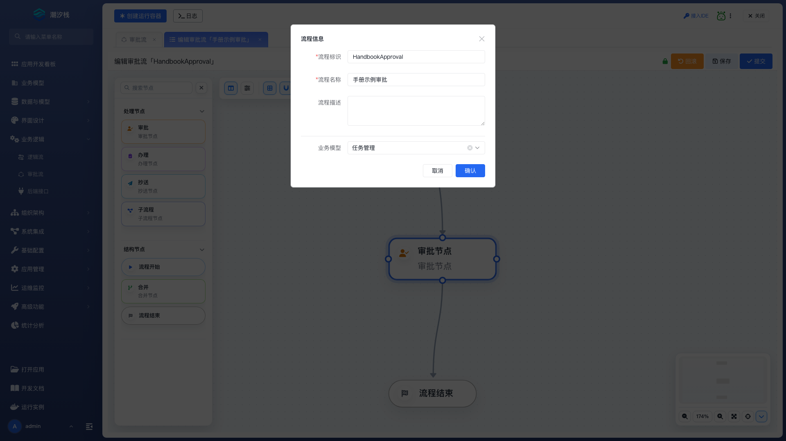
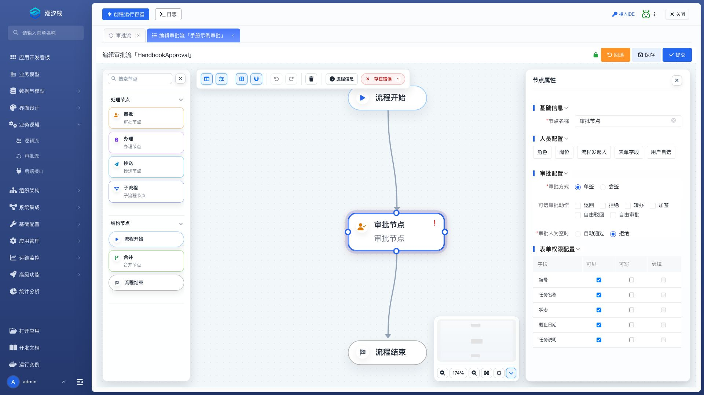
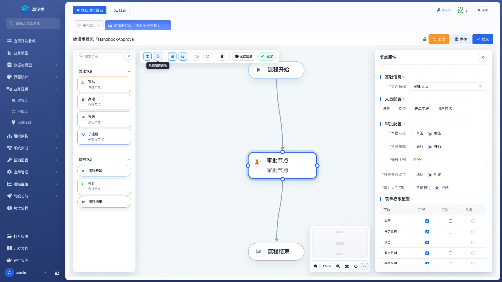

# 审批流

审批流用于定义一项业务申请经过哪些审批节点、由谁处理以及在什么条件下流转。每个流程绑定一个业务模型，运行时以该模型的表单和数据作为审批对象。

## 开始前准备

创建流程前先确认：

1. 业务模型已经提交，新增和详情表单可以正常使用。
2. 发起人和审批人能够映射到明确的用户、员工、部门、岗位或角色。
3. 业务状态字段及通过、拒绝、退回后的处理规则已经明确。
4. 需要通知时，相关通知模板和渠道已经配置。

## 打开审批流

打开应用，在左侧菜单选择“业务逻辑 / 审批流”。可用“名称或标识”搜索流程，点击“查询”执行筛选，点击“重置”清空条件。

| 列 | 说明 |
| --- | --- |
| 流程名称 | 面向发起人和审批人的显示名称。 |
| 流程标识 | 应用内唯一的流程名称，用于接口和流程实例识别。 |
| 流程描述 | 流程用途和适用范围。 |
| 关联表单 | 流程绑定的业务模型。 |
| 操作 | 编辑、查看或删除流程。 |

## 新建审批流

点击“新建”，在前置对话框中填写：

| 配置项 | 说明 |
| --- | --- |
| 流程标识 | 必填。应用内唯一且稳定的流程标识。 |
| 流程名称 | 必填。用户发起和处理审批时看到的名称。 |
| 流程描述 | 说明适用场景、发起条件或审批范围。 |
| 业务模型 | 必填。选择流程使用的申请数据和表单。 |

点击“创建并编辑”后进入流程编辑器。

## 编辑基本信息

在编辑器中点击 **流程信息**，维护流程定义本身：

| 配置项 | 说明 |
| --- | --- |
| 流程标识 | 必填。已有流程的稳定标识；修改前要确认没有外部调用依赖。 |
| 流程名称 | 必填。审批列表和详情中显示的名称。 |
| 流程描述 | 流程的业务说明。 |
| 业务模型 | 选择流程绑定的业务模型。修改后应重新检查表单字段和条件表达式。 |

## 使用流程编辑器

进入后先点击 **开始编辑** 取得编辑权。左侧节点库用于添加节点，中间画布连接顺序和分支，右侧属性面板配置当前选中的元素。画布被面板遮挡时，点击右下角 **适配** 或 **居中** 重新定位。

### 开始和结束节点

开始节点定义流程入口，结束节点表示一条路径正常完成。每条可达路径都应从开始节点出发并最终到达结束节点。

### 审批节点

选中审批节点，配置人员来源、审批方式和表单权限。

| 配置项 | 说明 |
| --- | --- |
| 节点名称 | 必填，标明该步骤由谁处理或处理什么事项。 |
| 人员配置 | 选择角色、岗位、流程发起人、表单字段或用户自选，再填写该来源要求的角色、岗位、字段等参数。当前节点维护一种人员来源。 |
| 审批方式 | 单签或会签。单签配置可用动作，会签配置执行方式和通过比例。 |
| 可选审批动作 | 单签时选择退回、拒绝、转办、加签、自由驳回或自由审批。只开启业务确实允许的动作。 |
| 会签模式 | 会签时选择串行或并行。 |
| 通过比例 | 会签时填写 `1` 到 `100` 的百分比，默认 `100`。 |
| 会签失败动作 | 会签未通过时选择退回或拒绝。 |
| 审批人为空时 | 配置自动通过或拒绝；环境提供用户选择器时还可指定转交人。应根据业务要求明确选择，避免人员配置缺失时意外通过。 |
| 表单权限配置 | 对每个业务字段分别设置可见、可写和必填；仅在平台提供了表单字段时显示。 |

### 办理、抄送和子流程

- **办理节点**：配置节点名称、办理人员来源和表单字段权限。
- **抄送节点**：配置节点名称和抄送人员来源，不承担审批通过判断。
- **子流程节点**：选择要调用的流程，设置传入变量和回传变量；每条映射填写来源和目标变量。
- **合并节点**：汇合上游路径。添加后检查进入和离开该节点的连线。

### 条件分支

分支条件根据申请数据或流程上下文决定下一条路径。为每条分支配置互斥且可验证的条件，并保留能够处理未命中情况的路径，避免实例停在分支节点。

### 连线

连线表示节点执行顺序。修改节点后检查所有入线和出线，尤其是分支、退回和并行路径。分支路由在连线及其条件配置中维护，不需要另外添加旧版条件节点。

选中连线后，右侧面板根据连线用途显示以下内容：

| 配置项 | 说明 |
| --- | --- |
| 条件表达式 | 同一节点有多条出线等条件路由场景下配置。使用关联表单提供的字段组合判断条件；缺少可用字段时，先检查流程绑定的业务模型及字段来源。 |
| 路由顺序 | 连线已有顺序值时显示，只读，用于核对分支顺序。 |

普通顺序连线无需配置条件，只读模式下只能查看已有条件和顺序。

### 诊断信息

编辑器诊断入口会汇总缺失配置和结构错误。保存前处理所有错误项，并逐项检查警告指向的节点或连线。

## 保存与验证

1. 保存流程定义并确认编辑器没有阻断性诊断。
2. 使用业务用户发起一条最小测试申请。
3. 使用审批人账号进入审批中心，确认能够看到待办和申请表单。
4. 分别验证通过、拒绝和需要的退回路径。
5. 检查业务状态、审批记录和通知结果。
6. 在审批流统计中确认实例当前节点、处理人和最终状态。

流程包含条件分支时，每条分支至少执行一次；包含多人审批时，还要验证通过规则是否符合预期。

## 查看与删除

“查看”以只读方式打开流程定义，适合核对节点、表单和流转路径。“删除”会移除定义，执行前应确认没有运行中的流程实例或业务入口仍在使用它。

## 常见问题

### 为什么业务模型下拉框中找不到目标模型？

确认业务模型已经保存并提交，且当前流程和业务模型属于同一应用。刷新页面后仍不可见时，再检查模型是否加载失败。

### 为什么审批人收不到待办？

检查流程是否已到达该审批节点、节点的审批人规则是否能解析到具体用户，以及员工、部门、岗位、角色与用户账号之间的映射是否完整。

### 为什么流程停在条件分支？

检查分支表达式引用的字段是否存在、实际值类型是否匹配，以及是否存在没有任何条件命中的情况。为兜底路径设置清晰规则后重新发起测试实例。

### 修改流程后为什么已有实例没有变化？

运行中的实例通常按其启动时使用的流程定义继续执行。修改后应新发起实例验证，不要用已有实例判断新定义是否生效。

## 扩展阅读

- [审批流专题](../../guide/module/approval-workflow/)
- [业务模型](./business-model)
- [内置角色](./builtin-role)
- [内置岗位](./builtin-position)
