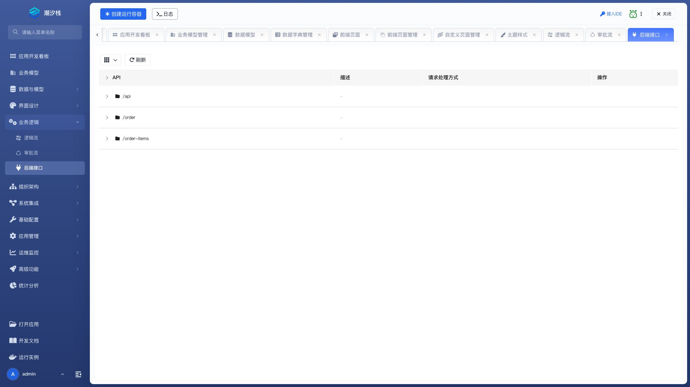
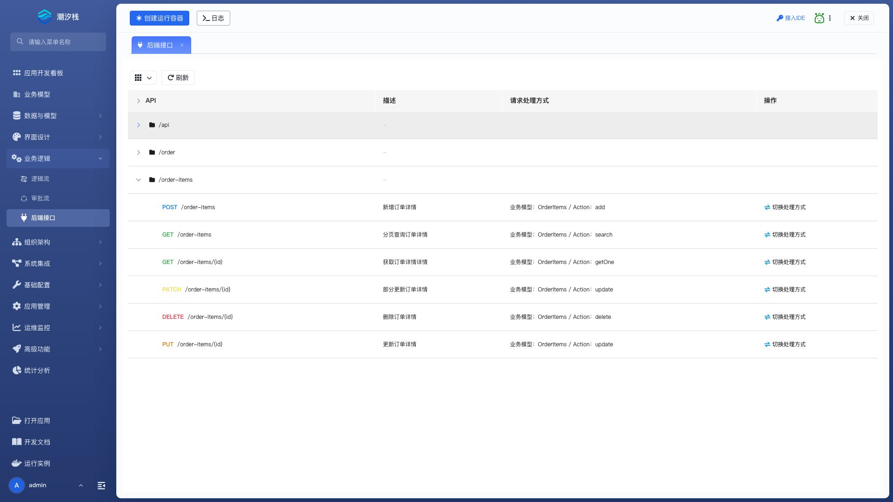
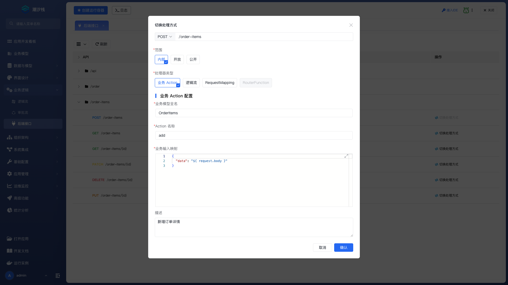

# 后端接口

后端接口页汇总应用已经提供的 HTTP API，并允许在应用内切换接口的处理方式。接口可以绑定业务模型中的 Action，交给逻辑流处理，或调用后端代码中的 RequestMapping。

## 打开后端接口

打开应用，在左侧菜单选择“业务逻辑 / 后端接口”。接口按路径分组显示，分组行用于组织下级 API。



| 列 | 说明 |
| --- | --- |
| API | 请求方法和路径。 |
| 描述 | 接口的摘要说明。 |
| 请求处理方式 | 显示当前业务 Action、逻辑流或代码处理器及其关联对象。 |
| 操作 | 切换处理方式，或复原应用内的覆盖。 |

点击处理方式旁的“查看”，可以检查关联逻辑流或 RequestMapping 详情。

## 查看处理器



### 查看逻辑流

逻辑流详情会打开只读画布。根据当前模型状态，还可以：

- **克隆并编辑**：把继承的逻辑流克隆到当前应用后修改。
- **编辑**：打开当前应用已经修改的逻辑流。
- **复原**：撤销应用内逻辑流覆盖。

### 查看 RequestMapping

详情显示：

| 字段 | 说明 |
| --- | --- |
| 类名 | 提供该接口的后端类。 |
| 方法名 | 实际处理请求的方法。 |

这两个字段用于定位代码实现，不能在详情窗口中修改。

## 切换处理方式

在接口行点击“切换处理方式”，配置接口入口和处理器。

| 配置项 | 出现条件 | 说明 |
| --- | --- | --- |
| 请求方法 | 始终显示 | 必填。接口使用的 HTTP 方法。 |
| 路径 | 始终显示 | 必填。接口相对于应用的请求路径。 |
| 范围 | 始终显示 | 必填。可选内部、开放或公开。 |
| 处理器类型 | 始终显示 | 必填。可选业务 Action、逻辑流或 RequestMapping；RouterFunction 在当前切换表单中不可选。 |
| 业务模型全名 | 处理器类型为业务 Action | 必填。动作所属模型，包含模块命名空间，例如 `HandbookTask`。 |
| Action 名称 | 处理器类型为业务 Action | 必填。目标模型已经定义的动作标识，例如 `add` 或自定义动作名。 |
| 业务输入映射 | 处理器类型为业务 Action | 必填的 JSON 对象。把 HTTP 请求映射到动作的 `params`、`data` 两个输入分区；无输入时显式填写 `{}`。 |
| 逻辑流名称 | 处理器类型为逻辑流 | 选择处理当前请求的逻辑流。 |
| 完整类名 | 处理器类型为 RequestMapping | 后端控制器或处理类的完整类名。 |
| 方法名 | 处理器类型为 RequestMapping | 类中处理请求的方法名。 |
| 描述 | 始终显示 | 接口用途、输入和输出的摘要。 |

### 接口范围

- **内部**：供应用内部能力调用，应按平台内部访问规则使用。
- **开放**：供经过身份认证和授权的外部调用方使用。
- **公开**：无需登录即可访问，应谨慎评估数据泄露、滥用和限流风险。

切换范围前先确认安全要求。公开接口不能依赖“调用方一定已登录”的假设。

### 选择处理器

- **业务 Action**：复用模型定义的输入输出契约、权限和前置条件；实际处理由该 Action 的实现绑定决定。
- **逻辑流**：适合通过可视化节点完成校验、查询、写入和数据转换。
- **RequestMapping**：复用后端扩展包或平台模块中的控制器方法。

例如，更新动作的业务输入可以这样映射：

```json
{
  "params.record.id": "${ request.pathVariables['id'] }",
  "data": "${ request.body }"
}
```

这里的 `id` 必须与接口路径中的变量名一致；请求体还必须符合目标 Action 的输入 Schema。HTTP 路径、请求头和查询参数不会自动成为业务输入，应显式声明需要的来源。



## 复原接口

接口被当前应用修改后，操作栏出现“复原”。复原会删除应用内处理方式覆盖并恢复上游定义。执行前记录当前方法、路径、范围和处理器，确认没有调用方依赖本地修改。

## 验证接口

1. 保存处理方式后刷新列表，确认方法、路径和处理器。
2. 打开处理器详情，检查关联逻辑流或后端方法。
3. 使用符合接口范围的账号或凭证发起请求。
4. 验证成功响应、参数错误、无权限和处理器异常。
5. 涉及写操作时检查数据库结果和业务日志。
6. 逻辑流处理器出现问题时，结合调试会话定位具体节点。

## 常见问题

### 为什么这里没有“新建接口”？

该页面汇总由业务模型、后端模块或其他元数据提供的接口，并允许覆盖处理方式。需要新的低代码接口时，先在业务模型的接口配置中创建；需要代码接口时，通过后端扩展包注册。

### 选择逻辑流后为什么请求失败？

检查逻辑流是否存在并启用、是否通过校验，以及入口输入和出口输出是否与 HTTP 请求处理约定匹配。

### 修改为公开范围前要检查什么？

确认接口不返回敏感数据，输入经过严格校验，并具备必要的防重放、限流和审计措施。公开范围意味着不能依赖登录态保护接口。

### 复原会删除逻辑流吗？

复原只移除接口处理方式的应用内覆盖，不会自动删除独立逻辑流。之后应检查该逻辑流是否仍被其他接口、任务或消息绑定引用。

## 扩展阅读

- [业务模型](./business-model)
- [逻辑流](./logicflow)
- [后端扩展包](./backend-extension-package)
