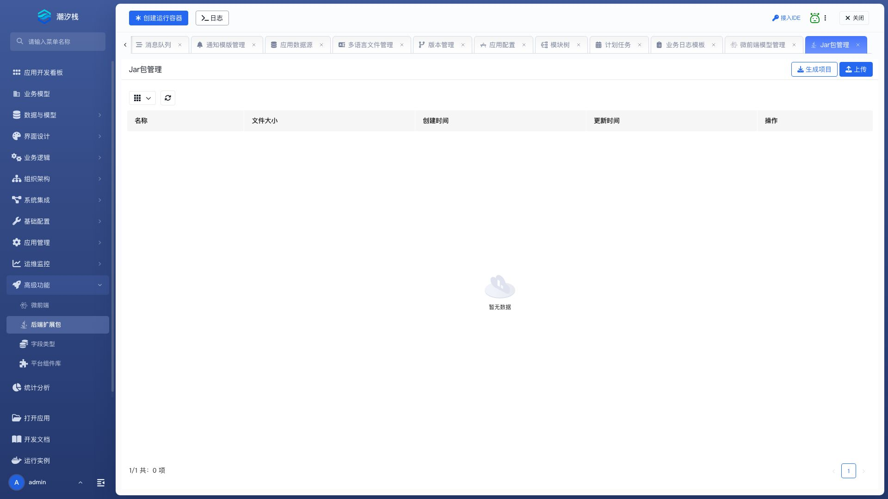
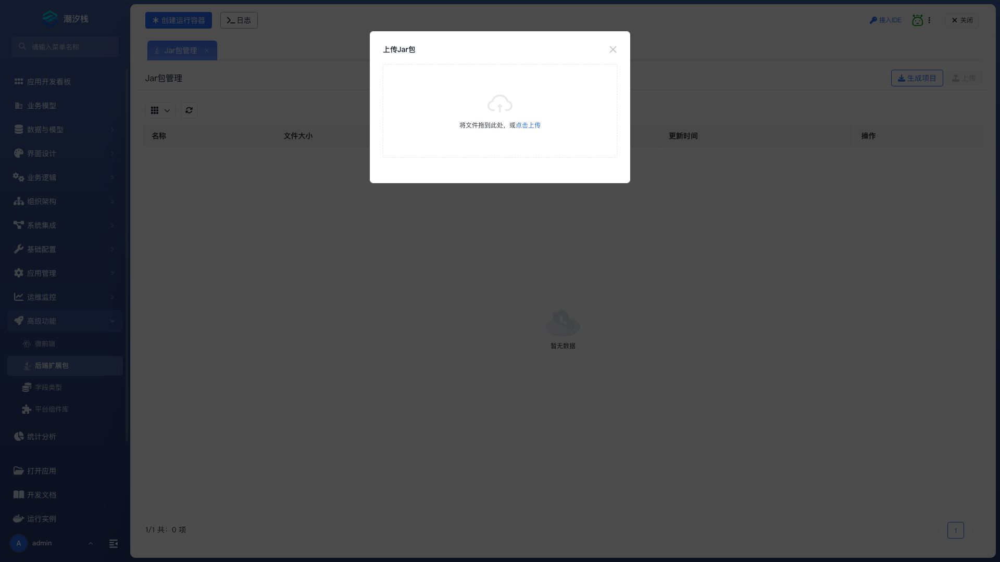

# 后端扩展包

后端扩展包用于把 Java 代码能力接入当前应用，例如自定义服务、控制器、配置或平台扩展点实现。平台加载的是构建后的 Jar 包，源码仍在独立工程中维护。

## 打开后端扩展包

打开应用，在左侧菜单选择“高级功能 / 后端扩展包”。列表显示 Jar 文件名、文件大小、创建时间和更新时间。

## 生成项目

拥有应用编辑权限时，点击“生成项目”并选择兼容的官方模板。

| 配置项 | 说明 |
| --- | --- |
| 项目模板 | 必填。当前提供 Spring 自动配置后端扩展模板。 |
| Maven groupId | 必填。Maven 坐标中的组织标识，并须符合 Java 包名规则。 |
| Maven artifactId | 必填。项目和 Jar 的制品标识。 |
| 项目版本 | 必填。默认 `0.1.0-SNAPSHOT`。 |
| Java 包名 | 必填。源码根包名。 |
| 自动配置类名 | 自动配置入口类名，默认 `ExtensionAutoConfiguration`。 |

点击“生成并下载”得到源码 ZIP。生成器不编译项目，也不会把源码或 Jar 自动写入应用。

## 开发扩展包

1. 解压项目并使用 Java 21、Maven 3.8.6+ 开发。
2. 在既有平台扩展点上实现功能，不绕过注册机制。
3. Spring 自动配置通过 `AutoConfiguration.imports` 等模板已提供的入口注册。
4. 添加单元测试和必要的集成测试。
5. 使用 Maven 构建 thin Jar，并在与目标平台兼容的依赖版本上验证。

扩展包不应打入平台已经提供的依赖，以免出现类冲突和版本漂移。

## 上传 Jar

点击“上传”，选择构建好的 Jar 文件并提交。

上传后列表应显示文件名、大小和创建时间。运行实例需要重新加载或重启才能使用新扩展时，按实例管理流程执行。

## 更新 Jar

在列表中点击“更新”，选择新构建的 Jar。更新前应保持文件标识和扩展注册兼容；存在破坏性变更时先准备应用元数据和数据迁移。

## 删除 Jar

删除前确认业务模型、逻辑流节点、后端接口和配置不再依赖该扩展。删除只移除应用中的 Jar，不会自动清理扩展提供的元数据引用。

## 验证扩展包

1. 在测试应用上传 Jar。
2. 启动或重启运行实例，检查启动日志中自动配置加载结果。
3. 验证扩展提供的接口、服务或元数据能够发现。
4. 验证配置缺失、依赖不可用和异常输入。
5. 更新到新 Jar 后重复关键路径测试。
6. 删除或回退 Jar 时确认实例可以恢复启动。

## 常见问题

### 为什么上传后功能没有出现？

检查 Jar 是否包含正确的扩展注册文件，运行实例是否重新加载，以及扩展依赖的平台版本是否兼容。

### 为什么“生成项目”按钮不可见？

只有拥有应用编辑权限的用户能生成项目。菜单可见不代表拥有应用编辑权。

### “生成项目”窗口空白怎么办？

检查平台日志中的项目生成表单和模板目录加载错误。生成服务不可用时，可按 [后端扩展包开发](../../fusion-development/backend-extension-packages) 准备扩展工程，本地构建后上传 Jar；生成失败不会自动安装扩展。

### 更新 Jar 后实例启动失败怎么办？

查看启动日志中的类加载、依赖版本和自动配置错误。恢复上一版 Jar 后，再在本地按目标平台依赖重现并修复。

### 可以把所有依赖打进一个 fat Jar 吗？

官方模板交付的是 thin Jar。把平台依赖重复打包可能造成类冲突，应按模板的依赖和打包方式构建。

## 扩展阅读

- [后端接口](./backend-api)
- [字段类型](./field-type)
