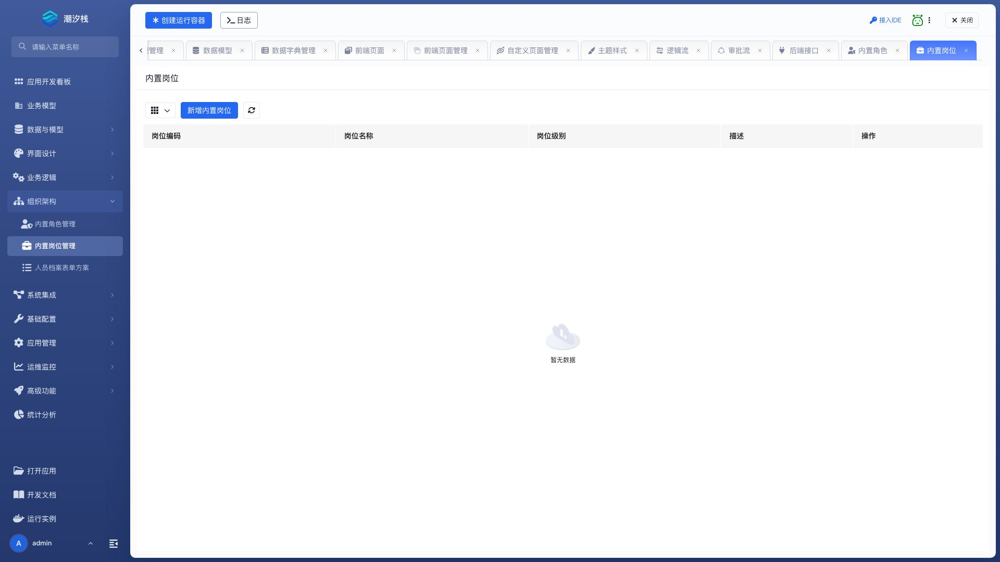
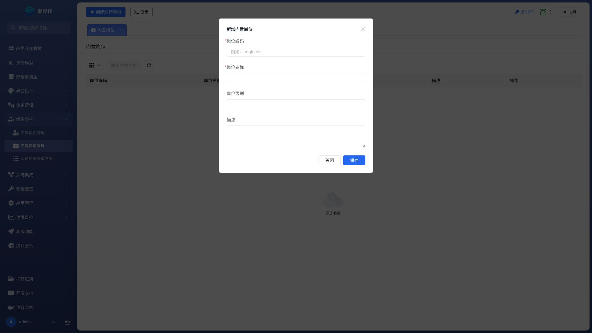

# 内置岗位

内置岗位用于在应用中预先定义人员职责，例如流程审批、组织筛选或业务分工所需的岗位。应用部署后，管理员可以把实际员工分配到这些岗位。

## 打开内置岗位

打开应用，在左侧菜单选择“组织架构 / 内置岗位管理”。列表显示岗位编码、岗位名称、岗位级别和描述。

## 新增内置岗位

点击“新增内置岗位”，填写：

| 配置项 | 说明 |
| --- | --- |
| 岗位编码 | 必填。应用内唯一的稳定标识，供审批流和组织规则引用。 |
| 岗位名称 | 必填。管理员和业务人员看到的岗位名称。 |
| 岗位级别 | 可选。用于表达岗位层级或业务等级；同一应用内应采用统一编码规则。 |
| 描述 | 说明岗位职责、适用组织或人员范围。 |

保存后，岗位会随应用定义交付，但不会自动把任何员工分配到该岗位。

## 编辑内置岗位

点击列表中的“编辑”，可以修改岗位编码、名称、级别和描述。已被审批流、组织规则或外部配置引用的岗位编码不应随意修改。

## 删除内置岗位

点击“删除”前检查：

1. 审批流是否按该岗位选择审批人。
2. 组织架构中是否已有员工分配到该岗位。
3. 权限或数据范围是否引用岗位编码。
4. 外部集成是否同步或识别该岗位。

存在引用时应先迁移配置和人员，再删除岗位。

## 验证岗位

1. 保存岗位后确认列表字段正确。
2. 在运行环境的组织架构中找到该岗位。
3. 给测试员工分配岗位。
4. 发起引用该岗位的审批或业务流程。
5. 确认候选人、数据范围或业务规则解析到预期人员。

## 常见问题

### 新建岗位后为什么没有人员？

内置岗位只定义岗位本身。员工分配属于运行环境的组织管理操作，需要由管理员完成。

### 岗位级别应该填什么？

岗位级别没有替代岗位编码的作用。根据组织已有规则填写稳定的层级或等级值；如果业务不使用岗位层级，可以留空。

### 修改岗位编码会有什么影响？

审批流、权限规则和外部集成可能按编码引用岗位。投入使用后修改编码可能导致人员解析失败，应先查清引用并迁移。

### 内置岗位和角色有什么区别？

岗位表达人员在组织中的职责或位置，角色表达用户拥有的系统权限。一个员工可以有岗位，也可以同时拥有多个角色，两者不应混用。

## 扩展阅读

- [内置角色](./builtin-role)
- [审批流](./approval-workflow)
- [人员档案表单](./personnel-profile-form)
