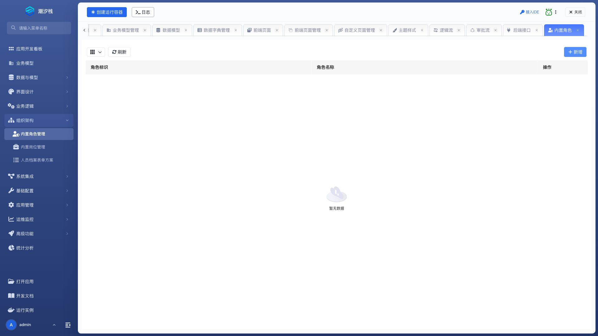
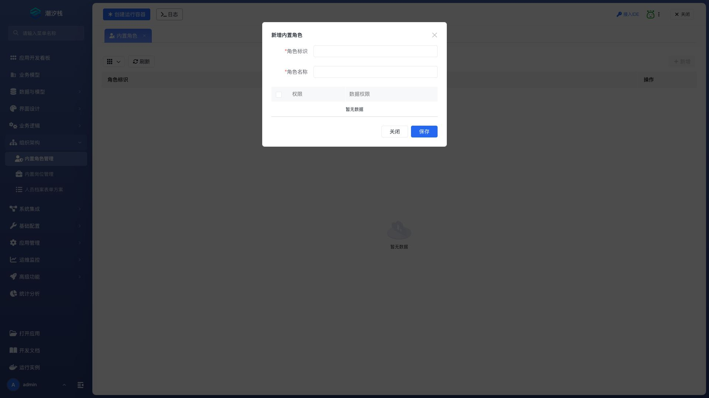

# 内置角色

内置角色随应用定义交付，用于预设一组功能权限和数据权限。部署应用后，平台管理员可以把实际用户分配到这些角色，而不必重新设计应用权限结构。

## 打开内置角色

打开应用，在左侧菜单选择“组织架构 / 内置角色管理”。列表显示角色标识和角色名称，并提供新增、编辑等操作。

权限树从应用的开发助手中读取。配置前先在顶部工具栏启动开发助手，并确认助手已加载当前应用、后端 API 会话可以建立。修改业务模型的权限定义后，需要刷新助手再重新打开角色表单。

## 新增内置角色

点击“新增”，配置角色身份和权限。

| 配置项 | 说明 |
| --- | --- |
| 角色标识 | 必填。应用内唯一的稳定标识，创建后不应随意修改。 |
| 角色名称 | 必填。管理员分配角色时看到的名称。 |
| 权限 | 在权限选择器中勾选该角色拥有的功能权限。 |
| 数据权限 | 为支持访问控制的业务模型配置查询范围或规则；仅在当前应用存在可配置的数据权限时显示。 |

权限选择器应按最小权限原则配置，只授予角色完成职责所需的菜单、接口和操作。

## 配置数据权限

数据权限区域按支持访问控制的业务模型展开。每个模型可能提供不同的配置项，具体字段由该模型的访问控制定义决定。

配置时需要明确：

1. 角色可以查看哪些记录。
2. 是否允许查看本人、所属组织或全部数据。
3. 创建、修改、删除等操作是否使用同一范围。
4. 没有命中规则时采用拒绝还是默认范围。

修改规则后使用实际角色账号验证列表查询和详情访问，不能只验证菜单是否出现。

## 编辑内置角色

点击角色行进入编辑。

| 配置项 | 说明 |
| --- | --- |
| 角色标识 | 显示现有标识，作为角色引用依据。 |
| 角色名称 | 必填。可以根据业务称谓调整。 |
| 权限 | 重新选择角色拥有的功能权限。 |
| 数据权限 | 调整各业务模型的数据访问规则。 |

取消权限后，已经登录的用户可能需要重新登录或刷新权限缓存才能看到变化。

## 验证角色

1. 保存角色并确认列表中标识和名称正确。
2. 在运行环境把一个测试用户分配到该角色。
3. 使用该用户登录，检查菜单和按钮权限。
4. 分别查询属于和不属于该用户范围的数据。
5. 验证直接访问页面路径和接口时也会被权限规则拦截。

## 常见问题

### 内置角色和平台中的实际角色有什么区别？

内置角色是应用随定义交付的角色模板；运行环境中的实际用户分配由平台权限管理完成。应用设计者定义职责和权限，管理员负责把人员映射到角色。

### 为什么没有显示数据权限配置？

先确认开发助手已运行且后端 API 会话正常；权限树读取失败时，表单也可能显示“暂无数据”。连接正常后，再确认业务模型已经启用相应访问控制并提供配置 Schema，然后刷新助手和角色页面。

### 用户已经获得角色，为什么仍看不到功能？

检查角色是否包含对应权限、用户分配是否在当前运行环境生效，以及权限缓存或登录会话是否需要刷新。

### 可以修改角色标识吗？

角色标识可能被权限绑定和外部配置引用。已投入使用后不要把修改标识当作普通重命名；更稳妥的做法是新建角色并迁移用户和权限。

## 扩展阅读

- [业务模型](./business-model)
- [内置岗位](./builtin-position)
- [审批流](./approval-workflow)
