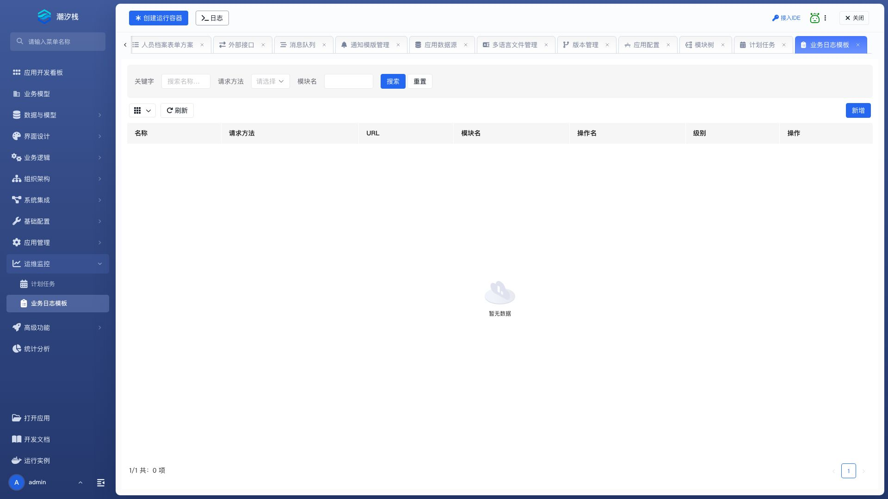
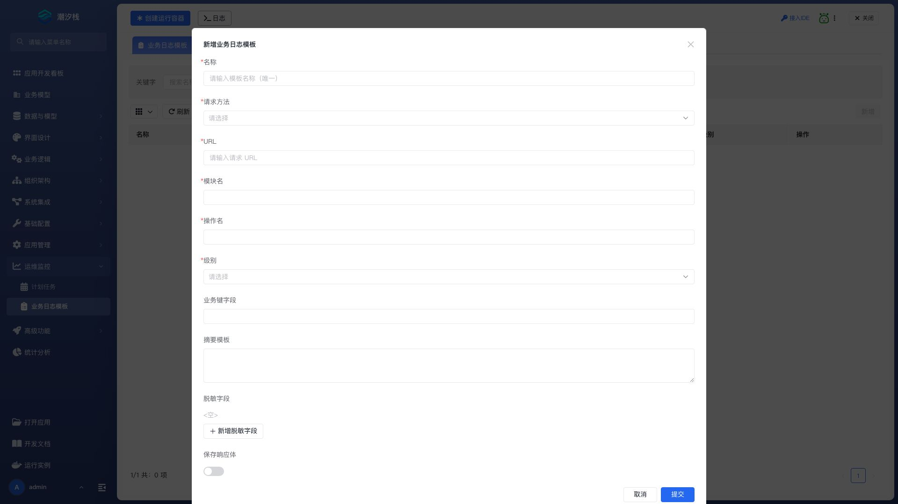

# 业务日志模板

业务日志模板定义哪些 HTTP 操作需要记录业务日志，以及日志中的模块、操作、业务键、摘要、脱敏字段和响应内容。它用于审计业务行为，不替代系统异常日志。

## 打开业务日志模板

打开应用，在左侧菜单选择“运维监控 / 业务日志模板”。可按关键字、请求方法和模块名筛选。

| 列 | 说明 |
| --- | --- |
| 名称 | 模板唯一名称。 |
| 请求方法 | 匹配的 HTTP 方法。 |
| URL | 匹配的请求路径。 |
| 模块名 | 日志归属模块。 |
| 操作名 | 日志中显示的业务操作。 |
| 级别 | 一般、警告或危险。 |

## 新增日志模板

点击“新增”，填写：

| 配置项 | 说明 |
| --- | --- |
| 名称 | 必填。应用内唯一的模板标识。 |
| 请求方法 | 必填。可选 GET、POST、PUT、PATCH 或 DELETE。 |
| URL | 必填。需要记录的请求路径。 |
| 模块名 | 必填。日志所属业务模块。 |
| 操作名 | 必填。对业务动作的可读描述。 |
| 级别 | 必填。可选一般、警告或危险。 |
| 业务键字段 | 从请求或上下文中提取业务对象标识的字段名。 |
| 摘要模板 | 生成日志摘要的模板，可引用请求上下文中的字段。 |
| 脱敏字段 | 不应以原值写入日志的字段名列表。 |
| 保存响应体 | 开启后记录响应内容，会增加存储和数据泄露风险。 |

密码、令牌、身份证件、联系方式等敏感字段应加入脱敏列表。没有明确审计需要时不要保存完整响应体。

## 选择日志级别

- **一般**：常规查询、创建或修改。
- **警告**：需要关注但不一定造成高风险的操作。
- **危险**：删除、权限变更、敏感数据导出等高风险动作。

级别应反映审计优先级，不要为了“更显眼”把全部操作设为危险。

## 编辑与查看详情

详情页只读展示全部配置。编辑页允许修改同样的字段；修改 URL 或请求方法前先确认不会与其他模板重复匹配。

## 验证业务日志

1. 保存模板后使用匹配的请求方法调用目标 URL。
2. 在业务日志中找到记录，核对模块、操作、级别和业务键。
3. 验证摘要中的变量替换。
4. 检查脱敏字段没有出现原值。
5. 开启保存响应体时，检查内容和大小是否可接受。
6. 再调用一个不匹配的 URL，确认不会误记日志。

## 常见问题

### 为什么调用接口后没有业务日志？

检查请求方法和 URL 是否准确匹配，模板是否已经加载到当前运行实例，以及目标请求是否经过业务日志拦截链路。

### 业务键字段填什么？

填写能够唯一定位业务对象的请求字段，例如记录 ID。字段必须能从平台支持的请求或上下文位置提取。

### 是否应该开启保存响应体？

只在审计确实需要且响应不含敏感数据时开启。大响应会明显增加日志存储，应优先用业务键和摘要定位。

### 脱敏字段为什么仍出现在摘要中？

脱敏配置与摘要模板都要检查。不要在摘要中主动拼接敏感字段，并通过实际请求验证最终日志内容。

## 扩展阅读

- [后端接口](./backend-api)
