# 业务模型

业务模型用于定义业务对象及其标准能力。字段和关联描述数据结构，视图配置决定列表和表单如何呈现，接口配置和访问控制约束数据读写，行为契约进一步定义动作、事件以及事件订阅。

在业务模型页面中，可以完成从新建模型到调试验证的完整配置。通常先确定模型的基本信息、字段和关联，再配置视图与接口；工作流、高级特性、访问控制和自定义功能根据实际需要启用。

## 开始前

开始配置前，确认当前账号可以编辑应用，并提前确定以下内容：

- 模型名：模型的稳定标识，以字母开头，只能包含字母和数字。
- 模型标题：显示在开发界面和业务页面中的名称。
- 所属模块：用于在模块树和应用菜单中组织模型。
- 核心字段：至少明确主键、显示字段、必填字段和唯一字段。
- 关联对象：需要建立主表、子表或引用关系时，先确认目标业务模型已经存在。

模型名会用于模型全名及相关页面、接口的标识。创建前应尽量确定稳定的命名，避免后续重命名影响已有引用。

## 打开业务模型

打开应用后，在左侧开发菜单中选择 **业务模型**。页面左侧是模块树，右侧是当前模块中的业务模型列表。

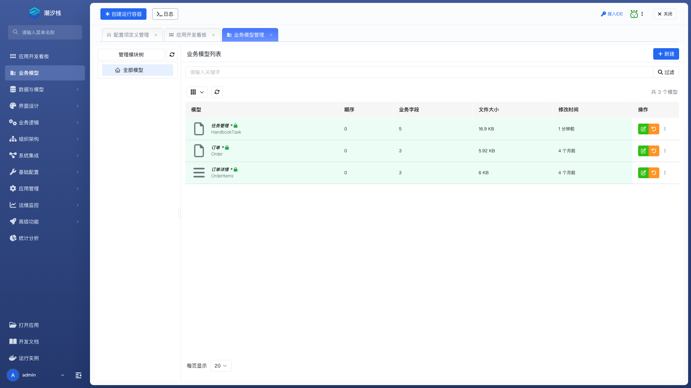

### 使用模块树

模块树用于按业务范围组织模型。选择一个模块后，右侧列表只显示该模块中的模型；选择 **全部模型** 可以查看整个应用的模型。

需要新增、重命名或调整模块时，点击 **管理模块树**。模块树只负责组织模型，不改变模型本身的字段、视图和接口配置。

### 查看模型列表

模型列表提供以下信息和操作：

| 区域 | 用途 |
| --- | --- |
| 关键字与过滤 | 按模型名或模型标题查找模型。 |
| 模型 | 查看模型标题、模型名、启用状态、锁定状态和校验状态；点击模型标题可以打开模型详情。 |
| 顺序 | 查看模型在同级模块中的排列顺序。 |
| 业务字段 | 查看模型当前包含的字段数量。 |
| 文件大小、修改时间 | 判断模型规模和最近一次修改时间。 |
| 编辑 | 锁定模型并打开编辑器；模型被其他用户锁定时不能编辑。 |
| 放弃变更并解锁 | 丢弃尚未提交的修改，并释放当前用户持有的编辑锁。 |
| 更多操作 | 重命名、移动模型、立即编辑、查看变更记录或删除模型。 |

列表中的后端校验错误需要先处理，再继续提交或验证模型。点击错误标识可以查看具体错误和对应范围。

## 新建业务模型

1. 在业务模型列表右上角点击 **新建**。
2. 选择模型类型和所属模块。
3. 填写模型名和模型标题。
4. 按需选择图标并填写模型描述。
5. 确认表单，返回业务模型列表。

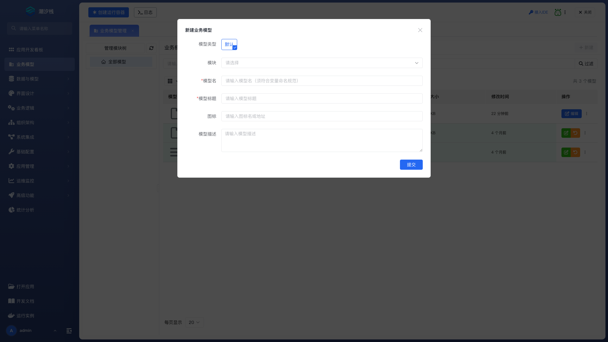

| 配置项 | 是否必填 | 说明 |
| --- | --- | --- |
| 模型类型 | 是 | 选择业务模型类型；当前标准业务建模使用 **默认**。 |
| 模块 | 否 | 模型在模块树中的位置。未选择时，模型位于模块树根级。 |
| 模型名 | 是 | 模型标识，以字母开头，只能包含字母和数字。 |
| 模型标题 | 是 | 开发界面和业务页面中显示的名称。 |
| 图标 | 否 | 模型在菜单或相关入口中使用的图标。 |
| 模型描述 | 否 | 说明模型的用途和边界。 |

创建成功后，新模型会出现在列表中。此时模型只有基本信息，需要继续进入编辑器配置字段、视图和接口。

## 编辑业务模型

点击模型行中的 **编辑**。平台会先锁定模型，再打开业务模型编辑器；其他用户在锁释放前只能查看，不能同时编辑。

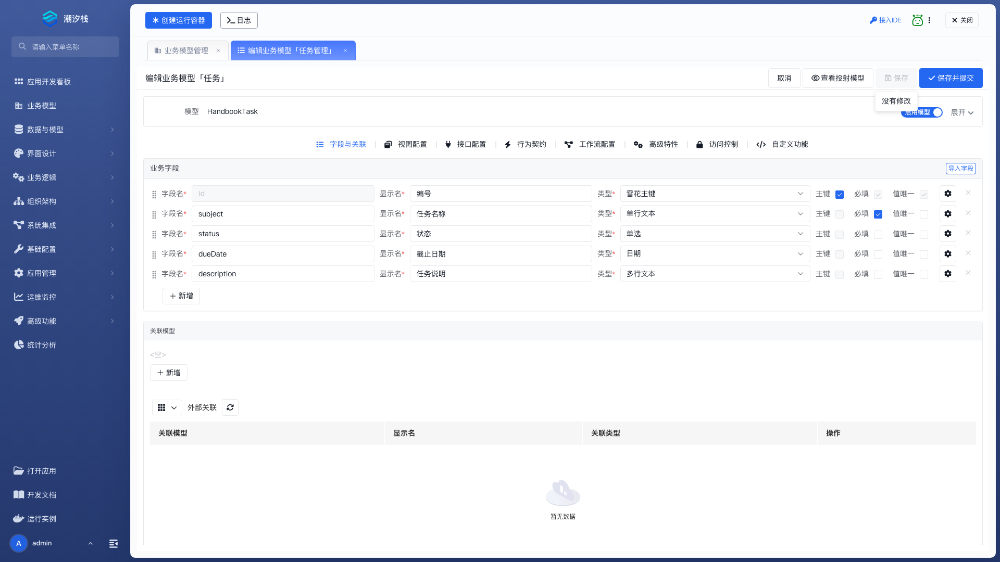

编辑器包含基本信息以及以下配置区：

| 配置区 | 主要用途 | 通常何时配置 |
| --- | --- | --- |
| 字段与关联 | 定义字段、字段属性以及模型之间的关系。 | 每个模型都需要。 |
| 视图配置 | 配置索引页、新建表单、编辑表单和详情页。 | 需要标准业务页面时。 |
| 接口配置 | 配置搜索、获取单条、新建、更新和删除接口。 | 需要标准数据操作时。 |
| 行为契约 | 查看动作和事件目录，定义自定义动作、事件及消费方订阅。 | 需要明确业务动作或事件协作时。 |
| 工作流配置 | 将模型动作与审批流程连接。 | 业务操作需要审批时。 |
| 高级特性 | 配置软删除、审计字段、批量删除、导入和服务端导出等能力。 | 有相应数据管理要求时。 |
| 访问控制 | 打开查询、新建、更新和删除的控制维度。 | 需要按角色、字段或组织范围限制数据操作时。 |
| 自定义功能 | 增加标准页面和接口之外的 UI 入口或 API。 | 标准能力无法覆盖时。 |

建议先完成字段与关联，再配置视图和接口。接口配置和访问控制在模型尚无字段或关联时不可用。

### 配置基本信息

基本信息默认折叠，先点击右侧 **展开** 再修改标题、图标、描述等信息。启用开关可以直接控制模型是否参与运行。

| 配置项 | 说明 |
| --- | --- |
| 模型 | 只读显示模型全名，用于确认当前正在编辑的模型。 |
| 启用模型 | 控制模型是否参与应用运行。新建模型默认未启用；准备验证标准页面和接口前需要启用。 |
| 模型标题 | 模型在开发界面和业务页面中的显示名称，必填。 |
| 图标 | 模型在菜单和相关入口中显示的图标。 |
| 附属模型 | 将模型标记为其他模型的组成部分，不为它提供独立菜单入口。 |
| 排序 | 控制模型在同级模块中的顺序，必填；数值越小越靠前。 |
| 模型描述 | 记录模型的用途和边界。 |

点击 **高级设置** 可以配置数据存储位置：

| 配置项 | 说明 |
| --- | --- |
| 数据源 | 指定模型使用的数据源名称。留空时使用应用的默认数据配置。 |
| 原始表名 | 模型对应的数据库表名。未选择数据源时可以直接填写；选择数据源后，可以从该数据源已有表中选择，也可以新增表名。 |

只有确实要接入指定数据源或已有表时才使用 **高级设置**。普通模型沿用应用默认数据配置即可。

### 配置字段与关联

字段与关联决定模型的数据结构。先添加字段，再根据模型之间的实际关系配置关联。

#### 添加业务字段

在 **字段与关联** 中找到 **业务字段**，点击 **新增**，逐项填写字段信息。字段可以拖动排序，也可以使用 **导入字段** 一次加入已有字段定义。


| 配置项 | 说明 |
| --- | --- |
| 字段名 | 字段的稳定标识，不能与当前模型中的其他字段名或关系名重复。字段设为主键后不能在属性弹窗中修改名称。 |
| 显示名 | 字段在表单、表格和详情页中的默认标题。 |
| 类型 | 决定字段存储方式、默认输入组件和显示组件。 |
| 主键 | 将字段设为模型主键。一个模型只能有一个主键；主键同时为必填和唯一。 |
| 必填 | 新建数据时必须提供该字段。主键或唯一字段会自动设为必填，不能单独关闭。 |
| 值唯一 | 字段值不能重复；启用后字段同时为必填。 |

一个字段应只表达一个稳定属性。不要为了减少字段数量，把多个含义拼进同一文本字段；这会使过滤、校验、接口和权限配置变得困难。

#### 批量导入字段

已有 Excel 表头或字段清单时，点击 **导入字段**，通过两步向导一次生成多个字段。

第一步 **选择文件** 包含以下字段：

| 配置项 | 说明 |
| --- | --- |
| 模式 | 选择 **从表头生成字段** 或 **从字段表导入**。前者把第一个工作表的第一行作为字段标题；后者把第一个工作表的每一行作为一个字段，表头必须包含“字段名”“显示名”“类型”。两种模式都会忽略名为 `id` 的输入列。 |
| 文件 | 上传 `.xls` 或 `.xlsx` 文件，必填。平台只读取第一个工作表。 |

点击 **下一步** 后，在 **检查字段** 中逐项确认导入结果：

| 配置项 | 说明 |
| --- | --- |
| 字段名 | 检查或修改生成的字段标识。 |
| 显示名 | 检查或修改字段在页面中的默认标题。 |
| 类型 | 为每个字段选择字段类型，必填。平台无法可靠推断类型时，需要在这里修正。 |
| 主键 | 标识主键字段。向导会自动加入 `id` 主键，该项不能取消，也不能删除。 |

确认导入后，字段会加入当前模型，但仍需保存模型。逐项检查字段名、类型、必填和唯一约束；导入向导不会替代字段属性配置。

#### 设置字段属性

点击字段行末的设置按钮打开 **字段属性**。

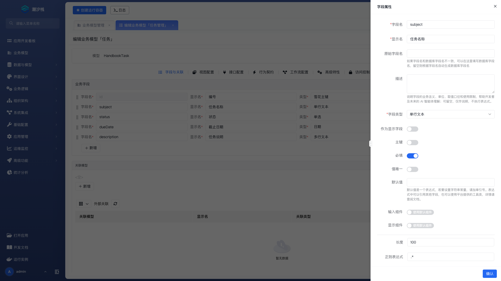

| 配置项 | 说明 |
| --- | --- |
| 字段名 | 字段标识。主键字段的名称不可修改。 |
| 显示名 | 字段在页面和配置界面中的默认标题。 |
| 原始字段名 | 字段名与数据库字段名不一致时填写；留空时由平台根据字段名生成。 |
| 描述 | 说明字段的业务含义、单位、取值口径和使用限制。这里是说明文字，不执行表达式。 |
| 字段类型 | 设置字段的数据类型，并决定后续出现的类型专属配置。 |
| 作为显示字段 | 其他模型引用当前模型时，用该字段代表一条记录。主键字段不显示此选项。 |
| 主键 | 将当前字段设为模型主键。一个模型只能有一个主键。 |
| 必填 | 要求新建数据时提供该字段。主键或唯一字段会自动启用，不能单独关闭。 |
| 值唯一 | 要求当前字段的值在模型中不重复。主键字段自动唯一。 |
| 默认值 | 新建数据时使用的默认值表达式。主键字段不显示此项；字符串常量需要使用单引号。 |
| 输入组件 | 覆盖该字段在新建、编辑表单中的默认输入组件。 |
| 显示组件 | 覆盖该字段在索引页、详情页中的默认显示组件。 |
| 展开更多设置 | 打开当前字段类型的专属配置。各内置类型的字段见下表。 |

默认值表达式的语法和可用上下文见 [表达式](/docs/guide/tutorial/expression/)。字段类型及其组件配置见 [字段定义](/docs/concepts/field-define/)。

##### 配置字段类型专属属性

选择字段类型后，**展开更多设置** 中只显示该类型适用的字段：

| 字段类型 | 配置项 | 说明 |
| --- | --- | --- |
| 单行文本 | 长度 | 设置可存储和输入的最大字符数，默认 `100`。 |
| 单行文本 | 正则表达式 | 使用正则表达式校验输入值；默认 `.*` 表示接受任意内容。 |
| 单行文本 | 自定义校验信息 | 输入不符合正则表达式时显示的提示。配置了限制性正则表达式后，应同时填写清晰的校验信息。 |
| 单选 | 值类型 | 选择选项值按字符串、短整型、整型或长整型存储。创建数据后不要随意改变值类型。 |
| 单选 | 长度 | 值类型为字符串时，设置选项值可使用的最大字符数，默认 `100`。 |
| 单选 | 选项：值 | 设置实际保存到数据中的值，必填且不能重复；输入控件随值类型切换为文本或数字。 |
| 单选 | 选项：显示文本 | 设置页面向使用者展示的文字，必填且不能重复。 |
| 图片 | 字段大小 | 设置图片引用信息可使用的最大字符数，默认 `200`；该值不是上传文件的字节大小。 |
| 多行文本 | 长度 | 设置可存储和输入的最大字符数，默认 `200`。 |
| 多行文本 | 最小行数 | 设置多行输入框的最小显示行数。 |
| 多行文本 | 最大行数 | 设置多行输入框扩展到多少行后开始滚动。该值不限制文本字符数。 |
| 多选 | 长度 | 设置多选结果可使用的最大字符数，默认 `200`。 |
| 多选 | 选项：值 | 设置实际保存到数据中的字符串值，必填且不能重复。 |
| 多选 | 选项：显示文本 | 设置页面向使用者展示的文字，必填且不能重复。 |
| 定点数字 | 最小值 | 设置表单允许输入的最小数值；留空时不设置下限。 |
| 定点数字 | 最大值 | 设置表单允许输入的最大数值；留空时不设置上限。 |
| 定点数字 | 总长度 | 设置整数部分和小数部分合计允许的总位数，默认 `10`。 |
| 定点数字 | 小数位数 | 设置小数部分的位数，默认 `2`，且不能大于总长度。 |
| 整数数字 | 最小值 | 设置表单允许输入的最小整数；留空时不设置下限。 |
| 整数数字 | 最大值 | 设置表单允许输入的最大整数；留空时不设置上限。 |
| 浮点数字 | 最小值 | 设置表单允许输入的最小数值；留空时不设置下限。 |
| 浮点数字 | 最大值 | 设置表单允许输入的最大数值；留空时不设置上限。 |
| 浮点数字 | 小数位数 | 设置输入和显示保留的小数位数，默认 `3`。浮点数不适合要求十进制精确计算的金额。 |
| 货币 | 最小值 | 设置表单允许输入的最小金额；留空时不设置下限。 |
| 货币 | 最大值 | 设置表单允许输入的最大金额；留空时不设置上限。 |
| 货币 | 精度 | 设置金额输入和显示使用的小数位数，默认 `2`。 |
| 日期 | 格式 | 设置日期输入和显示格式，默认 `YYYY-MM-DD`。 |
| 日期时间 | 格式 | 设置日期时间输入和显示格式，默认 `YYYY-MM-DD HH:mm:ss`。 |
| 手机号码 | 长度 | 设置手机号码可使用的最大字符数，默认 `20`。 |
| 电话号码 | 长度 | 设置电话号码可使用的最大字符数，默认 `20`。 |
| 电子邮箱 | 长度 | 设置电子邮箱可使用的最大字符数，默认 `100`。 |
| 网址 | 长度 | 设置网址可使用的最大字符数，默认 `200`。 |
| 邮政编码 | 长度 | 设置邮政编码可使用的最大字符数，默认 `6`。 |
| 编码主键 | 长度 | 编码字符串的最大长度，默认 `20`，应容纳前缀、日期和序号。 |
| 编码主键 | 编码模版 | 必填，默认 `{yyyyMMdd}<0001>`。日期片段使用 `{日期格式}`；`<0001>` 表示从 1 开始的四位序号，`<0001,2>` 将步长设为 2，`<序列器名:0001>` 使用指定序列器。模版也支持以 `\${}` 包裹的表达式。 |
| 数据字典 | 字典名称 | 必填，选择当前应用的数据字典；数据保存字典项标识。 |
| 数据字典 | 选择模式 | 可选树形下拉框、下拉框、单选按钮、列表选择或按钮组，默认树形下拉框。 |
| 文件、文件（多选） | 文件类型 | 允许上传的扩展名，例如 `.txt,.zip`；留空时不在此限制类型。 |
| 文件、文件（多选） | 目录编码 | 必填，指定文件上传所用的存储目录编码。运行环境需要配置对应的上传目录。 |
| 员工 | 默认当前人员 | 开启后，录入时默认选择当前账号关联的人员；默认关闭。 |
| 员工（多选） | 最少选择 | 最少选择的人员数，默认 `1`。 |
| 员工（多选） | 最多选择 | 最多选择的人员数，默认 `99`，应不小于最少选择数。 |
| 组织架构 | 部门、公司 | 确定可选的组织类型；切换其中一项时，编辑器会联动调整另一项。 |
| 组织架构 | 默认当前公司 | 允许选择公司时显示；是否默认使用当前人员所属公司。 |
| 组织架构 | 默认当前部门 | 允许选择部门时显示；是否默认使用当前人员所属部门。 |
| 组织架构（多选） | 长度 | 组织标识集合的存储长度，默认 `256`。 |
| 组织架构（多选） | 部门、公司 | 控制能否选择部门、公司，两项默认开启。 |
| 雪花主键 | 值类型 | 选择以 Snowflake 数值或字符串形式保存生成的主键。 |

**自增主键** 没有专属配置字段。主键类型一旦投入使用，修改值类型或生成方式可能影响已有数据和外部引用，应在建模初期确定。

#### 建立模型关联

当当前模型需要引用或包含另一个业务模型时，在 **关联模型** 中点击 **新增**。


| 配置项 | 说明 |
| --- | --- |
| 关系名 | 关系标识，不能与当前模型中的字段名重复。 |
| 显示名 | 关系在页面和配置界面中的标题。 |
| 类型 | 选择主表、子表或引用。 |
| 模型 | 选择关系指向的业务模型。 |
| 引用键 | 新建主表或引用关系时，指定目标模型中被引用的键；留空时使用目标模型的主键。子表关系在关系属性中配置关联键。 |

三类关系的用途不同：

- **主表**：外部模型是当前模型的上级对象。
- **子表**：外部模型是当前模型包含的明细集合；目标模型需要先建立指向当前模型的主表关系。
- **引用**：当前模型引用一个独立对象，但两者不构成主表与子表的组成关系。

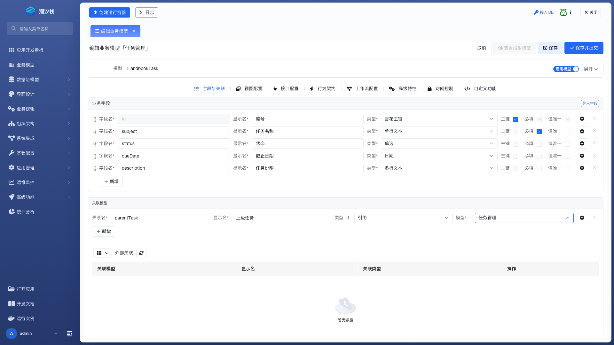

新增关系后，点击关系行末的设置按钮打开 **关联属性**。

| 配置项 | 何时出现 | 说明 |
| --- | --- | --- |
| 关系名 | 始终 | 关系的稳定标识，不能与当前模型中的字段名重复。 |
| 显示名 | 始终 | 关系在页面和配置界面中的标题。 |
| 原始字段名 | 主表、引用 | 外键对应的数据库字段名；留空时由平台根据关系名生成。 |
| 描述 | 始终 | 记录关系的业务含义和使用限制。 |
| 类型 | 始终 | 选择主表、子表或引用。 |
| 关联模型 | 始终 | 选择关系指向的业务模型。 |
| 关联键 | 子表 | 选择目标模型中指向当前模型的主表或引用关系。 |
| 引用键 | 主表、引用 | 指定目标模型中被引用的字段；留空时使用目标模型主键。 |
| 同步提交 | 子表 | 决定子表数据是否随当前模型表单一起提交。 |
| 必填 | 主表、引用 | 要求表单提交时必须选择关联记录。 |
| 输入方式 | 主表、引用 | 选择 **拾取器** 或 **下拉框** 作为表单输入方式。 |
| 显示方式 | 主表、引用 | 选择在详情页中按 **详情（字段集）** 或 **表单字段** 显示关联数据。 |

**同步提交** 会把子表数据和当前模型放在同一次表单提交中处理。只有确实需要在主表表单内同时维护明细时才启用；独立维护的子表不需要打开该选项。

##### 配置主表或引用关系

主表和引用关系的高级选项控制关联数据如何加载，以及拾取器显示哪些列和过滤条件。

| 配置项 | 何时出现 | 说明 |
| --- | --- | --- |
| 默认请求参数 | 主表、引用 | 拉取关联模型数据时附带的固定请求参数。 |
| 自定义拾取器 | 输入方式为拾取器 | 启用后可以自行选择拾取器的显示列和过滤器。 |
| 拾取器显示列 | 启用自定义拾取器 | 从目标模型的字段和关系中选择列、调整顺序，或添加自定义列。 |
| 自定义过滤器 | 启用自定义拾取器 | 启用后可以逐项定义拾取器中的查询条件。 |

拾取器中的每个显示列可以继续配置：

| 配置项 | 说明 |
| --- | --- |
| 列名 | 新增自定义列时填写的稳定标识。 |
| 列标题 | 列在拾取器表头中的标题；编辑已有列时可以覆盖默认标题。 |
| 固定宽度 | 列宽；留空时由表格自动计算。 |
| 固定列 | 选择固定在表格左侧、右侧或不固定。 |
| 对齐方式 | 选择两端对齐、左对齐、居中或右对齐。 |
| 显示组件 | 设置该列的数据展示方式。 |

拾取器中的每个过滤器可以继续配置：

| 配置项 | 说明 |
| --- | --- |
| 过滤对象 | 选择目标模型的业务字段，或选择主表、引用关系。 |
| 操作符 | 业务字段支持等于、不等于、包含、比较、范围等操作；关系支持等于、不等于、在列表中和不在列表中。 |
| 过滤器类型 | 业务字段可以使用文本、数字、日期、日期时间、日期范围、日期时间范围或自定义组件；关系可以使用自动、下拉框或拾取器。 |
| 自定义组件 | 过滤器类型为自定义时，配置完整的输入组件。 |
| 过滤器属性 | 使用内置过滤器类型时，继续调整对应组件的属性。 |
| 过滤器标签 | 覆盖过滤器在页面中的默认标题。 |
| 默认请求参数 | 关系过滤器加载候选数据时附带的固定请求参数。 |

##### 配置子表关系

| 配置项 | 何时出现 | 说明 |
| --- | --- | --- |
| 自定义子表显示 | 选择子表关联模型后 | 启用后可以自行决定子表在页面中显示哪些列。 |
| 子表显示列 | 启用自定义子表显示 | 选择、排序或新增显示列。每列可以设置列名、列标题、固定宽度、固定位置、对齐方式和显示组件。 |
| 自定义子表输入 | 启用同步提交后 | 启用后可以自行决定随主表一起录入的子表字段。 |
| 子表输入项 | 启用自定义子表输入 | 选择、排序或新增输入项，也可以加入占位符和分隔符。 |

子表显示列中的每一列包含以下字段：

| 配置项 | 说明 |
| --- | --- |
| 列名 | 新增自定义列时填写的稳定标识。 |
| 列标题 | 子表表头显示的标题；编辑已有列时可以覆盖默认标题。 |
| 固定宽度 | 设置列宽；留空时由表格自动计算。 |
| 固定列 | 选择固定在左侧、右侧或不固定。 |
| 对齐方式 | 选择两端对齐、左对齐、居中或右对齐。 |
| 显示组件 | 设置该列的数据展示方式。 |

子表输入项可以继续配置：

| 配置项 | 说明 |
| --- | --- |
| 类型 | 新增输入项时选择占位符、分隔符或自定义。 |
| 字段名 | 自定义输入项的稳定标识。 |
| 字段标题 | 自定义输入项的标题；编辑已有字段时可以覆盖默认标题。 |
| 固定宽度 | 输入项宽度；留空时自动计算。 |
| 固定列 | 设置输入项固定在左侧、右侧或不固定。 |
| 对齐方式 | 设置输入内容的对齐方式。 |
| 输入组件 | 设置自定义输入项的组件，或覆盖已有字段的默认输入组件。 |

##### 查看外部关联

**外部关联** 显示其他模型已经建立、且指向当前模型的关系：

| 信息 | 说明 |
| --- | --- |
| 关联模型 | 显示关系来源模型。 |
| 显示名 | 显示该关系在来源模型中的标题。 |
| 关联类型 | 显示主表、子表或引用类型。 |

需要在当前模型中补齐对应关系时，可以从外部关联直接添加，不必重新选择目标模型。

### 配置标准页面

打开 **视图配置**。索引页、新建表单、编辑表单和详情页分别控制数据列表、新建、编辑和查看场景。

#### 配置索引页

索引页是业务数据的列表入口。打开 **启用** 后，按列表的选择方式、显示内容、操作按钮、过滤器和导出方式进行配置。

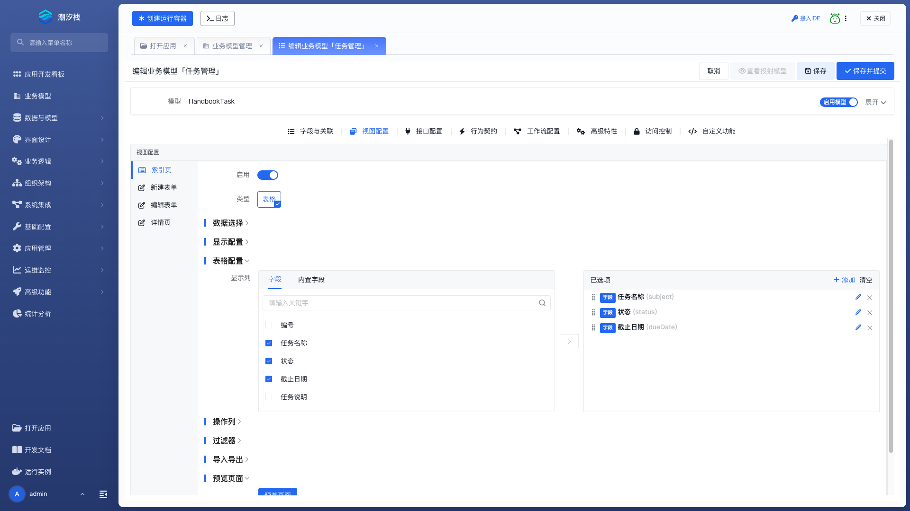

| 配置项 | 说明 |
| --- | --- |
| 启用 | 控制是否为模型提供索引页。关闭后，索引页的其他配置不生效。 |
| 类型 | 索引页的呈现类型；当前可选值为 **表格**。 |
| 点击选中 | 启用后，点击一行任意位置即可选中记录，不必精确点击选择框。 |
| 占满高度 | 让表格自动适应父容器高度，适合在固定区域内滚动。 |
| 显示列 | 从业务字段、关联模型和内置字段中选择表格列并调整顺序，也可以添加自定义列。 |
| 操作列列宽 | 设置查看、编辑、删除和自定义操作所在列的宽度。 |
| 操作列固定列 | 控制操作列是否固定，避免横向滚动后操作入口离开可视区域。 |
| 操作列按钮样式 | 选择默认、按钮或自定义样式。 |
| 操作列颜色 | 使用按钮样式时，选择操作按钮的预置颜色组合。 |
| 操作列大小 | 使用按钮样式时，选择中、小或极小尺寸。 |
| 操作列图标 | 使用按钮样式时，控制查看、编辑和删除按钮是否显示图标。 |
| 默认过滤器 | 配置索引页默认显示的查询条件，可以添加多个并调整顺序。 |
| 启用导出全部 | 在索引页提供导出全部数据的入口。 |
| 启用导出当前页 | 在索引页提供只导出当前页数据的入口。 |

显示列中可以选择以下内置字段：

| 内置字段 | 出现条件 | 说明 |
| --- | --- | --- |
| 创建时间 | 启用基本审计字段 | 记录数据的创建时间。 |
| 更新时间 | 启用基本审计字段 | 记录数据的最后更新时间。 |
| 创建人 | 启用基本审计字段 | 记录创建数据的平台用户。 |
| 更新人 | 启用基本审计字段 | 记录最后更新数据的平台用户。 |
| 制单人 | 查询、更新或删除启用了按制单人控制 | 记录数据归属的人员。 |
| 创建部门 | 查询、更新或删除启用了按部门控制 | 记录数据归属的部门。 |
| 创建公司 | 查询、更新或删除启用了按公司控制 | 记录数据归属的公司。 |

编辑显示列时，可以逐列设置：

| 配置项 | 说明 |
| --- | --- |
| 列名 | 新增自定义列时填写的稳定标识。 |
| 列标题 | 表头显示的标题；编辑已有列时可以覆盖字段或关系的默认标题。 |
| 固定宽度 | 设置列宽；留空时由表格自动计算。 |
| 固定列 | 选择固定在左侧、右侧或不固定。 |
| 对齐方式 | 选择两端对齐、左对齐、居中或右对齐。 |
| 显示组件 | 设置该列的数据展示方式；已有字段可以沿用默认组件。 |

默认过滤器中的每一项包含：

| 配置项 | 说明 |
| --- | --- |
| 过滤对象 | 选择业务字段，或选择主表、引用关系。 |
| 操作符 | 业务字段支持等于、不等于、包含、比较和范围等操作；关系支持等于、不等于、在列表中和不在列表中。 |
| 过滤器类型 | 业务字段可以使用文本、数字、日期、日期时间、日期范围、日期时间范围或自定义组件；关系可以使用自动、下拉框或拾取器。 |
| 自定义组件 | 过滤器类型为自定义时，配置完整的输入组件。 |
| 过滤器属性 | 使用内置过滤器类型时，继续调整对应组件属性。 |
| 过滤器标签 | 覆盖过滤器在索引页中的默认标题。 |
| 默认请求参数 | 关系过滤器加载候选数据时附带的固定请求参数。 |

完成配置后先保存模型，再点击 **预览页面**，检查列顺序、过滤器、选择方式和操作按钮。预览按钮在存在未保存修改时不可用。

#### 配置新建表单

新建表单决定用户如何创建一条业务数据。


| 配置项 | 何时出现 | 说明 |
| --- | --- | --- |
| 显示 | 始终 | 控制索引页是否提供新建按钮。 |
| 标题 | 显示新建表单后 | 设置表单标题；留空时使用模型标题组成默认标题。 |
| 打开方式 | 显示新建表单后 | 选择弹窗、抽屉或新标签。 |
| 弹窗尺寸 | 打开方式为弹窗 | 选择超小、小、中、大、超大或全屏。 |
| 抽屉尺寸 | 打开方式为抽屉 | 选择超小、小、中、大或超大。 |
| 可拖动改变大小 | 打开方式为抽屉 | 允许运行时拖动抽屉边缘调整宽度。 |
| 布局类型 | 显示新建表单后 | 选择水平、垂直或多列布局。 |
| 列数 | 布局类型为多列 | 设置每行显示的表单列数。 |
| Label 宽度 | 布局类型为水平 | 设置字段标题区域的宽度。 |
| 表单字段 | 显示新建表单后 | 选择允许新建时填写的业务字段和关联，并调整顺序。 |
| 新增项类型 | 在表单字段中点击添加 | 选择占位符、分隔符或自定义。占位符用于留出布局位置，分隔符用于划分内容区块。 |
| 字段名 | 新增项类型为自定义 | 自定义输入项的稳定标识。 |
| 字段标题 | 新增项类型为自定义 | 自定义输入项的标题；编辑已有字段时可以覆盖默认标题。 |
| 输入组件 | 新增项类型为自定义，或编辑已有字段 | 设置自定义输入组件，或覆盖字段的默认输入组件。 |

表单字段不必等同于模型的全部字段。主键、系统维护字段或不应由用户录入的字段可以不放入新建表单。

保存模型后点击 **预览页面**，检查必填校验、默认值、关联选择和输入组件。

#### 配置编辑表单

编辑表单决定用户可以修改哪些字段，以及表单如何打开和排列。

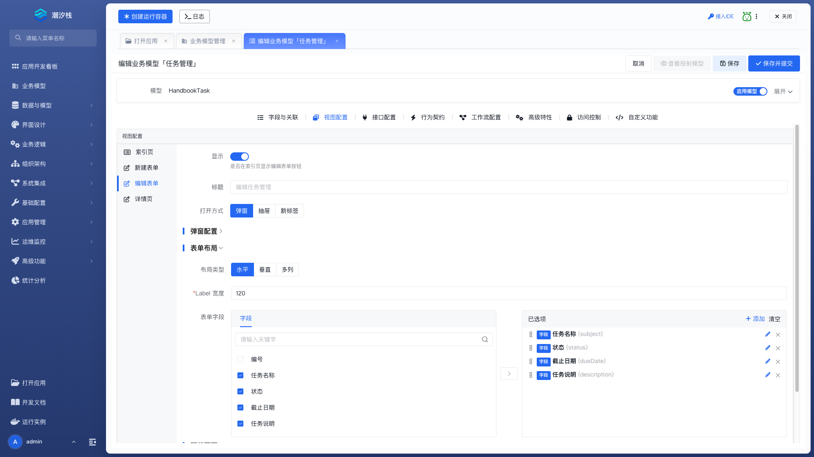

| 配置项 | 何时出现 | 说明 |
| --- | --- | --- |
| 显示 | 始终 | 控制索引页是否提供编辑按钮。 |
| 标题 | 显示编辑表单后 | 设置编辑表单标题；留空时使用默认标题。 |
| 打开方式 | 显示编辑表单后 | 选择弹窗、抽屉或新标签。 |
| 弹窗尺寸 | 打开方式为弹窗 | 选择超小、小、中、大、超大或全屏。 |
| 抽屉尺寸 | 打开方式为抽屉 | 选择超小、小、中、大或超大。 |
| 可拖动改变大小 | 打开方式为抽屉 | 允许运行时拖动抽屉边缘调整宽度。 |
| 布局类型 | 显示编辑表单后 | 选择水平、垂直或多列布局。 |
| 列数 | 布局类型为多列 | 设置每行显示的表单列数。 |
| Label 宽度 | 布局类型为水平 | 设置字段标题区域的宽度。 |
| 表单字段 | 显示编辑表单后 | 选择允许修改的业务字段和关联，并调整顺序。 |
| 新增项类型 | 在表单字段中点击添加 | 选择占位符、分隔符或自定义。 |
| 字段名 | 新增项类型为自定义 | 自定义输入项的稳定标识。 |
| 字段标题 | 新增项类型为自定义 | 自定义输入项的标题；编辑已有字段时可以覆盖默认标题。 |
| 输入组件 | 新增项类型为自定义，或编辑已有字段 | 设置自定义输入组件，或覆盖字段的默认输入组件。 |

新建表单和编辑表单可以采用不同字段、布局和打开方式。创建后不可修改的编号、归属对象或状态字段，应只放在新建表单或详情页中。

保存模型后点击 **预览页面**，确认不可修改字段没有出现在编辑表单中。

#### 配置详情页

详情页用于只读查看一条业务数据。它可以包含业务字段、关联数据，以及启用审计或访问控制后出现的内置字段。

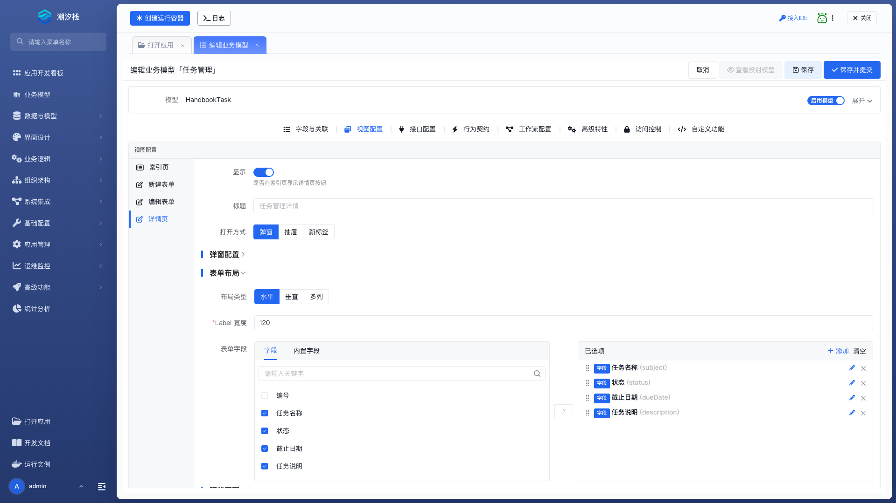

| 配置项 | 何时出现 | 说明 |
| --- | --- | --- |
| 显示 | 始终 | 控制索引页是否提供查看按钮。 |
| 标题 | 显示详情页后 | 设置详情页标题；留空时使用默认标题。 |
| 打开方式 | 显示详情页后 | 选择弹窗、抽屉或新标签。 |
| 弹窗尺寸 | 打开方式为弹窗 | 选择超小、小、中、大、超大或全屏。 |
| 抽屉尺寸 | 打开方式为抽屉 | 选择超小、小、中、大或超大。 |
| 可拖动改变大小 | 打开方式为抽屉 | 允许运行时拖动抽屉边缘调整宽度。 |
| 布局类型 | 显示详情页后 | 选择水平、垂直或多列布局。 |
| 列数 | 布局类型为多列 | 设置每行显示的信息列数。 |
| Label 宽度 | 布局类型为水平 | 设置字段标题区域的宽度。 |
| 表单字段 | 显示详情页后 | 选择业务字段、关联模型和内置字段，并调整顺序。 |
| 新增项类型 | 在表单字段中点击添加 | 选择占位符、分隔符或自定义。 |
| 字段名 | 新增项类型为自定义 | 自定义展示项的稳定标识。 |
| 字段标题 | 新增项类型为自定义 | 自定义展示项的标题；编辑已有字段时可以覆盖默认标题。 |
| 输入组件 | 新增项类型为自定义，或编辑已有字段 | 设置自定义组件，或覆盖字段的默认组件。 |

启用基本审计字段后，可以加入创建时间、更新时间、创建人和更新人；启用相应数据范围控制后，还可以加入制单人、创建部门和创建公司。这些内置字段的出现条件与索引页相同。

保存模型后点击 **预览页面**，检查长文本、关联数据和空值的显示效果。

#### 使用 UI Schema 自定义页面

标准配置无法满足布局或交互要求时，先保存模型，再点击对应页面的 **预览页面**。在预览窗口中点击 **克隆当前 UI Schema**，平台会基于当前标准页面创建 UI Schema，并询问是否打开编辑页面。

自定义 UI Schema 会增加独立维护内容。标准页面能够满足需求时，继续在业务模型中配置字段、布局和组件即可。

### 配置标准接口

**接口配置** 包含搜索、获取单条、新建、更新和删除五类标准接口。每类接口都可以独立启用。

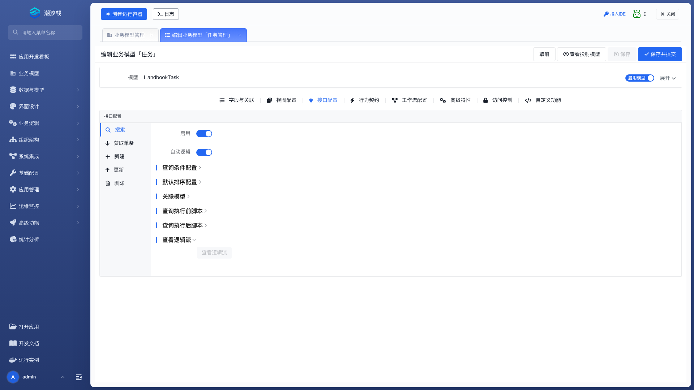

默认情况下保留 **自动逻辑**，平台会按照模型字段、关联和访问控制生成标准数据操作。关闭自动逻辑后，接口改为执行完整的自定义脚本。

#### 搜索接口

| 配置项 | 何时出现 | 说明 |
| --- | --- | --- |
| 启用 | 始终 | 控制是否生成并开放标准搜索接口。 |
| 自动逻辑 | 启用接口后 | 启用时使用平台生成的查询逻辑；关闭后改为执行自定义脚本。 |
| 排序字段类型 | 启用自动逻辑 | 选择 **模型字段** 或 **内置字段**。 |
| 排序字段 | 启用自动逻辑 | 选择默认排序字段。内置字段仅在启用基本审计字段后提供创建时间和更新时间。 |
| 排序方向 | 选择排序字段后 | 选择顺序或倒序。 |
| 默认条件、覆写条件 | 启用自动逻辑 | 当前界面标注为“功能完善中”，不要依赖它们承担数据权限或强制业务限制。 |
| 填充关联模型 | 启用自动逻辑 | 点击添加关联，逐层选择需要随结果返回的关系；嵌套关系按层级配置，不是平铺的字段清单。 |
| 查询执行前脚本语言 | 启用自动逻辑 | 选择 JavaScript 或 Groovy。 |
| 查询执行前脚本 | 启用自动逻辑 | 在查询执行前校验或调整查询参数。 |
| 查询执行后脚本语言 | 启用自动逻辑 | 选择 JavaScript 或 Groovy。 |
| 查询执行后脚本 | 启用自动逻辑 | 在查询完成后整理返回数据。 |
| 自定义脚本语言 | 关闭自动逻辑 | 选择 JavaScript 或 Groovy。 |
| 自定义脚本 | 关闭自动逻辑 | 编写完整的搜索接口实现。 |

#### 获取单条接口

| 配置项 | 何时出现 | 说明 |
| --- | --- | --- |
| 启用 | 始终 | 控制是否生成并开放获取单条数据的标准接口。 |
| 自动逻辑 | 启用接口后 | 启用时使用平台生成的查询逻辑；关闭后改为执行自定义脚本。 |
| 填充关联模型 | 启用自动逻辑 | 选择返回单条数据时需要一并加载的关联模型及其嵌套关系。 |
| 查询前执行脚本语言 | 启用自动逻辑 | 选择 JavaScript 或 Groovy。 |
| 查询前执行脚本 | 启用自动逻辑 | 在读取数据前校验或调整请求。 |
| 查询后执行脚本语言 | 启用自动逻辑 | 选择 JavaScript 或 Groovy。 |
| 查询后执行脚本 | 启用自动逻辑 | 在读取完成后整理返回数据。 |
| 自定义脚本语言 | 关闭自动逻辑 | 选择 JavaScript 或 Groovy。 |
| 自定义脚本 | 关闭自动逻辑 | 编写完整的获取单条接口实现。 |

#### 新建接口

| 配置项 | 何时出现 | 说明 |
| --- | --- | --- |
| 启用 | 始终 | 控制是否生成并开放标准新建接口。 |
| 自动逻辑 | 启用接口后 | 启用时使用平台生成的插入逻辑；关闭后改为执行自定义脚本。 |
| 允许的字段 | 启用自动逻辑 | 限定新建接口允许调用方传入的业务字段。 |
| 字段默认值 | 启用自动逻辑 | 为未传入的字段提供默认表达式。 |
| 字段覆写值 | 启用自动逻辑 | 以服务端表达式覆盖对应字段的输入值。 |
| 插入执行前脚本语言 | 启用自动逻辑 | 选择 JavaScript 或 Groovy。 |
| 插入执行前脚本 | 启用自动逻辑 | 在写入数据前执行校验、补值或转换。 |
| 插入执行后脚本语言 | 启用自动逻辑 | 选择 JavaScript 或 Groovy。 |
| 插入执行后脚本 | 启用自动逻辑 | 在写入完成后整理结果或执行后续处理。 |
| 自定义脚本语言 | 关闭自动逻辑 | 选择 JavaScript 或 Groovy。 |
| 自定义脚本 | 关闭自动逻辑 | 编写完整的新建接口实现。 |

#### 更新接口

| 配置项 | 何时出现 | 说明 |
| --- | --- | --- |
| 启用 | 始终 | 控制是否生成并开放标准更新接口。 |
| 自动逻辑 | 启用接口后 | 启用时使用平台生成的更新逻辑；关闭后改为执行自定义脚本。 |
| 允许传递字段 | 启用自动逻辑 | 限定更新接口可接受的字段，避免调用方修改未开放的属性。 |
| 更新执行前脚本语言 | 启用自动逻辑 | 选择 JavaScript 或 Groovy。 |
| 更新执行前脚本 | 启用自动逻辑 | 在更新数据前执行校验、补值或转换。 |
| 更新执行后脚本语言 | 启用自动逻辑 | 选择 JavaScript 或 Groovy。 |
| 更新执行后脚本 | 启用自动逻辑 | 在更新完成后整理结果或执行后续处理。 |
| 自定义脚本语言 | 关闭自动逻辑 | 选择 JavaScript 或 Groovy。 |
| 自定义脚本 | 关闭自动逻辑 | 编写完整的更新接口实现。 |

#### 删除接口

| 配置项 | 何时出现 | 说明 |
| --- | --- | --- |
| 启用 | 始终 | 控制是否生成并开放标准删除接口。 |
| 自动逻辑 | 启用接口后 | 启用时使用平台生成的删除逻辑；关闭后改为执行自定义脚本。 |
| 强制检查引用 | 启用接口后 | 打开后始终检查目标数据是否被引用；关闭时，仅在未启用软删除的情况下检查引用。 |
| 删除执行前脚本语言 | 启用自动逻辑 | 选择 JavaScript 或 Groovy。 |
| 删除执行前脚本 | 启用自动逻辑 | 在删除前执行校验或其他准备操作。 |
| 删除执行后脚本语言 | 启用自动逻辑 | 选择 JavaScript 或 Groovy。 |
| 删除执行后脚本 | 启用自动逻辑 | 在删除完成后整理结果或执行后续处理。 |
| 自定义脚本语言 | 关闭自动逻辑 | 选择 JavaScript 或 Groovy。 |
| 自定义脚本 | 关闭自动逻辑 | 编写完整的删除接口实现。 |

关联填充用于控制返回结构，不能替代关系本身的定义。只添加确实需要的层级，避免一次列表查询加载过多关联数据。

保存模型后，各接口页的 **查看逻辑流** 可以预览平台生成的逻辑流，也可以克隆后进入逻辑流编辑器。只有标准接口确实无法满足要求时才关闭自动逻辑；脚本可用对象和工具见 [脚本上下文](/docs/api/backend/script-context/)。

### 配置行为契约

打开 **行为契约**。Action 描述可以请求执行的业务动作，Event 描述已经发生的业务事实，Event Subscription 定义收到事件后由谁、如何处理。例如，“完成任务”是动作，“任务已完成”是事件，收到事件后更新统计是订阅的处理责任。

标准搜索、新建、更新等动作来自接口配置，数据变更事件来自平台的数据操作能力；需要额外的业务动作或事件时，再在本页新增定义。


#### 查看动作、事件及其来源

在 **查看范围** 中选择 **当前完整草稿**，点击 **预览当前完整草稿**。目录会汇总当前输入中的动作、事件和订阅，并标明它们来自模型动态定义、平台生成还是代码贡献。选择成员可以查看契约、实现绑定、生产来源和引用关系；修改后需要重新预览，旧结果不能代表当前草稿。

选择 **目标应用已发布契约** 时，需要填写目标应用 API 地址；跨应用访问还要提供目标应用访问令牌，再加载目标应用的目录。这里反映运行应用当前加载的契约，适合核对部署结果。开发环境的草稿预览只包含当前实际加载的代码贡献，不能代替目标应用核验。

平台生成的标准动作应回到 **接口配置** 或相应特性中维护；代码贡献应回到扩展包维护。不要在动态定义中新增同名成员覆盖它们。

#### 定义 Action

在 **Actions** 页签点击 **新增自定义动作**。默认使用结构化编辑，也可以点击 **切换 JSON 高级编辑** 直接维护动作数组。切换前先修正当前 JSON 中的错误。

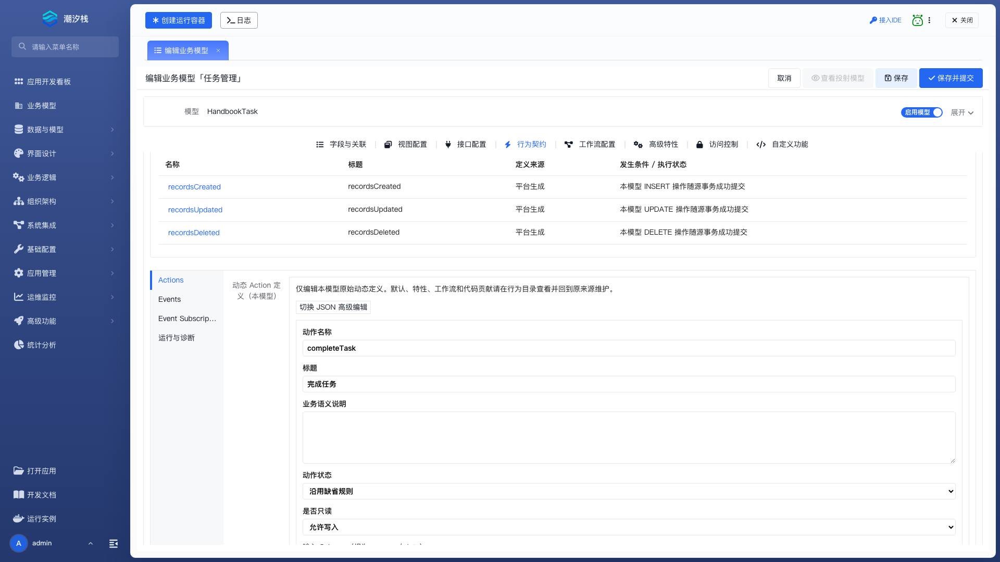

| 配置项 | 说明 |
| --- | --- |
| 动作名称 | 动作在当前模型内的稳定标识，必填。不能与已有标准动作、特性动作或代码贡献重名。 |
| 标题 | 动作的显示名称，例如“完成任务”。 |
| 业务语义说明 | 说明动作的业务用途、输入和预期结果。 |
| 动作状态 | 选择启用或停用。停用后不可执行。 |
| 是否只读 | 只查询数据时选择只读；写入数据或产生外部副作用时选择允许写入。只读动作不能通过实现绕过写入约束。 |
| 输入 Schema（根为 params / data） | 用 JSON Schema 约束业务输入。根对象只允许 `params` 和 `data`：前者放操作参数，后者放业务载荷。 |
| 输出 Schema | 用 JSON Schema 声明动作返回结果。调用方应按此契约读取结果。 |
| 实现绑定 | 选择逻辑流或高代码 Handler。契约本身不提供实现。 |
| 逻辑流名称 | 绑定逻辑流时填写，必须引用已存在、可执行的逻辑流。 |
| 逻辑流输入映射 | 把动作输入映射为逻辑流的工作数据。表达式通过 `input.params`、`input.data` 读取业务输入，通过 `context` 读取可信执行上下文。 |
| 逻辑流输出映射 | 把逻辑流执行结果整理为动作输出，结果仍需符合输出 Schema。 |
| Handler 名称 | 绑定高代码 Handler 时填写，必须与扩展包中已经注册的实现名称一致。 |
| 依赖 HTTP 请求 | 实现确实需要同步 HTTP 请求上下文时选择需要。此类动作不能由没有 HTTP 上下文的后台事件消费直接执行。 |
| 前置条件表达式 | 执行前检查业务状态的布尔表达式，可读取业务输入及已授权的对象状态。它是受限谓词，不支持任意方法调用或副作用。 |
| 前置条件不满足时的提示 | 前置条件为假时向调用方解释原因，例如“只有待办任务可以开始”。 |
| 允许发出的事件引用 | 事件引用数组，每项填写 `modelFullName` 和 `eventName`。它限定实现允许发出哪些事件，声明本身不会自动产生事件。 |

例如，只接收任务编号的动作，可以把输入 Schema 写成：

```json
{
  "type": "object",
  "additionalProperties": false,
  "required": ["params"],
  "properties": {
    "params": {
      "type": "object",
      "additionalProperties": false,
      "required": ["taskId"],
      "properties": {"taskId": {"type": "string"}}
    }
  }
}
```

对应输入是 `{"params":{"taskId":"任务编号"}}`。涉及对象状态判断或数据权限时，还需在 Schema 中声明业务对象引用，由服务端读取并授权；客户端传来的状态不能作为授权依据。

#### 定义 Event

在 **Events** 页签新增事件。事件名称表达已经发生的事实；发生条件应说明事实何时成立。

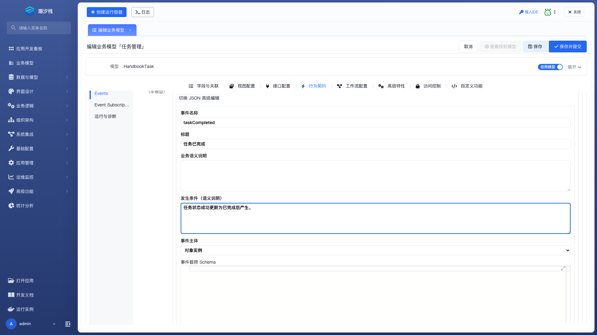

| 配置项 | 说明 |
| --- | --- |
| 事件名称 | 当前模型内的事件标识，必填。 |
| 标题 | 事件显示名称，例如“任务已完成”。 |
| 业务语义说明 | 说明事件含义及订阅方可以依赖的事实。 |
| 发生条件（语义说明） | 说明何时产生该事件，是解释文字，不会作为触发表达式执行。 |
| 事件主体 | 选择模型或对象实例。实例事件需要在产生时提供对象身份。 |
| 事件载荷 Schema | 声明事件携带的 JSON 对象结构，明确字段、类型和必填项。 |
| 允许的生产者种类 | 限定允许产生此事件的生产者类别。由 Action 产生的事件使用 `action`，并在对应动作的事件引用中声明。 |
| 完整模型读取要求 | 开启后，消费者必须具备完整、无过滤的模型读取权；不能用受限的行或字段权限读取包含完整模型信息的历史事实。 |

标准数据操作会提供 `recordsCreated`、`recordsUpdated`、`recordsDeleted` 事件，载荷包含操作类型、对象 ID 集合和受影响数量。不要手工定义同名事件，也不必在标准新增、更新、删除脚本中重复发出它们。

自定义事件需要在逻辑流中通过正式的业务事件节点发出，或由后端扩展调用事件端口。仅新增事件定义或订阅，不会让事件自动发生。

#### 配置事件订阅

在 **Event Subscriptions** 页签新增订阅。订阅写在消费方模型中，源事件可以属于其他模型。一个订阅选择目标 Action 或 Listener 中的一种。


| 配置项 | 说明 |
| --- | --- |
| 订阅名称 | 当前消费方模型内的订阅标识，必填。 |
| 订阅状态 | 缺省启用。停用后不再为此订阅新增投递；恢复启用不会补发停用期间的事件。 |
| 事件所属模型 | 源事件的业务模型全名。 |
| 事件名称 | 源模型中的事件标识。 |
| 真实消费身份引用 | 已存在且启用的用户身份。该身份需要源事件读取权、目标动作权限及所需数据读取权限。 |
| 事件过滤表达式／事件过滤规则 | 只消费满足条件的事实。过滤在入队时执行，修改过滤器不会删除已经入队的交付责任。 |
| 目标 Action 所属模型 | 采用 Action 处理时，填写目标动作所属模型。 |
| 目标 Action 名称 | 要执行的动作标识。 |
| Action 输入映射 | 将事件载荷映射到目标动作的 `params`、`data`，例如用 `${event.payload.taskId}` 读取载荷。 |
| Listener 名称 | 采用代码监听器处理时，填写已经注册的监听器名称；与目标 Action 二选一。 |
| Listener 字面配置 | 原样交给监听器的 JSON 配置，不作为表达式求值。 |
| Listener 动态输入映射 | 用表达式从事件和交付上下文计算监听器需要的输入。异步处理不继承源 HTTP 请求。 |

事件处理可能重试，消费逻辑应使用事件或交付标识保证幂等。停用期间已经存在的交付责任会阻塞；重新启用并修复原因后，需要有权限的用户显式重驱。

#### 检查与调用已部署的动作

在 **运行与诊断** 中点击 **检查或调用已发布 Action**。先保存并校验模型，再刷新目标运行实例；本窗口调用目标应用实际加载的契约。

| 配置项 | 说明 |
| --- | --- |
| 目标应用 API 地址 | 目标应用的 API 前缀，末尾不带斜杠。通过运行实例的后端 API 会话访问时，可使用其提供的 `/api/tunnel/会话ID/api`。 |
| 目标应用访问令牌 | 跨应用访问时填写目标应用的令牌；留空沿用当前登录态。只用于本次表单请求，不保存到模型。 |
| 模型 | 当前业务模型全名，只读。 |
| Action | 从目标应用按当前身份返回的动作中选择。 |
| 输入 | 符合所选动作输入 Schema 的对象，根为 `params`、`data`。 |

点击 **检查可用性** 只检查契约、权限和前置条件，不执行业务处理。结果区分可执行、被阻止和需要补充输入。点击 **执行 Action** 并确认后会真实执行，可能写入数据或调用外部系统；执行时仍会重新检查权限和前置条件。

点击 **查询事件交付**，填写目标应用 API 地址、访问令牌及 **Event ID**，可查看事实和订阅交付结果。对允许重驱的失败交付，先修复消费身份、目标动作或处理逻辑，再执行重驱；不要反复重驱仍未修复的处理。

#### 升级已有模型格式

新建模型使用 `2.0` 格式，动作在行为契约中唯一定义，自定义功能引用动作。已有模型需要升级时，先使用本页的格式升级预览，核对关系校验、动作迁移和输入映射的变化，再应用升级。升级后重新检查自定义功能的页面入口和 API，并在目标实例验证调用结果。

### 配置工作流

业务数据需要进入审批流程时，打开 **工作流配置** 并启用工作流集成。可以绑定已有审批流程，也可以从业务模型中创建默认审批流程并继续编辑。

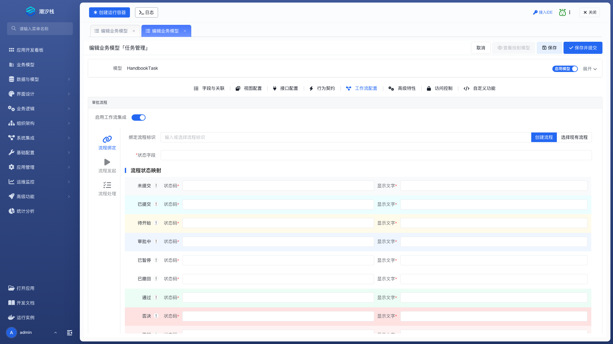

| 配置项 | 说明 |
| --- | --- |
| 启用工作流集成 | 打开后才能配置流程绑定、发起方式和处理动作。 |

启用工作流前，先在业务模型中准备可保存流程状态的字段。

#### 流程绑定

| 配置项 | 说明 |
| --- | --- |
| 绑定流程标识 | 输入审批流程标识，或从已有流程中选择。绑定后可以直接打开流程编辑器。 |
| 新建流程：流程标识 | 创建默认审批流程时填写的稳定标识，必填。 |
| 新建流程：流程名称 | 创建默认审批流程时填写的显示名称，必填。 |
| 新建流程：流程描述 | 说明审批流程的用途和边界。 |
| 状态字段 | 选择业务模型中用于保存流程状态的字段，必填；不能选择默认主键 `id`。 |

每个流程状态都需要配置 **状态码** 和 **显示文字**。状态码写入业务模型的状态字段，显示文字用于业务页面展示。

| 流程状态 | 状态码字段 | 显示文字字段 | 状态含义 |
| --- | --- | --- | --- |
| 未提交 | 填写未提交状态对应的业务值。 | 填写页面显示的未提交文案。 | 表单内容尚未正式提交，可以继续编辑。 |
| 已提交 | 填写已提交状态对应的业务值。 | 填写页面显示的已提交文案。 | 表单已正式提交，可以发送到工作流。 |
| 待开始 | 填写待开始状态对应的业务值。 | 填写页面显示的待开始文案。 | 流程实例已经发起，但尚未开始运行，通常只持续较短时间。 |
| 审批中 | 填写审批中状态对应的业务值。 | 填写页面显示的审批中文案。 | 流程实例正在运行。 |
| 通过 | 填写审批通过状态对应的业务值。 | 填写页面显示的通过文案。 | 流程正常结束，审批通过。 |
| 否决 | 填写否决状态对应的业务值。 | 填写页面显示的否决文案。 | 流程被否决并强制结束。 |
| 撤销 | 填写撤销状态对应的业务值。 | 填写页面显示的撤销文案。 | 流程被撤销并强制结束。 |
| 终止 | 填写终止状态对应的业务值。 | 填写页面显示的终止文案。 | 流程被管理员终止并强制结束。 |

#### 流程发起

| 配置项 | 说明 |
| --- | --- |
| 发起方式 | 选择 **提交表单自动发起** 或 **手动发起**。手动发起时，用户从列表中的发起流程按钮启动流程。 |
| 可重新发起状态 | 选择否决、撤销和终止中的一种或多种，允许处于这些状态的数据重新发起流程。判断依据是流程状态映射后的业务状态值。 |
| 发送编辑连接 | 发起流程时向流程引擎发送编辑页面地址，供统一门户待办在需要时跳转。 |
| 流程表单数据 | 选择向流程引擎传递全部字段，或使用数据映射指定传递内容。 |
| 数据映射 | 流程表单数据选择数据映射时出现，用于逐项定义传递给流程引擎的数据。 |

每一条数据映射包含两个字段：

| 配置项 | 说明 |
| --- | --- |
| 流程引擎表单字段名 | 设置流程引擎接收的字段名，必填。 |
| 映射表达式 | 填写取值用的 SpEL 表达式，必填；可以直接引用业务模型字段。界面会自动补全表达式外层的 `${` 和 `}`。 |

#### 流程处理

| 配置项 | 说明 |
| --- | --- |
| 在操作列显示处理按钮 | 控制索引页操作列是否显示流程处理入口。 |
| 处理表单打开方式 | 选择弹窗、抽屉或新标签。 |
| 流程详情页面打开方式 | 选择弹窗、抽屉或新标签。 |

**允许动作** 中的每个字段控制一种处理入口：

| 配置项 | 说明 |
| --- | --- |
| 通过 | 驱动当前节点继续流转。该动作固定启用，界面中不能关闭。 |
| 驳回 | 当前节点允许驳回时，把流程退回到最近的任务节点。 |
| 加签 | 当前节点允许加签时，选择人员和加签方式，并创建新的审批任务。 |
| 转办 | 当前节点允许转办时，把当前任务转交给指定人员。 |
| 撤回 | 当前节点允许撤回时，把流程退回到开始节点，不结束流程实例。 |
| 撤销 | 结束流程实例并触发撤销事件。 |
| 否决 | 结束流程实例并触发否决事件。 |

**高级动作** 中的字段用于开放更灵活的流程处理能力：

| 配置项 | 说明 |
| --- | --- |
| 允许自由审批 | 节点同时开放自由审批后，执行人可以临时指派其他人员审批，完成后回到当前节点。 |
| 允许自由驳回 | 节点同时开放自由驳回后，用户可以选择驳回到指定节点。 |
| 允许自由重入 | 驳回接口传入 `isFreedomRecovery` 后，允许用户选择驳回后的重入节点。该能力可能跳过中间节点，应谨慎启用。 |

模型中的处理动作还会受到审批流程节点配置的限制。例如模型允许驳回，但当前节点没有开放驳回时，运行页面不会显示该动作。只需要自动处理、不需要人员审批的逻辑应在逻辑流中配置。

### 配置高级特性

高级特性用于打开模型级的数据管理能力：

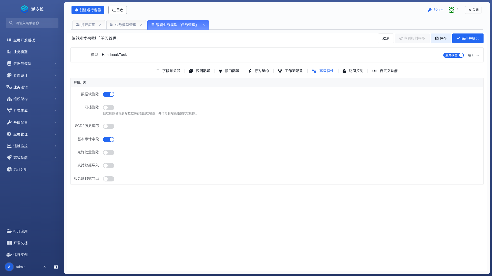

| 配置项 | 何时出现 | 说明 |
| --- | --- | --- |
| 数据软删除 | 始终 | 删除后保留记录，通过删除标记排除常规查询。模型尚无字段或关系时不可启用。 |
| 归档删除 | 始终 | 删除时把数据转存到归档模型，并替代软删除策略。 |
| SCD2 历史追踪 | 始终 | 按 SCD2 方式保留数据随时间变化的历史版本。 |
| 基本审计字段 | 始终 | 提供创建时间、更新时间、创建人和更新人等内置字段。模型尚无字段或关系时不可启用。 |
| 允许批量删除 | 始终 | 允许在索引页选中多条记录后批量删除。 |
| 支持数据导入 | 始终 | 为模型生成数据导入能力。 |
| 数据映射模式 | 启用数据导入后 | 选择自动或自定义。自动模式按字段名、关系名和显示名匹配 Excel 列。 |
| 映射字段 | 数据映射模式为自定义 | 逐项定义 Excel 行数据与模型字段或关系的对应方式。 |
| 服务端数据导出 | 始终 | 在服务端生成导出文件，适合数据量较大或需要统一字段范围的场景。 |
| 导出数据字段 | 启用服务端数据导出后 | 选择允许服务端导出的字段并调整顺序。字段列表没有更新时，先保存模型，再点击 **刷新字段**。 |

每一条导入映射包含两个字段：

| 配置项 | 说明 |
| --- | --- |
| 字段名 | 选择要写入的非主键业务字段，或选择非子表关系，必填。 |
| 映射表达式 | 填写取值用的 SpEL 表达式，必填；`$item` 表示当前 Excel 行，可以使用 `$item.get('列名')` 或 `$item['列名']` 读取单元格。界面会自动补全表达式外层的 `${` 和 `}`。 |

软删除和归档删除是两种互斥的删除策略，启用其中一个会关闭另一个。打开批量删除、导入或服务端导出前，应同时检查访问控制和目标角色权限。

保存模型后，可以在数据导入配置中 **查看逻辑流**，也可以克隆后进入逻辑流编辑器。

### 配置访问控制

访问控制区域决定当前模型支持哪些控制维度，不在这里给具体用户或角色授权。模型尚无字段或关系时，此页不可用。


#### 查询访问控制

| 配置项 | 何时出现 | 说明 |
| --- | --- | --- |
| 允许第三方应用委托访问 | 始终 | 仅在客户端范围、用户本次授权和用户角色权限共同允许时开放委托访问；开启不等于直接授予第三方权限。 |
| 启用访问控制 | 始终 | 启用查询权限和数据范围控制。 |
| 字段访问控制 | 启用查询访问控制后 | 允许按角色限制可以查询的字段。 |
| 按制单人 | 启用查询访问控制后 | 以数据的制单人为范围限制可查询记录。 |
| 按部门 | 启用查询访问控制后 | 以数据的创建部门为范围限制可查询记录。 |
| 按公司 | 启用查询访问控制后 | 以数据的创建公司为范围限制可查询记录。 |

#### 新建访问控制

| 配置项 | 何时出现 | 说明 |
| --- | --- | --- |
| 允许第三方应用委托访问 | 始终 | 仅在客户端范围、用户本次授权和用户角色权限共同允许时开放委托访问；开启不等于直接授予第三方权限。 |
| 启用访问控制 | 始终 | 启用新建权限控制。 |
| 字段访问控制 | 启用新建访问控制后 | 允许按角色限制新建时可以写入的字段。 |

#### 更新访问控制

| 配置项 | 何时出现 | 说明 |
| --- | --- | --- |
| 允许第三方应用委托访问 | 始终 | 仅在客户端范围、用户本次授权和用户角色权限共同允许时开放委托访问；开启不等于直接授予第三方权限。 |
| 启用访问控制 | 始终 | 启用更新权限和数据范围控制。 |
| 字段访问控制 | 启用更新访问控制后 | 允许按角色限制可以更新的字段。 |
| 按制单人 | 启用更新访问控制后 | 以数据的制单人为范围限制可更新记录。 |
| 按部门 | 启用更新访问控制后 | 以数据的创建部门为范围限制可更新记录。 |
| 按公司 | 启用更新访问控制后 | 以数据的创建公司为范围限制可更新记录。 |

#### 删除访问控制

| 配置项 | 何时出现 | 说明 |
| --- | --- | --- |
| 允许第三方应用委托访问 | 始终 | 仅在客户端范围、用户本次授权和用户角色权限共同允许时开放委托访问；开启不等于直接授予第三方权限。 |
| 启用访问控制 | 始终 | 启用删除权限和数据范围控制。 |
| 按制单人 | 启用删除访问控制后 | 以数据的制单人为范围限制可删除记录。 |
| 按部门 | 启用删除访问控制后 | 以数据的创建部门为范围限制可删除记录。 |
| 按公司 | 启用删除访问控制后 | 以数据的创建公司为范围限制可删除记录。 |

同一操作可以同时启用多个数据范围。按制单人、部门或公司启用控制后，平台还会提供相应的内置字段，供索引页和详情页显示数据归属。

模型保存并提交后，还需要在 [用户角色管理](/docs/guide/module/rbac/) 中把相应权限分配给角色。模型只启用了控制选项、角色却没有权限时，运行页面仍然无法执行对应操作。

### 添加自定义功能

标准页面和标准接口无法覆盖某项操作时，可以增加自定义功能，为业务模型补充页面入口、自定义 API，或者把两者组合成一个完整操作。

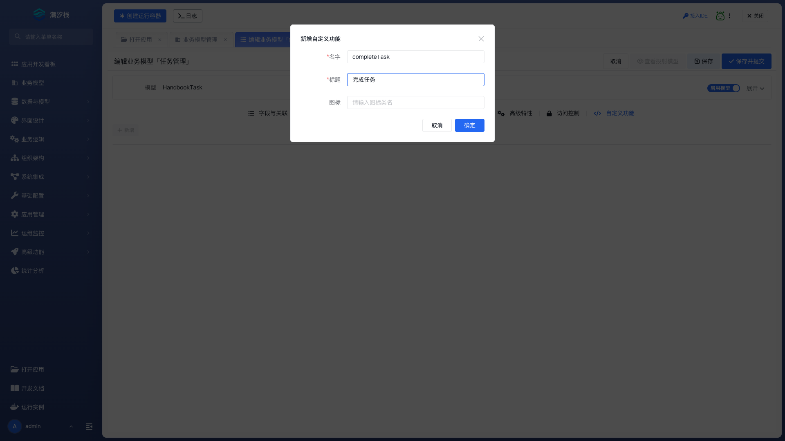

点击 **新增** 后，先配置用于识别功能的基本字段：

| 字段 | 是否必填 | 说明 |
| --- | --- | --- |
| 名字 | 是 | 功能的稳定标识。必须以字母开头，只能包含字母和数字，不能使用 `add`、`create`、`update`、`delete` 等保留字；创建后不能修改。 |
| 标题 | 是 | 功能在编辑器和默认运行入口中显示的名称，创建后仍可修改。 |
| 图标 | 否 | 功能的默认图标。未单独配置按钮图标时，UI 入口沿用此图标。 |

创建功能后，展开该功能可以继续维护基本信息：

| 字段 | 是否必填 | 说明 |
| --- | --- | --- |
| 名字 | 是 | 显示创建时确定的功能标识。该字段只读。 |
| 标题 | 是 | 修改功能的显示名称。按钮文字留空时，也会使用此标题。 |
| 图标 | 否 | 修改功能的默认图标。 |
| 功能描述 | 否 | 说明功能的用途、适用对象或执行结果，便于后续维护。 |

UI 配置和 API 配置可以单独启用。只需要页面入口时启用 UI；只需要提供接口时启用自定义 API；页面入口需要直接调用当前接口时，同时启用两项。

#### 提供页面入口

打开 **UI 配置**，先配置入口的位置和行为：

| 字段 | 出现条件 | 说明 |
| --- | --- | --- |
| 启用 | 始终 | 在运行页面中提供当前功能的 UI 入口。名字或标题为空时不能开启。 |
| 入口 | 启用 UI 后 | 选择功能入口的呈现位置：**工具栏**位于索引页工具栏，适合不依赖当前记录的操作；**操作列**位于每条记录末尾，适合直接处理当前记录；**单条动作**在选中一条记录后可用；**批量动作**在选中多条记录后可用。 |
| 打开方式 | 启用 UI 后 | 选择点击入口后的动作。**弹窗**、**抽屉**和**新标签**打开自定义页面；**API 调用**直接请求当前功能的 API；**自定义**通过 Schema 定义完整按钮行为。 |
| 对齐方式 | 入口为工具栏时 | 设置入口在工具栏中左对齐或右对齐。 |
| 按钮顺序 | 启用 UI 后 | 按数值从小到大排列同一区域的按钮。可参照操作列内置的查看、编辑、删除按钮顺序 `10`、`20`、`30`，以及工具栏新建按钮顺序 `10`，把自定义入口插入预期位置。 |
| 禁用条件 | 打开方式不是自定义时 | 填写判断按钮是否禁用的表达式，例如 `${status == 1}`。操作列和单条动作可以引用当前记录字段，批量动作应根据所选数据编写条件。 |

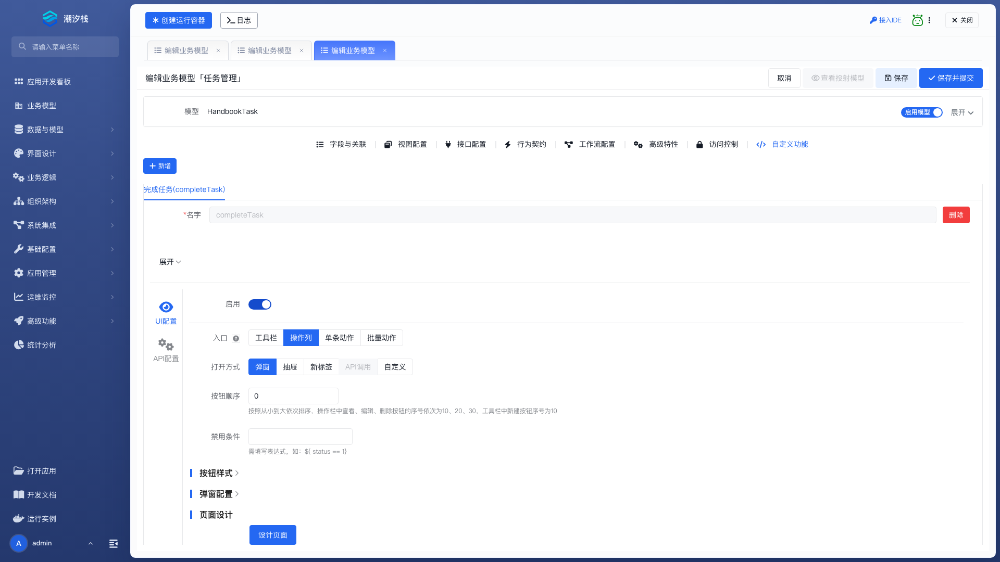

展开 **按钮样式** 后，可以逐项调整入口外观：

| 字段 | 说明 |
| --- | --- |
| 样式 | 选择按钮的语义样式，包括默认、主要、次要、提示、成功、警告、危险、浅色、深色、强调和链接。样式应与操作的重要程度和风险一致。 |
| 尺寸 | 选择极小、小、中等或大。操作列内按钮通常使用较小尺寸，工具栏入口应与相邻按钮保持一致。 |
| 按钮文字 | 设置入口上显示的文字；留空时使用功能标题。 |
| 显示按钮文字 | 控制是否显示按钮文字。关闭后只显示图标，因此应同时配置含义明确的按钮图标。 |
| 按钮图标 | 设置入口使用的图标；留空时使用功能图标。 |
| 背景颜色 | 覆盖当前样式的按钮背景色。没有明确的视觉规范时保持为空，沿用所选样式。 |
| 文字颜色 | 覆盖当前样式的文字和图标颜色。需要同时检查与背景色的对比度。 |

打开方式为 **自定义** 时，按钮样式和禁用条件由自定义按钮 Schema 决定，上述字段不显示。

#### 配置页面打开方式

选择弹窗、抽屉或新标签后，通过 **设计页面** 创建或编辑当前功能的 UI Schema。首次设计时需要选择页面类型：

| 选项 | 说明 |
| --- | --- |
| 表单 | 创建以填写和提交数据为主的表单 Schema。 |
| 页面 | 创建可自由组合展示、操作和数据组件的页面 Schema。 |

不同打开方式还会显示对应的容器字段：

| 字段 | 出现条件 | 说明 |
| --- | --- | --- |
| 弹窗尺寸 | 打开方式为弹窗时 | 选择超小、小、中、大、超大或全屏，决定弹窗占用的页面空间。 |
| 抽屉尺寸 | 打开方式为抽屉时 | 选择超小、小、中、大或超大，决定抽屉的初始宽度。 |
| 可拖动改变大小 | 打开方式为抽屉时 | 允许使用者拖动抽屉边界调整宽度。内容较多或需要对照主页面时可以开启。 |

选择 **新标签** 时没有额外的容器字段，设计好的页面会在新标签中打开。

#### 配置 API 调用反馈

打开方式为 **API 调用** 时，必须先在当前功能的 **API 配置** 中启用自定义 API。随后可以配置调用确认、成功反馈和后续跳转：

| 字段 | 出现条件 | 说明 |
| --- | --- | --- |
| 调用前确认 | 打开方式为 API 调用时 | 点击入口后先显示确认框，使用者确认后才发送请求。删除、提交、状态变更等难以撤销的操作应开启。 |
| 标题 | 开启调用前确认后 | 设置确认框标题；留空时使用平台默认标题。 |
| 文字 | 开启调用前确认后 | 设置确认提示内容，必填。操作列入口可以用 `${字段名}` 引用当前记录的字段值。 |
| 成功反馈弹窗 | 打开方式为 API 调用时 | API 调用成功后显示反馈弹窗。需要展示处理结果或下一步提示时开启。 |
| 弹窗标题 | 开启成功反馈弹窗后 | 设置反馈弹窗标题；留空时使用平台默认标题。 |
| 弹窗内容 | 开启成功反馈弹窗后 | 使用 Schema 编辑器定义反馈内容，必填；可以展示接口返回的数据。 |
| 成功后打开页面 | 打开方式为 API 调用时 | API 调用成功后打开指定页面。 |
| 页面地址 | 开启成功后打开页面后 | 填写要打开的页面地址，必填。操作列入口可以用 `${字段名}` 引用当前记录的字段值。 |

#### 自定义按钮行为

打开方式为 **自定义** 时，使用 **自定义按钮** 字段编写按钮 Schema。该 Schema 同时决定按钮的外观、禁用条件和点击行为，必须包含有效的按钮配置。此方式适合标准弹窗、抽屉、新标签和 API 调用均无法覆盖的交互。

#### 提供自定义 API

打开 **API 配置**，开启 **启用自定义 API**，设置请求方法、地址和实现方式。新建模型采用 `2.0` 格式，功能通过引用 Action 复用业务契约；输入、输出和前置条件在 **行为契约** 中统一维护。


| 配置项 | 出现条件 | 说明 |
| --- | --- | --- |
| 启用自定义 API | 始终 | 为当前功能提供接口。名字或标题为空时不能开启。 |
| 请求方法 | 启用自定义 API 后 | 选择 GET、POST、PUT、PATCH 或 DELETE，应与业务动作及调用方约定一致。 |
| 接口地址 | 启用自定义 API 后 | 必填。相对地址使用界面显示的模型路径前缀；以 `/` 开头时使用应用级路径。 |
| 实现方式 | 启用自定义 API 后 | 选择调用业务动作或调用普通接口。前者经过 Action 契约、权限和执行过程；后者由高代码 Controller 提供 REST 实现。 |
| 引用 Action | 调用业务动作 | 先点击 **读取完整草稿的动作**，再选择目标动作。多个功能可以引用同一动作，关闭当前 API 不会停用目标动作。 |
| HTTP 输入映射 | 调用业务动作 | 用 JSON 对象显式映射请求来源到 `params`、`data`，如 `{"params.record.id":"${ request.pathVariables['id'] }","data":"${ request.body }"}`。无输入时填 `{}`。 |

动作列表反映当前完整草稿；修改模型后要重新读取。目录未覆盖目标环境的代码贡献时，已有动作引用会保留，不会因本次未查到而自动清空。需要修改动作本身时，点击 **打开业务行为契约** 回到定义来源。

#### 快捷创建脚本动作

需要用脚本实现新功能时，在 **调用业务动作** 下点击 **新建脚本动作**。先保存 `2.0` 格式模型，再按以下步骤操作：

1. 填写新动作名称，选择 JavaScript 或 Groovy。
2. 编写脚本，通过 `$input.params`、`$input.data` 读取输入，通过 `$input.context` 读取执行上下文。同步 HTTP 请求位于 `$input.context.request`，后台调用不能假定它存在。
3. 在 **执行效果** 中选择只读或允许写入。
4. 点击 **预览脚本动作资源**，逐项检查模型和逻辑流的保存前后差异。
5. 确认无误后点击 **确认创建并提交完整资源**。


此操作会保存当前完整模型草稿，创建唯一的 Action 和正式逻辑流，并更新当前功能引用；原动作保留。修改脚本或草稿后，需要重新预览。点击 **取消创建** 不修改文件。

未填写 HTTP 输入映射时，快捷创建会提供从 `request.params`、`request.body` 到 `params`、`data` 的默认映射；已有映射保留。创建后应回到行为契约，进一步收紧输入类型、必填字段和业务前置条件。

已有旧格式模型可能仍显示 **生成接口实现**、**绑定同名业务 Action**、**自定义逻辑流** 和脚本配置。维护这类模型时，先通过行为目录核对实际来源，升级格式前检查迁移预览，不要把旧位置的契约再复制成第二份动作定义。

## 保存、提交和放弃变更

编辑器提供 **保存** 和 **保存并提交**，两者用途不同：

| 操作 | 结果 | 适用场景 |
| --- | --- | --- |
| 保存 | 保存当前修改并执行后端校验，修改仍处于未提交状态，模型继续保持编辑锁。 | 分阶段配置、预览页面或暂时保留草稿。 |
| 保存并提交 | 先保存并校验，再填写修改说明，把当前修改写入变更记录。 | 一组配置已经完成并可以交给其他人继续使用。 |
| 取消 | 关闭编辑页；存在未保存修改时会提示确认。 | 不保留本次尚未保存的页面输入。 |
| 放弃变更并解锁 | 回到上一次提交的版本并释放编辑锁，操作不可撤销。 | 整组未提交修改都不再需要。 |

点击 **保存并提交** 后，为本次修改填写能够说明内容的提交信息，例如“补充编辑表单字段和查询权限”。

如果保存后提示后端校验错误，修改已经保存，但模型仍有需要处理的问题。根据页面警告或列表中的错误详情修正配置，再重新保存并提交。

## 维护已有模型

### 重命名、移动和删除

在模型未被编辑锁定时，打开行末的更多操作，可以重命名、移动或删除模型。

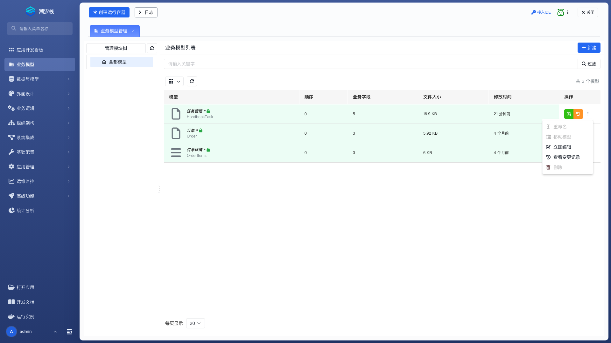

- **重命名** 会改变模型标识。执行前检查页面、接口、逻辑和其他模型中的引用。
- **移动模型** 只调整模型在模块树中的位置。
- **删除模型** 前先确认它没有被其他模型、页面、流程或接口引用，并确认不再需要对应数据。

### 查看模型详情和投射模型

点击模型名称或 **查看详情**，可以查看基本信息、完整模型定义和投射模型。编辑器中没有未保存内容时，也可以点击 **查看投射模型**。

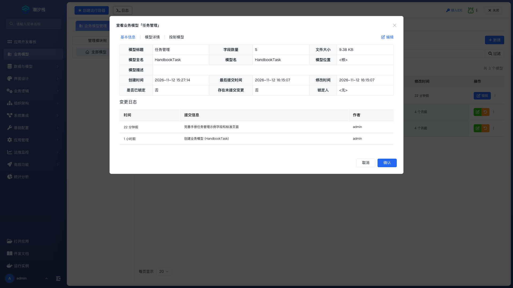

投射模型用于核对业务模型对应的数据模型、页面模型、接口模型、菜单模型和权限模型等结果。这里适合检查结果，不用于替代业务模型编辑器中的源配置。

### 查看变更记录

选择 **查看变更记录**，可以查看每次提交的时间、提交信息和作者。

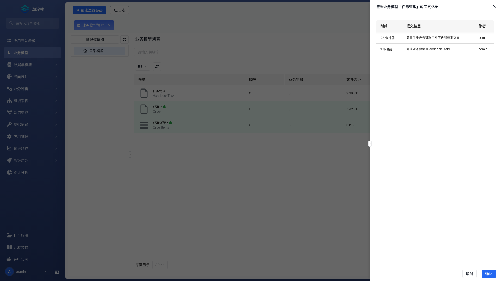

提交信息应写明本次修改的对象和目的，避免使用“修改”“调整”等无法帮助后续排查的描述。

## 在调试实例中验证

完成配置后，按以下顺序检查模型是否可以使用：

1. 在基本信息中打开 **启用模型**。
2. 确认索引页、新建表单、编辑表单和详情页已经按需要打开。
3. 点击 **保存并提交**，并填写修改说明。
4. 使用页面预览分别检查四类视图。
5. 在应用顶部的调试工具栏中启动调试实例；实例已经运行时，点击 **热刷新应用**。
6. 打开调试应用，检查模型菜单和索引页。
7. 新建一条测试数据，再依次检查查询、查看、编辑和删除。
8. 使用目标角色登录，检查字段权限、数据范围和操作权限。

验证不应停留在“页面能打开”。至少需要确认一条数据能够完成新建、查询、查看和编辑；启用了删除、工作流、自定义功能或导入导出时，还要分别验证对应路径。

## 常见问题

### 为什么不能编辑业务模型？

模型可能被其他用户锁定。查看列表中的锁定状态和锁定人，等待对方提交或解锁。

### 为什么保存按钮不可用？

当前页面没有检测到修改。确认配置值已经发生变化后再保存。

### 为什么保存后仍有错误标识？

打开错误详情，根据错误范围修正字段、关系、视图或接口配置，再重新保存。

### 为什么预览页面按钮不可用？

当前模型存在尚未保存的修改。先保存模型，再打开预览页面。

### 为什么新建或编辑表单缺少字段？

检查对应视图的 **表单字段**，确认字段已经加入，并检查字段访问控制。

### 为什么索引页没有显示预期列？

检查索引页的 **显示列**，并确认目标角色拥有相应字段的查询权限。

### 为什么服务端导出找不到新增字段？

先保存业务模型，再回到服务端数据导出配置中点击 **刷新字段**。

### 为什么调试应用中没有模型菜单？

确认模型已启用、不是附属模型、视图已启用，并且修改已经保存并提交。完成后，在顶部调试工具栏中热刷新应用。

### 为什么页面可以打开，却不能新建或更新数据？

检查对应的标准接口是否启用、访问控制是否开启，以及目标角色是否获得相应权限。

### 为什么修改没有出现在调试应用中？

确认修改已经提交，并对运行中的调试实例执行热刷新。

## 扩展阅读

- 了解业务模型的概念和投射关系：[业务模型核心概念](/docs/concepts/business-model/)
- 配置数据结构：[数据模型](./data-model)
- 配置页面结构：[UI Schema](./ui-schema)、[UI 模型](./ui-model)
- 配置接口：[后端接口](./backend-api)
