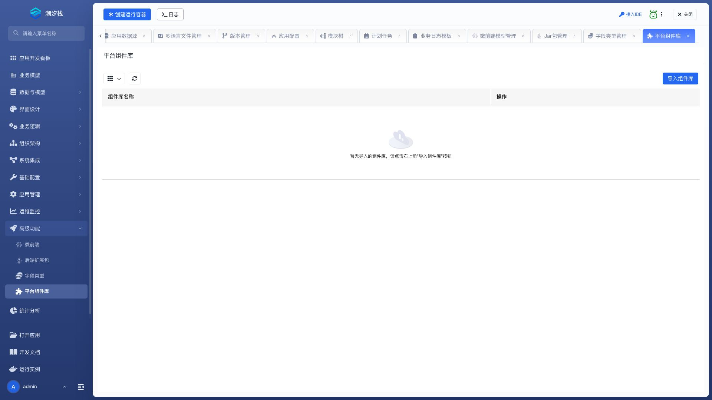
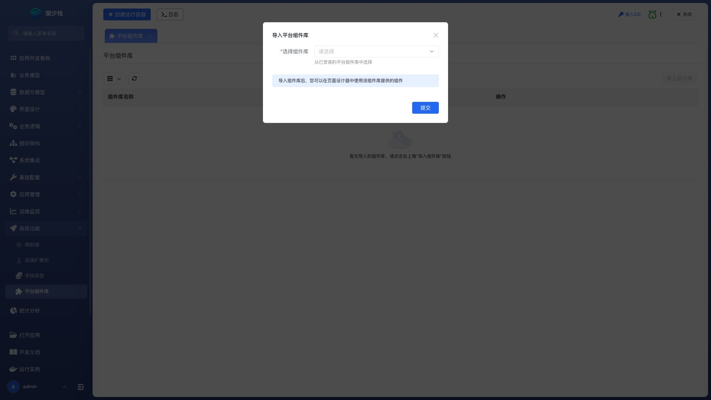

# 组件库

组件库页用于把平台管理员已经安装的组件库导入当前应用。导入后，应用中的 UI Schema 可以使用组件库提供的渲染器、表单项、选项控件或动作。

## 打开组件库

打开应用，在左侧菜单选择“高级功能 / 平台组件库”。列表显示当前应用已经导入的组件库名称。

## 导入组件库

点击“导入组件库”，填写：

| 配置项 | 说明 |
| --- | --- |
| 选择组件库 | 必填。从平台已安装且当前应用尚未导入的组件库中选择。 |

保存后，组件库成为当前应用的依赖。若下拉列表为空，先确认平台管理员已经在“平台组件库”上传并安装目标组件库。

## 在页面中使用组件

1. 导入组件库。
2. 打开 UI Schema 编辑器。
3. 在相应组件类别中找到组件库提供的渲染器或表单项。
4. 按组件文档配置属性、数据和动作。
5. 预览 Schema，并从实际页面验证。

组件能否出现在编辑器中取决于组件库清单和注册结果。导入成功但没有组件时，应到平台组件库查看清单。

## 移除组件库

列表中点击“移除”会解除当前应用与组件库的关联，不会从平台卸载组件库。

移除前检查所有 UI Schema 和微前端是否仍使用该库的组件。存在引用时，页面可能无法渲染或显示未知组件错误。

## 验证组件库

1. 导入后刷新 UI Schema 编辑器。
2. 分别检查渲染器、表单项、选项控件和动作分类。
3. 创建最小测试 Schema 使用目标组件。
4. 验证编辑态、只读态、空值、禁用和错误状态。
5. 在运行实例中检查组件包加载和浏览器控制台。
6. 移除测试导入前先清理测试 Schema 引用。

## 常见问题

### 为什么选择组件库的下拉框为空？

平台没有可导入的组件库，或所有可用库已经导入。到“平台组件库”检查安装列表。

### 导入后为什么编辑器中找不到组件？

检查平台组件库详情中是否登记了对应类别和组件名称，并刷新编辑器。若清单为空，组件包可能没有正确注册。

### 移除会卸载平台组件库吗？

不会。移除只影响当前应用；其他应用和平台安装仍保留。

### 组件库升级后应用需要重新导入吗？

通常关联名称保持不变，但仍应检查平台升级结果和组件兼容性。升级后对关键页面执行回归验证。

## 扩展阅读

- [平台组件库](./platform-component-library)
- [UI Schema](./ui-schema)
- [微前端](./micro-frontend)
