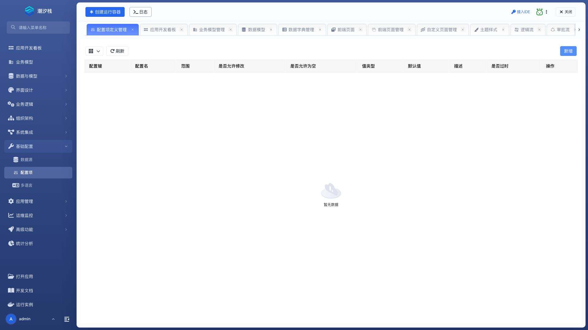
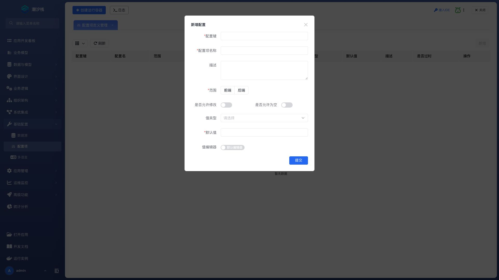

# 配置项

配置项用于声明应用运行所需的可变参数，例如外部服务地址、功能开关或凭据引用。应用定义保存配置的结构和默认值，各运行环境再提供实际值。

## 打开配置项

打开应用，在左侧菜单选择“基础配置 / 配置项”。列表显示配置键、配置名、范围、可修改性、可空性、值类型、默认值、描述和过时状态。

## 新增配置项

点击“新增”，填写：

| 配置项 | 说明 |
| --- | --- |
| 配置键 | 必填。应用内唯一的稳定标识，代码和表达式通过它读取配置。 |
| 配置项名称 | 必填。管理界面中的可读名称。 |
| 描述 | 说明用途、取值范围、示例和安全要求。 |
| 范围 | 必填。可选前端或后端。 |
| 是否允许修改 | 控制运行环境管理员能否覆盖配置值。 |
| 是否允许为空 | 控制实际配置是否可以留空。 |
| 值类型 | 选择配置值的数据类型。 |
| 默认值 | 没有环境覆盖时使用的值。 |
| 值编辑器 | 使用 UI Schema 定义运行环境中编辑该配置的控件和校验。 |

前端范围的配置可能被发送到浏览器，不能用于密码、令牌或私钥。敏感配置应使用后端范围，并由受控环境提供实际值。

## 配置值编辑器

“值编辑器”决定管理员如何录入配置值。应根据值类型选择合适控件，例如：

- 布尔值使用开关。
- 有限选项使用下拉选择。
- 数值使用带范围校验的数字输入。
- 敏感字符串使用密码输入并避免回显。
- 结构化值使用能够校验格式的编辑器。

编辑器只负责录入体验，实际值仍须符合“值类型”和业务约束。

## 编辑与查看详情

编辑页包含新建时的全部字段，并增加：

| 配置项 | 出现条件 | 说明 |
| --- | --- | --- |
| 是否过时 | 始终显示 | 标记配置已不建议继续使用。 |
| 过时原因 | “是否过时”开启 | 必填。说明替代配置、迁移方法和计划移除时间。 |

详情页也显示全部字段；当默认值不能为空时，会要求提供默认值。

将配置标记为过时不会自动迁移调用方，也不会立即删除现有环境值。应先更新引用，再考虑移除。

## 在运行环境中维护实际值

开发菜单中的配置项维护的是定义和默认值。运行环境的 **系统设置 / 配置管理** 按分组展示当前可管理的配置，环境覆盖值在这里维护。

配置声明了专用管理入口时，配置工作台会把维护操作交给该入口，不再生成通用编辑表单。例如人员资料等结构化设置，应进入相应管理页面修改。

受保护配置由专用管理策略控制可见内容和可写字段。密码输入控件只改变显示方式，不会自动建立读取保护；不要通过普通配置表达式引用受保护值。连接凭据应沿用对应组件提供的安全管理入口。

保存实际值时，平台会检查读取版本。遇到“配置已被修改”一类冲突提示，重新加载最新值，核对其他人的修改后再保存，避免用旧表单覆盖新配置。

## 验证配置

1. 保存配置定义后刷新列表。
2. 在目标运行环境打开配置管理，检查编辑控件和默认值。
3. 对可修改配置设置环境值并保存。
4. 启动或刷新使用该配置的功能，确认读取的是目标环境值。
5. 分别验证空值、非法类型和边界值。
6. 敏感配置检查页面、接口响应和日志中是否发生泄露。

## 常见问题

### 前端范围和后端范围怎样选择？

只有浏览器必须直接读取且可以公开的值才使用前端范围。连接串、密码、令牌和内部地址使用后端范围。

### 默认值和环境值哪个生效？

环境提供了覆盖值时使用环境值；没有覆盖时使用默认值。具体环境的结果应在运行配置中核对。

### 为什么运行环境不能修改配置？

检查“是否允许修改”是否开启。若配置属于固定系统行为，应保持不可修改，不要为了临时调试放宽约束。

### 标记过时后可以直接删除吗？

不可以仅凭标记判断。先按“过时原因”迁移代码、逻辑流和环境值，确认没有读取方后再删除定义。

## 扩展阅读

- [应用配置](./app-configuration)
- [外部接口](./external-api)
