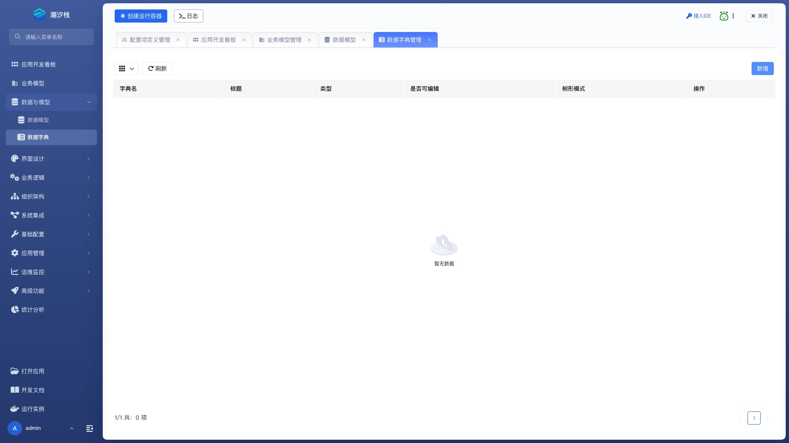
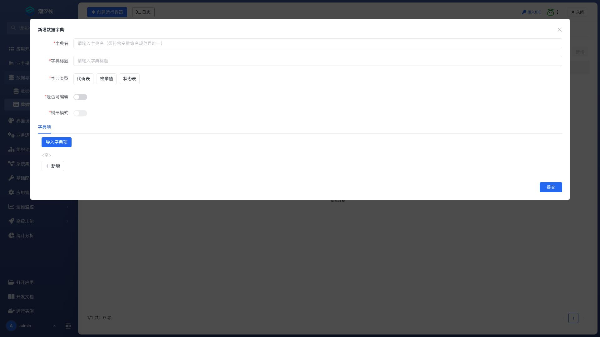

# 数据字典

数据字典用于维护一组稳定、可复用的选项，例如状态、类型或分级。字段绑定字典后，页面可以使用统一的标题、编码和排序；状态表还可以记录允许的状态转移。

## 打开数据字典

打开应用，在左侧菜单选择“数据与模型 / 数据字典”。列表显示字典名、标题、类型、是否可编辑和是否启用树形模式。点击一行可查看字典项，使用行内操作可以编辑字典定义。

## 新建数据字典

点击“新增”，填写字典定义并配置第一批字典项。

| 配置项 | 说明 |
| --- | --- |
| 字典名 | 必填。字典在应用中的唯一标识，须符合变量命名规范；创建后不可修改。 |
| 字典标题 | 必填。开发界面中显示的名称。 |
| 字典类型 | 必填。可选“代码表”“枚举值”或“状态表”。 |
| 是否可编辑 | 控制运行阶段是否允许维护字典项。 |
| 树形模式 | 仅代码表可用。开启后，字典项可以包含下级选项。 |
| 字典项 | 当前字典包含的选项集合，可逐项新增、排序和配置。 |

### 选择字典类型

- **代码表**：用于普通选项集合，可配置为树形结构，也可以允许运行阶段维护。
- **枚举值**：用于随应用定义交付的固定枚举。
- **状态表**：用于业务状态，并可为每个状态配置允许转移到的目标状态。

选定类型后再录入字典项。类型决定后续可用的配置，不应只按显示效果选择。

## 配置字典项

在“字典项”区域新增或打开一个选项，每个字典项包含以下字段：

| 配置项 | 出现条件 | 说明 |
| --- | --- | --- |
| 编码 | 始终显示 | 必填。当前字典内唯一的稳定值，业务数据保存的是这个值。 |
| 标题 | 始终显示 | 必填。页面向用户展示的文字。 |
| 顺序 | 始终显示 | 必填。非负整数，数值较小的选项排在前面。 |
| 包含子选项 | 开启树形模式 | 表示当前项下还包含下一层选项。 |
| 子选项 | “包含子选项”开启 | 使用与上级相同的编码、标题和顺序规则维护下级选项。 |
| 状态转移配置 | 字典类型为状态表 | 维护当前状态允许转移到的目标状态及转移说明。 |
| 扩展配置 | 字典类型不是状态表 | 使用键值对保存该字典项的附加属性。 |

### 配置状态转移

状态表中的每条转移配置包含：

| 配置项 | 说明 |
| --- | --- |
| 转移状态 | 必填。允许到达的目标状态编码。应填写同一状态表中已经存在的编码。 |
| 状态转移描述 | 必填。说明这次状态变化的业务含义或触发条件。 |

状态转移表会按当前状态汇总展示这些配置。保存前应检查目标编码是否存在，避免形成无法执行的状态路径。

## 导入字典项

字典详情中点击“导入字典项”，可通过 Excel 批量录入。

1. 点击“下载字典项模板”。
2. 在模板中填写“编码”“标题”和“排序”。
3. 回到导入窗口选择 Excel 文件。
4. 检查解析出的字典项，确认后提交。

| 模板列 | 说明 |
| --- | --- |
| 编码 | 字典项的唯一值。 |
| 标题 | 页面显示文字。 |
| 排序 | 控制显示次序的非负整数。 |

导入适合一次性录入平铺选项。树形层级、状态转移和扩展配置仍应在字典项配置中补充。

## 编辑字典定义

列表行内的“编辑”会打开字典定义表单。字典名以只读方式显示，其余字段与新建时一致：

- 字典标题
- 字典类型
- 是否可编辑
- 树形模式
- 字典项

修改类型可能使原有的树形配置、状态转移或扩展配置不再适用。切换前先确认现有业务数据和字段绑定仍能解释原来的编码。

## 验证字典

1. 保存字典后重新打开详情。
2. 确认编码唯一、标题正确、顺序符合预期。
3. 树形字典展开父项，检查子项层级。
4. 状态表查看“状态转移表”，确认每个状态的可达目标。
5. 在绑定该字典的业务字段中预览选项，确认显示标题与保存编码一致。

## 常见问题

### 为什么树形模式不可用？

树形模式只适用于代码表。将字典类型设为枚举值或状态表时，该开关会被禁用。

### 修改字典项编码会有什么影响？

业务数据保存的是编码而不是标题。已经产生数据后修改编码，原数据可能无法匹配到标题。通常只修改标题，不修改已使用的编码。

### 为什么状态转移没有生效？

先确认当前字典类型是状态表，目标状态填写的是同一字典中的编码，并且使用该字典的业务逻辑确实读取了状态转移配置。

### 什么时候使用扩展配置？

当页面或逻辑需要为某个选项附加颜色、分类标记等额外属性时使用。键名和取值应与消费这些属性的组件或逻辑约定一致。

## 扩展阅读

- [业务模型](./business-model)
- [数据模型](./data-model)
