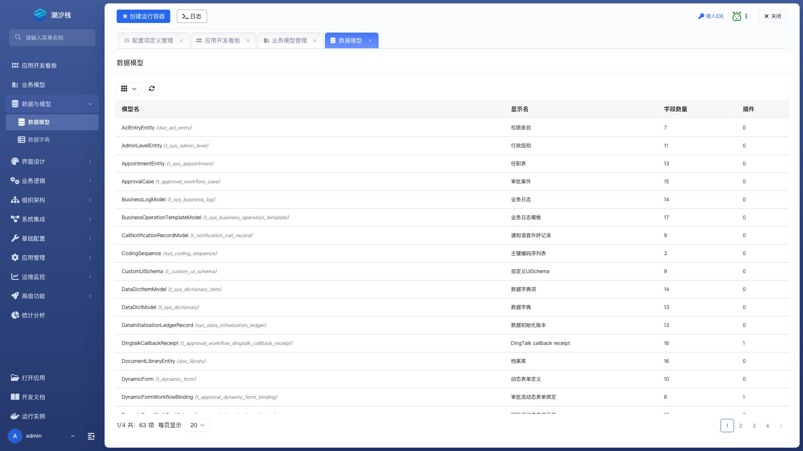
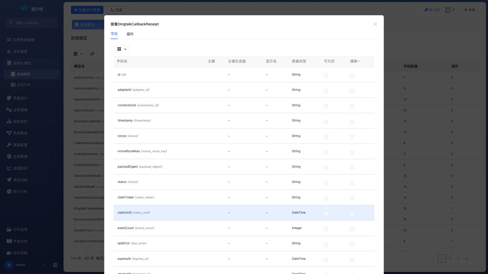
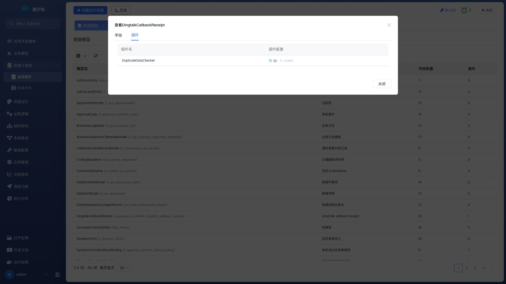

# 数据模型

数据模型页用于查看应用已经加载的数据结构。业务模型提交后形成的数据表模型，以及应用依赖模块提供的数据模型，都会汇总到这里。这个页面主要用于核对最终的数据字段、主键和插件配置，不提供新建或修改入口。

## 打开数据模型

打开应用，在左侧菜单选择“数据与模型 / 数据模型”。页面默认显示当前应用能够访问的全部数据模型，每页显示 20 条，可切换为 10、20 或 50 条。

如果刚刚提交了业务模型而列表尚未更新，点击“刷新”重新加载元数据。

## 查看模型列表

| 列 | 说明 |
| --- | --- |
| 模型名 | 数据模型的完整名称。括号内出现的名称是底层原始名称，可用于排查模型映射问题。 |
| 显示名 | 面向用户的模型名称。 |
| 字段数量 | 当前模型中包含的字段总数。 |
| 插件 | 挂载到该数据模型的插件数量。 |

点击任意一行可打开模型详情。

## 查看字段

详情中的“字段”页签逐行展示最终生效的数据字段。

| 字段信息 | 说明 |
| --- | --- |
| 字段名 | 字段的逻辑名称；括号内为底层原始字段名。 |
| 主键 | 钥匙图标表示该字段属于主键。一个模型可能包含一个或多个主键字段。 |
| 主键生成器 | 主键值的生成方式；非主键字段或未配置生成器时显示 `-`。 |
| 显示名 | 字段在开发界面中的名称。 |
| 数据类型 | 字段在数据模型中的实际类型。 |
| 可为空 | 选中表示写入数据时允许不提供该字段。 |
| 值唯一 | 选中表示该字段受唯一性约束。 |

这里展示的是提交后的数据结构。若字段信息与业务模型编辑器中的配置不一致，先确认业务模型是否已经保存并提交，再刷新数据模型列表。

## 查看插件

“插件”页签展示附加到数据模型的扩展能力。

| 字段信息 | 说明 |
| --- | --- |
| 插件名 | 插件的注册名称。 |
| 插件配置 | 该插件在当前数据模型上的 JSON 配置。 |

插件配置用于定位扩展行为。修改插件应回到提供该插件的模型或扩展功能中进行，不要把详情页中的 JSON 当作可编辑配置。

## 验证数据结构

完成业务模型配置后，可按以下顺序核对结果：

1. 保存并提交业务模型。
2. 打开“数据模型”并刷新列表。
3. 找到对应模型，确认字段数量。
4. 打开详情，检查字段类型、主键、可空和唯一约束。
5. 如果模型使用扩展插件，切换到“插件”页签确认插件及其配置已经加载。

## 常见问题

### 为什么这里不能新建或编辑数据模型？

数据模型页反映应用最终加载的数据结构，属于只读检查入口。需要调整结构时，应修改产生该数据模型的业务模型或相应扩展定义，然后重新提交。

### 为什么找不到刚刚修改的字段？

先确认业务模型已经提交，而不只是保存在编辑器中。提交完成后刷新数据模型列表；如果仍未更新，再检查提交过程是否出现校验错误。

### 原始名称和模型名有什么区别？

模型名和字段名是平台中的逻辑名称；原始名称表示底层数据结构实际使用的名称。日常配置通常使用逻辑名称，排查数据库映射或历史模型兼容问题时再关注原始名称。

## 扩展阅读

- [业务模型](./business-model)
- [数据字典](./data-dictionary)
