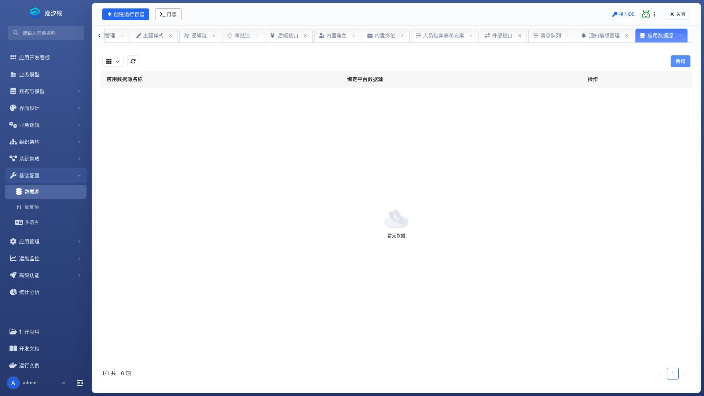
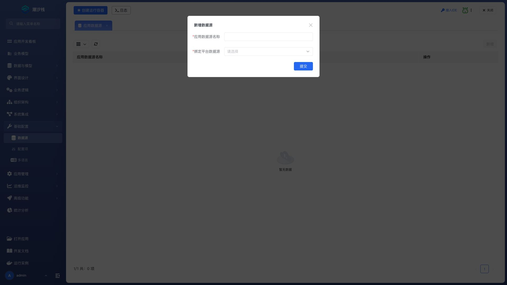

# 数据源

应用数据源把应用内使用的逻辑名称绑定到平台已经配置的数据源。业务模型和数据能力引用应用数据源名称，运行环境通过绑定关系找到实际连接。

## 打开数据源

打开应用，在左侧菜单选择“基础配置 / 数据源”。列表显示“应用数据源名称”和“绑定平台数据源”。

## 新增数据源

点击“新增”，填写：

| 配置项 | 说明 |
| --- | --- |
| 应用数据源名称 | 必填。应用内唯一的逻辑名称，供模型和数据访问配置引用。 |
| 绑定平台数据源 | 必填。从平台数据源列表中选择实际连接。 |

应用数据源名称应表达用途，例如主业务库或报表库，不要使用具体主机名。不同环境可以让同一逻辑名称绑定到各自的平台数据源。

## 编辑绑定

列表中点击“编辑”，可修改应用数据源名称和绑定的平台数据源。修改逻辑名称前先检查模型引用；切换平台数据源前确认目标库的结构、账号权限和数据一致。

## 验证数据源

1. 确认平台数据源已经为当前环境配置并可连接。
2. 新建应用绑定后刷新列表。
3. 打开使用该名称的业务模型或逻辑流，执行一次最小查询。
4. 再执行受控写入并核对目标数据库。
5. 在不同运行环境分别验证绑定，避免开发环境成功但测试或生产环境缺少同名定义。

## 常见问题

### 为什么平台数据源下拉框为空？

需要先由平台管理员在“平台数据源”中创建可用定义。应用数据源不会直接保存 JDBC 连接信息。

### 切换绑定会迁移数据吗？

不会。它只改变应用访问的实际数据源。目标数据库必须已经具备所需结构和数据，迁移应通过单独的发布或运维流程完成。

### 应用数据源名称可以修改吗？

可以编辑，但已有业务模型、逻辑流或扩展代码可能按名称引用。投入使用后应把它当作稳定标识，确需修改时同步迁移所有引用。

### 为什么开发环境可用，运行实例不可用？

检查运行实例所在环境是否存在对应的平台数据源定义、网络是否可达，以及数据库账号是否具备所需权限。

## 扩展阅读

- [平台数据源](./platform-datasource)
- [业务模型](./business-model)
