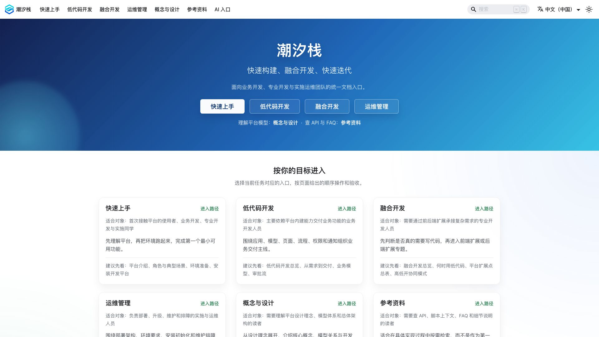

# 开发文档

开发文档入口在新窗口打开当前部署附带的用户手册。开发应用时可以从这里查询低代码配置、运行管理和融合开发说明。平台镜像与手册可以分别更新，使用前应核对文档适用版本。

## 打开开发文档

在平台菜单或应用开发工作区的辅助入口点击“开发文档”。浏览器会打开 `/dev-docs`，无需离开当前开发页面。

## 查找内容

进入手册后可按任务选择栏目：

| 需求 | 建议入口 |
| --- | --- |
| 第一次部署并创建应用 | 快速上手 |
| 查询某个开发菜单的字段和操作 | 低代码开发 |
| 完成一条具体配置流程 | 操作教程 |
| 使用组织、权限、通知或审批能力 | 模块指南 |
| 编写微前端、组件库或后端扩展 | 融合开发 |

页面左侧目录用于浏览同一栏目，站内搜索适合按界面字段、错误信息或功能名称定位内容。

## 使用版本匹配的文档

平台功能和字段会随版本变化。遇到文档与界面不一致时，先确认：

1. 当前打开的是运行平台自身的 `/dev-docs`。
2. 浏览器没有缓存旧站点资源。
3. 当前账号有权看到对应功能和动态字段。
4. 应用加载的模块与文档所述能力一致。

不要用搜索引擎中的旧版本页面替代当前平台内置手册。

## 常见问题

### 点击后为什么没有打开文档？

开发文档使用新窗口打开。检查浏览器是否拦截弹窗，并确认当前平台已部署手册站点。

### 为什么文档中的某个菜单在应用里不存在？

菜单可能受应用模块、平台能力或用户权限控制。先检查应用是否加载相应模块，再确认当前角色权限。

### 文档和界面字段不一致怎么办？

先刷新文档和应用页面，确认平台版本一致。仍不一致时以当前界面和平台元数据为准，并记录具体页面、字段和版本反馈给维护者。

### 如何返回正在编辑的应用？

开发文档在新窗口打开，原应用开发工作区保持不变，切回原浏览器标签即可。

## 扩展阅读

- [低代码开发](../)
- [融合开发](../../fusion-development/)
