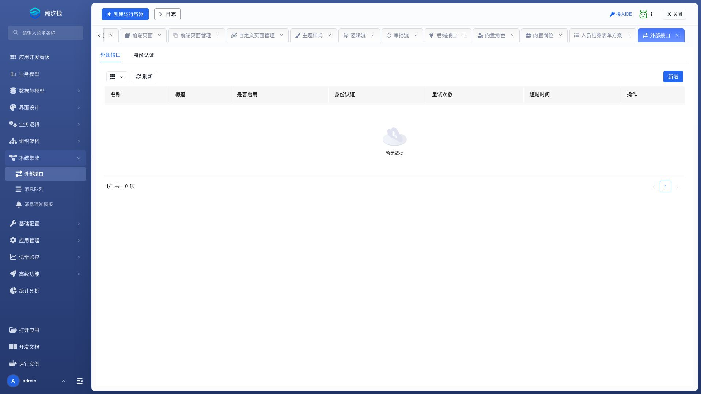
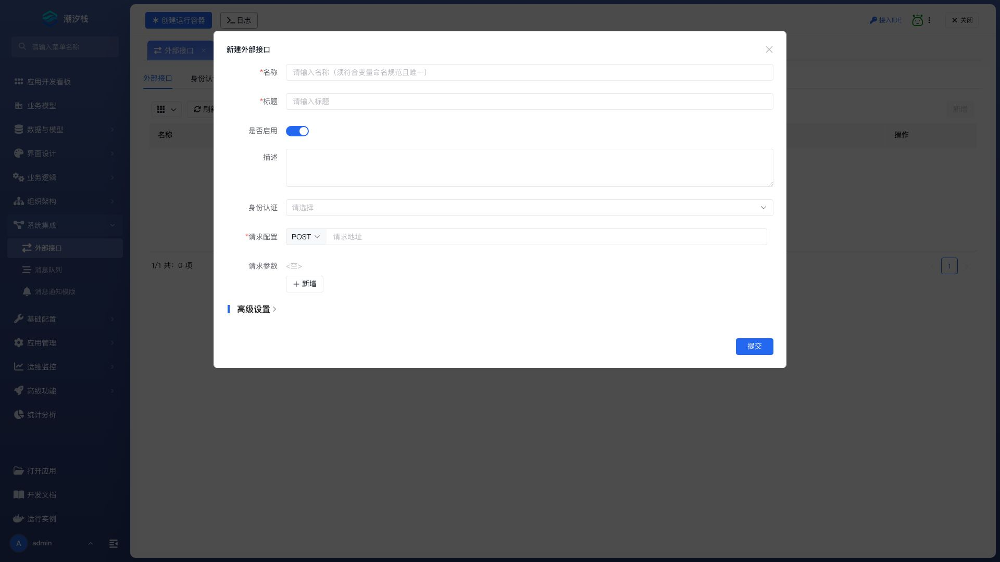
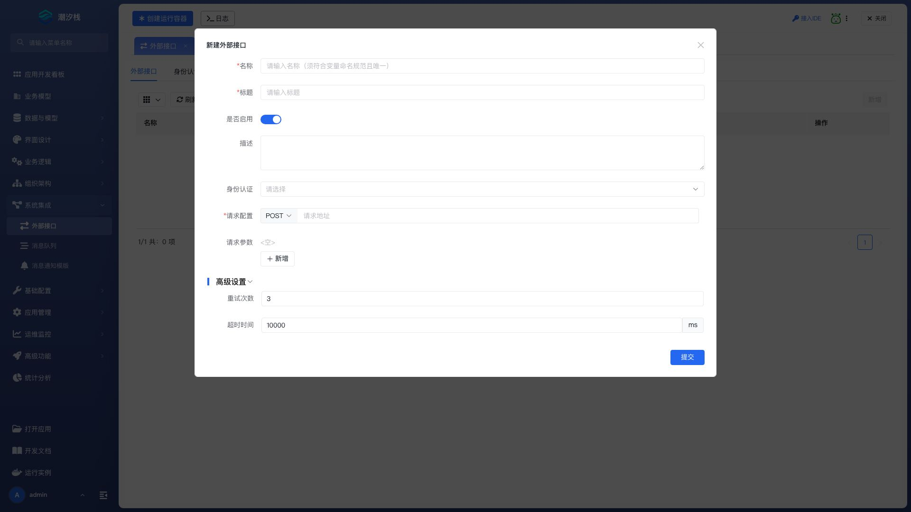
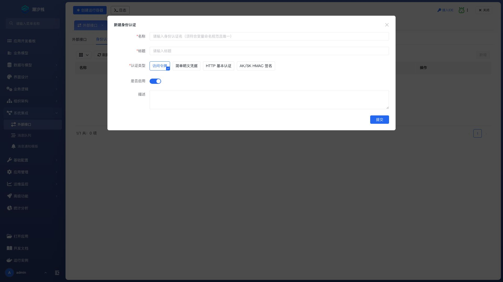

# 外部接口

外部接口用于把应用需要调用的 HTTP 服务注册为可复用模型。接口定义集中管理请求地址、参数、认证、超时和重试，逻辑流可以按名称调用它，而不必在每个流程中重复保存连接信息。

## 打开外部接口

打开应用，在左侧菜单选择“系统集成 / 外部接口”。页面包含“外部接口”和“身份认证”两个页签。

“外部接口”列表显示名称、标题、启用状态、身份认证、重试次数和超时时间；“身份认证”列表显示名称、标题、认证类型和启用状态。

## 新建外部接口

在“外部接口”页签点击“新增”。

### 基本信息

| 配置项 | 说明 |
| --- | --- |
| 名称 | 必填。应用内唯一标识，编辑时只读，供逻辑流等调用方引用。 |
| 标题 | 必填。开发界面中的可读名称。 |
| 分组 | 接口所属的分组标识，用于组织和识别同类外部服务；没有分组需求时可留空。 |
| 是否启用 | 关闭后，该接口不应被正常调用。 |
| 描述 | 说明服务用途、输入、输出和依赖方。 |
| 身份认证 | 选择已配置的认证；也可以在下拉框中直接新增认证。无需认证时留空。 |

### 请求配置

| 配置项 | 说明 |
| --- | --- |
| 请求方法 | 必填。可选 POST、GET、PUT、PATCH 或 DELETE。 |
| 请求地址 | 必填。外部服务的完整 URL；需要动态部分时结合请求参数处理。 |

### 请求参数

每条参数包含：

| 配置项 | 说明 |
| --- | --- |
| 参数位置 | 必填。可选 path、header、query、body 或 cookie。 |
| 参数名 | 必填。外部服务约定的参数名称。 |
| 参数值 | 必填。可写固定值，使用 `${变量名}` 或 `$变量名` 引用调用入参，使用 `#{配置项}` 引用应用配置。 |

URL 中的 path 参数应与路径占位符一一对应；GET 请求不要把业务参数放在 body 中。

### 高级设置

展开“高级设置”配置：

| 配置项 | 说明 |
| --- | --- |
| 重试次数 | 请求失败后的重试次数。只对可以安全重试的调用设置大于 0 的值。 |
| 超时时间 | 单次请求的超时毫秒数。应小于上层调用链的总超时。 |

创建时默认重试 3 次、超时 10000 毫秒。写操作若不具备幂等性，重试可能造成重复数据，应根据接口契约调整。

## 配置身份认证

在“身份认证”页签点击“新增”。所有认证类型都有以下字段：

| 配置项 | 说明 |
| --- | --- |
| 名称 | 必填。应用内唯一标识，供外部接口引用。 |
| 标题 | 必填。认证配置的可读名称。 |
| 认证类型 | 必填。可选访问令牌、简单明文凭据、HTTP 基本认证或 AK/SK HMAC 签名。 |
| 是否启用 | 控制认证能否被接口使用。 |
| 描述 | 说明凭据来源、适用服务和轮换要求。 |

敏感值优先通过 `#{配置项}` 引用，不要把生产密钥直接写进应用定义。

### 访问令牌

“获取令牌方式”可选动态获取或静态配置。

动态获取时配置：

| 配置项 | 说明 |
| --- | --- |
| 请求接口 / 方法 | 必填。令牌服务使用 POST 或 GET。 |
| 请求接口 / 地址 | 必填。令牌服务 URL。 |
| 请求参数 / 位置 | 必填。header、query、body 或 cookie；GET 时 body 不可用。 |
| 请求参数 / 参数名 | 必填。令牌请求参数名称。 |
| 请求参数 / 参数值 | 必填。支持通过 `#{配置项}` 引用凭据。 |
| 令牌路径 | 必填。从响应中提取访问令牌的 JSONPath。 |
| 过期时间来源 | 选择从响应获取或手动输入。 |
| 过期时间路径 | 从响应获取时填写，用 JSONPath 提取过期时间。 |
| 过期时间 | 手动输入时填写数值和单位，单位可选毫秒或秒。 |

静态配置时填写“访问令牌”，可以通过 `#{配置项}` 引用配置值。

“令牌位置”决定取得令牌后如何附加到业务请求：

- **Authorization 标头**：按 `Bearer <accessToken>` 写入请求头。
- **自定义**：逐项配置附加位置、参数名和参数值，可注入 header、query、body 或 cookie。

### 简单明文凭据

“请求参数”可添加多条凭据，每条包含：

| 配置项 | 说明 |
| --- | --- |
| 参数位置 | 必填。凭据写入 header、query、body、cookie 等位置。 |
| 参数名 | 必填。外部服务要求的凭据字段名。 |
| 参数值 | 必填。建议引用配置项，不直接保存密钥。 |

### HTTP 基本认证

| 配置项 | 说明 |
| --- | --- |
| 用户名 | 必填。HTTP Basic 用户名。 |
| 密码 | 必填。HTTP Basic 密码，优先引用受控配置。 |

### AK/SK HMAC 签名

| 配置项 | 出现条件 | 说明 |
| --- | --- | --- |
| 预设模式 | 始终显示 | 必填。可选 AWS SigV4、腾讯云 TC3、华为云、火山引擎、阿里云 ACS3 或阿里云 RPC V1。 |
| Access Key | 始终显示 | 必填。访问密钥标识。 |
| Secret Key | 始终显示 | 必填。签名密钥。 |
| 安全令牌 | AWS、腾讯云、华为云、火山引擎或阿里云 ACS3 | 临时凭证附带的安全令牌。 |
| 地域 | AWS、腾讯云或火山引擎 | 服务所在地域。 |
| 服务名 | AWS、腾讯云或火山引擎 | 必填。参与签名范围计算的服务名。 |
| Action | 腾讯云、阿里云 ACS3 或阿里云 RPC V1 | 请求动作名称。 |
| Version | 腾讯云、阿里云 ACS3 或阿里云 RPC V1 | API 版本。 |
| Nonce | 阿里云 ACS3 或阿里云 RPC V1 | 请求随机数。 |
| Payload Hash 模式 | AWS | 可选自动、空内容 SHA-256 或 unsigned payload。 |
| 附加签名头 | 除阿里云 RPC V1 外的预设 | 把指定请求头纳入签名。 |
| 排除签名头 | 除阿里云 RPC V1 外的预设 | 从签名头集合中排除指定请求头。 |
| 签名算法 | 阿里云 RPC V1 | 可选 HMAC-SHA1 或 HMAC-SHA256。 |

预设模式必须与目标云服务的签名规范一致。地域、服务名、Action 或 Version 填错都会导致签名校验失败。

## 编辑与查看

接口和认证列表都提供“查看”和“编辑”。查看页展示完整配置；编辑页中稳定名称保持只读，其余字段按新增规则修改。

禁用或修改认证前，先检查有哪些外部接口正在引用它。修改超时、重试或请求参数后，应重新验证所有调用方。

## 验证外部调用

1. 使用测试环境地址和凭据创建接口。
2. 通过最小逻辑流传入一组明确参数并执行调用。
3. 检查路径、查询、请求头和请求体是否符合外部服务契约。
4. 分别验证认证成功、凭据错误、超时和非 2xx 响应。
5. 验证响应字段能够被后续节点正确读取。
6. 写接口还要验证重试不会造成重复操作。

## 常见问题

### 为什么参数值没有替换变量？

检查引用语法和调用入参字段名。运行变量使用 `${变量名}` 或 `$变量名`，应用配置使用 `#{配置项}`，两者来源不同。

### 为什么动态令牌可以获取，业务请求仍返回未认证？

检查令牌 JSONPath、过期时间和令牌位置。若使用自定义位置，确认参数名、位置和 `accessToken` 引用与服务要求一致。

### 为什么请求被执行多次？

高级设置中的重试会在失败时重新发起请求。对于创建、扣减等非幂等操作，将重试次数设为 0 或先在外部服务实现幂等控制。

### 为什么 HMAC 签名不一致？

逐项核对预设模式、地域、服务名、Action、Version、时间和签名头集合，并确认密钥与目标环境匹配。

## 扩展阅读

- [逻辑流](./logicflow)
- [配置项](./config-item)
- [数据源](./datasource)
