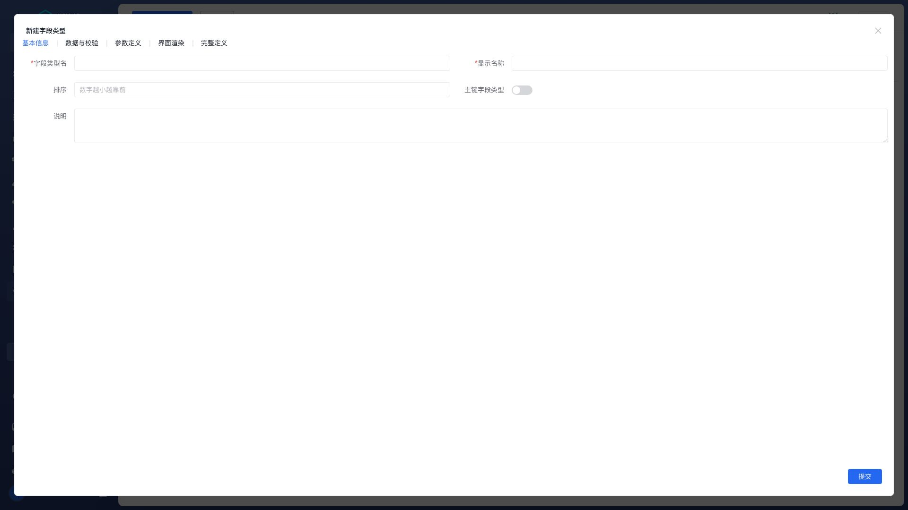
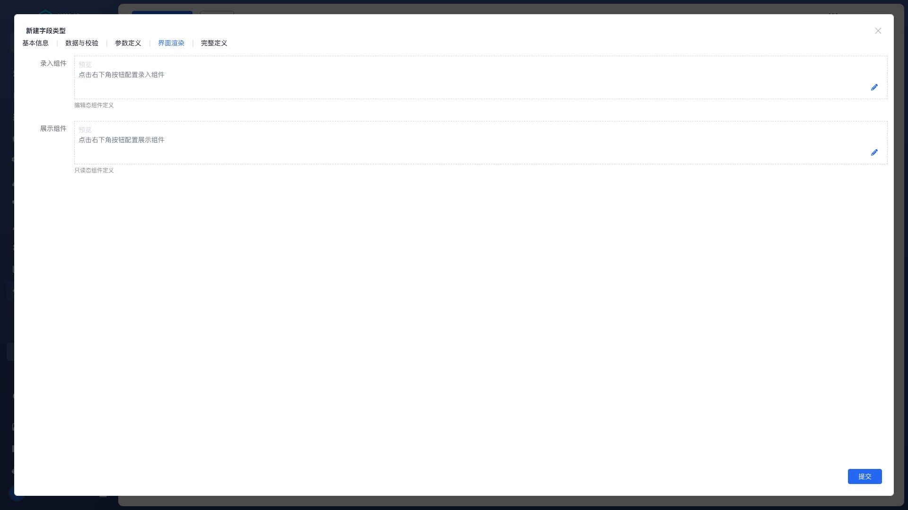

# 字段类型

字段类型定义业务模型编辑器中可选的字段，包括数据结构、校验规则、配置参数以及编辑态和只读态组件。它适合把一套可复用的领域字段能力交付给当前应用。

## 打开字段类型

打开应用，在左侧菜单选择“高级功能 / 字段类型”。列表显示字段类型名、显示名称、排序、是否为主键类型、主键生成器、参数项、录入组件和展示组件。

## 新建字段类型

点击“新增”，表单按五个页签组织。

### 基本信息

| 配置项 | 出现条件 | 说明 |
| --- | --- | --- |
| 字段类型名 | 始终显示 | 必填。应用内唯一的稳定标识。 |
| 显示名称 | 始终显示 | 必填。业务模型编辑器中显示的名称。 |
| 排序 | 始终显示 | 数值越小，在字段类型选择列表中越靠前。 |
| 主键字段类型 | 始终显示 | 表示该类型可以用于主键字段。 |
| 说明 | 始终显示 | 描述用途、值格式和使用限制。 |
| 主键生成器 | 开启主键字段类型 | 配置该类型使用的主键值生成器。 |

### 数据与校验

| 配置项 | 说明 |
| --- | --- |
| 数据类型 | 字段底层数据类型的 JSON 对象。 |
| 校验规则 | 字段值需要满足的校验规则 JSON 对象。 |
| 校验提示 | 各校验失败时显示的消息 JSON 对象。 |

校验提示的键应与校验规则对应，确保用户能知道哪个约束失败以及如何修正。

### 参数定义

| 配置项 | 说明 |
| --- | --- |
| 参数 UI Schema | 定义业务模型编辑器为该字段类型显示的配置项。每个参数项的 `value` 会参与提取默认值。 |

参数应只暴露字段使用者真正需要调整的内容。字段运行必须依赖的固定约束应留在类型定义中。

### 界面渲染

| 配置项 | 说明 |
| --- | --- |
| 录入组件 | 编辑态组件定义，负责输入和修改字段值。 |
| 展示组件 | 只读态组件定义，负责列表和详情中的显示。 |

两个组件都要处理空值、禁用状态和长内容。只配置录入组件会导致只读页面体验不完整。

### 完整定义

| 配置项 | 说明 |
| --- | --- |
| 完整定义 | 字段类型的完整 JSON。可直接编辑，结构化表单未展示的属性也会保留。 |

直接修改完整定义后，返回其他页签检查结构化字段是否仍一致。

## 查看与编辑

详情页以只读方式展示全部五组字段。编辑页与新建页字段一致；字段类型名被业务模型引用后应保持稳定。

## 删除字段类型

删除前搜索业务模型中是否有字段使用该类型。已有字段无法解析类型时，模型编辑、页面渲染和数据校验都可能失败。先迁移字段，再删除定义。

## 验证字段类型

1. 新建一个测试业务模型字段并选择该类型。
2. 检查参数 UI Schema 中的所有参数和默认值。
3. 在新增、编辑、详情和列表页面验证录入与展示组件。
4. 分别测试空值、边界值和非法值，核对校验提示。
5. 若支持主键，创建记录并确认主键生成器结果。
6. 提交业务模型后再从数据模型核对实际数据类型。

## 常见问题

### 新建类型后为什么业务模型中看不到？

确认字段类型已经保存并提交，排序和定义没有校验错误，然后刷新业务模型编辑器。

### 参数默认值为什么没有生效？

参数 UI Schema 需要在参数项的 `value` 中提供默认值。检查参数名称、组件值和完整定义是否一致。

### 主键生成器应该填什么？

填写当前平台已经注册且与该数据类型兼容的生成器。不要只写自定义名称；没有实现和注册的生成器不会工作。

### 修改数据类型会影响已有数据吗？

会影响模型映射和读写兼容性。已有字段投入使用后，修改底层数据类型应按数据迁移处理，而不是普通界面配置修改。

## 扩展阅读

- [业务模型](./business-model)
- [数据模型](./data-model)
- [后端扩展包](./backend-extension-package)
