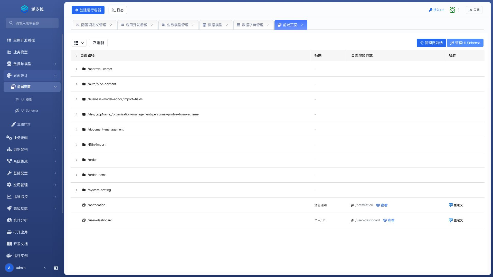
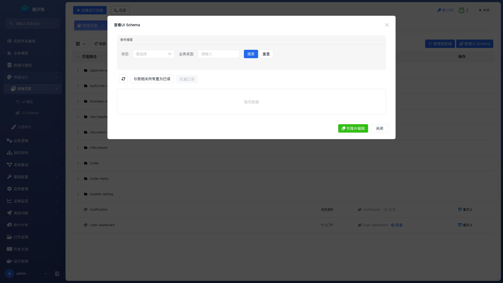
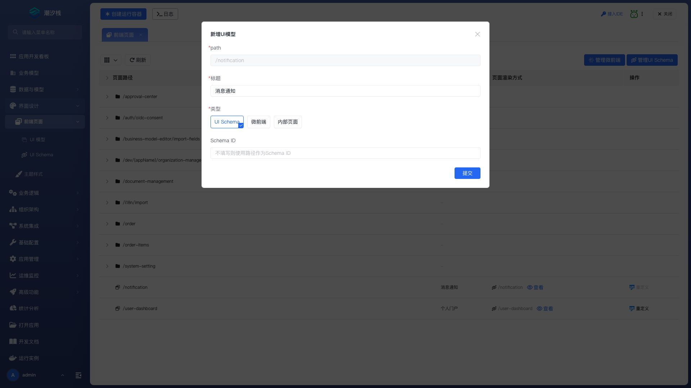

# 前端页面

前端页面汇总应用能够访问的页面，并显示每个页面当前采用的渲染方式。这里既能查看业务模型和模块提供的页面，也能为继承页面创建应用内的重定义配置。

## 打开前端页面

打开应用，在左侧菜单选择“界面设计 / 前端页面”。页面列表按路径组织，文件夹图标表示路径分组，窗口图标表示可以打开的具体页面。

列表上方提供三个操作：

- **刷新**：重新加载页面模型。
- **管理 UI Schema**：进入当前应用的 UI Schema 列表。
- **管理微前端**：进入当前应用的微前端配置。

## 查看页面列表

| 列 | 说明 |
| --- | --- |
| 页面路径 | 页面在应用内的访问路径；分组行用于组织下级页面。 |
| 标题 | 当前生效的页面标题。 |
| 页面渲染方式 | 显示 UI Schema、微前端或内部页面，以及关联的 Schema ID 或微前端名称。 |
| 操作 | 根据页面来源和状态提供查看、修改、重定义或复原。 |

被应用重定义过的页面会使用区别于继承页面的行样式，便于识别本地修改。

## 查看页面内容

渲染方式为 UI Schema 或微前端时，点击“查看”打开预览。

### 查看 UI Schema 页面

预览窗口展示当前 Schema 渲染结果，并根据页面状态提供以下操作：

- **克隆并编辑**：当前页面来自依赖模块且尚未在应用内修改时，将 Schema 克隆到应用后进入编辑。
- **编辑**：当前应用已经拥有该 Schema 时，进入 Schema 编辑器。
- **复原**：页面已经被应用重定义时，撤销应用内修改并恢复继承配置。
- **关闭**：退出预览，不修改页面。

### 查看微前端页面

微前端详情展示名称、类型、包、部署路径、入口和描述。页面引用的微前端发生变化时，应到“微前端”菜单维护其定义。

## 重定义继承页面

继承页面的操作栏显示“重定义”。点击后可以在当前应用中覆盖页面标题和渲染方式，而不修改提供该页面的原始模块。

| 配置项 | 出现条件 | 说明 |
| --- | --- | --- |
| path | 始终显示 | 页面路径。重定义现有页面时固定不可修改。 |
| 标题 | 始终显示 | 必填。应用中显示的页面标题。 |
| 类型 | 始终显示 | 必填。可选 UI Schema、微前端或内部页面。 |
| 微前端入口 | 类型为“微前端” | 必填。从当前应用已配置的微前端应用中选择。 |
| Schema ID | 类型为“UI Schema” | 关联的 Schema 标识；留空时使用页面路径作为 Schema ID。 |

“内部页面”用于平台或模块已经注册的内部渲染入口，通常不需要额外配置。

## 修改与复原

页面已经被当前应用重定义后，操作栏提供“修改”和“复原”。

- **修改**：重新打开同一配置表单，路径保持只读，可以调整标题和渲染方式。
- **复原**：删除应用内的重定义，恢复上游模块提供的页面配置。

复原会丢弃当前应用对该页面模型的覆盖。执行前应确认不再需要本地标题、Schema 或微前端入口。

## 验证页面

1. 保存重定义后刷新列表。
2. 确认标题和渲染方式列显示新配置。
3. 点击“查看”检查 UI Schema 或微前端是否能够正常渲染。
4. 从应用菜单打开实际页面，确认访问路径、标题和交互均符合预期。
5. 若页面依赖运行数据，在运行实例中再完成一次业务操作验证。

## 常见问题

### 为什么列表中有些行不能修改？

路径分组不是具体页面，因此没有页面配置操作。部分内部页面也可能由平台固定提供，只能查看其当前渲染方式。

### Schema ID 留空会怎样？

类型为 UI Schema 时，留空会使用页面路径作为 Schema ID。只有需要指向另一个已存在 Schema 时才手动填写。

### 重定义和直接编辑 UI Schema 有什么区别？

重定义决定一个页面使用哪种渲染方式以及关联哪个 Schema；编辑 UI Schema 修改的是 Schema 本身的组件结构和交互。页面指向正确但界面内容需要调整时，进入 UI Schema 编辑器。

### 复原后自定义 Schema 会被删除吗？

复原移除的是页面模型覆盖。独立创建的 UI Schema 是否仍保留，应到“UI Schema”列表确认；不再使用的 Schema 可以在确认无其他页面引用后单独删除。

## 扩展阅读

- [UI Schema](./ui-schema)
- [UI 模型](./ui-model)
- [微前端](./micro-frontend)
