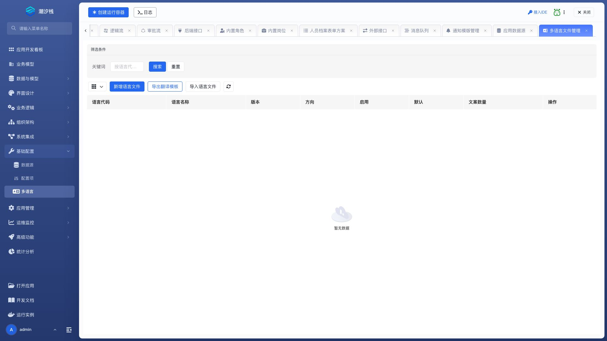
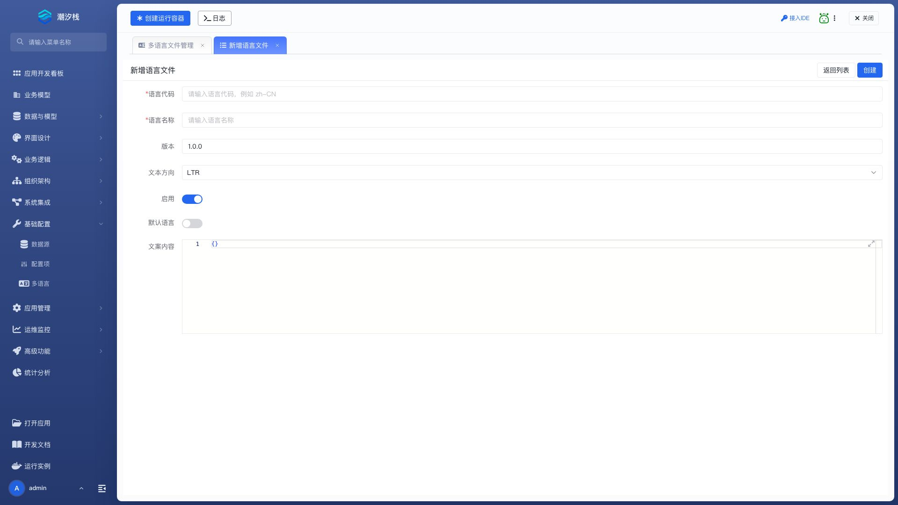
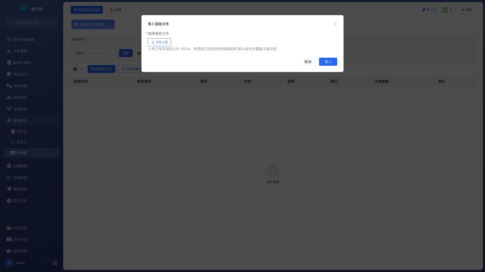

# 多语言

多语言页用于维护应用的语言文件。每个语言文件包含语言代码、显示名称、文本方向和一组文案键值，页面和组件通过文案键获取当前语言文本。

## 打开多语言

打开应用，在左侧菜单选择“基础配置 / 多语言”。可按关键词筛选语言文件。

| 列 | 说明 |
| --- | --- |
| 语言代码 | 语言和地区标识。 |
| 语言名称 | 管理界面中的可读名称。 |
| 版本 | 语言文件版本。 |
| 方向 | LTR 或 RTL。 |
| 启用 | 该语言是否可用。 |
| 默认 | 是否为应用默认语言。 |
| 文案数量 | 当前文件包含的文案条数。 |

## 新增语言文件

点击“新增语言文件”，填写：

| 配置项 | 说明 |
| --- | --- |
| 语言代码 | 必填。使用稳定的语言或语言-地区代码，创建后作为文件标识。 |
| 语言名称 | 必填。用户能够识别的语言名称。 |
| 版本 | 可选。用于标记翻译版本。 |
| 文本方向 | 选择 LTR（从左到右）或 RTL（从右到左）。 |
| 启用 | 控制该语言能否被选择。 |
| 默认语言 | 把该语言设为应用默认值。 |
| 文案内容 | JSON 键值对象，键为文案标识，值为翻译文本。 |

应用应只有一个明确的默认语言。RTL 语言还需要验证页面布局、图标方向和浮层位置。

## 编辑与查看详情

编辑页中语言代码只读，可以修改名称、版本、方向、启用状态、默认标记和文案内容。详情页以只读方式展示相同字段。

修改文案键前先检查页面和 Schema 引用。删除仍被使用的键会导致界面显示回退文本或键名。

## 导入与导出

### 导入语言文件

点击“导入语言文件”，选择“语言文件”并提交。导入前检查文件格式、语言代码和 JSON 文案结构，避免覆盖错误语言。

### 导出翻译模板

“导出翻译模板”用于获取待翻译的文案结构。交给翻译人员时保留键名，只翻译值。

### 导出单个语言

列表中的“导出”下载当前语言文件，适合备份、外部翻译或环境迁移。

## 同步文案

点击“同步文案”会把应用当前文案集合与语言文件对齐。

| 配置项 | 说明 |
| --- | --- |
| 删除多余文案 | 开启后，删除语言文件中已经不属于当前应用文案集合的键。 |

第一次同步或版本升级后，先关闭“删除多余文案”查看结果。确认历史自定义键确实不再使用后，再执行清理。

## 删除语言文件

删除前确认它不是当前唯一启用或默认语言，并检查运行环境中是否仍有用户选择该语言。准备替代语言后再删除。

## 验证多语言

1. 确认每个启用语言包含相同的核心文案键。
2. 切换默认语言并打开应用首页。
3. 逐个切换语言，检查菜单、表单、校验和通知文本。
4. 使用长文本检查截断和布局。
5. 对 RTL 语言检查整体方向、返回图标和弹层位置。
6. 检查缺失文案键的回退行为。

## 常见问题

### 新增语言后为什么用户不能选择？

检查“启用”是否打开，并确认语言文件已随应用配置加载到当前运行环境。

### 为什么页面显示文案键而不是翻译？

当前语言文件缺少该键，或页面使用的键名与文件不一致。同步文案后补充翻译，并检查引用拼写。

### 可以同时设置多个默认语言吗？

不应这样配置。默认语言用于无法确定用户偏好时的唯一回退值，应保持一个明确选项。

### 同步时应该开启“删除多余文案”吗？

只有确认多余键没有被动态页面、扩展代码或历史配置引用时才开启。首次同步优先保留并审查差异。

## 扩展阅读

- [UI Schema](./ui-schema)
- [应用配置](./app-configuration)
