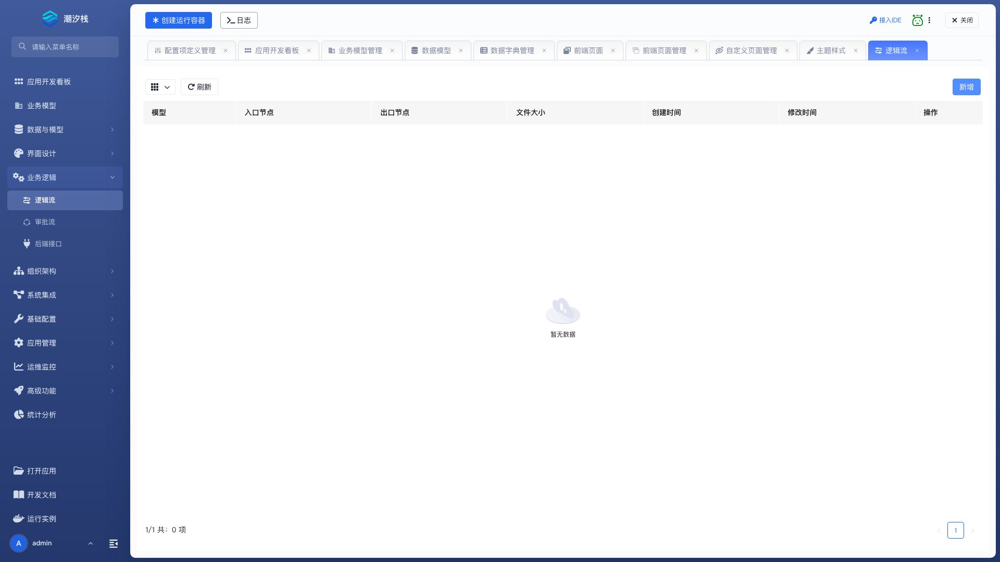
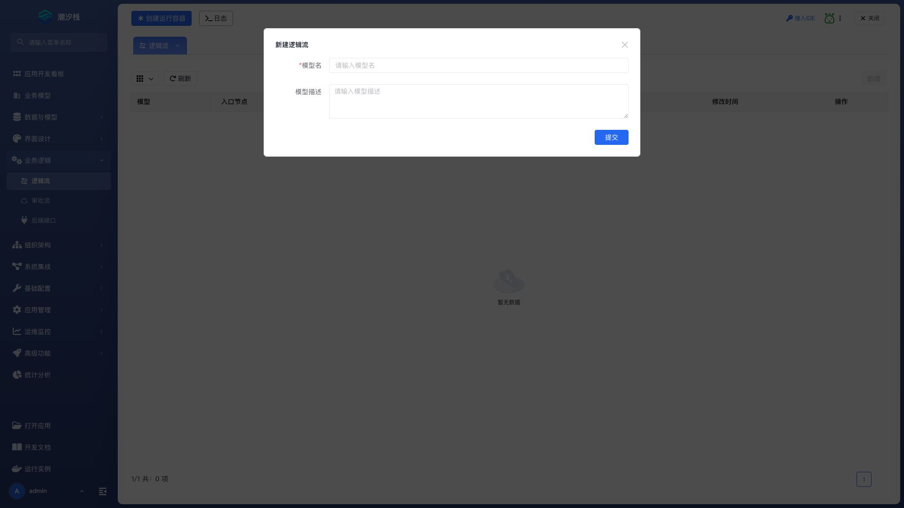
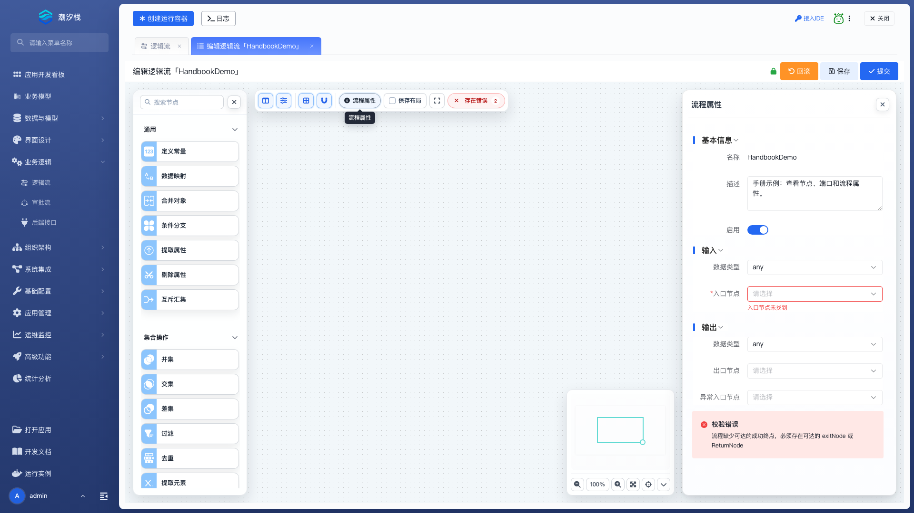
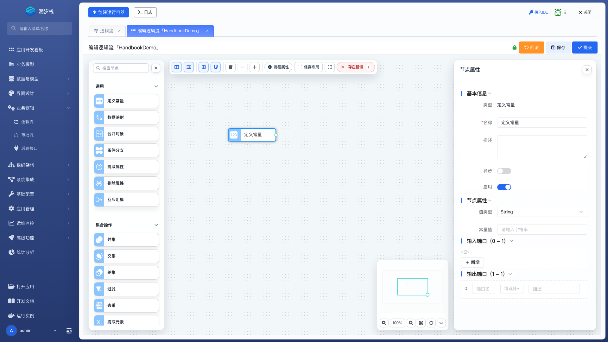
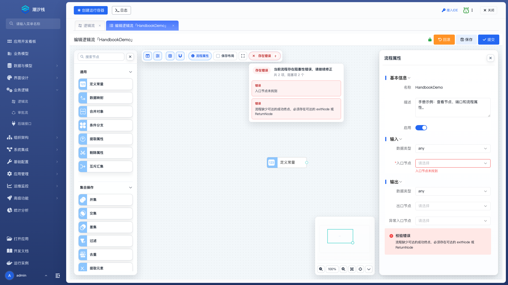

# 逻辑流

逻辑流用节点和连线组织一段可执行的业务处理。它可以接收输入、判断条件、转换数据、读写数据模型，并把结果返回给接口、计划任务或消息队列等调用方。

## 打开逻辑流

打开应用，在左侧菜单选择“业务逻辑 / 逻辑流”。列表汇总当前应用可见的逻辑流及其版本状态。

| 列 | 说明 |
| --- | --- |
| 模型 | 逻辑流名称；锁图标表示模型正在被编辑。 |
| 校验状态 | 出现警告图标时，表示后端校验发现错误或诊断信息。 |
| 入口节点 | 流程接收输入的节点。 |
| 出口节点 | 流程返回结果的节点。 |
| 文件大小 | 逻辑流定义文件的大小。 |
| 创建时间 | 模型首次创建的时间。 |
| 修改时间 | 最近一次保存的时间。 |
| 操作 | 编辑、查看校验错误、查看变更记录或删除。 |

页面上的显示模式开关用于切换列表详情的展示方式，不会修改逻辑流定义。

## 新建逻辑流

点击“新增”，先填写逻辑流的基本信息。

| 配置项 | 说明 |
| --- | --- |
| 模型名 | 必填。应用内唯一的逻辑流标识，后续接口、计划任务和消息绑定通过它引用逻辑流。 |
| 模型描述 | 说明逻辑流的用途、输入和预期输出。 |

保存后打开编辑器，继续配置节点和连线。

## 使用编辑器

编辑器由左侧节点库、中间画布和右侧属性面板组成。顶部画布工具栏用于控制面板、对齐和吸附，右下角提供缩略图、缩放及定位操作。

节点库支持按名称搜索。**保存布局** 用于把画布排布随定义保存，**保存** 保存工作区定义，**提交** 将已完成的修改纳入应用版本。保存和提交都会检查当前定义；存在阻断错误时，先按诊断修正。

### 节点库

从节点库把需要的节点拖到画布。常见节点包括：

- **常量、映射和脚本节点**：生成或转换数据。
- **分支与汇集节点**：根据条件选择路径或合并执行路径。
- **插入、更新、删除、搜索和计数节点**：读写数据模型。
- **规范化查询条件节点**：把输入整理为数据查询能够识别的条件。
- **业务模型节点**：同步业务模型子表、产生业务 Event，并处理认证上下文、访问控制过滤器和允许或禁止访问的字段。
- **审批流节点**：发起审批、提交任务、获取任务信息、附加工作流信息及按流程状态路由。
- **集成节点**：调用外部接口、发送通知、发送消息队列和读取配置。

具体可用节点取决于当前平台加载的逻辑流扩展。

### 节点基本信息

选中节点后，属性面板会显示通用字段和该节点的专属配置。

| 配置项 | 说明 |
| --- | --- |
| 类型 | 节点类型，只读。 |
| 名称 | 节点在当前逻辑流中的唯一标识。 |
| 描述 | 节点的业务用途或处理说明。 |
| 异步 | 开启后按该节点支持的异步方式执行。 |
| 启用 | 关闭后节点不参与当前流程执行。 |
| 输入端口 | 定义节点接收的数据及端口数量。不同节点允许的最小和最大数量不同。 |
| 输出端口 | 定义节点向下游传递的数据。 |

节点的专属字段会随类型变化。例如数据操作节点需要选择数据模型并配置查询或写入内容，脚本节点需要填写脚本，分支节点需要配置判断条件。应逐项完成属性面板中出现的必填字段。

### 连线

从源节点输出端口连接到目标节点输入端口。选中连线后可查看：

| 配置项 | 说明 |
| --- | --- |
| 标签 | 连线在画布上显示的文字。 |
| 描述 | 说明数据传递或分支含义。 |
| 源节点 | 连线起点，只读。 |
| 源节点端口下标 | 当前连接使用的输出端口，只读。 |
| 目标节点 | 连线终点，只读。 |
| 目标节点端口下标 | 当前连接使用的输入端口，只读。 |

节点右键菜单是否允许增加或删除输入端口，取决于该节点的端口数量规则。

### 逻辑流属性

点击画布工具栏中的 **流程属性**，打开流程级设置。

| 配置项 | 说明 |
| --- | --- |
| 名称 | 当前逻辑流标识，只读。 |
| 描述 | 整段流程的处理目标和输入输出说明。 |
| 输入数据类型 | 调用方传入的数据类型。 |
| 输入节点 | 逻辑流接收数据的入口。 |
| 输出数据类型 | 逻辑流返回的数据类型。 |
| 输出节点 | 逻辑流产生最终结果的节点；也可以通过可达的成功返回节点结束。 |
| 异常入口节点 | 指定流程级异常处理入口，留空时不另设异常处理路径。 |
| 启用 | 控制逻辑流能否被调用。 |

## 查看校验错误

编辑器中的诊断按钮显示 **存在错误**、错误数量或当前校验状态。点击打开诊断面板，按条目定位到节点、端口或流程属性；列表中的“查看校验错误”用于检查后端校验结果。

常见原因包括：

- 未设置入口，或没有可达的显式出口、成功返回节点。
- 节点名称重复。
- 必填属性为空。
- 端口没有连线或连接数量不符合节点规则。
- 节点输入输出类型不兼容。
- 引用的数据模型、脚本或其他资源不存在。

修正后保存，再回到列表刷新校验结果。

## 查看变更记录

“查看变更记录”显示每次提交的时间、提交信息和作者。它用于确认一项修改何时进入版本，以及定位引入问题的变更。

## 调试与验证

1. 先用最短路径连接入口、核心处理和出口节点。
2. 保存后处理所有校验错误。
3. 通过引用该逻辑流的接口、计划任务或消息绑定触发一次执行。
4. 打开逻辑流调试会话，按会话 ID 查看逻辑流名称、开始时间、状态和事件数量。开发态页面路径为 `/dev/{应用名}/logicflow/debug/sessions`，例如 `/dev/test-app/logicflow/debug/sessions`。
5. 在事件列表中检查事件类型、节点名称和消息；需要时打开事件详情查看载荷。
6. 验证输出数据以及数据库写入、外部调用等副作用。

### 阅读调试会话

会话列表每 5 秒刷新。状态 `ACTIVE` 表示仍在执行，`COMPLETED` 表示已完成，`FAILED` 表示失败。进入会话后，按事件序号依次检查发生时间、事件类型、节点名称和消息；事件详情中的载荷用于核对实际输入、输出及错误上下文。

调试会话是执行记录。设计器中没有错误，只能说明定义通过校验；还需要由接口、任务或消息入口触发，才能验证真实执行结果。

## 删除逻辑流

模型未被他人锁定时可以删除。删除前先检查后端接口、计划任务、消息队列和其他逻辑流是否引用该名称，避免留下无法执行的配置。

## 常见问题

### 为什么不能编辑或删除逻辑流？

逻辑流被其他用户锁定时，编辑和删除会受到限制。查看锁定提示，确认编辑会话结束后刷新列表。

### 保存成功为什么仍不能执行？

保存只说明定义已经写入。还要通过后端校验，并确保逻辑流已启用、入口与成功终点完整、所有引用资源存在。

### 如何排查执行到一半停止？

打开对应调试会话，按事件顺序找到最后执行的节点，再检查该节点的输入载荷、属性和错误消息。不要只看最终接口错误。

### 什么时候应拆分逻辑流？

当一段处理拥有独立输入输出、会被多个入口复用，或单个画布已经难以验证时，可拆成职责明确的逻辑流，并由上层入口分别调用。

## 扩展阅读

- [逻辑流专题](../../guide/tutorial/logicflow/)
- [后端接口](./backend-api)
- [计划任务](./scheduled-task)
- [消息队列](./message-queue)
