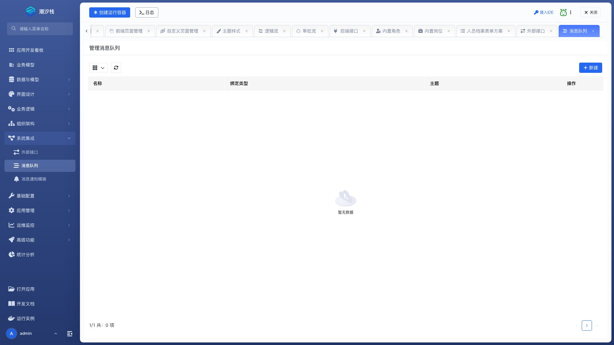
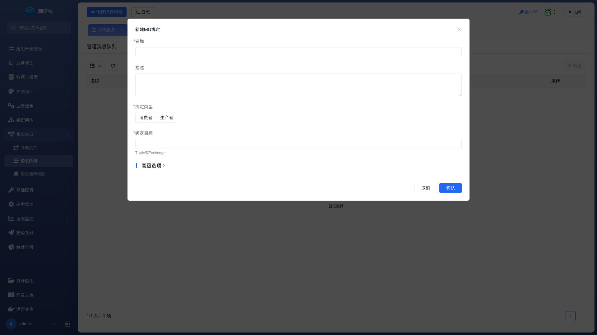

# 消息队列

消息队列页用于定义应用与消息中间件之间的生产者或消费者绑定。生产者把消息发送到目标主题，消费者接收消息后交给指定逻辑流处理。

## 打开消息队列

打开应用，在左侧菜单选择“系统集成 / 消息队列”。列表显示名称、绑定类型、主题和锁定状态，并提供查看、编辑和删除操作。

## 新建绑定

点击“新建”，填写：

| 配置项 | 出现条件 | 说明 |
| --- | --- | --- |
| 名称 | 始终显示 | 必填。应用内唯一的绑定标识。 |
| 描述 | 始终显示 | 说明消息用途、生产方、消费方和数据格式。 |
| 绑定类型 | 始终显示 | 必填。可选消费者或生产者。 |
| 绑定目标 | 始终显示 | 必填。消息主题、队列或中间件目标名称。 |
| 逻辑流 | 类型为消费者 | 必填。收到消息后执行的逻辑流。 |
| 路由键/分区键 | 高级选项 | 用于消息路由或分区；格式由所用中间件决定。 |
| 分组 | 高级选项 | 消费组或绑定分组名称。 |
| 消息队列名 | 高级选项 | 指定平台中已配置的 binder；留空时使用默认绑定器。 |
| 自定义属性 | 高级选项 | 以键值对传递中间件或绑定器的附加配置。 |

消费者逻辑流的输入应能够接收消息载荷及平台提供的消息上下文。

## 查看与编辑

点击“查看”可以核对完整绑定配置。点击“编辑”进入同一配置表单；名称用于稳定引用，修改其他字段后应重新验证连接。

绑定被其他用户锁定时，编辑按钮会禁用。等待锁释放后刷新列表，不要通过重复新建绕过锁定。

## 删除绑定

删除前确认：

1. 生产者没有继续按该绑定发送消息。
2. 消费者对应的未处理消息已经完成或迁移。
3. 逻辑流和外部系统不再引用绑定名称。
4. 删除后不会导致同一消费组失去必要消费者。

## 验证消息链路

1. 在测试环境创建绑定并确认 binder 可用。
2. 生产者绑定发送一条包含明确标识的测试消息。
3. 消费者绑定检查消息是否到达，并查看关联逻辑流的调试事件。
4. 验证消息字段到逻辑流输入的映射。
5. 验证处理失败、重复投递和重试场景。
6. 检查同一分组和路由键下的消费行为是否符合中间件预期。

## 常见问题

### 为什么消费者没有收到消息？

检查绑定目标、binder、分组和路由键是否与生产者一致，再确认运行实例已经启动且中间件连接正常。

### 为什么消息到达但逻辑流没有执行？

确认绑定类型为消费者、逻辑流存在且启用，并检查逻辑流输入是否能解析消息载荷。随后查看调试会话中的错误事件。

### 自定义属性应该填什么？

只填写当前消息中间件和 binder 明确支持的属性。属性名、值类型和默认行为以部署环境的中间件配置为准。

### 修改消费组会有什么影响？

消费组决定消息在多个消费者之间的分发和消费进度。修改后可能形成新的消费位置或重复消费，应先评估存量消息。

## 扩展阅读

- [逻辑流](./logicflow)
- [计划任务](./scheduled-task)
