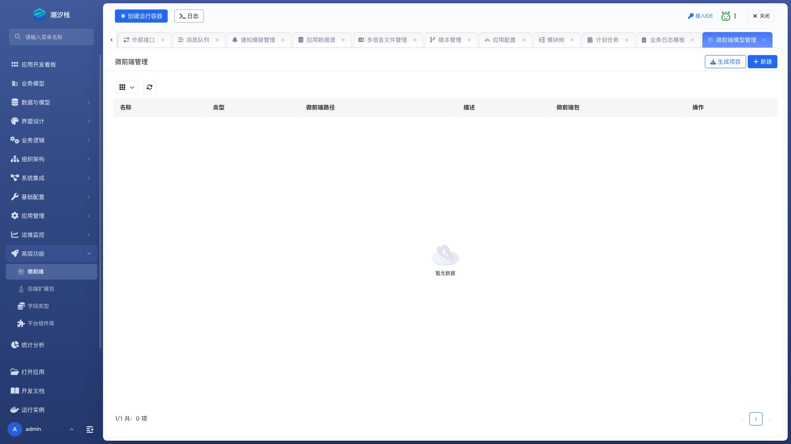
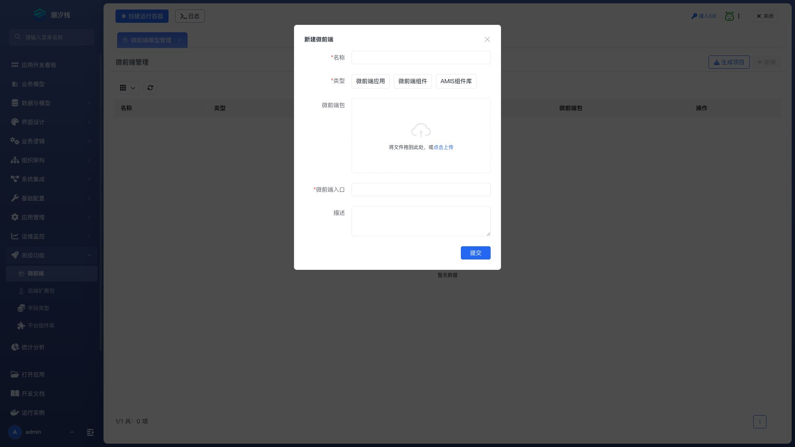

# 微前端

微前端用于把独立构建的前端应用、布局组件或 AMIS 组件库接入当前应用。它适合 UI Schema 难以覆盖的复杂交互，以及需要独立工程、依赖和发布节奏的前端扩展。

## 打开微前端

打开应用，在左侧菜单选择“高级功能 / 微前端”。列表显示名称、类型、部署路径、描述和微前端包。

| 类型 | 用途 |
| --- | --- |
| 微前端应用 | 作为完整页面或自定义登录页加载。 |
| 微前端组件 | 作为顶栏、侧边栏等局部布局组件加载。 |
| AMIS 组件库 | 向 UI Schema 注册自定义渲染器、表单项或动作。 |

## 新建微前端

点击“新建”，填写：

| 配置项 | 出现条件 | 说明 |
| --- | --- | --- |
| 名称 | 始终显示 | 必填。应用内唯一标识，UI 模型和应用配置通过它引用。 |
| 类型 | 始终显示 | 必填。选择微前端应用、微前端组件或 AMIS 组件库。 |
| 微前端包 | 始终显示 | 上传已经构建好的前端包。 |
| 微前端部署路径 | 已上传微前端包 | 必填。包在运行环境中的公开路径。 |
| 微前端入口 | 未上传微前端包时可编辑 | 指向外部部署的入口地址。上传包后由包和部署路径确定入口。 |
| 描述 | 始终显示 | 说明用途、入口、依赖和维护方。 |

上传包和外部入口是两种接入方式。使用上传包时应填写部署路径；使用外部入口时应确保运行实例能够访问该地址。

## 生成项目

拥有应用编辑权限时，可以点击“生成项目”下载官方工程模板。表单先选择“项目模板”，只展示与当前平台版本兼容的模板，再按模板显示参数。

当前微前端模板可能包含以下字段：

| 配置项 | 适用模板 | 说明 |
| --- | --- | --- |
| 项目模板 | 全部 | 必填。选择 React/Webpack 或 Vue/Vite 的微应用、布局、登录页或组件库模板。 |
| npm 包名 | 全部 | 必填。生成项目的包名，也是下载目录和构建标识的基础。 |
| 包含示例路由 | 微前端应用 | 是否在生成项目中保留示例页面路由。 |
| 顶栏标题 | 自定义布局 | 生成的顶栏初始标题。 |
| 侧栏标题 | 自定义布局 | 生成的侧栏初始标题。 |
| 品牌名称 | 自定义登录页 | 登录页初始显示的品牌名称。 |

点击“生成并下载”得到源码 ZIP。生成器只提供本地开发起点，不会编译、上传或注册微前端。

## 构建并接入

1. 解压源码并按项目 README 安装依赖。
2. 本地开发并验证 qiankun 生命周期或组件注册。
3. 构建可交付包。
4. 回到“微前端”上传包，或填写可访问的外部入口。
5. 在“UI 模型”中创建微前端页面，或在“应用配置”中选择布局入口。
6. 从实际页面验证加载、路由、权限和异常回退。

## 编辑和删除

编辑页中名称只读，可以调整类型、包、部署路径、外部入口和描述。切换类型后应检查所有 UI 模型和布局引用是否仍适用。

删除前检查 UI 模型、前端页面重定义和应用配置中的登录页、顶栏、侧边栏引用。删除定义不会自动修复这些入口。

## 验证微前端

1. 打开实际页面并检查网络请求和浏览器控制台。
2. 验证直接访问、应用内跳转和浏览器前进后退。
3. 验证登录过期、接口失败和入口不可用时的反馈。
4. 检查微前端应用的挂载、更新和卸载。
5. 在常用桌面和移动宽度检查布局。
6. 在运行实例中确认部署路径和静态资源路径正确。

## 常见问题

### 上传包后为什么入口字段不能编辑？

上传包模式下，入口由包内容和部署路径确定，因此外部入口字段会禁用。需要使用独立部署地址时，清除包并配置入口。

### 新建微前端后为什么没有页面？

微前端定义只注册入口。完整页面还需要在“UI 模型”中创建路径，布局组件则需要在“应用配置”中选择。

### 为什么“生成项目”按钮不可见？

该按钮只对拥有当前应用编辑权限的用户显示。检查应用编辑权限，而不只是菜单访问权限。

### “生成项目”窗口空白怎么办？

先检查平台日志中项目生成表单的加载错误。模板目录或生成服务不可用时，窗口可能无法显示表单；此时可按 [前端扩展路径](../../fusion-development/frontend-extension-paths) 准备工程，构建完成后通过“新建”接入。空窗口不表示源码包已经生成。

### 本地可以运行，上传后静态资源 404 怎么办？

检查构建产物的公共路径、微前端部署路径和运行实例的静态资源地址。不要把本地开发服务器地址写入生产包。

## 扩展阅读

- [UI 模型](./ui-model)
- [应用配置](./app-configuration)
- [平台组件库](./platform-component-library)
