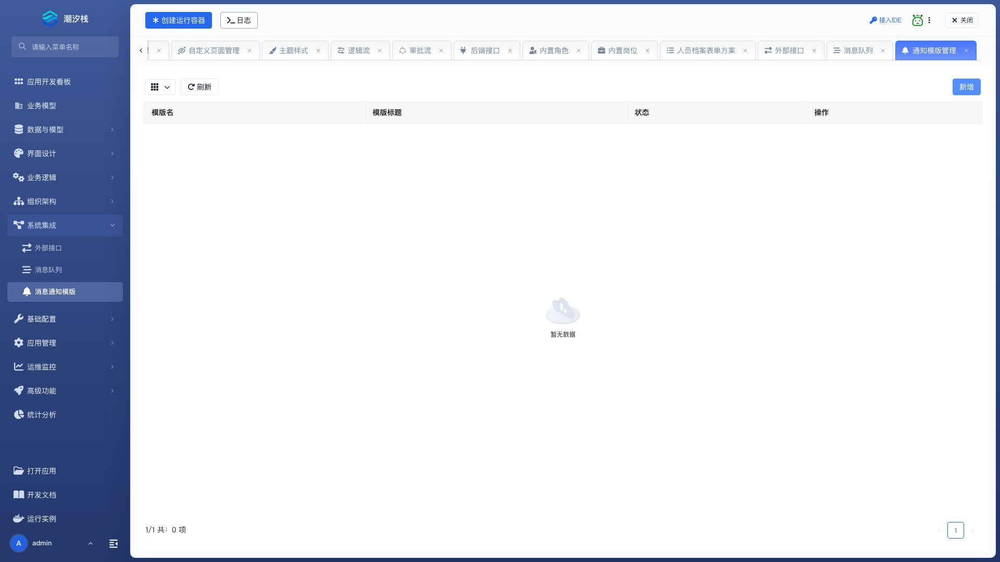
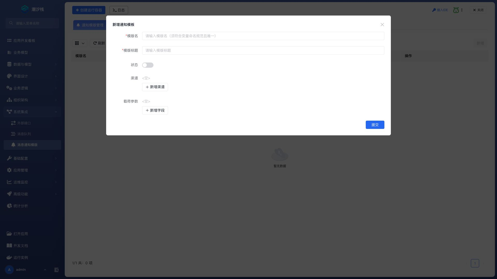
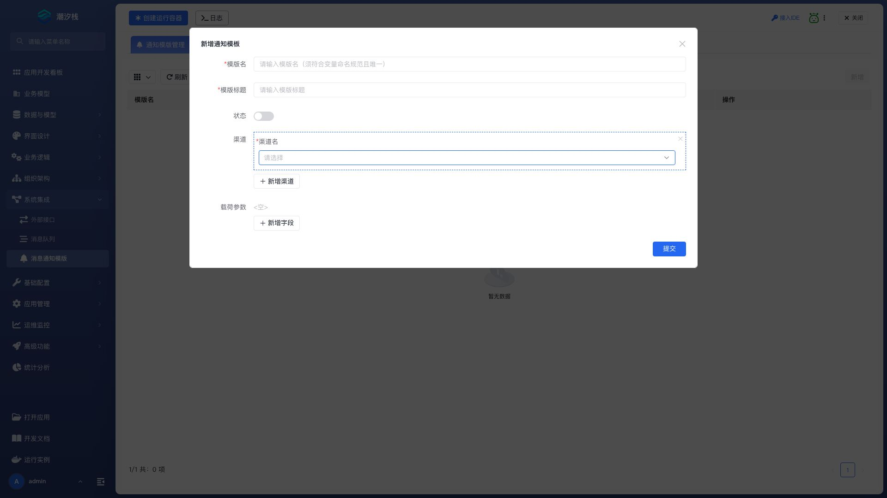

# 通知模板

通知模板集中定义一类通知的载荷参数，以及站内信、微信、短信、钉钉、推送、邮件和电话等渠道的内容。业务逻辑发送通知时只需提供模板名、接收人和载荷数据。

## 打开通知模板

打开应用，在左侧菜单选择“系统集成 / 消息通知模版”。列表显示模板名、模板标题和启用状态，并提供新增、详情和编辑操作。

## 新建通知模板

点击“新增”，先填写：

| 配置项 | 说明 |
| --- | --- |
| 模板名 | 必填。符合变量命名规范且在应用内唯一，供发送逻辑引用。 |
| 模板标题 | 必填。开发和管理界面中显示的名称。 |
| 状态 | 控制模板是否启用。 |
| 渠道 | 为模板新增一个或多个发送渠道，并配置各渠道内容。 |
| 载荷参数 | 定义模板允许使用的变量名称、说明和类型。 |

## 定义载荷参数

每个载荷字段包含：

| 配置项 | 说明 |
| --- | --- |
| 字段名 | 发送通知时提供的变量名。 |
| 描述 | 说明字段含义和示例值。 |
| 字段类型 | 可选 string、integer、number 或 boolean。 |

标题模板和内容模板中使用的变量应全部在载荷参数中定义。调用方也应按这里的类型传值。

每个渠道还提供 **必填项** 配置，用 JSON Schema 描述该渠道模板需要的数据。站内信、钉钉、推送和邮件等渠道可从公共载荷参数中选择并补充；微信、短信和电话渠道需要按第三方模板的变量要求配置。渠道的必填字段应与实际模板占位符保持一致。

## 配置渠道

点击“新增渠道”并选择渠道名。同一模板可以配置多个渠道。

### 站内信

| 配置项 | 说明 |
| --- | --- |
| 标题模板 | 必填。站内信标题，可引用载荷参数。 |
| 内容模板 | 必填。站内信正文，可引用载荷参数。 |
| 动作 / 跳转地址 | 点击通知后打开的地址。 |
| 动作 / 描述 | 对跳转动作的说明。 |
| 类型 | 站内信业务类型。 |
| 接收终端 / app | 是否发送到 App 端。 |
| 接收终端 / web | 是否发送到 Web 端。 |

### 微信

| 配置项 | 说明 |
| --- | --- |
| 第三方模板 ID | 必填。微信侧已审核模板的 ID。 |
| 防重入 ID | 用于外部渠道去重。 |
| 模板数据颜色 | 按微信模板要求设置各字段颜色。 |
| 跳转小程序配置 / 具体页面路径 | 点击模板消息后打开的小程序页面。 |
| 跳转小程序配置 / appid | 目标小程序 App ID。 |
| 模板跳转链接 | 不跳转小程序时使用的网页地址。 |

### 阿里云短信

| 配置项 | 说明 |
| --- | --- |
| 第三方模板 ID | 必填。阿里云短信模板编码。 |
| 上行短信扩展码 | 需要接收上行短信时使用的扩展码。 |
| 短信签名 | 已审核通过的短信签名。 |
| 外部流水扩展字段 | 传递给阿里云并在回执中返回的业务标识。 |

### 钉钉

| 配置项 | 说明 |
| --- | --- |
| 标题模板 | 必填。通知标题。 |
| 内容模板 | 必填。通知正文。 |
| 状态提示消息 | 钉钉卡片或通知中的状态说明。 |
| App 跳转 URL | 移动端点击后的地址。 |
| PC 端跳转 URL | 桌面端点击后的地址。 |
| 应用 ID | 钉钉应用的 Agent ID。 |
| 发送方 | 通知中显示的发送方。 |

### 极光推送

| 配置项 | 说明 |
| --- | --- |
| 标题模板 | 必填。推送标题。 |
| 内容模板 | 必填。推送内容。 |
| 通知选项 / Android | Android 平台的通知参数对象。 |
| 通知选项 / iOS | iOS 平台的通知参数对象。 |
| 推送可选参数 | 极光推送支持的附加参数对象。 |

Android、iOS 和推送可选参数的键值应遵循当前接入的极光推送接口，不要写入未被适配器识别的属性。

### 邮箱

| 配置项 | 说明 |
| --- | --- |
| 标题模板 | 必填。邮件主题。 |
| 内容模板 | 必填。邮件正文。 |
| 可选项 | 邮件适配器支持的附加 JSON 属性。 |

### 阿里云电话通知

| 配置项 | 说明 |
| --- | --- |
| 第三方模板 ID | 必填。阿里云语音模板 ID。 |
| 播放音量 | 语音播放音量。 |
| 被叫显号 | 外呼时向接收方显示的号码。 |
| 播放次数 | 模板语音重复播放次数。 |
| 回执 ID | 用于关联发送结果的外部业务标识。 |
| 语速控制 | 模板语音播放速度。 |

## 编辑与查看

详情页展示模板全部配置。编辑页可调整标题、启用状态、渠道和载荷参数；模板名作为稳定引用，不应随意修改。

删除渠道或载荷字段前，检查发送逻辑和其他渠道模板是否仍在使用它。

## 验证通知

1. 使用测试渠道账号或号码启用模板。
2. 构造包含全部必填载荷字段的测试数据。
3. 分渠道发送，检查标题、正文和变量替换。
4. 验证缺少字段、类型错误和渠道失败时的错误反馈。
5. 检查跳转地址、小程序或终端选择。
6. 确认敏感数据没有出现在不适合的渠道或日志中。

## 常见问题

### 为什么模板保存成功但不能发送？

确认模板已启用、渠道适配器已经在运行环境配置、第三方模板 ID 有效，并且调用方提供了完整载荷。

### 为什么模板变量没有替换？

检查变量名是否与载荷参数完全一致，调用值类型是否匹配，以及当前渠道的标题或内容模板是否使用了正确语法。

### 同一模板可以使用多个渠道吗？

可以。每个渠道独立配置内容和选项，但共用模板名与载荷参数。应逐个渠道测试，不要用一个渠道成功推断其他渠道也可用。

### 第三方模板 ID 在哪里创建？

它来自对应渠道服务商，例如微信、阿里云短信或阿里云电话。先在服务商后台创建并审核模板，再把 ID 填入这里。

## 扩展阅读

- [逻辑流](./logicflow)
- [配置项](./config-item)
