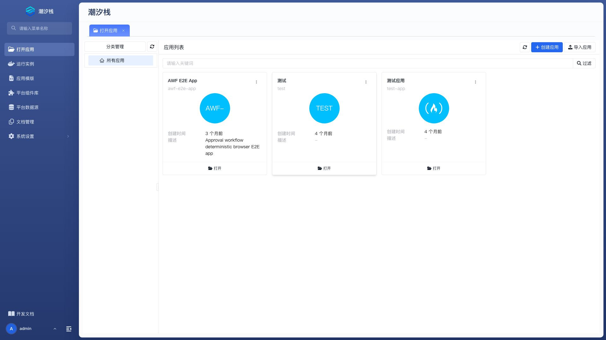
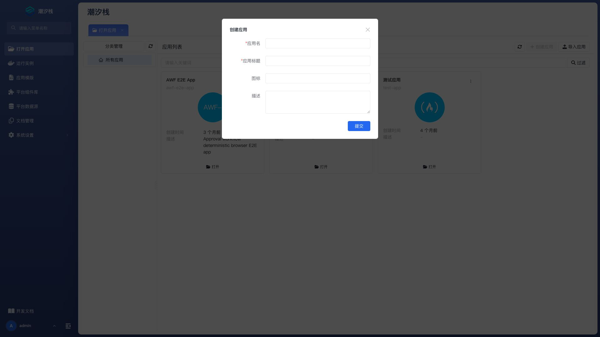
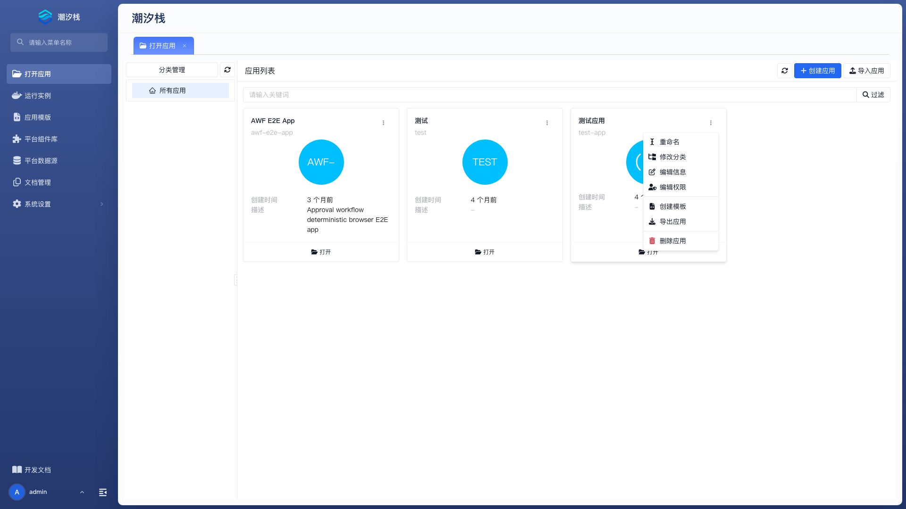
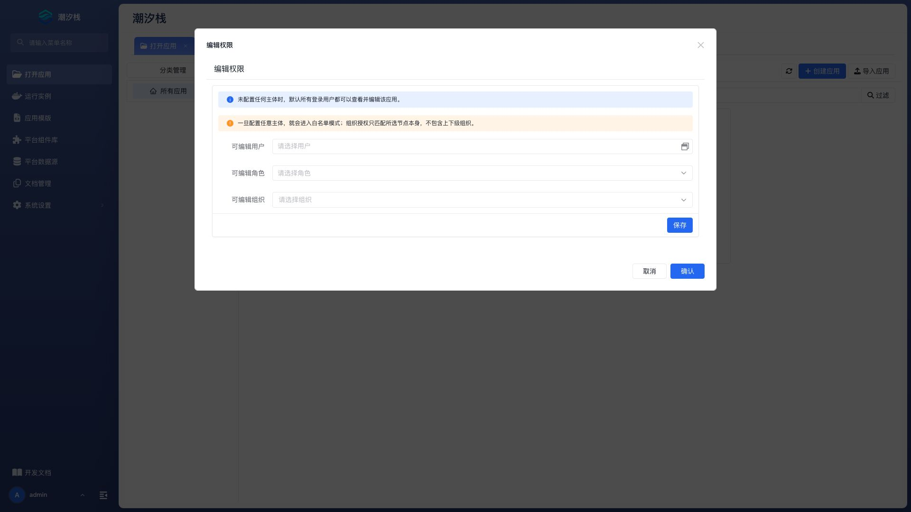

# 打开应用

打开应用页是应用开发的起点。这里可以创建、导入、查找和打开应用，也可以维护应用信息、分类、编辑权限、模版和导出包。

## 查找并打开应用

在平台菜单点击“打开应用”。使用关键字输入框筛选应用，卡片显示标题、描述和创建时间。点击“打开”进入该应用的开发工作区。

## 创建应用

点击“创建应用”，填写：

| 配置项 | 说明 |
| --- | --- |
| 应用名 | 必填。平台内唯一的稳定标识，创建后不支持直接修改。 |
| 应用标题 | 必填。用户和开发者看到的名称。 |
| 图标 | 应用卡片和菜单使用的图标。 |
| 描述 | 说明应用用途和服务对象。 |

创建完成后打开应用，先配置业务模型、应用配置和开发运行实例。

## 编辑应用信息

应用操作菜单中的“编辑信息”可修改：

| 配置项 | 说明 |
| --- | --- |
| 应用名 | 只读。当前稳定标识。 |
| 应用标题 | 必填。可修改的显示名称。 |
| 图标 | 应用图标。 |
| 描述 | 应用说明。 |

“应用信息”抽屉还会显示创建时间和更新时间。

## 重命名应用标识

操作菜单中的“重命名”要求填写：

| 配置项 | 说明 |
| --- | --- |
| 新名称 | 必填。新的应用标识。 |

应用标识可能参与 URL、运行实例、远程仓库和外部集成。重命名前检查所有引用，并在完成后重新验证开发和运行入口。

## 管理分类

### 修改应用分类

点击“修改分类”，在“分类”树中选择新分类。

### 分类管理

点击“分类管理”可新增、编辑和删除分类。新增或编辑时包含：

| 配置项 | 说明 |
| --- | --- |
| 上级分类 | 选择父分类，留空表示根分类。 |
| 分类名 | 必填。分类显示名称。 |
| 图标 | 分类图标。 |
| 排序 | 必填。控制同级分类顺序。 |

删除分类前先迁移其中的应用和子分类。

## 编辑权限

有管理权限时，应用操作菜单会显示“编辑权限”。它决定哪些主体可以查看和修改应用定义。

| 配置项 | 说明 |
| --- | --- |
| 可编辑用户 | 选择可以编辑应用的具体用户，可多选。 |
| 可编辑角色 | 选择可以编辑应用的角色，可多选。角色中的用户都获得编辑权。 |
| 可编辑组织 | 选择可以编辑应用的公司或部门，可多选。只匹配选中的组织节点本身，不自动包含上级或下级组织。 |

三个字段都未配置时，默认所有登录用户都可以查看和编辑该应用。一旦配置任意主体，应用就进入白名单模式，只有命中用户、角色或组织之一的账号可以编辑。

应用编辑权限与运行应用的业务角色不同。保存前确保当前维护团队和至少一个管理账号仍在白名单中，避免配置后无人能够继续维护应用。

## 从应用创建模版

点击“创建模板”，填写：

| 配置项 | 说明 |
| --- | --- |
| 应用名称 | 只读。模版来源应用。 |
| 模板名称 | 必填。模版唯一标识。 |
| 模板标题 | 必填。模版列表显示名称。 |
| 模版图标 | 模版图标。 |
| 模板描述 | 说明适用场景和包含内容。 |
| 模板版本 | 必填。模版版本号。 |
| 作者 | 模版维护者。 |

创建后到“应用模版”中验证能否生成新的测试应用。

## 导出和导入应用

### 导出应用

| 配置项 | 说明 |
| --- | --- |
| 应用名称 | 只读。当前导出的应用。 |
| 包含未提交的更改 | 开启后把工作区修改纳入导出；用于正式迁移前应先提交并验证。 |
| 包含 Git 仓库 | 开启后把应用版本库一并打包，会增加文件大小并可能包含历史信息。 |

点击“下载”获取应用包。

### 导入应用

点击“导入应用”，填写：

| 配置项 | 说明 |
| --- | --- |
| 应用文件 | 必填。选择平台导出的应用包。 |

导入后检查应用名冲突、平台版本兼容性、数据源、配置值和平台组件库依赖。

## 删除应用

删除应用前停止并处理运行实例，备份需要的版本和应用包，并确认不再需要应用数据。删除属于高影响操作，不能依赖页面刷新恢复。

## 常见问题

### 应用标题和应用名有什么区别？

应用名是 URL、接口和版本库等位置使用的稳定标识；应用标题是可以调整的显示名称。普通改名优先修改标题。

### 为什么看不到“编辑权限”？

该操作只对具有应用编辑权限管理能力的用户显示。联系平台管理员确认当前账号权限。

### 导入应用后为什么不能运行？

导入包不会自动补齐目标环境的数据源、密钥、外部服务和平台组件库。逐项检查依赖后再创建运行实例。

### 导出时应该包含未提交更改吗？

正式交付优先先提交并验证，再导出稳定版本。只有明确需要保存临时工作区状态时才包含未提交更改。

## 扩展阅读

- [应用模版](./app-templates)
- [运行实例](./runtime-instance)
