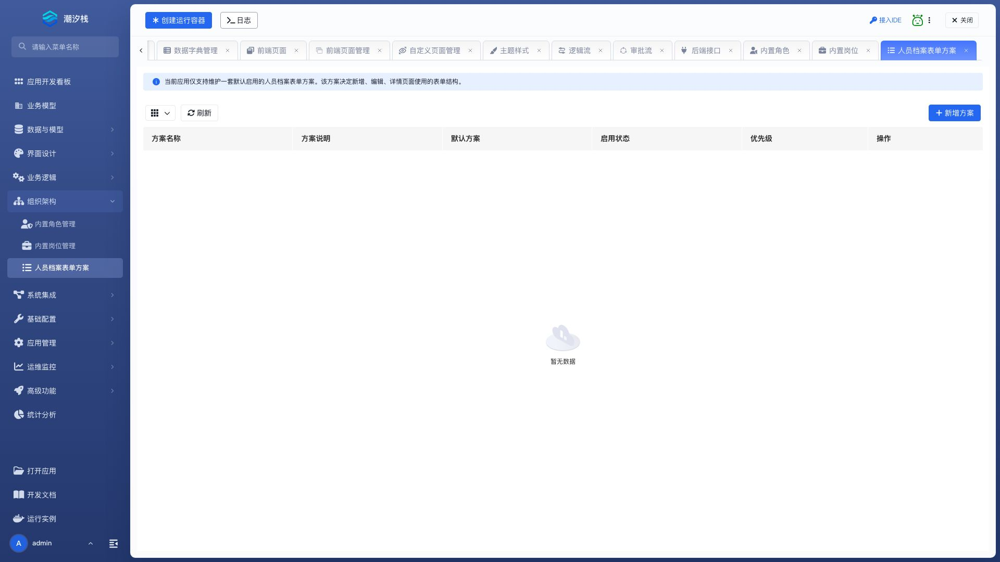
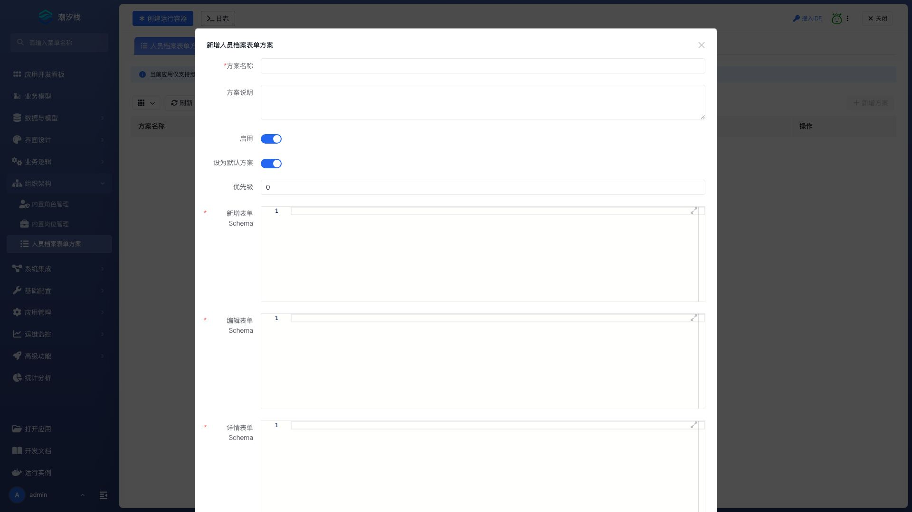

# 人员档案表单方案

人员档案表单方案用于定制人员新增、编辑和详情页面。运行时使用当前应用中启用的默认方案，三类页面分别读取其中对应的 UI Schema。同一应用只能有一个默认方案。

## 打开人员档案表单

打开应用，在左侧菜单选择“组织架构 / 人员档案表单方案”。列表显示方案名称、说明、默认方案、启用状态和优先级。已有方案时，进入该方案编辑。

| 列 | 说明 |
| --- | --- |
| 方案名称 | 表单方案的名称。 |
| 方案说明 | 适用范围或定制内容。 |
| 默认方案 | 标记运行时使用的默认方案；同一应用只能有一个默认方案。 |
| 启用状态 | 只有启用的默认方案才会生效。 |
| 优先级 | 方案优先级，新增时默认为 `0`。 |

## 新增方案

点击“新增方案”，配置基本信息和三类页面 Schema。

| 配置项 | 说明 |
| --- | --- |
| 方案名称 | 必填。用于在列表和管理界面中识别方案。 |
| 方案说明 | 说明方案适用的人群、组织或业务场景。 |
| 启用 | 默认开启。关闭后，该方案不参与运行时表单选择。 |
| 设为默认方案 | 默认开启。当前应用已有默认方案时，不能再保存第二个默认方案；切换前先取消原方案的默认标记。 |
| 优先级 | 默认 `0`。当前页面不提供按人员或部门匹配多套方案的规则，通常保持默认值。 |
| 新增表单 Schema | 必填。创建人员时使用的完整 UI Schema。 |
| 编辑表单 Schema | 必填。修改人员档案时使用的完整 UI Schema。 |
| 详情表单 Schema | 必填。查看人员档案时使用的完整 UI Schema。 |

这里的 Schema 是描述页面组件、布局和交互的 UI Schema。

三份 Schema 面向不同任务，应分别处理可编辑性和字段显示，不要直接把新增表单原样复制为详情表单。

## 编写三类 Schema

### 新增表单 Schema

只包含创建人员时需要采集的字段。系统生成字段、只读信息和创建后才存在的数据不应要求用户填写。

### 编辑表单 Schema

保留允许维护的字段，并把人员标识等稳定字段设为只读或隐藏。需要保留但不允许修改的数据不能简单删除，否则提交时可能丢失上下文。

### 详情表单 Schema

用于只读展示。根据阅读顺序组织基本信息、组织归属和扩展档案，不提供可写接口或提交动作。

## 查看与编辑方案

“查看”会展示基本信息以及三份 Schema 的当前内容。“编辑”可以修改全部可见字段，并额外保留方案 ID 作为内部标识。

编辑时各字段含义与新建一致。需要投入使用的方案应同时启用并设为默认，三类页面都应包含预期的 Schema。

## 删除方案

删除前确认人员管理页面是否依赖当前定制，并保存三份 Schema。删除后应重新检查人员新增、编辑和详情页，确认默认表单满足要求。

## 验证方案

1. 保存后重新打开详情，确认三份 UI Schema 完整。
2. 在组织管理中分别执行新增人员、编辑人员和查看详情。
3. 检查字段顺序、必填校验、只读状态和默认值。
4. 检查保存后的方案仍为默认启用状态，优先级符合预期。
5. 使用无扩展档案数据和已有完整档案数据的人员各测试一次。

## 常见问题

### 为什么保存成功但人员页面没有变化？

确认修改的是当前应用的默认方案，三份 Schema 已保存且没有校验错误，再刷新组织管理页面。

### 三份 Schema 可以完全相同吗？

技术上可以，但通常不合适。新增页需要采集数据，编辑页需要保护稳定字段，详情页应只读展示。应按任务分别设计。

### 为什么表单打开后提示 Schema 错误？

先检查 JSON 语法，再检查组件类型、字段名、数据源和表达式。修改后分别从新增、编辑和详情入口验证，不能只在编辑器中检查。

### 能否按人员或部门配置多套方案？

当前页面不提供按人员或部门匹配方案的规则。需要不同人员显示不同字段时，应在默认方案的 Schema 中配置相应的显示条件，并验证新增、编辑和详情三类页面。

## 扩展阅读

- [内置岗位](./builtin-position)
- [内置角色](./builtin-role)
