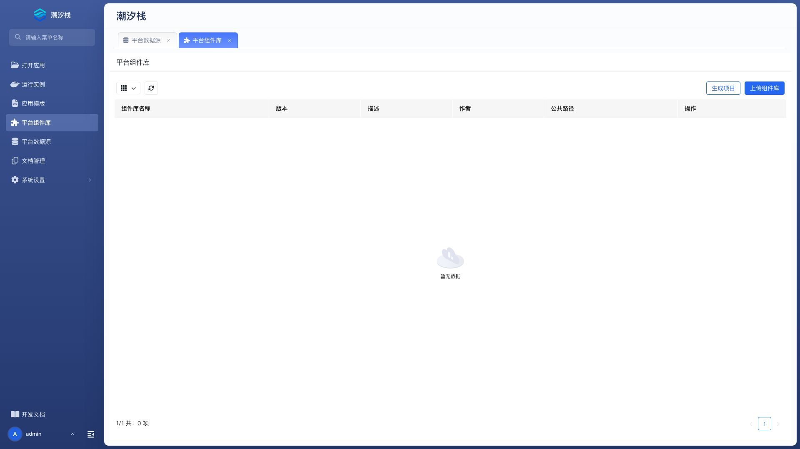
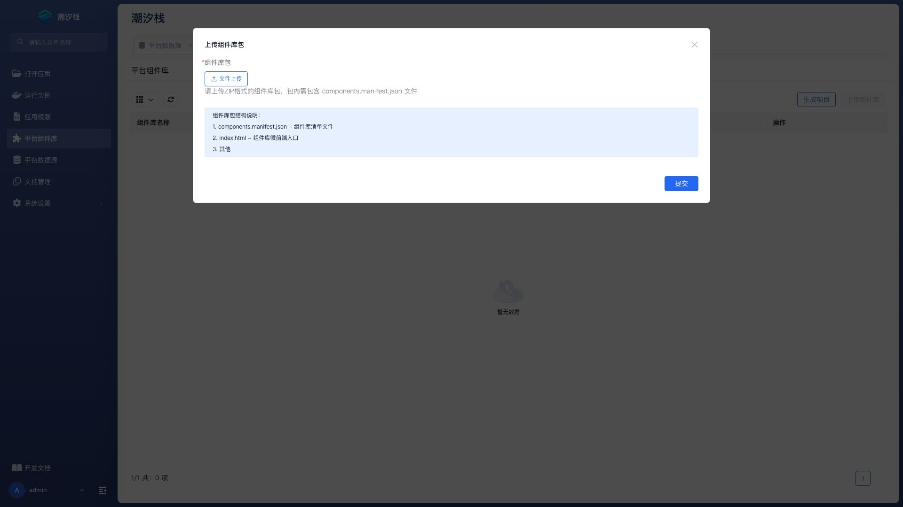

# 平台组件库

平台组件库负责安装和管理可供多个应用复用的前端组件包。管理员在这里上传组件库，应用设计者再从各自应用的“高级功能 / 平台组件库”菜单导入。

## 打开平台组件库

在平台管理菜单选择“平台组件库”。列表显示组件库名称、版本、描述、作者和公共路径。

| 操作 | 说明 |
| --- | --- |
| 查看组件 | 按渲染器、表单项、选项控件和动作查看组件清单。 |
| 查看应用 | 查看当前导入该组件库的应用。 |
| 卸载 | 从平台移除组件库。存在应用引用时应先处理依赖。 |

## 上传组件库

点击“上传组件库”，填写：

| 配置项 | 说明 |
| --- | --- |
| 组件库包 | 必填。选择按平台组件库规范构建的包。 |

包内需要包含组件清单、管理元数据和构建产物。上传后先检查列表元数据和组件详情，再通知应用导入。

## 查看组件详情

详情按四类展示名称、标签和描述：

- **渲染器**：在 UI Schema 中渲染普通组件。
- **表单项**：参与表单录入和校验。
- **选项控件**：提供选项型输入能力。
- **动作**：为按钮或事件提供自定义行为。

组件详情为空通常意味着包清单没有正确注册，而不只是应用尚未导入。

## 生成项目

点击“生成项目”，选择与当前平台兼容的 React/Webpack 或 Vue/Vite 模板。

| 配置项 | 说明 |
| --- | --- |
| 项目模板 | 必填。选择平台组件库技术栈。 |
| npm 包名 | 必填。生成项目的包名。 |

点击“生成并下载”得到源码 ZIP。生成器不编译或上传组件库，开发者仍需在本地实现、测试和构建。

## 查看使用应用

“查看应用”列出应用名称和应用标题。升级或卸载前应逐个确认这些应用是否兼容，并对关键页面执行回归测试。

## 卸载组件库

卸载会影响所有仍使用该库的应用。推荐顺序：

1. 查看使用应用。
2. 在各应用中迁移 UI Schema 组件。
3. 从应用“高级功能 / 平台组件库”菜单移除关联。
4. 确认没有运行页面加载该组件库。
5. 再从平台卸载。

## 验证组件库

1. 上传后核对名称、版本、作者和公共路径。
2. 打开组件详情，检查四类组件清单。
3. 在测试应用中导入组件库。
4. 用最小 UI Schema 验证一个组件和一个动作。
5. 检查浏览器控制台和静态资源请求。
6. 升级版本时对所有使用应用执行关键页面回归。

## 常见问题

### 上传成功为什么组件详情为空？

检查包内组件清单和注册入口是否符合平台规范，并确认构建产物位于包要求的目录。重新构建后再上传。

### 为什么应用中看不到平台组件库？

确认组件库已成功安装，当前应用尚未导入同名库，并刷新应用的“高级功能 / 平台组件库”页面。

### 可以直接卸载正在使用的组件库吗？

不应这样做。页面仍引用其组件时会渲染失败，应先迁移并从所有应用移除关联。

### 生成项目后为什么平台列表没有新增组件库？

生成器只下载源码。需要本地实现并构建组件库包，再通过“上传组件库”安装。

### “生成项目”窗口空白怎么办？

检查平台日志中的生成表单与模板目录加载错误。窗口未显示配置项时，源码包尚未生成；可先按组件库开发规范在本地准备工程，构建后通过“上传组件库”安装。

## 扩展阅读

- [组件库](./component-library)
- [UI Schema](./ui-schema)
