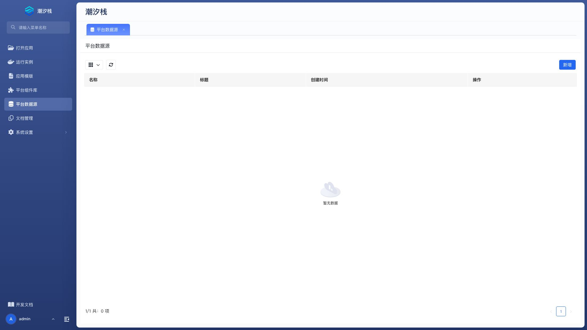
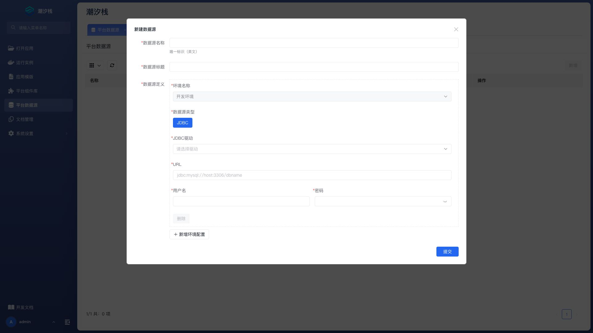

# 平台数据源

平台数据源保存各环境的实际数据库连接。应用通过“数据源”菜单把应用内逻辑名称绑定到这里的定义，从而在开发、测试和生产环境使用不同连接。

## 打开平台数据源

在平台管理菜单选择“平台数据源”。列表显示名称、标题和创建时间，并提供详情和编辑操作。

## 新建平台数据源

点击“新增”，填写基本信息和一个或多个环境定义。

| 配置项 | 说明 |
| --- | --- |
| 数据源名称 | 必填。平台内唯一的稳定标识，供应用绑定。 |
| 数据源标题 | 必填。管理员看到的可读名称。 |
| 数据源定义 | 必填。按环境维护实际连接参数。 |

### 环境定义

每个环境包含：

| 配置项 | 说明 |
| --- | --- |
| 环境名称 | 当前连接适用的环境。`dev` 环境定义不可删除。 |
| 数据源类型 | 必填。当前支持 JDBC。 |
| JDBC 驱动 | 必填。可选 MySQL、Oracle、PostgreSQL、KingbaseES / 人大金仓或 SQLServer。 |
| URL | 必填。完整 JDBC 连接地址。 |
| 用户名 | 必填。数据库账号。 |
| 密码 | 必填。数据库密码。 |

同一个平台数据源可以为多个环境提供不同 URL 和凭据。数据库账号只授予应用运行所需的最小权限。

## 查看与编辑

详情页展示全部环境定义。编辑页允许修改名称、标题和各环境连接，并可删除除 `dev` 外的环境项。

修改正在使用的数据源前，应确认连接池刷新或实例重启要求，并准备回退值。

## 验证连接

1. 从平台所在网络验证数据库主机和端口可达。
2. 新建平台数据源后，在测试应用中创建应用数据源绑定。
3. 创建或重启测试运行实例。
4. 执行一次只读查询和一次受控写入。
5. 检查字符集、时区、事务和账号权限。
6. 分环境重复验证，不能用开发环境结果替代生产检查。

## 安全建议

- 使用专用数据库账号，不复用管理员账号。
- 限制来源网络和允许访问的库。
- 定期轮换密码，并记录哪些实例需要刷新。
- 不在截图、文档、日志和应用前端配置中暴露密码。
- 修改生产连接前先验证备份和回退路径。

## 常见问题

### 为什么不能删除 dev 环境？

`dev` 是平台要求保留的开发环境定义，因此在编辑表单中被禁用删除。可以修改其连接参数，但应先评估正在运行的开发实例。

### 一个平台数据源可以配置多个数据库类型吗？

每个环境项独立选择 JDBC 驱动，技术上可以不同；实际使用前要确认数据模型和 SQL 在各数据库之间兼容。

### 修改密码后为什么应用仍连接失败？

运行实例可能仍使用旧连接池或旧环境配置。确认平台数据源保存成功，再按运行管理要求重启或刷新实例。

### 为什么应用的数据源下拉框里看不到新定义？

检查平台数据源是否保存成功、当前用户权限和应用所在环境，然后刷新应用数据源页面。

## 扩展阅读

- [数据源](./datasource)
- [运行实例](./runtime-instance)
