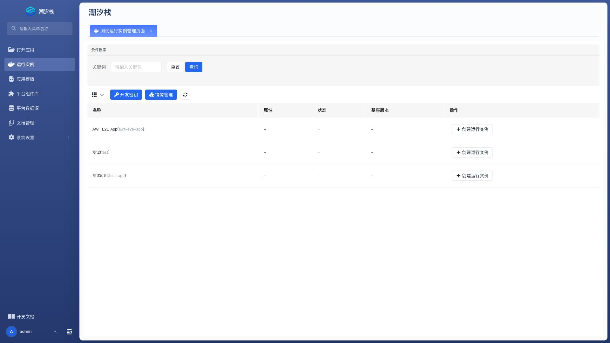
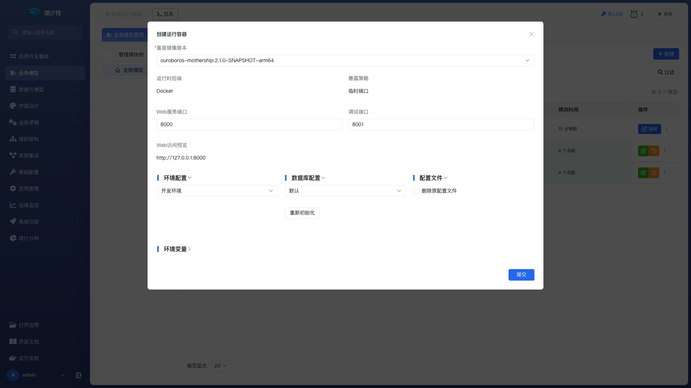
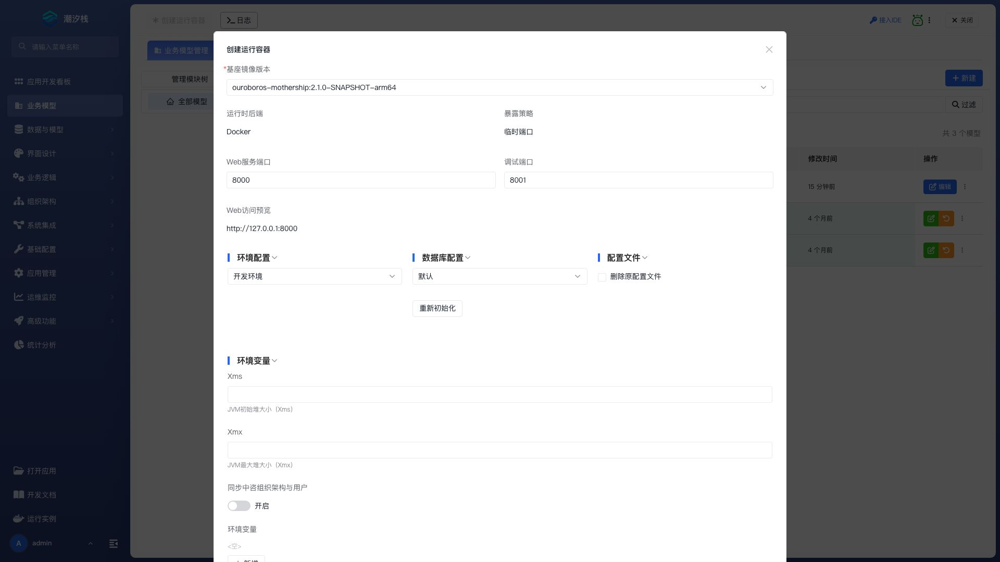

# 运行实例

运行实例页集中管理应用的开发运行环境。每个应用可以创建实例、打开 Web 入口、启停或重启后端，并查看运行端点、调试能力和基座镜像状态。

## 打开运行实例

在平台管理菜单选择“运行实例”。可按关键词搜索应用，列表显示实例名称、属性、状态和基座版本。

常见状态包括未创建、启动中、运行中、已暂停和已停止。不同运行后端支持的控制操作可能不同。

## 创建运行实例

打开目标应用，在开发工作区顶部的调试工具栏点击“创建运行容器”。

### 运行基础配置

| 配置项 | 出现条件 | 说明 |
| --- | --- | --- |
| 应用名称 | 始终存在 | 内部传入的当前应用标识，不需要手动填写。 |
| 基座镜像版本 | Docker 后端 | 从平台已经拉取的基座镜像中选择。 |
| 镜像引用 | Kubernetes 后端 | 填写集群可以拉取的完整镜像引用。 |
| 运行时后端 | 始终显示 | 只读。显示 Docker 或 Kubernetes。 |
| 暴露策略 | 环境允许显示时 | 只读。说明 Web 和 API 如何对外暴露。 |
| Web 服务端口 | 始终显示 | 为 Web 入口绑定的主机端口；留空时按后端策略分配。 |
| 调试端口 | 始终显示 | 为调试能力绑定的端口；使用前确认网络和安全策略。 |
| Web 访问预览 | 地址可计算时 | 只读显示创建后预计的 Web 地址。 |
| API 访问预览 | 地址可计算时 | 只读显示创建后预计的 API 地址。 |

### 环境配置

| 配置项 | 说明 |
| --- | --- |
| 环境名称 | 选择运行实例使用的环境配置。可选项由当前平台提供。 |

环境决定配置值、数据源等运行参数。创建后若要切换环境，先评估数据库和外部依赖差异。

### 数据库配置

| 配置项 | 说明 |
| --- | --- |
| 数据源类型 | 可选默认、内存或跟随环境。默认使用平台默认策略；内存适合短期开发验证；跟随环境读取所选环境的数据源。 |
| 重新初始化 | 开启后重新初始化实例数据。可能覆盖已有开发数据，只在明确需要时使用。 |

### 配置文件

| 配置项 | 说明 |
| --- | --- |
| 删除原配置文件 | 创建时删除实例已有配置文件，再由运行环境重新生成。已有定制配置可能丢失。 |

### 环境变量

| 配置项 | 说明 |
| --- | --- |
| Xms | JVM 初始堆大小。填写 JVM 可识别的内存值。 |
| Xmx | JVM 最大堆大小，应与主机或容器资源限制匹配。 |
| 同步中咨组织架构与用户 | 控制实例启动后是否执行对应主数据同步。仅在环境具备该集成时开启。 |
| 环境变量 | 以键值对添加其他环境变量，每项包含必填的键和值。 |

不要在普通环境变量中长期保存明文密码。优先使用平台配置和密钥管理机制。

## 管理实例状态

实例创建后，根据状态提供以下操作：

- **打开 Web 入口**：实例有可用 Web 地址时打开应用。
- **启动**：启动已停止实例。
- **暂停 / 恢复**：仅后端声明支持暂停时显示。
- **重启**：重新启动运行进程。
- **停止**：停止实例但保留实例定义。
- **停止并删除容器**：删除当前运行容器，后续需重新创建。
- **更新镜像**：检测到建议更新的基座镜像时显示。

启动中状态应等待完成，不要连续执行多个控制动作。

## 查看实例详情

点击详情可查看：

| 字段 | 说明 |
| --- | --- |
| 状态 | 当前运行状态。 |
| 运行时后端 | Docker 或 Kubernetes。 |
| 暴露策略 | 当前访问端点的暴露方式。 |
| 后端摘要 | 运行后端返回的实例概况。 |
| Web 入口 | 应用前端地址。 |
| API 入口 | 应用 API 地址。 |
| 远程调试入口 | IDE 或调试客户端连接地址。 |
| Web 访问视图 | 解析后的 Web 访问端点。 |
| API 访问视图 | 解析后的 API 访问端点。 |
| 后端 API 隧道端点 | 后端 API 会话使用的隧道地址。 |
| 活动后端 API 会话 ID | 当前打开的后端 API 会话。 |
| service / deployment / ingress | Kubernetes 后端对应资源的名称。 |

## 调试会话

实例运行且支持调试时，可以打开调试会话。状态区显示应用、Profile、运行时后端和实例状态；已有会话时还显示会话 ID、状态、broker 主机、端口、绑定范围、客户端访问提示和过期时间。

新建调试会话只有一个输入字段：

| 配置项 | 说明 |
| --- | --- |
| 开启原因 | 记录本次调试用途，便于审计和协作。 |

使用完成后点击“关闭当前会话”，不要让调试端口长期开放。

## 后端 API 会话

后端 API 会话用于临时开放应用后端 API 访问能力。它显示的会话字段与调试会话一致，新建时填写“开启原因”。仅在实例运行且后端能力允许时可以开启。

## 开发密钥

“开发密钥”用于管理当前应用的 Dev Key。已有密钥时可查看创建时间、过期时间和描述，并执行复制、下载 IDE 配置、轮换或删除。

生成新密钥时填写：

| 配置项 | 说明 |
| --- | --- |
| 描述 | 说明使用人、用途和开发环境。 |
| 有效期（天） | 必填。设置最短可用有效期，到期后需轮换。 |

密钥只应提供给需要调试的开发者，不要写入仓库或文档。

## 基座镜像管理

点击“镜像管理”查看本地基座镜像。列表显示镜像名和 Tag，可以刷新、重新拉取，或点击“按 Tag 拉取”填写：

| 配置项 | 说明 |
| --- | --- |
| Tag | 必填。需要拉取的基座镜像标签。 |

拉取前确认标签与当前平台版本兼容。更新镜像后，已有实例通常需要执行更新或重新创建才能使用新版本。

## 验证运行实例

1. 创建后等待状态变为运行中。
2. 打开 Web 入口并登录应用。
3. 调用一个只读 API，确认 API 入口和数据源可用。
4. 检查实例详情中的端点与实际地址一致。
5. 按需开启调试会话，验证连接后立即关闭。
6. 执行一次重启，确认实例能够恢复运行。

## 常见问题

### 创建实例前需要开启 Docker API 吗？

平台通过远程 Docker API 管理 Docker 后端。Linux 和 Windows 主机都需要让 Docker daemon 监听平台可以访问的 API，并限制来源网络；不要把未加保护的 Docker API 暴露到公网。Linux 可通过 systemd 的 Docker 启动参数或 `daemon.json` 配置受控监听，Windows 可在 Docker Desktop 或 Docker Engine 配置中启用相应 TCP 端点。修改后重启 Docker，并从平台主机验证端点可达。生产环境优先使用 TLS 双向认证或受控代理。

### 为什么创建按钮不显示？

已有实例时会显示状态控制按钮而非创建按钮。还要检查当前用户是否有实例管理权限。

### 为什么 Web 入口按钮不可用？

实例尚未生成 `webEndpoint`，通常是仍在启动、启动失败或暴露策略未成功创建。查看实例状态和后端日志。

### 为什么不能暂停实例？

暂停和恢复只在当前运行后端声明支持时显示。其他后端只能停止、启动或重启。

### 重新初始化数据有什么风险？

它可能清空或覆盖实例中的开发数据。执行前确认数据可丢弃或已经备份，不要把它当作普通重启选项。

## 扩展阅读

- [应用配置](./app-configuration)
- [版本管理](./version-management)
- [数据源](./datasource)
