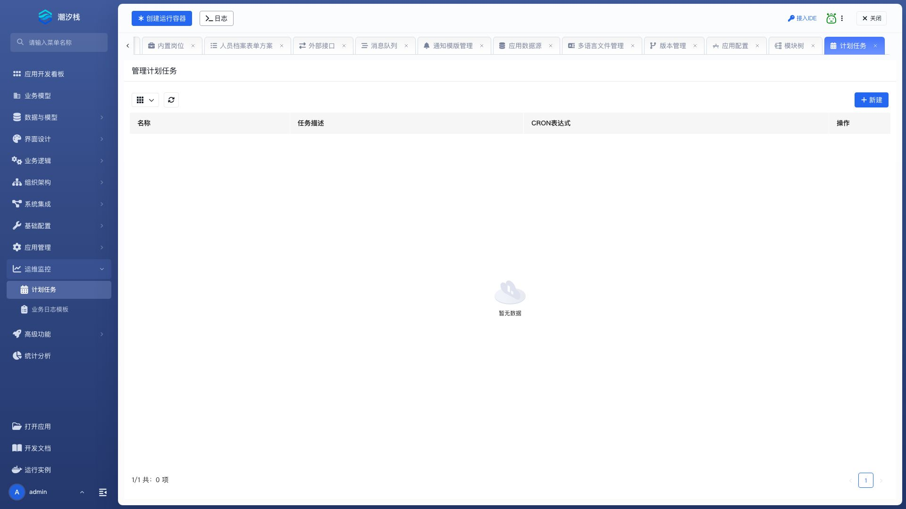
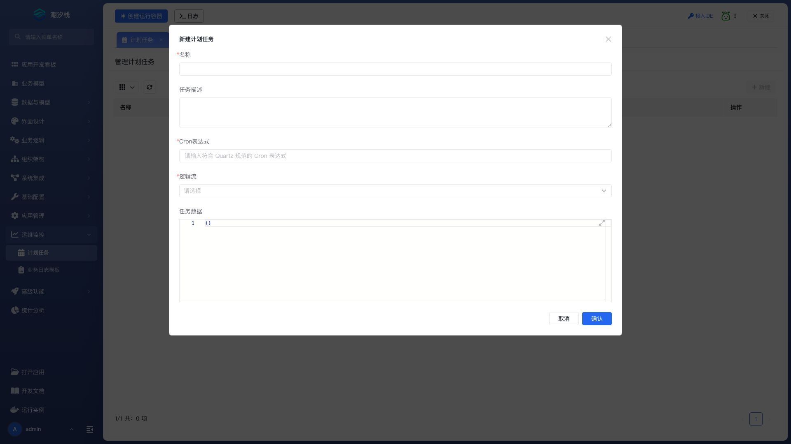

# 计划任务

计划任务按 Cron 表达式定时执行指定逻辑流，适合周期同步、汇总、清理和提醒等无需人工触发的处理。

## 打开计划任务

打开应用，在左侧菜单选择“运维监控 / 计划任务”。列表显示名称、任务描述、Cron 表达式和锁定状态，并提供查看、编辑和删除操作。

## 新建计划任务

点击“新建”，填写：

| 配置项 | 说明 |
| --- | --- |
| 名称 | 必填。应用内唯一的任务标识。 |
| 任务描述 | 说明执行目的、频率、影响数据和负责人。 |
| Cron 表达式 | 必填。定义触发时间，按平台调度器支持的 Cron 语法填写。 |
| 逻辑流 | 必填。每次触发时执行的逻辑流。 |
| 任务数据 | JSON 数据，作为逻辑流的固定输入。 |

任务数据结构应与逻辑流输入一致。不要在其中保存密码或令牌，敏感信息通过配置项引用。

## 计划任务与延迟任务

此菜单维护周期性 Cron 任务。平台还支持延迟任务，用于在指定延迟后执行一次处理；延迟任务由业务逻辑在运行时创建，不在这里填写 Cron，也不会因新增一个计划任务而自动产生。

周期任务适合定时汇总、同步；“提交后 30 分钟检查是否超时”这类需求应使用延迟任务能力，并在业务逻辑中处理取消和重复执行。

## 查看与编辑

“查看”展示任务完整定义。“编辑”打开同一表单；任务被其他用户锁定时编辑按钮不可用。

修改 Cron、逻辑流或任务数据后，应按新配置手动验证一次，不能等到下一个生产调度周期才发现错误。

## 删除任务

删除会停止后续调度，但不会撤销已经开始或已经完成的执行。删除前确认没有运维流程依赖该任务，并记录替代方案。

## 验证计划任务

1. 使用无外部副作用的测试逻辑流创建任务。
2. 将 Cron 临时设置为便于观察的测试时间。
3. 等待一次触发并查看逻辑流调试会话。
4. 核对任务数据、输出和数据库副作用。
5. 验证重复执行的幂等性和失败重试影响。
6. 验证通过后改回正式 Cron，并确认时区。

## 常见问题

### Cron 已到时间为什么没有执行？

检查运行实例是否启动、调度能力是否启用、Cron 语法和时区是否正确，以及任务引用的逻辑流是否存在并启用。

### 任务数据应该填写什么？

填写逻辑流入口需要的 JSON。字段名和类型必须与逻辑流输入约定一致；动态时间等运行值应由逻辑流在执行时获取。

### 修改任务会影响正在执行的实例吗？

修改用于后续调度，已经开始的执行通常按触发时配置继续。应通过调试会话分别观察旧执行和新执行。

### 如何避免重复执行造成问题？

让逻辑流按业务键、执行周期或幂等标识检查是否已经处理。不要只依赖调度器“通常只触发一次”。

## 扩展阅读

- [逻辑流](./logicflow)
- [配置项](./config-item)
