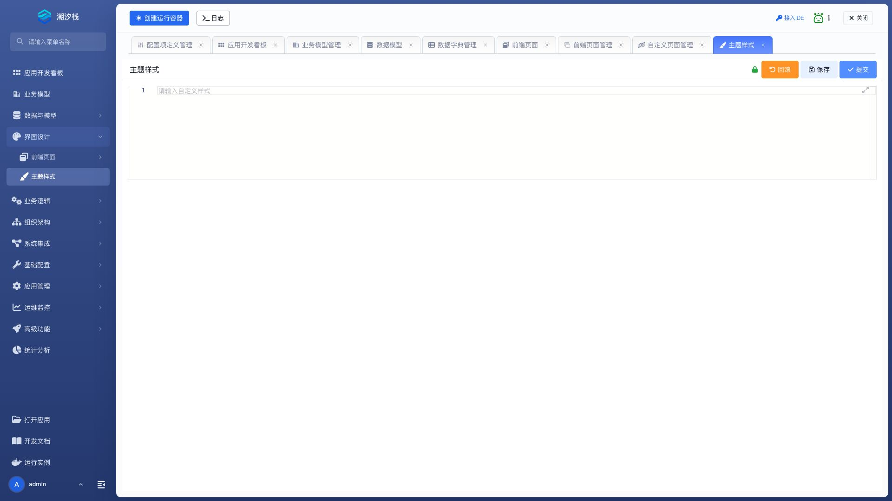

# 主题样式

主题样式用于为当前应用补充 CSS。它适合统一调整品牌色、间距或特定组件外观，不承担页面结构和业务交互配置。

## 打开主题样式

打开应用，在左侧菜单选择“界面设计 / 主题样式”。页面主体是一个 CSS 编辑器，显示当前应用保存的全部自定义样式。

## 编辑样式

页面只有一个可编辑配置：

| 配置项 | 说明 |
| --- | --- |
| 样式 | 当前应用的 CSS 内容。可以使用标准选择器、属性和媒体查询。 |

编辑时遵循以下原则：

1. 优先使用页面或组件已经提供的稳定类名。
2. 尽量把选择器限定在目标页面或容器下，避免影响整个应用。
3. 不覆盖组件的交互状态，除非同时验证禁用、悬停、聚焦和错误状态。
4. 需要调整页面结构时回到 UI Schema 或微前端，不用大量 CSS 修补结构问题。
5. 为移动端添加样式时同时验证桌面端，反之亦然。

## 保存并验证

保存后，自定义样式会在应用页面中加载。建议按以下顺序检查：

1. 打开受影响的实际页面并强制刷新。
2. 检查浅色和深色主题下的文字、背景和边框对比度。
3. 检查表单的正常、聚焦、错误和禁用状态。
4. 检查弹窗、抽屉、下拉菜单等浮层是否被意外影响。
5. 分别验证常用桌面宽度和移动端宽度。
6. 在运行实例中确认样式已经随应用配置生效。

## 常见问题

### 保存后为什么看不到变化？

先刷新实际应用页面，必要时清除浏览器缓存。随后检查选择器是否命中当前组件、样式是否被更高优先级规则覆盖，以及当前打开的是否是正确应用和运行版本。

### 为什么一个页面的样式影响了其他页面？

选择器范围过宽。给目标页面或外层容器增加稳定类名，再把样式限定到该容器下，避免直接覆盖通用标签或平台组件全局类名。

### 可以在这里引入完整前端主题吗？

这里适合少量应用级 CSS。需要组件库、复杂主题变量或自定义交互时，应使用平台组件库或微前端，并把样式随对应工程管理。

### 如何撤销有问题的样式？

删除或修改对应 CSS 后重新保存。如果无法快速定位，先注释最近增加的规则并逐段恢复，确认是哪条选择器造成影响。

## 扩展阅读

- [UI Schema](./ui-schema)
- [微前端](./micro-frontend)
- [平台组件库](./platform-component-library)
