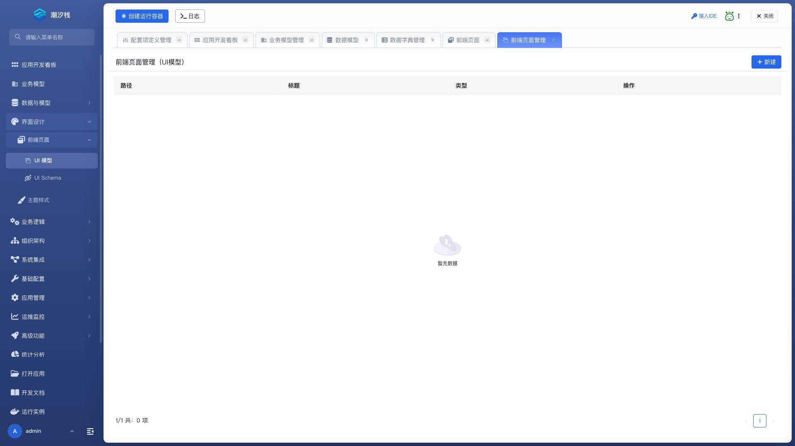
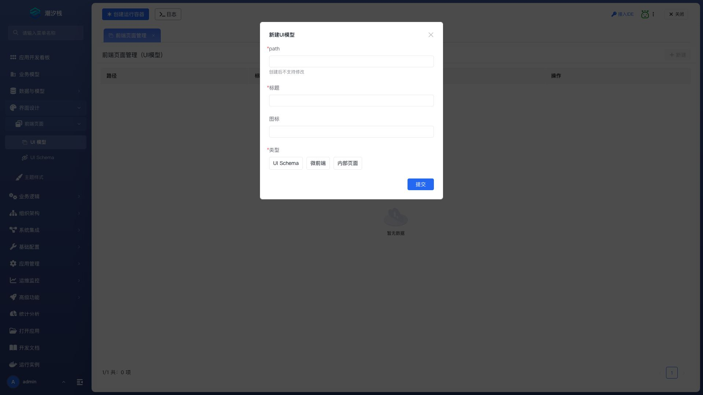

# UI 模型

UI 模型把页面路径、标题和渲染入口组合成可访问的前端页面。新建 UI Schema 或微前端后，需要通过 UI 模型为其分配应用内路径。

## 打开 UI 模型

打开应用，在左侧菜单选择“界面设计 / 前端页面 / UI 模型”。列表显示当前应用直接维护的 UI 模型。

| 列 | 说明 |
| --- | --- |
| 路径 | 页面在应用内的访问路径。 |
| 标题 | 页面标题。 |
| 类型 | 页面采用 UI Schema、微前端还是内部页面。 |
| 操作 | 编辑或删除 UI 模型。 |

需要同时查看继承页面和应用重定义时，使用“前端页面”菜单。

## 新建 UI 模型

点击“新建”，配置页面入口。

| 配置项 | 出现条件 | 说明 |
| --- | --- | --- |
| path | 始终显示 | 必填。应用内页面路径；创建后不可修改。系统同时根据路径生成模型名。 |
| 标题 | 始终显示 | 必填。页面和相关菜单显示的名称。 |
| 图标 | 始终显示 | 页面使用的图标；需要把页面加入菜单时可复用。 |
| 类型 | 始终显示 | 必填。可选 UI Schema、微前端或内部页面。 |
| 微前端入口 | 类型为“微前端” | 必填。从当前应用已配置的微前端应用中选择。 |
| Schema 名 | 类型为“UI Schema” | 关联的 Schema ID；留空时使用页面路径作为 Schema ID。 |

### 页面类型

- **UI Schema**：由平台 Schema 渲染器生成页面，适合表单、列表和常规业务页面。
- **微前端**：加载应用中已经注册的微前端入口，适合自定义前端工程或组件。
- **内部页面**：指向平台或扩展模块提供的内部页面。

保存前先确认所选 Schema 或微前端已经存在，否则路径创建成功后仍可能无法渲染内容。

## 编辑 UI 模型

列表中点击“编辑”可以修改以下字段：

| 配置项 | 出现条件 | 说明 |
| --- | --- | --- |
| path | 始终显示 | 页面路径。编辑时保留现有值，不应作为日常重命名方式。 |
| 标题 | 始终显示 | 必填。修改后影响页面标题及引用该标题的界面。 |
| 图标 | 始终显示 | 页面图标。 |
| 类型 | 始终显示 | 必填。切换类型后，只保留新类型需要的关联配置。 |
| 微前端入口 | 类型为“微前端” | 必填。选择新的微前端入口。 |
| Schema ID | 类型为“UI Schema” | 关联的 Schema 标识。 |

从一种类型切换到另一种类型后，应立即打开页面验证，因为旧类型的入口配置不会继续参与渲染。

## 删除 UI 模型

删除会移除页面路径定义，但不会自动删除关联的 UI Schema 或微前端配置。执行前检查：

1. 应用菜单是否仍引用该路径。
2. 其他页面是否会跳转到该路径。
3. 对应 Schema 或微前端是否还被其他 UI 模型使用。

确认不再使用后再删除，避免产生失效菜单和链接。

## 验证页面入口

1. 保存 UI 模型后刷新列表。
2. 打开“前端页面”，确认路径、标题和渲染方式。
3. 从实际路由打开页面，检查 Schema 或微前端是否加载。
4. 若页面需要出现在业务菜单中，再到相应菜单模型或模块编排中配置入口。
5. 在运行实例中验证用户权限和真实数据场景。

## 常见问题

### path 应该怎样填写？

使用应用内稳定、可读的路径，并避免与已有页面冲突。路径创建后不可直接修改；需要更换路径时，应新建模型并迁移引用。

### 为什么 Schema 名可以留空？

类型为 UI Schema 时，系统会在留空情况下使用页面路径作为 Schema ID。只有页面路径与 Schema 标识不同或需要复用现有 Schema 时才填写。

### UI 模型创建后为什么左侧菜单没有入口？

UI 模型只注册页面路径，不负责把页面加入业务菜单。还需要在业务模型的菜单配置或对应模块编排中添加入口。

### 删除 UI 模型会删除页面内容吗？

不会自动删除独立的 UI Schema 或微前端包，但页面路径会失效。删除后应清理菜单和跳转引用，并按需处理不再使用的页面资源。

## 扩展阅读

- [前端页面](./frontend-page)
- [UI Schema](./ui-schema)
- [微前端](./micro-frontend)
