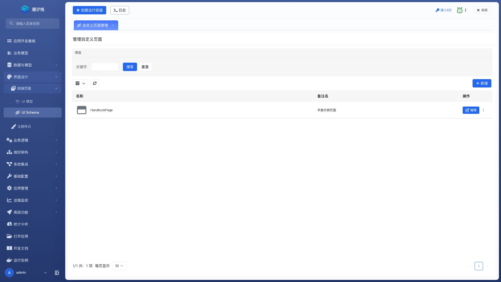
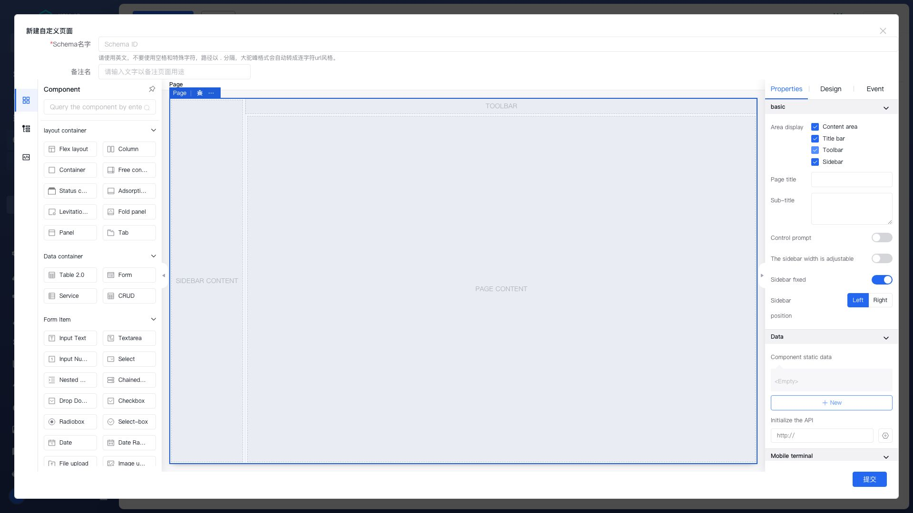
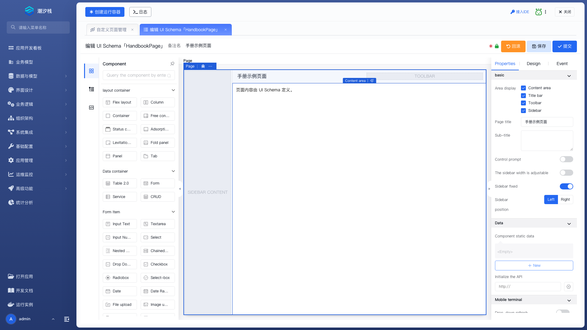
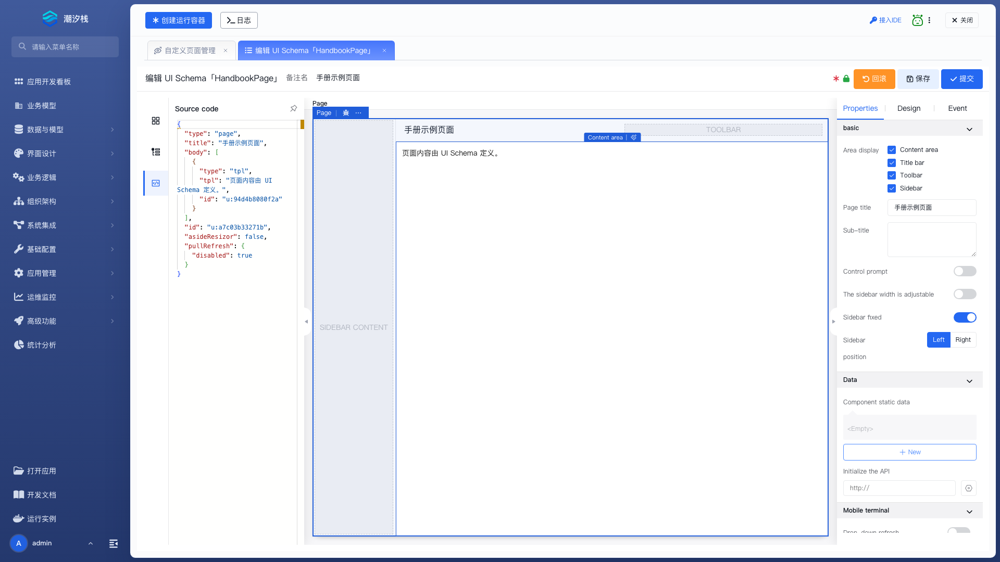

# UI Schema

UI Schema 用结构化配置描述页面中的组件、布局、数据请求和交互。应用可以新建独立 Schema，也可以克隆继承页面使用的 Schema 后进行应用内定制。

## 打开 UI Schema

打开应用，在左侧菜单选择“界面设计 / 前端页面 / UI Schema”。列表展示当前应用可见的 Schema，并标记锁定状态。

| 列 | 说明 |
| --- | --- |
| 名称 | Schema 的唯一名称。 |
| 备注名 | 便于开发者识别用途的说明性名称。 |
| 锁定状态 | 锁图标表示 Schema 正被编辑；悬停可查看锁定提示。 |
| 操作 | 提供编辑、代码编辑、预览和删除等操作。 |

页面上方的关键字输入框可按名称或备注查找 Schema。“提交”用于提交当前应用中已经保存的 Schema 变更。

## 新建 UI Schema

点击“新建”，填写基本信息并在可视化编辑器中设计页面。

| 配置项 | 说明 |
| --- | --- |
| Schema 名字 | 必填。Schema 在应用中的唯一标识，供 UI 模型或页面重定义引用。 |
| 备注名 | 可选。说明页面用途，建议使用用户能够识别的页面名称。 |
| Schema | 必填。通过可视化编辑器配置组件、布局、数据源和动作。 |

保存后，Schema 会出现在列表中。需要让用户访问它时，还要在“UI 模型”中创建页面路径，或在“前端页面”中把现有路径重定义到该 Schema。

## 使用可视化编辑器

可视化编辑器由左侧组件库与组件树、中间画布、右侧属性面板组成。把组件加入画布后，选中它再配置属性、样式和事件；需要调整父子关系时使用组件树。

编辑时重点检查：

1. 页面容器和布局是否适合目标终端。
2. 表单字段的名称是否与接口参数或数据模型一致。
3. 列表、表单等组件的数据接口是否指向正确应用。
4. 按钮动作、弹窗和页面跳转是否有完整的成功与失败反馈。
5. 条件显示表达式是否覆盖空值和无权限状态。

编辑器保存的是 Schema 定义，不会自动创建页面路径或后端接口。

## 使用代码编辑器

需要直接修改 JSON 时，先进入 Schema 编辑页，点击编辑器左侧的代码图标切换到 **Source code**。修改后等待画布刷新，检查内容，再点击页面顶部的 **保存**。代码模式与可视化模式维护同一份定义。

| 配置项 | 说明 |
| --- | --- |
| Schema | 必填。完整的 UI Schema JSON。保存前必须保持 JSON 语法有效。 |

代码编辑适合批量调整、复制组件配置或维护可视化编辑器暂未覆盖的属性。修改后先预览，再从实际页面验证数据请求和动作。

列表更多操作中的 **代码** 也会打开 JSON 弹窗。当前版本的这个弹窗没有保存按钮，需要保存修改时使用编辑页中的代码模式。

## 编辑 Schema

打开 Schema 编辑页后可以修改：

| 配置项 | 说明 |
| --- | --- |
| 备注名 | 更新列表中显示的用途说明。 |
| Schema | 在可视化编辑器中修改页面定义。 |

编辑期间 Schema 会被锁定。其他用户看到锁定标记时应等待锁释放，避免同时修改造成覆盖。若页面提示被其他用户锁定，先确认对方是否仍在编辑。

## 预览与删除

- **预览**：按当前 Schema 渲染页面，用于检查布局和基础交互。
- **删除**：移除当前应用中的 Schema。删除前应确认没有 UI 模型、前端页面或其他 Schema 引用它。

预览环境可能缺少实际页面路由参数或运行数据。依赖这些上下文的页面还需要在真实页面路径中验证。

## 提交变更

保存只更新工作区中的 Schema。完成一组修改后回到列表点击“提交”，将变更纳入应用元数据版本。

提交前建议：

1. 预览所有已修改的 Schema。
2. 检查关联 UI 模型是否指向正确的 Schema ID。
3. 验证关键数据请求和按钮动作。
4. 确认没有遗留的编辑锁。

## 常见问题

### 新建 Schema 后为什么应用菜单里没有页面？

Schema 只定义页面内容。还需要在“UI 模型”中创建访问路径，或在“前端页面”中把已有路径重定义到该 Schema。

### 为什么编辑按钮不可用？

Schema 被其他用户锁定时，编辑按钮会禁用。悬停锁图标查看提示，待锁释放后刷新列表。

### 可视化编辑和代码编辑应该用哪个？

常规布局和组件配置优先使用可视化编辑器；需要精确维护 JSON、批量复制配置或使用高级属性时使用代码编辑器。两种方式修改的是同一份 Schema。

### 预览正常，实际页面为什么仍报错？

检查实际路由提供的参数、用户权限、后端接口和运行数据。预览只能证明 Schema 可以加载，不能替代完整业务场景验证。

## 扩展阅读

- [前端页面](./frontend-page)
- [UI 模型](./ui-model)
- [微前端](./micro-frontend)
