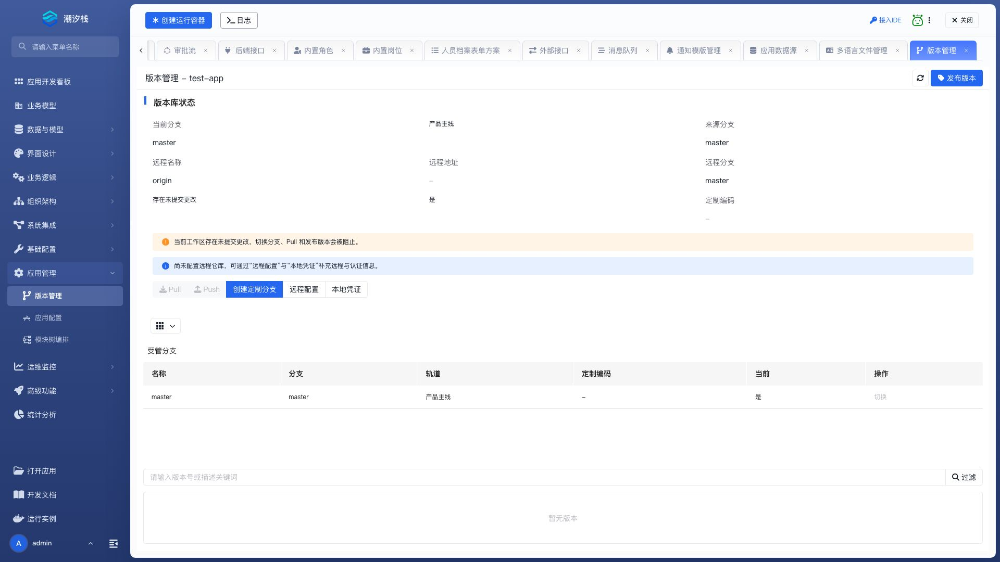
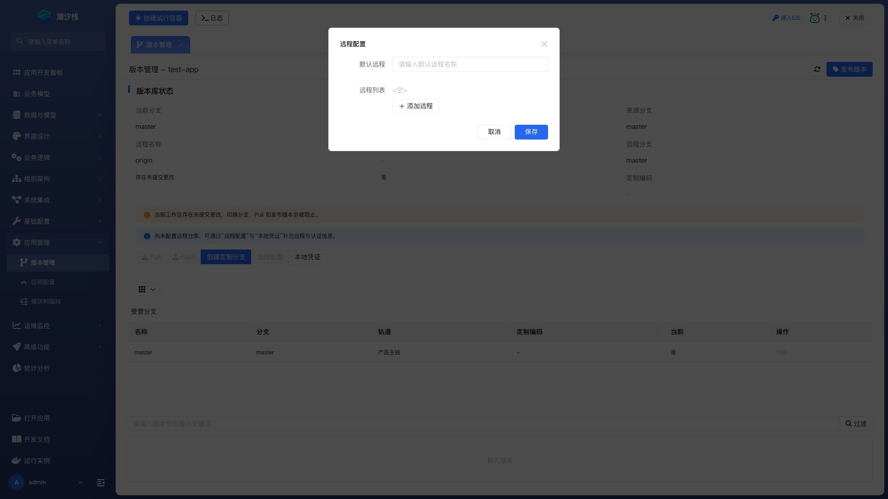
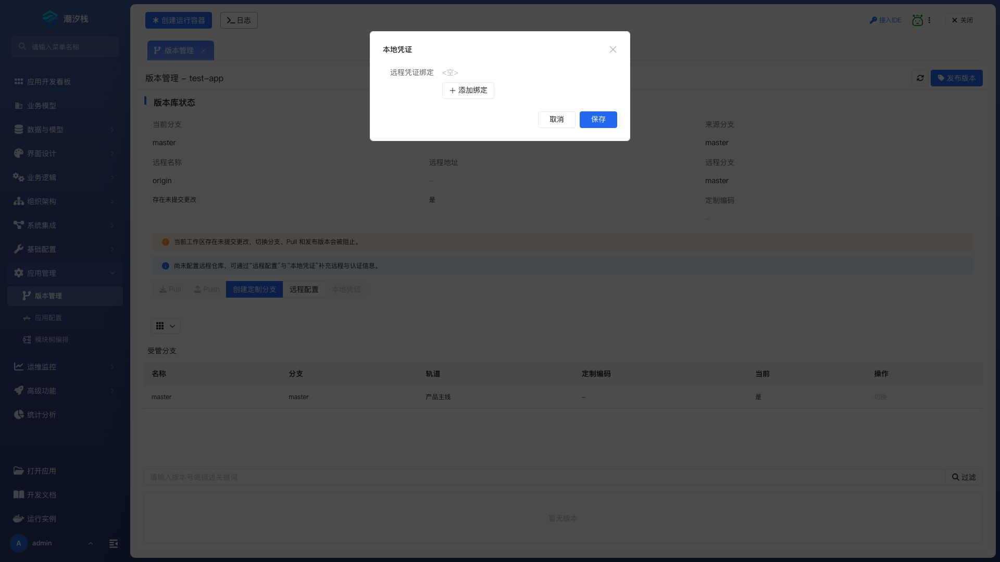

# 版本管理

版本管理记录应用元数据的版本历史，并管理应用版本库的当前分支、远程地址和凭证。它用于提交后的版本追踪、分支切换、远程同步以及版本包导出。

## 打开版本管理

打开应用，在左侧菜单选择“应用管理 / 版本管理”。页面上方显示版本库状态，下方依次列出受管分支和应用版本。

## 查看版本库状态

| 状态 | 说明 |
| --- | --- |
| 当前分支 | 当前应用工作区所在的分支。 |
| 发布轨道 | 当前分支所属的版本轨道。 |
| 来源分支 | 定制分支的上游来源。 |
| 远程名称 | 当前关联的远程仓库名称。 |
| 远程地址 | 远程仓库 URI。 |
| 远程分支 | 当前跟踪的远程分支。 |
| 工作区状态 | 是否存在未提交修改。 |
| 受管分支 | 当前分支是否由平台管理。 |
| 定制编码 | 定制分支的业务编码。 |

工作区存在未提交修改时，切换分支、Pull 和发布版本会被阻止。先提交或明确放弃相关修改，再继续这些操作。

## 管理受管分支

受管分支列表显示名称、分支、轨道、定制编码和当前状态。点击“切换”进入其他分支，当前分支的切换按钮不可用。

### 创建定制分支

点击“创建定制分支”，填写：

| 配置项 | 说明 |
| --- | --- |
| 定制编码 | 必填。用于派生分支名称和识别定制版本。 |
| 派生规则 | 只读。显示平台按当前来源分支生成定制分支的规则。 |

创建前确认当前分支和工作区状态正确。定制编码应稳定、可追踪，不要使用临时描述。

## 配置远程仓库

点击“远程配置”，填写：

| 配置项 | 说明 |
| --- | --- |
| 默认远程 | 默认执行 Pull、Push 的远程名称。 |
| 远程名称 | 必填。远程仓库在当前应用中的标识。 |
| 远程地址 | 必填。Git 远程仓库地址。 |

可以配置多个远程。默认远程必须与远程列表中的名称一致。

## 配置本地凭证

点击“本地凭证”，为每个远程绑定认证方式。

| 配置项 | 出现条件 | 说明 |
| --- | --- | --- |
| 远程名称 | 始终显示 | 必填。凭证应用到的远程。 |
| 认证方式 | 始终显示 | 可选不使用认证、HTTP Basic 或 SSH Key。 |
| 用户名 | HTTP Basic | 远程仓库用户名。 |
| 密码 | HTTP Basic | 密码或访问令牌。 |
| Key 名称 | SSH Key | 本地保存的密钥名称。 |
| SSH 私钥 | SSH Key | 私钥内容。 |
| 已保存 Key 路径 | SSH Key 且已有密钥 | 只读显示当前密钥保存位置。 |

凭证保存在当前平台环境，不随应用版本导出。生产环境应按组织的密钥管理要求配置。

## Pull 与 Push

- **Pull**：从当前远程分支获取并整合更新。
- **Push**：把本地提交推送到远程分支。

未配置远程地址时按钮不可用。同步前先确认当前分支、未提交修改和远程目标，遇到冲突时不要反复重试覆盖。

## 查看和导出版本

版本列表可按关键字过滤，并显示版本号、轨道、来源分支、作者和发布时间。版本操作中的“导出”或“导出版本”会下载该版本的应用包，用于备份或受控迁移。

导出前确认选择的是目标版本，而不是只看列表排序。导出包不会替代数据库迁移、运行环境配置和平台级依赖检查。

## 创建版本记录

点击“发布版本”后，页面会显示待纳入版本的文件树，并要求填写：

| 配置项 | 说明 |
| --- | --- |
| 应用名称 | 只读。当前应用标识。 |
| 逻辑版本号 | 必填。用于识别该版本的业务版本号。 |
| 版本描述 | 说明本次变更内容、影响和验证结果。 |
| 文件树 | 选择本次版本包含的应用文件。 |

创建版本前应确保相关模型已经保存、提交并通过验证。版本记录是应用元数据快照，不代表运行实例已经完成升级。

## 验证版本操作

1. 检查工作区状态和当前分支。
2. 查看变更记录，确认目标修改都已提交。
3. 创建版本后刷新列表，核对版本号、作者和时间。
4. 导出该版本并检查文件可正常下载。
5. 配置了远程时，执行 Push 后从远程仓库确认提交和分支。

## 常见问题

### 为什么 Pull 或 Push 按钮不可用？

当前应用没有有效的远程地址。先完成远程配置，并为需要认证的远程绑定本地凭证。

### 为什么不能切换分支？

先检查工作区是否存在未提交修改。保存或回滚这些修改后再切换，避免应用定义丢失或产生冲突。

### 导出版本是否包含数据库数据？

版本包主要包含应用定义和元数据，不应假定它包含运行数据库中的业务数据或平台环境配置。

### 创建版本后运行实例会自动更新吗？

不会把版本记录等同于实例升级。运行实例是否更新取决于部署和运行管理流程，应在目标实例中单独验证。

## 扩展阅读

- [运行实例](./runtime-instance)
