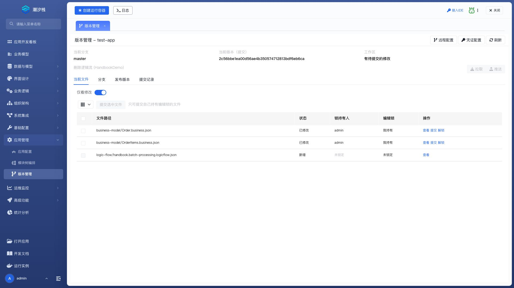
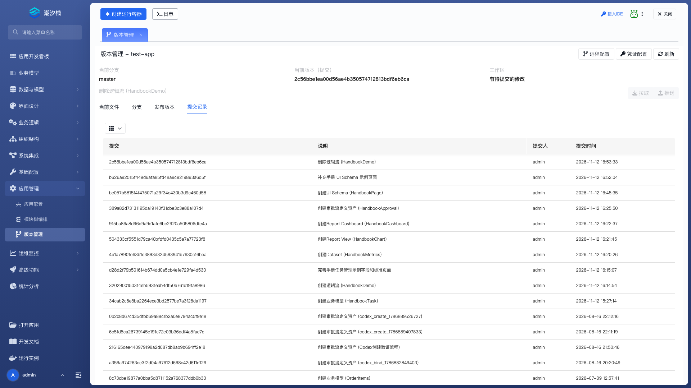
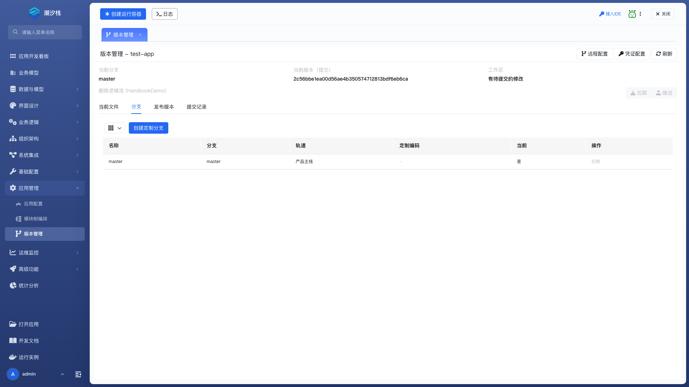
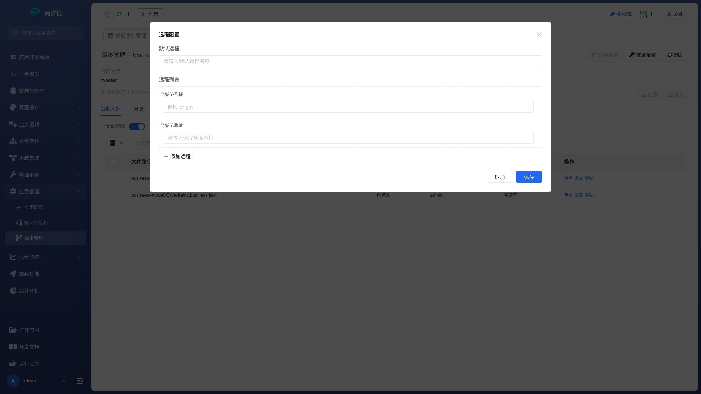
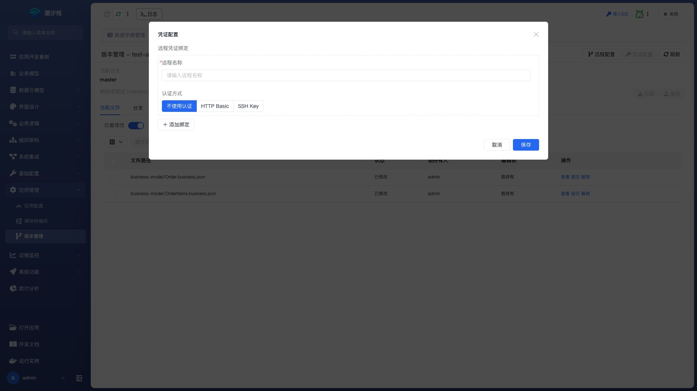

# 版本管理

版本管理记录应用元数据的版本历史，并管理应用版本库的当前分支、远程地址和凭证。它用于提交后的版本追踪、分支切换、远程同步以及版本包导出。

## 打开版本管理

打开应用，在左侧菜单选择“应用管理 / 版本管理”。页面上方显示当前分支、当前提交和工作区状态，下方提供 **当前文件**、**分支**、**发布版本** 和 **提交记录** 四个页签。

## 查看工作区并提交文件

顶部先核对当前分支、当前版本（提交）和工作区状态。**当前文件** 列表显示文件路径、变更状态、锁持有人和编辑锁状态；**仅看修改** 用于筛出待处理文件。

| 操作 | 用法 |
| --- | --- |
| 查看 | 检查文件内容和修改范围。 |
| 提交 | 提交当前文件；需要由自己持有该文件的编辑锁。 |
| 提交选中文件 | 勾选属于本次修改的一组文件后一起提交。 |
| 解锁 | 释放文件编辑锁。解锁本身不等于提交，也不应当作回滚使用。 |

1. 先在模型编辑器保存修改。
2. 在当前文件中核对路径、状态和锁持有人。
3. 选择单文件提交或勾选关联文件后点击 **提交选中文件**。
4. 填写能说明修改目的的提交信息，确认提交范围。
5. 打开 **提交记录**，核对新提交及工作区状态。

只提交与本次功能相关的文件。不能提交他人持锁的文件；先与持锁人确认编辑状态，不要通过解锁规避协作约束。

## 管理受管分支

打开 **分支** 页签。受管分支列表显示名称、分支、轨道、定制编码和当前状态。点击“切换”进入其他分支，当前分支的切换按钮不可用。

### 创建定制分支

点击“创建定制分支”，填写：

| 配置项 | 说明 |
| --- | --- |
| 定制编码 | 必填。用于派生分支名称和识别定制版本。 |
| 派生规则 | 只读。显示平台按当前来源分支生成定制分支的规则。 |

创建前确认当前分支和工作区状态正确。定制编码应稳定、可追踪，不要使用临时描述。

## 配置远程仓库

点击“远程配置”，填写：

| 配置项 | 说明 |
| --- | --- |
| 默认远程 | 默认执行 Pull、Push 的远程名称。 |
| 远程名称 | 必填。远程仓库在当前应用中的标识。 |
| 远程地址 | 必填。Git 远程仓库地址。 |

可以配置多个远程。默认远程必须与远程列表中的名称一致。

## 配置远程凭证

点击 **凭证配置**，为每个远程绑定认证方式。

| 配置项 | 出现条件 | 说明 |
| --- | --- | --- |
| 远程名称 | 始终显示 | 必填。凭证应用到的远程。 |
| 认证方式 | 始终显示 | 可选不使用认证、HTTP Basic 或 SSH Key。 |
| 用户名 | HTTP Basic | 远程仓库用户名。 |
| 密码 | HTTP Basic | 密码或访问令牌。 |
| Key 名称 | SSH Key | 本地保存的密钥名称。 |
| SSH 私钥 | SSH Key | 私钥内容。 |
| 已保存 Key 路径 | SSH Key 且已有密钥 | 只读显示当前密钥保存位置。 |

凭证保存在当前平台环境，不随应用版本导出。生产环境应按组织的密钥管理要求配置。

## 拉取与推送

- **拉取**：从当前远程分支获取并整合更新。
- **推送**：把本地提交推送到远程分支。

未配置远程地址时按钮不可用。同步前先确认当前分支、未提交修改和远程目标，遇到冲突时不要反复重试覆盖。

## 查看和导出版本

**发布版本** 列表显示版本标签、说明、来源分支、发布时间和作者。版本操作中的“导出”或“导出版本”会下载该版本的应用包，用于备份或受控迁移。

导出前确认选择的是目标版本，而不是只看列表排序。导出包不会替代数据库迁移、运行环境配置和平台级依赖检查。

## 创建版本记录

打开 **发布版本** 页签，点击 **发布版本**。弹窗显示当前分支及其标签规则，并要求填写：

| 配置项 | 说明 |
| --- | --- |
| 应用名称 | 只读。当前应用标识。 |
| 逻辑版本号 | 必填。使用语义化版本，例如 `v1.0.0`。`master` 分支直接使用该标签；`custom/{editionCode}` 分支由系统追加 `-ce.<editionCode>` 后缀。 |
| 版本描述 | 可选，说明本次变更内容、影响和验证结果。 |

工作区存在未提交修改时，平台会阻止发布，并在 **查看未提交的文件** 中列出待处理文件。先保存模型、完成验证并提交修改，再返回发布。版本记录是应用元数据快照，不代表运行实例已经完成升级。

## 验证版本操作

1. 检查工作区状态和当前分支。
2. 查看变更记录，确认目标修改都已提交。
3. 创建版本后刷新列表，核对版本号、作者和时间。
4. 导出该版本并检查文件可正常下载。
5. 配置了远程时，执行 Push 后从远程仓库确认提交和分支。

## 常见问题

### 为什么拉取或推送不可用？

当前应用没有有效的远程地址。先完成远程配置，并在凭证配置中为需要认证的远程添加绑定。

### 为什么不能切换分支？

先检查工作区是否存在未提交修改。保存或回滚这些修改后再切换，避免应用定义丢失或产生冲突。

### 导出版本是否包含数据库数据？

版本包主要包含应用定义和元数据，不应假定它包含运行数据库中的业务数据或平台环境配置。

### 创建版本后运行实例会自动更新吗？

不会把版本记录等同于实例升级。运行实例是否更新取决于部署和运行管理流程，应在目标实例中单独验证。

## 扩展阅读

- [运行实例](./runtime-instance)
