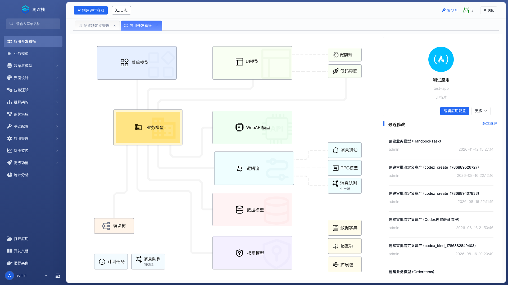
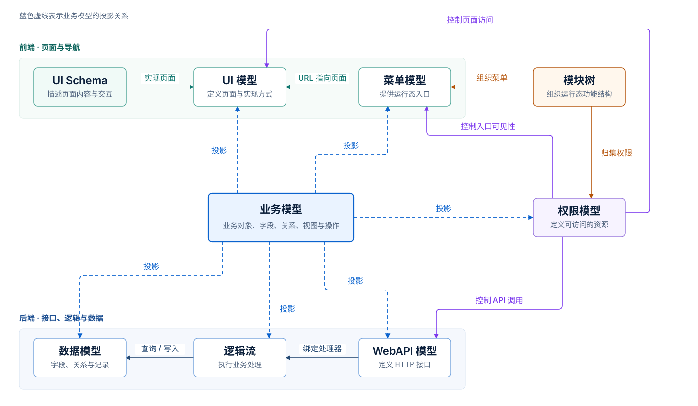

# 低代码开发

打开应用后，首先看到的是应用开发看板。看板用图形化界面呈现平台的主要对象及其关系，并提供应用信息、最近修改和常用开发入口。开始开发时，先定义业务模型，再根据需要配置界面、逻辑、集成和运行能力。

本栏目按 `2.1.0-SNAPSHOT` 开发平台说明，业务模型包含行为契约、动作引用和新版字段配置。

## 看懂应用开发看板

进入应用后，默认打开“应用开发看板”。左侧是按开发阶段组织的功能菜单，中间是应用内模型关系图，右侧显示应用信息和最近修改；顶部工具栏用于控制调试实例、查看日志和管理开发助手。

| 区域 | 提供的能力 | 使用建议 |
| --- | --- | --- |
| 顶部调试工具栏 | 创建、启动、恢复、停止或热刷新运行容器，打开应用页面和实时日志 | 修改模型后在这里启动或刷新调试实例，不必离开开发工作区 |
| 顶部右侧工具 | 接入 IDE、创建或管理开发助手、关闭当前应用 | 低代码能力不足、需要代码扩展时再接入 IDE 或开发助手 |
| 左侧主菜单 | 进入建模、界面、逻辑、集成、配置和运维功能 | 从业务模型开始，再按需要进入专门功能 |
| 中间能力图 | 展示业务模型及其投影模型，并提供常用功能入口 | 用于理解模型关系，也可以点击节点直接进入对应页面 |
| 应用信息卡 | 显示应用图标、标题、名称和描述，提供应用配置与编辑权限入口 | 开发前先确认当前应用，避免在错误的应用中修改 |
| 最近修改 | 显示近期提交记录，并可进入版本管理 | 用于确认修改是否已提交，不代表应用已经发布或部署 |

## 业务模型是应用开发的中心

业务模型集中描述业务对象的字段、关系、视图、接口和访问控制，并通过投影关系关联数据模型、UI 模型、WebAPI 模型、逻辑流、菜单模型和权限模型。

- **投影关系**：业务模型分别投影到数据模型、UI 模型、WebAPI 模型、逻辑流、菜单模型和权限模型。每类模型承担不同的运行职责。
- **接口调用**：WebAPI 模型可以绑定业务 Action 或逻辑流处理器。Action 由逻辑流或后端 Handler 实现，数据读写通过数据模型完成；WebAPI 模型不直接访问数据模型。
- **页面导航**：UI Schema 提供页面结构，UI 模型定义页面及其实现方式，菜单模型通过 URL 指向页面。
- **功能组织**：模块树组织菜单，并归集相应的权限定义，形成运行态功能结构。
- **访问控制**：权限模型关联菜单、UI 页面和 WebAPI，分别控制入口可见性、页面访问和 API 调用。

标准列表、表单和 CRUD 能力优先在业务模型中定义。数据模型页面用于检查生效后的数据结构；需要定制页面、接口或流程时，再进入相应菜单。

## 应用开发菜单

应用开发菜单覆盖从业务建模到界面、逻辑、集成和运行保障的完整功能范围。

### 🧩 业务模型

[业务模型](./development-platform-menus/business-model) 用业务对象统一定义字段、关系、标准页面、接口和访问控制。大多数应用功能应从这里开始。

### 🗄️ 数据与模型

| 菜单 | 作用 |
| --- | --- |
| [数据模型](./development-platform-menus/data-model) | 只读检查生效的数据结构、字段和插件；业务模型投射的数据结构回到业务模型中修改 |
| [数据字典](./development-platform-menus/data-dictionary) | 管理状态、类型等可复用的受控值域 |

### 🎨 界面设计

| 菜单 | 作用 |
| --- | --- |
| [前端页面](./development-platform-menus/frontend-page) | 管理应用中的页面入口和页面定义 |
| [UI 模型](./development-platform-menus/ui-model) | 前端页面下的路由管理入口，指定 UI Schema、微前端等实现方式 |
| [UI Schema](./development-platform-menus/ui-schema) | 前端页面下的内容管理入口，用声明式组件树配置页面与交互 |
| [主题样式](./development-platform-menus/theme-style) | 维护应用级主题变量和样式覆盖 |

### ⚙️ 业务逻辑

| 菜单 | 作用 |
| --- | --- |
| [逻辑流](./development-platform-menus/logicflow) | 编排数据处理、条件分支和系统自动动作 |
| [审批流](./development-platform-menus/approval-workflow) | 编排需要人员参与的申请、审批和流转过程 |
| [后端接口](./development-platform-menus/backend-api) | 查看和调整应用 WebAPI 的处理方式 |

### 🏢 组织架构

| 菜单 | 作用 |
| --- | --- |
| [内置角色管理](./development-platform-menus/builtin-role) | 定义应用随包交付的角色 |
| [内置岗位管理](./development-platform-menus/builtin-position) | 定义应用使用的岗位 |
| [人员档案表单方案](./development-platform-menus/personnel-profile-form) | 配置人员档案需要扩展的表单字段 |

### 🔌 系统集成

| 菜单 | 作用 |
| --- | --- |
| [外部接口](./development-platform-menus/external-api) | 定义应用调用的外部 RPC 服务 |
| [消息队列](./development-platform-menus/message-queue) | 配置异步消息生产和消费 |
| [消息通知模版](./development-platform-menus/notification-template) | 定义通知渠道、标题和内容模版 |

### 🔧 基础配置

| 菜单 | 作用 |
| --- | --- |
| [数据源](./development-platform-menus/datasource) | 将应用内的稳定数据源名称绑定到平台数据源 |
| [配置项](./development-platform-menus/config-item) | 管理可以按环境调整的参数和开关 |
| [多语言](./development-platform-menus/i18n) | 管理应用文案的多语言资源 |

### 📦 应用管理

| 菜单 | 作用 |
| --- | --- |
| [版本管理](./development-platform-menus/version-management) | 查看提交记录并管理应用版本 |
| [应用配置](./development-platform-menus/app-configuration) | 修改应用标题、图标、描述等基础信息 |
| [模块树编排](./development-platform-menus/module-arrangement) | 组织运行态菜单和模块层级 |

### 📈 运维监控

| 菜单 | 作用 |
| --- | --- |
| [计划任务](./development-platform-menus/scheduled-task) | 按计划触发逻辑流 |
| [业务日志模板](./development-platform-menus/business-log-template) | 定义业务操作的结构化日志内容 |

### 🚀 高级功能

| 菜单 | 作用 |
| --- | --- |
| [微前端](./development-platform-menus/micro-frontend) | 把独立构建的前端应用接入当前应用 |
| [后端扩展包](./development-platform-menus/backend-extension-package) | 为当前应用安装后端代码扩展 |
| [字段类型](./development-platform-menus/field-type) | 查看和扩展业务字段能力 |
| [平台组件库](./development-platform-menus/component-library) | 从平台已安装的组件库中选择并导入当前应用 |

### 📊 统计分析

[统计分析](../guide/module/statistics-analysis/) 用数据源、数据集、图表和仪表板构建分析页面。

## 平台管理

平台管理集中处理应用开发之外的管理功能，包括 [运行实例](./development-platform-menus/runtime-instance)、[应用模版](./development-platform-menus/app-templates)、[平台数据源](./development-platform-menus/platform-datasource) 和 [平台组件库](./development-platform-menus/platform-component-library)。完整边界见 [平台管理](./platform-management)。

第一次使用平台并希望完整做出一个可运行应用时，从 [快速上手](../getting-started/) 开始。
