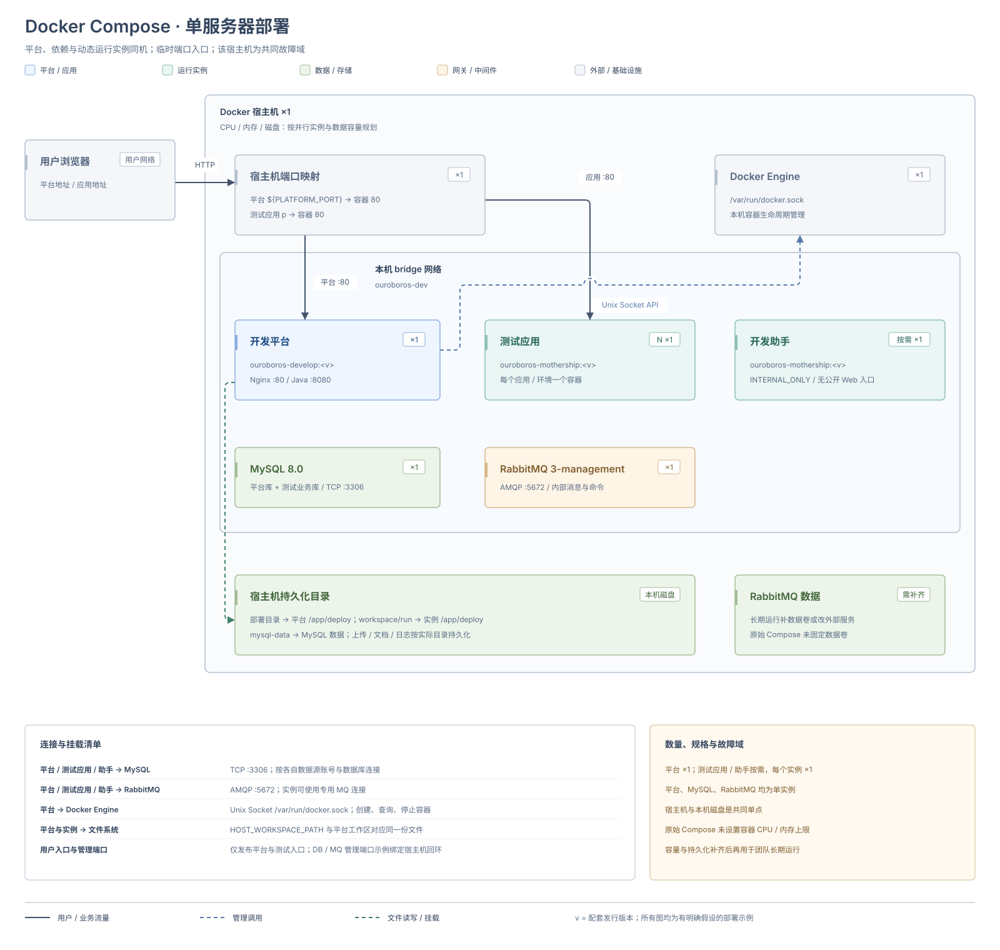
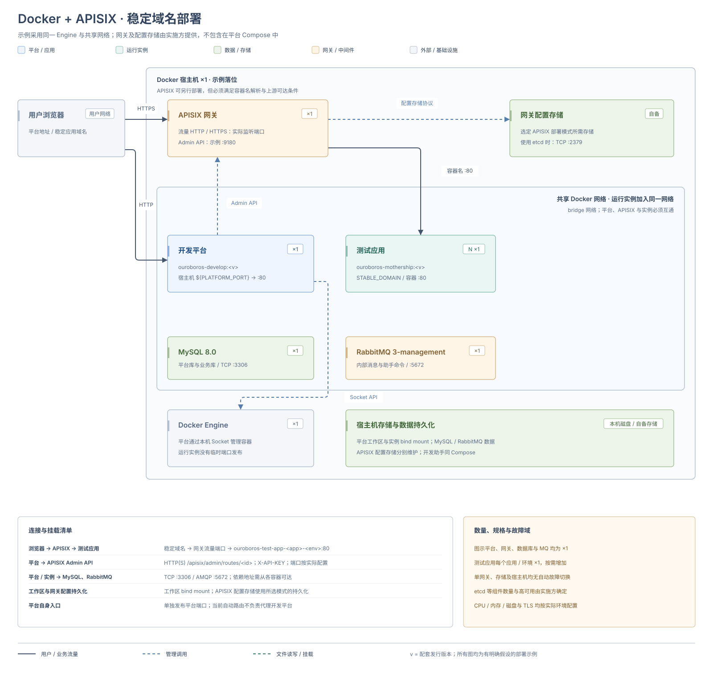
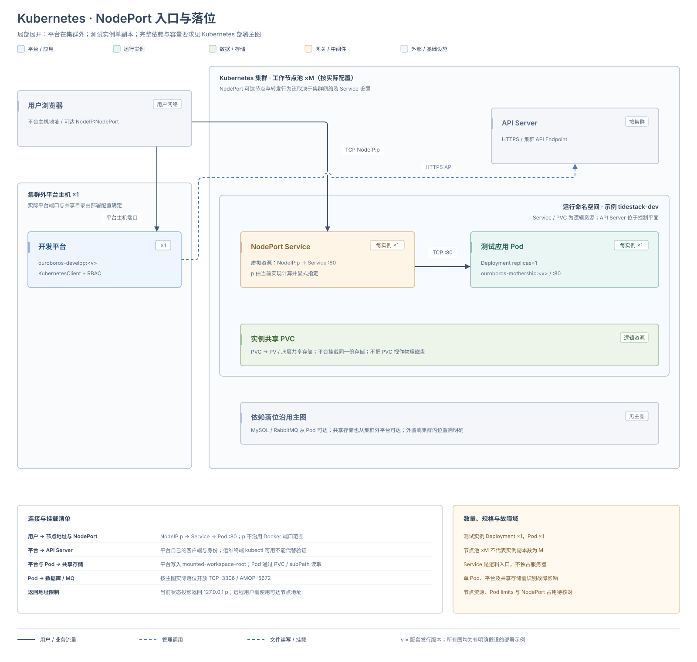
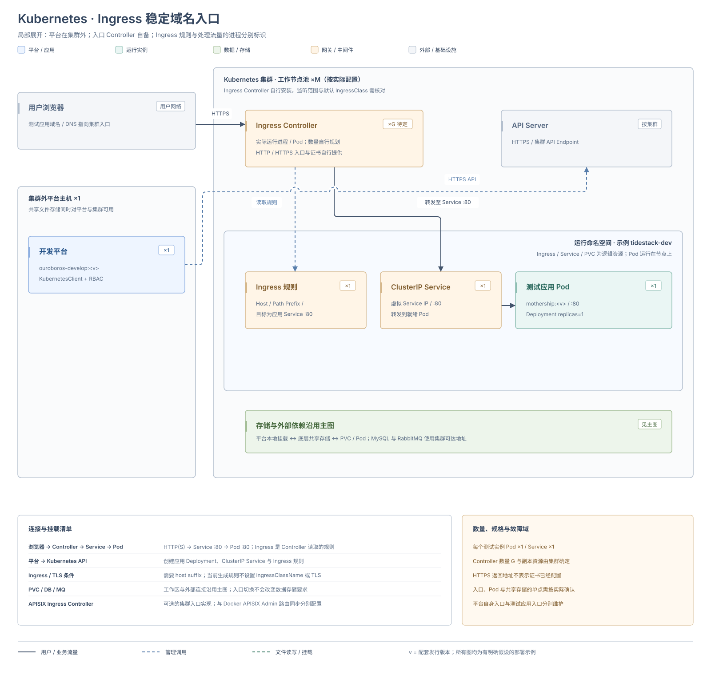
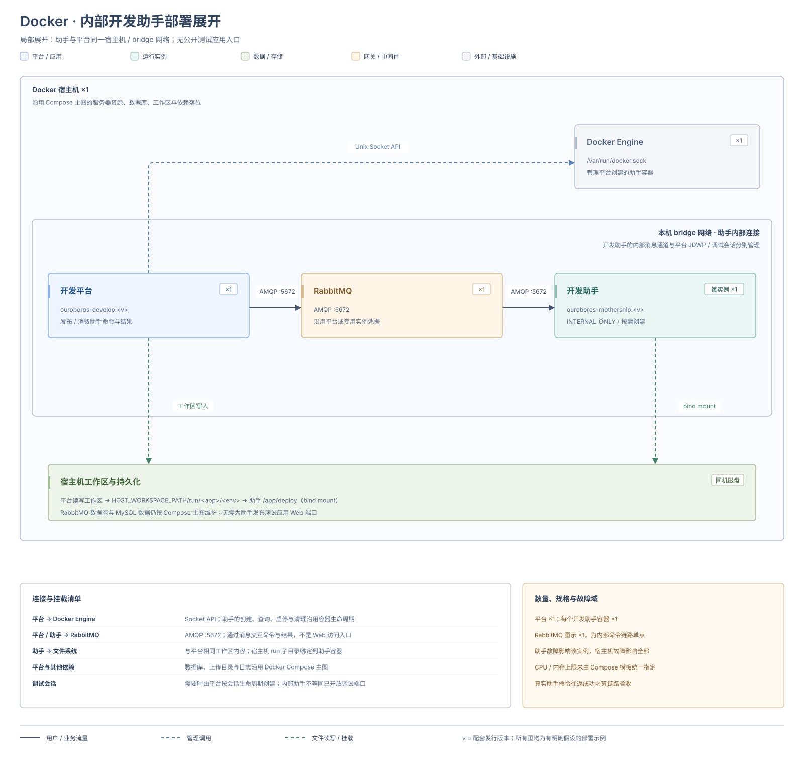
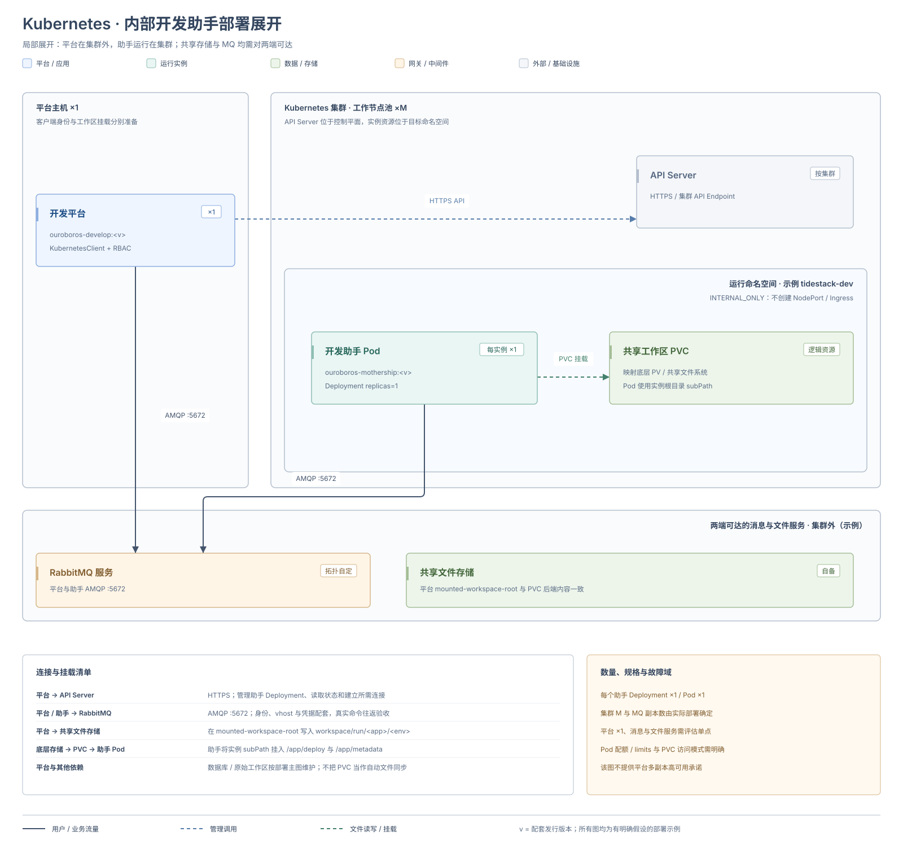
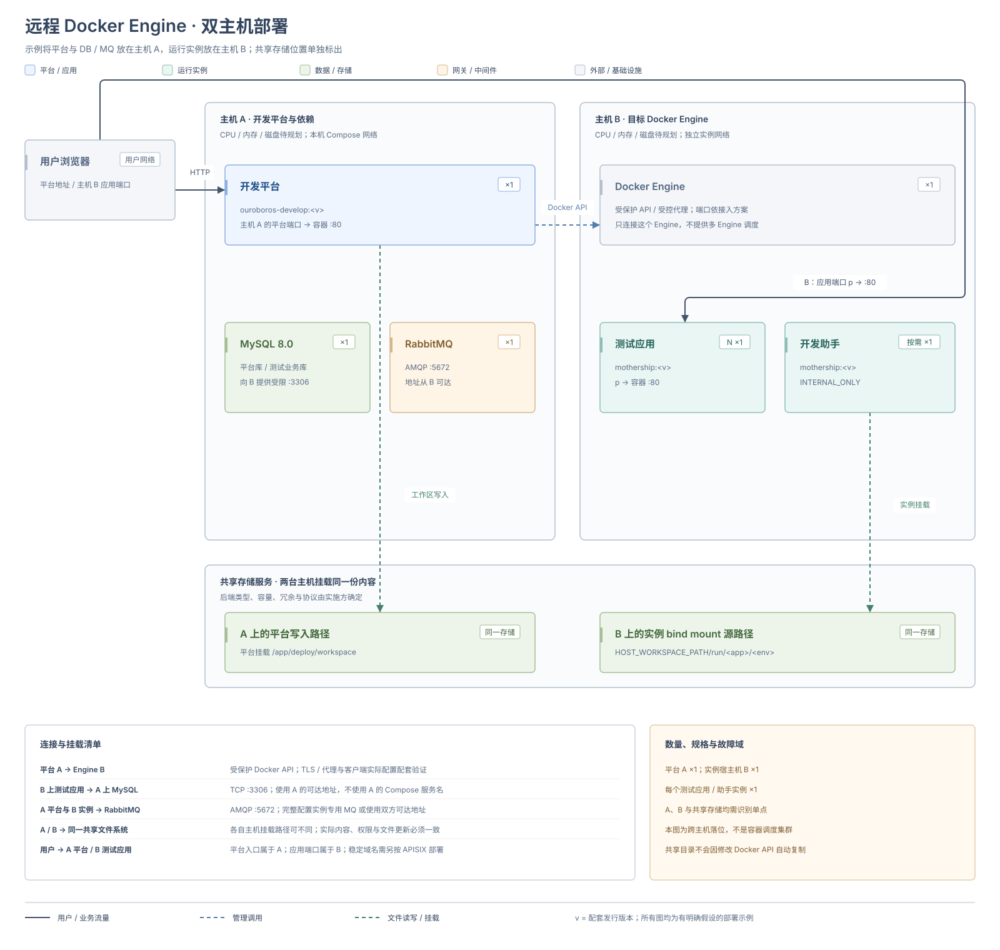
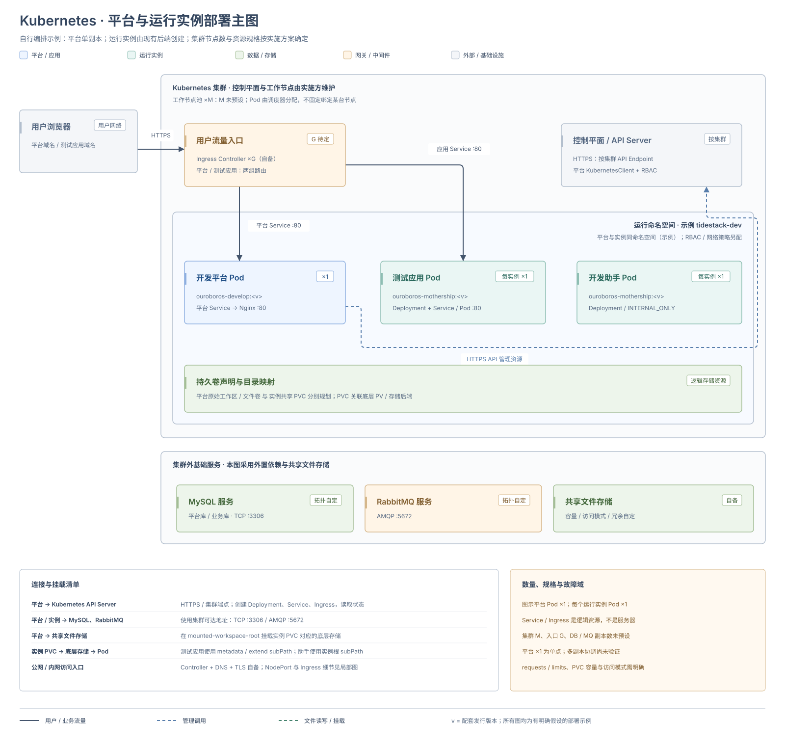

# 部署架构

部署开发平台时，先决定平台进程放在哪里，再选择测试应用和开发助手的运行后端，最后确定用户从哪个入口访问应用。本页按当前实现列出这些组合，并分别展示运行控制、用户流量与工作区挂载。

本页用四张部署主图说明 Docker Compose、Docker + APISIX、远程 Docker Engine 和 Kubernetes 的完整落位，再用局部图展开 NodePort、Ingress 与内部开发助手。图示的服务器、网络、数量与依赖位置均以每张图声明的假设为准；CPU、内存、存储容量或集群副本数没有统一验证值时，标注为待规划或由实施方确定。

本页覆盖开发平台及其管理的开发运行实例。正式业务应用的制品、发布与数据恢复流程见 [业务应用发布与回退](./application-release-and-rollback)。

## 先确定三个部署对象

| 对象 | 承载内容 | 部署时要决定 |
| --- | --- | --- |
| 开发平台 | `ouroboros-develop`、登录与建模入口、应用工作区、运行实例管理 | 使用配套 Compose，还是自行编排到 Kubernetes |
| 测试应用 | 由 `ouroboros-mothership` 基座承载的应用元数据与扩展 | Docker 或 Kubernetes；临时端口或稳定域名 |
| 开发助手 | 为平台提供开发态命令和后端能力的内部运行实例 | Docker 或 Kubernetes；标准流程均使用内部访问 |

平台使用 Docker 容器，不代表运行实例只能使用 Docker；平台部署到 Kubernetes，也不代表实例后端会自动切换。平台承载方式、实例后端和访问策略需要分别配置。

## 运行模式总览

标准测试应用流程提供 `TEMP_PORT`、`STABLE_DOMAIN` 两种访问策略；开发助手使用 `INTERNAL_ONLY`。与现有两个后端组合后，共有下列六种运行形态。

| 运行对象 | 后端 | 访问策略 | 实际入口 | 架构图 |
| --- | --- | --- | --- | --- |
| 测试应用 | `DOCKER` | `TEMP_PORT` | Docker 宿主机端口 → 容器 `80` | [Docker 临时端口](#docker-port) |
| 测试应用 | `DOCKER` | `STABLE_DOMAIN` | APISIX 按域名转发 → 容器 `80` | [Docker + APISIX](#docker-apisix) |
| 测试应用 | `KUBERNETES` | `TEMP_PORT` | 节点 NodePort → Service → Pod `80` | [Kubernetes NodePort](#kubernetes-nodeport) |
| 测试应用 | `KUBERNETES` | `STABLE_DOMAIN` | Ingress Controller → Service → Pod `80` | [Kubernetes Ingress](#kubernetes-ingress) |
| 开发助手 | `DOCKER` | `INTERNAL_ONLY` | 平台内部命令链路 | [Docker 开发助手](#docker-helper) |
| 开发助手 | `KUBERNETES` | `INTERNAL_ONLY` | 平台内部命令链路 | [Kubernetes 开发助手](#kubernetes-helper) |

另外两张图展示物理部署位置的变化：[远程 Docker Engine](#remote-docker) 和 [开发平台部署到 Kubernetes](#platform-kubernetes)。它们复用上表的运行模式。

图中实线表示用户或业务流量，蓝色虚线表示管理调用，绿色虚线表示文件读写或挂载。每张图下方的连接与挂载清单补充数据库、消息和文件路径，右侧列出数量、规格与单点；颜色区分平台、运行实例、数据存储、网关中间件与基础设施。主图画出数据库、RabbitMQ 和存储的部署位置，局部图明确沿用主图依赖。

`N ×1` 表示按需创建 N 个独立运行实例、每个实例单副本；不表示同一个应用具有 N 个高可用副本。Kubernetes 的集群、命名空间、Service、Ingress、PVC 与实际 Pod 或存储节点分别标识。

## Docker：临时端口 {#docker-port}

适合个人体验、团队开发和需要直接通过主机端口访问的测试环境。配套 Compose 启动开发平台、MySQL 和 RabbitMQ；测试应用容器由平台按需创建。

平台通过 Docker Engine API 创建容器，将测试应用的 Web `80` 端口映射到宿主机所选端口。业务应用入口与开发平台入口分别维护，不能用平台的 `PLATFORM_PORT` 代替应用端口。

默认同机部署使用 Docker Socket。平台容器内的工作区与 `HOST_WORKSPACE_PATH` 指向的宿主机目录必须对应同一份内容；实例的 bind mount 由 Docker Engine 在宿主机上解析。防火墙和外层代理按所选应用端口放行。

按 [Docker Compose 部署](./deployment-methods/docker-compose) 完成环境准备、安装和初始化，随后新建测试应用，验证入口、登录、查询和一次写入。

## Docker：APISIX 稳定域名 {#docker-apisix}

适合为多个测试应用提供固定域名的共享环境。当前仓库已提供 Docker 测试应用到 APISIX 的路由同步实现。

测试应用使用 `STABLE_DOMAIN`，不按 `TEMP_PORT` 发布宿主机应用端口。平台在实例运行、停止或删除时，通过 APISIX Admin API 更新或删除对应路由；浏览器请求通过 APISIX 的流量入口进入应用。

启用前需要完成：

- 部署 APISIX 及其所选部署模式需要的配置存储。配套平台 Compose 不包含 APISIX 或 etcd；当前适配器需要可写的 `/apisix/admin/routes/` 接口，不能直接连接只读取本地 YAML 的独立模式。
- 让 APISIX 与目标测试应用处于可按容器名称互访的共享 Docker 网络。当前上游固定为 `ouroboros-test-app-<应用名>-<环境>:80`。
- 在平台启用网关、指定 `apisix`，设置域名后缀、Admin API 根地址、密钥和路由 ID 前缀。完整环境变量名见 [稳定域名网关配置](./development-platform-configuration#稳定域名网关)。
- 在配置中心或创建请求中选择 `STABLE_DOMAIN`，并准备 DNS、流量入口、TLS 和访问范围。Admin API 地址与浏览器访问地址分别配置。

例如应用 `crm`、环境 `dev`、后缀 `develop.example.com` 对应 `crm-dev.develop.example.com`。当前同步的是该 Web 主机下的 `/*` 路由，包含应用统一入口承载的路径；不会额外生成独立的 API 域名。

实例状态与网关路由应分别验证：确认 APISIX 中的域名和上游正确，再从用户网络打开域名并完成业务操作。当前自动路由同步仅处理 Docker 测试应用；开发助手和 Kubernetes 实例不走这套适配器。环境准备、配置注入和路由验收步骤见 [Docker + APISIX 部署](./deployment-methods/docker-apisix)，APISIX 的部署角色和管理接口说明见 [官方部署模式](https://apisix.apache.org/docs/apisix/deployment-modes/)。

## Kubernetes：NodePort {#kubernetes-nodeport}

适合已有 Kubernetes 集群、需要通过节点端口访问测试应用的环境。这是平台位于集群外的入口局部图，数据库、消息和存储的完整落位沿用所选主图；平台放入集群后的变化见 [平台集群部署](#platform-kubernetes)。

选择 `KUBERNETES` 与 `TEMP_PORT` 后，后端创建单副本 Deployment 和 NodePort Service，Web 流量进入容器 `80`。该入口使用 Kubernetes 节点端口，不沿用 Docker 的应用端口分配范围。

部署前需要装配可用的 `KubernetesClient`、配置身份和资源权限、准备命名空间与共享 PVC。当前自动配置以已有客户端 Bean 为前提，单改后端环境变量不会创建客户端。平台还需把 PVC 背后的同一份共享存储挂载到自身的 `mounted-workspace-root`，因为平台会先在本地挂载路径写入实例文件；仅创建 PVC 不会把文件自动送到集群。

当前状态投影返回的 NodePort Web 地址使用 `http://127.0.0.1:<NodePort>`。远程集群中，应从实例信息取得实际 NodePort，结合用户可访问的节点地址或既定转发入口验证，不能直接把这个回环地址交给远程用户。

环境准备与接入步骤见 [Kubernetes 部署](./deployment-methods/kubernetes)，NodePort 设置见 [临时端口入口](./deployment-methods/kubernetes#nodeport)，参数和环境变量见 [Kubernetes 配置参考](./development-platform-configuration#kubernetes)。

## Kubernetes：Ingress 稳定域名 {#kubernetes-ingress}

适合使用统一域名入口的集群环境。选择 `KUBERNETES` 与 `STABLE_DOMAIN`，并配置 `ingress-host-suffix` 后，平台为测试应用创建 Ingress、ClusterIP Service 和单副本 Deployment。

与 NodePort 模式相比，工作区、客户端和权限要求相同，入口改由集群的 Ingress Controller 处理。平台创建的规则按应用和环境拼出域名，并将 `/` 前缀流量转发到应用 Service 的 `80` 端口。未配置域名后缀时不会创建 Ingress，不能只选择 `STABLE_DOMAIN` 就认为已有域名入口。

Ingress Controller、默认 IngressClass、DNS 和证书由集群部署负责。当前生成的 Ingress 未指定 IngressClass 和 TLS 配置，状态投影虽然返回 `https://<域名>`，仍需实际准备证书和 HTTPS 入口。

集群可以使用 APISIX Ingress Controller 承载入口，但这属于集群对标准 Ingress 的实现选择，需要另行验证 IngressClass 和资源监听范围。它复用本节拓扑，不使用 [Docker + APISIX](#docker-apisix) 的容器名称上游和平台 Admin API 路由同步。

操作步骤见 [Kubernetes 部署 / Ingress 稳定域名](./deployment-methods/kubernetes#ingress)。

## Docker：内部开发助手 {#docker-helper}

开发助手用于开发态能力，不作为测试应用的公开访问入口。标准流程使用 `DOCKER` 与 `INTERNAL_ONLY`，平台通过 Docker API 管理容器生命周期，通过内部命令链路使用助手能力。

助手与平台使用配套镜像、工作区和可达的消息连接。图中的 RabbitMQ 可与平台位于同一 Docker 网络，也可使用外部服务。无需为助手配置测试应用的宿主机 Web 端口或 APISIX 稳定域名。

开发助手的内部访问与 [调试、后端 API 会话](./development-platform-configuration#调试与后端-api-会话) 分别管理，`INTERNAL_ONLY` 不代表任意调试端口已经开放。

## Kubernetes：内部开发助手 {#kubernetes-helper}

开发助手也可由 Kubernetes 后端创建，标准流程仍使用 `INTERNAL_ONLY`。平台通过 Kubernetes API 管理助手 Deployment，助手通过 PVC 挂载共享文件存储，并经 RabbitMQ 的内部命令链路与平台配合。图中 API Server 位于控制平面，PVC 是命名空间内的逻辑存储资源。

该形态不依赖测试应用的 NodePort 或 Ingress 入口。需要可用客户端、助手所需的资源与连接权限、消息链路和共享存储。平台写入的目录必须与助手挂载的 PVC 内容一致。

启用后通过真实的助手命令验证准备、执行和结果返回，再按需验证有生命周期管理的调试会话。

## 部署位置变体：远程 Docker Engine {#remote-docker}

开发平台与 Docker Engine 可以位于不同主机。平台仍使用 Docker 后端，访问策略继续选择临时端口或 APISIX 稳定域名。下图以临时端口为例，明确假设平台与 MySQL、RabbitMQ 位于主机 A，运行实例位于主机 B，共享文件服务另行准备；依赖也可外置，但需重新核对地址与访问范围。

这个变体需要同时满足两条链路：

1. 平台能够通过受保护的 Docker API 接入目标 Engine。配置中的账号字段不能代替 TLS、网络访问控制或受控代理。
2. Engine 宿主机能够读取实例需要的工作区文件。平台写入的目录和 Engine 用于 bind mount 的宿主机目录应映射到同一份共享文件系统；修改 Docker API 地址不会自动复制工作区。

应用宿主机端口、Docker 网络与本地镜像都属于目标 Engine。使用 APISIX 时，网关也必须能通过该 Engine 的共享网络解析和访问应用容器名称。当前实现按配置连接一个 Engine，不提供多台 Docker 主机的自动调度。

环境要求、工作区映射与初始化步骤见 [远程 Docker Engine 部署](./deployment-methods/remote-docker)。

## 平台部署位置变体：Kubernetes {#platform-kubernetes}

将开发平台自身放到 Kubernetes，需要自行编排平台 Deployment、Service、入口、配置和持久化存储。当前仓库提供平台镜像和 Kubernetes 运行后端，没有配套的平台 Helm chart 或完整安装清单。编排要求和首次初始化见 [Kubernetes 部署 / 开发平台自身部署到集群](./deployment-methods/kubernetes#platform)。

主图采用平台与运行实例位于同一集群、同一示例命名空间，MySQL、RabbitMQ 和共享文件服务外置的落位；这是一种自行编排示例，并非仓库预设安装。工作节点数和 Controller 副本数由集群方案确定，Pod 不固定绑定图中的某台物理节点。测试应用可继续选择前文的 NodePort 或 Ingress。平台入口与测试应用入口是两组资源，分别管理域名、Service、证书和访问范围。

自行编排时至少处理：

- 平台进程的工作区、配置、日志、上传文件和文档库的持久化；平台原始工作区与实例共享 PVC 的目录映射。
- 数据库和 RabbitMQ 的服务地址、凭据、网络可达性与备份。
- 平台身份、`KubernetesClient` Bean 和管理实例资源所需的权限。
- 镜像版本与节点架构、启动与健康探针、平台自身的升级与数据恢复流程。

不能把“已有 Kubernetes 实例后端”当作“平台集群安装已经交付”。图中采用单个平台实例，也不表示平台的多副本并发、工作区协调或高可用方案已经得到验证。验证时仍需完成平台登录、创建应用、创建实例和一次业务写入。

## 公共依赖与持久化 {#shared-dependencies}

下列部署选择可叠加在各模式上，通常不改变前面的控制和访问拓扑。

| 对象 | 可选位置 | 需要保持的一致性 |
| --- | --- | --- |
| 平台与业务数据库 | Compose 内置数据库、独立数据库服务 | 平台库与业务库的账号、迁移权限和恢复点分别维护 |
| RabbitMQ | 同机容器或外部服务 | 平台与实例的连接、virtual host、权限和持久化定义配套 |
| Docker 工作区 | 同机 bind mount、跨主机共享文件系统 | 平台写入内容与目标 Engine 看到的宿主机路径一致 |
| Kubernetes 工作区 | 共享存储与 PVC | 平台的本地挂载、PVC、subPath 和 Pod 挂载内容一致 |
| 上传与文档存储 | 持久卷或已装配的外部存储实现 | 文件内容、数据库元数据、目录权限和备份时间点一致 |
| 外层代理与 TLS | 反向代理、负载均衡器或集群入口 | 实际域名、端口、证书与页面返回端点一致 |

图中的数据服务可外置，外置本身不会新增运行后端。Windows Docker Desktop 的本地 API 访问同样属于 Docker 模式，具体设置见 [快速上手](../getting-started/)。

## 配置与变更边界

| 维护对象 | 配置入口 | 生效时要验证 |
| --- | --- | --- |
| 平台镜像、端口、挂载、依赖与平台容器变量 | Compose，或自行维护的 Kubernetes 资源 | 重建或滚动更新后的平台容器 |
| 平台 Spring 参数、客户端、网关与工作区 | 部署配置文件或容器环境变量 | 实际属性来源、运行后端和外部连接 |
| 默认实例后端、访问策略、镜像和数据源 | 平台配置中心 | 新建实例实际使用的值 |
| 本次实例选择 | 创建请求 | 目标实例的后端、镜像、入口和数据源 |

测试应用后端按“创建请求 → 配置中心 → Spring 兜底值”选择；访问策略按“创建请求 → 配置中心 → 临时端口”选择。修改默认配置不会自动迁移已有实例。

发布应用版本、重建运行实例、升级开发平台和升级依赖分别记录与验证。平台与基座使用配套版本；切换后端也要保留工作区、数据库和访问端点的恢复依据。参数及完整环境变量名见 [统一运行基座配置项](./runtime-base-configuration) 和 [开发平台配置项](./development-platform-configuration)。

确定模式、持久化方案、入口和恢复方式后，在“开发平台部署 → 部署方式”中选择 [Docker Compose](./deployment-methods/docker-compose)、[Docker + APISIX](./deployment-methods/docker-apisix)、[远程 Docker Engine](./deployment-methods/remote-docker) 或 [Kubernetes](./deployment-methods/kubernetes)，按对应的环境要求、初始化步骤和验收项完成部署。
